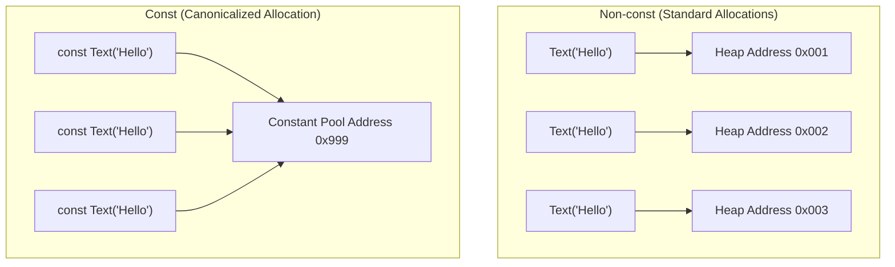

# Immutability: `final` vs `const` in Dart

> **Module:** 01-dart-fundamentals  
> **Subsection:** 01-basics-and-syntax  
> **Prerequisites:** [variables-types-and-inference.md](./variables-types-and-inference.md)  
> **Official References:** [dart.dev/language/variables#final-and-const](https://dart.dev/language/variables#final-and-const)

---

## 1. Introduction

Immutability is a cornerstone of modern, predictable software architecture. In Dart and Flutter, immutable data structures ensure that once an object or variable is initialized, its state cannot be modified unexpectedly by external code or asynchronous callbacks.

### Why Do We Need Immutability?
1. **Thread Safety & Predictability:** Immutable objects can be shared freely across functions, widgets, and isolates without race conditions or unintended side effects.
2. **Flutter Widget Performance:** Flutter's reactive UI framework heavily depends on immutable widgets. If widget configurations are immutable, the framework can optimize rebuilds and element reconciliations.
3. **Memory Optimization:** Constant objects in Dart are **canonicalized** at compile time—meaning identical constants point to the exact same physical memory address.

### Where Is It Used in Real Development?
- **Stateless & Stateful Widget Configurations:** Every field inside a `StatelessWidget` or `StatefulWidget` must be `final`.
- **Constant Constructors:** Optimizing Flutter layouts using `const EdgeInsets.all(16.0)`, `const SizedBox(height: 8)`, or `const Text('Title')`.
- **Domain State Models:** Data classes representing database records, API payloads, and state containers (e.g. Freezed models).

---

## 2. Core Concepts

### `final`: Runtime Immutability
A variable declared with `final` can be assigned **only once**. Its value does not need to be known at compile time; it can be computed or fetched at runtime (e.g., from an API, a database, or user input). Once set, the variable reference cannot be reassigned.

### `const`: Compile-Time Immutability
A variable or object declared with `const` is a **compile-time constant**. Its value must be fully known and resolvable by the Dart compiler before the program executes. Every `const` variable is implicitly `final`, but with extra restrictions and performance superpowers:
- It can only consist of numbers, strings, boolean values, or other compile-time constants.
- It is created in a read-only constant pool in memory.

### Canonicalization (Object Deduplication)
When you instantiate multiple objects using `const`, the Dart compiler creates only **one** instance in memory and reuses that identical instance everywhere.



### Shallow vs. Deep Immutability
- **`final` list:** The *reference* to the list is immutable, but the *contents* of the list are still mutable (`list.add(4)` works).
- **`const` list:** The reference *and* the contents are deeply immutable (`list.add(4)` throws an `UnsupportedError` at runtime).

---

## 3. Syntax and Implementation

```dart
// bin/immutability_demo.dart

void main() {
  // 1. Runtime initialization with 'final'
  final DateTime appStartTime = DateTime.now(); // Known only when app runs
  print('App started at: $appStartTime');
  // appStartTime = DateTime.now(); // COMPILATION ERROR: Cannot assign to final variable

  // 2. Compile-time constant with 'const'
  const double pi = 3.14159265359;
  const String appTitle = 'Flutter Mastery';
  // const DateTime compileTime = DateTime.now(); // COMPILATION ERROR: DateTime.now() is runtime

  // 3. Shallow vs Deep Immutability
  final List<int> finalList = [1, 2, 3];
  finalList.add(4); // Permitted! The reference is final, but the list itself is mutable
  print('finalList after mutation: $finalList');
  // finalList = [5, 6]; // COMPILATION ERROR: Cannot reassign reference

  const List<int> constList = [1, 2, 3];
  // constList.add(4); // RUNTIME ERROR: Unsupported operation: Cannot add to an unmodifiable list

  // 4. Verification of Canonicalization using identical()
  verifyCanonicalization();
}

void verifyCanonicalization() {
  // Non-const instances
  final nonConstList1 = [1, 2];
  final nonConstList2 = [1, 2];
  print('Non-const lists identical? ${identical(nonConstList1, nonConstList2)}'); // false

  // Const instances
  const constList1 = [1, 2];
  const constList2 = [1, 2];
  print('Const lists identical? ${identical(constList1, constList2)}'); // true! Same memory address
}
```

### Expected Output
```text
App started at: 2026-11-04 16:30:00.123456
finalList after mutation: [1, 2, 3, 4]
Non-const lists identical? false
Const lists identical? true
```

### Common Mistakes
- **Mistake 1: Trying to make a runtime calculation `const`.**  
  `const size = MediaQuery.of(context).size;` fails compilation because `MediaQuery` values depend on runtime screen metrics. Use `final`.
- **Mistake 2: Assuming `final` creates immutable collections.**  
  If you expose a `final List<String> tags`, external callers can still invoke `tags.clear()` or `tags.add()`. If you need immutability, use `List.unmodifiable(tags)` or `const [...]`.

---

## 4. Practical Example: Const Constructors in Flutter Architecture

```dart
// lib/user_badge.dart

class UserBadge {
  final String role;
  final int level;

  // Const constructor: all fields must be final
  const UserBadge({required this.role, required this.level});
}

void main() {
  // These two variables share the EXACT same memory location
  const adminBadge1 = UserBadge(role: 'Admin', level: 10);
  const adminBadge2 = UserBadge(role: 'Admin', level: 10);

  // Different field value -> distinct constant in memory
  const guestBadge = UserBadge(role: 'Guest', level: 1);

  print('adminBadge1 identical to adminBadge2: ${identical(adminBadge1, adminBadge2)}'); // true
  print('adminBadge1 identical to guestBadge: ${identical(adminBadge1, guestBadge)}'); // false
}
```

### Why This Matters in Flutter
In a Flutter widget tree, when a parent widget calls `setState()`, Flutter checks if child widgets need to be reconstructed. If a child widget was constructed with `const MyWidget()`, Flutter detects that the widget instance is identical to the previous frame's instance and **skips rebuilding it and its entire subtree**.

---

## 5. Comparison: `var` vs `final` vs `const`

| Characteristic | `var` | `final` | `const` |
|:---|:---|:---|:---|
| **Can reassign reference?** | Yes | **No** | **No** |
| **When is value determined?** | Compile time or runtime | **Runtime** or compile time | **Strictly Compile Time** |
| **Memory allocation** | New instance allocated on heap | New instance allocated on heap | **Canonicalized** (single shared instance) |
| **Collections deep immutability** | Mutable | Elements are mutable | **Elements are deeply immutable** |
| **Usable in const constructors?** | No | Allowed as final field | Required for all constructor params |
| **Can be declared at top-level?** | Yes | Yes | Yes |

---

## 6. Interview Preparation

### Frequently Asked Questions

#### Q1: What is the main difference between `final` and `const`?
- **Short Answer:** `final` variables are initialized once at runtime, whereas `const` variables must be known at compile time and are canonicalized in memory.
- **Detailed Answer:** Both keywords prevent reassignment. However, `const` represents compile-time constants. An expression assigned to `const` can only consist of literals or other compile-time constants (e.g., `const timeout = 10 * 1000;`). `final` can hold the result of any runtime function (e.g., `final now = DateTime.now();`). Furthermore, `const` collections are deeply immutable, whereas `final` collections only lock the reference.

#### Q2: Why does the Flutter linter recommend `prefer_const_constructors`?
- **Answer:** When a widget is marked `const`, it is allocated once at compilation/initialization and stored in memory. During widget tree rebuilds (e.g., animations, user interactions, `setState()`), Flutter's element reconciliation algorithm skips rebuilding `const` widget subtrees because their configuration reference has not changed. This drastically reduces garbage collection (GC) pressure and prevents dropped frames (jank).

#### Q3: Scenario Question: Can a class have a `const` constructor if one of its fields is not `final`?
- **Answer:** **No.** Dart enforces a strict rule: if a class declares a `const` constructor, **all** instance fields of that class (and any superclass) must be explicitly declared as `final`. If any field were mutable, canonicalizing the instance would violate thread-safety and object equality guarantees.

---

## 7. Practice Exercises

### Exercise 1 (Beginner): Predict the Output
Without running the code, predict the output of `identical()`:
```dart
void main() {
  const a = [1, 2, 3];
  final b = [1, 2, 3];
  const c = [1, 2, 3];

  print(identical(a, b));
  print(identical(a, c));
}
```

### Exercise 2 (Intermediate): Refactor to Const Constructor
Refactor the following class and instantiate two canonical instances:
```dart
class AppConfig {
  String apiUrl;
  int retryAttempts;

  AppConfig(this.apiUrl, this.retryAttempts);
}
```

---

## 8. References
- [Dart Official Docs: Variables - Final and Const](https://dart.dev/language/variables#final-and-const)
- [Flutter Docs: Performance Best Practices (Rebuild optimization)](https://docs.flutter.dev/perf/best-practices)
