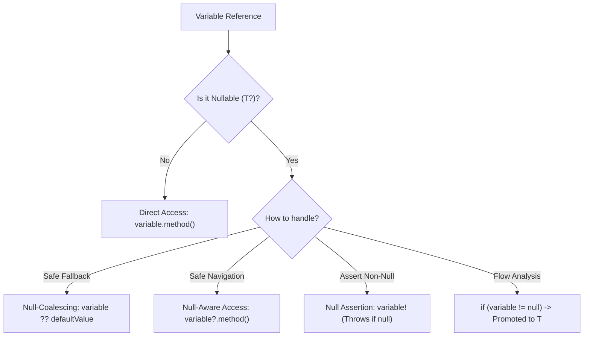

# Sound Null Safety in Dart: A Deep Dive

> **Module:** 01-dart-fundamentals  
> **Subsection:** 01-basics-and-syntax  
> **Prerequisites:** [variables-types-and-inference.md](./variables-types-and-inference.md)  
> **Official References:** [dart.dev/null-safety](https://dart.dev/null-safety) | [dart.dev/null-safety/understanding-null-safety](https://dart.dev/null-safety/understanding-null-safety)

---

## 1. Introduction

In 1965, computer scientist Tony Hoare invented the `null` reference, famously calling it his *"billion-dollar mistake"* due to the countless bugs, vulnerabilities, and system crashes caused by null pointer exceptions.

Dart features **Sound Null Safety**. In Dart, types are **non-nullable by default**. A variable cannot contain `null` unless you explicitly declare it as nullable.

### Why Do We Need Sound Null Safety?
1. **Crash Prevention:** Eliminates `NullPointerException` (or `NoSuchMethodError: The method 'x' was called on null`) before code is ever run in production.
2. **Compiler Optimization:** Because the Dart compiler knows with 100% mathematical certainty that a non-nullable variable will never be `null`, it generates smaller, faster machine code (ahead-of-time compilation) by omitting redundant runtime null checks.
3. **Self-Documenting Code:** Looking at a function signature immediately informs the developer whether a value can be omitted or missing.

### Where Is It Used in Real Development?
- **Form Inputs:** Form fields where users may leave optional inputs blank (e.g., `String? middleName`).
- **Network Responses:** API fields that might be absent or null depending on server state.
- **Authentication:** Current user session states (`User? currentUser` where `null` signifies an unauthenticated guest).

---

## 2. Core Concepts

### Non-Nullable by Default
In Dart, writing `String name = 'Dash';` creates a variable that can **never** hold `null`. Attempting to assign `name = null;` will immediately fail compilation.

To allow `null`, you must append a question mark (`?`):
```dart
String? optionalName = null; // Valid
```

### The Null Safety Operator Arsenal



1. **Nullable Type Declaration (`?`):** Indicates a variable, parameter, or return type can be `null`.
2. **Null-Aware Navigation (`?.`):** Invokes a property or method only if the target is non-null. If the target is null, the entire expression short-circuits and evaluates to `null`.
3. **Null-Coalescing (`??`):** Evaluates the left-hand expression; if it is non-null, returns it. Otherwise, evaluates and returns the right-hand fallback expression.
4. **Null-Coalescing Assignment (`??=`):** Assigns a value to a variable **only if** that variable is currently `null`.
5. **Null Assertion Operator (`!`):** Tells the compiler: *"I know this expression is typed as nullable, but I guarantee it is not null right now. Cast it to non-nullable; throw a runtime exception if I am wrong."*
6. **The `late` Keyword:** Tells the compiler: *"I will initialize this non-nullable variable before it is ever read. Do not force me to assign it immediately."*

---

## 3. Syntax and Implementation

```dart
// bin/null_safety_demo.dart

void main() {
  // 1. Non-nullable vs Nullable
  String nonNullableText = 'Guaranteed string';
  // nonNullableText = null; // COMPILATION ERROR

  String? nullableText = null;
  print('Initial nullable text: $nullableText');

  // 2. Null-Aware Access (?.)
  int? textLength = nullableText?.length; // Evaluates to null without throwing
  print('Length via ?.: $textLength');

  // 3. Null-Coalescing (??)
  String displayName = nullableText ?? 'Guest User';
  print('Display name: $displayName');

  // 4. Null-Coalescing Assignment (??=)
  String? cachedToken;
  cachedToken ??= generateToken(); // Evaluates function and assigns
  print('Token after first assignment: $cachedToken');
  cachedToken ??= generateToken(); // Does NOT run because cachedToken is already non-null

  // 5. Type Promotion via Flow Analysis
  printLengthWithPromotion(nullableText);
  printLengthWithPromotion('Flutter Engineer');

  // 6. The 'late' keyword
  late String heavyConfiguration;
  heavyConfiguration = 'Loaded from config file';
  print('Late variable: $heavyConfiguration');
}

String generateToken() {
  print('--> Generating fresh token...');
  return 'token_xyz_123';
}

void printLengthWithPromotion(String? input) {
  if (input == null) {
    print('Input is null; skipping length calculation.');
    return;
  }
  // Dart SOUND FLOW ANALYSIS: 'input' is automatically promoted from 'String?' to 'String' here!
  print('Promoted input length: ${input.length}');
}
```

### Expected Output
```text
Initial nullable text: null
Length via ?.: null
Display name: Guest User
--> Generating fresh token...
Token after first assignment: token_xyz_123
Input is null; skipping length calculation.
Promoted input length: 16
Late variable: Loaded from config file
```

### Common Mistakes
- **Mistake 1: Relying on the `!` operator as a quick fix.**  
  Using `!` silences compiler warnings, but if the value is actually `null` at runtime, your app will crash with an unhandled exception. Prefer `if (val != null)` flow analysis or `??` fallbacks.
- **Mistake 2: Reading a `late` variable before initialization.**  
  ```dart
  late String uninitializedValue;
  print(uninitializedValue); // RUNTIME ERROR: LateInitializationError: Field 'uninitializedValue' has not been initialized.
  ```
- **Mistake 3: Overusing `late` when a nullable type was more appropriate.**  
  If a variable can naturally be absent at certain points in its lifecycle, type it as `T?` instead of `late T`.

---

## 4. Practical Example: User Authentication State Management

```dart
// lib/auth_service.dart

class UserProfile {
  final String id;
  final String email;
  final String? avatarUrl; // Optional avatar

  UserProfile({required this.id, required this.email, this.avatarUrl});
}

class AuthService {
  UserProfile? _currentUser; // Null when logged out

  bool get isAuthenticated => _currentUser != null;

  UserProfile get currentUser {
    final user = _currentUser;
    if (user == null) {
      throw StateError('Cannot access currentUser while unauthenticated');
    }
    return user;
  }

  void login(String email) {
    _currentUser = UserProfile(id: 'usr_001', email: email);
  }

  void logout() {
    _currentUser = null;
  }

  String getAvatarImage() {
    // If user is null, or avatarUrl is null, fallback to placeholder
    return _currentUser?.avatarUrl ?? 'assets/images/default_avatar.png';
  }
}

void main() {
  final auth = AuthService();
  print('Is authenticated: ${auth.isAuthenticated}');
  print('Avatar to render: ${auth.getAvatarImage()}');

  auth.login('developer@flutter.dev');
  print('Is authenticated: ${auth.isAuthenticated}');
  print('User email: ${auth.currentUser.email}');
  print('Avatar to render: ${auth.getAvatarImage()}');
}
```

---

## 5. Internal Working: Flow Analysis & Definite Assignment

Dart achieves null safety through **Sound Flow Analysis**:
1. **Definite Assignment Analysis:** The compiler tracks every possible control-flow branch (loops, if-statements, try-catch) to ensure non-nullable variables are assigned before they are accessed.
2. **Type Promotion:** If the flow analysis observes a check like `if (variable != null)`, it temporarily changes the static type of that variable to its non-nullable counterpart within that scope.
3. **No Hidden Nulls (Soundness):** Unlike languages like TypeScript (where runtime values can drift from compile-time types), Dart's null safety is **sound**. If an expression has static type `int`, it will be an integer at runtime under all circumstances.

---

## 6. Comparison of Null-Handling Operators

| Operator / Keyword | Syntax | Behavior | When to Use |
|:---|:---|:---|:---|
| **Nullable Type** | `T?` | Declares that variable can hold `null` | Optional values, absent data |
| **Null-Aware Call** | `a?.b` | Invokes `b` only if `a != null`; otherwise returns `null` | Safe navigation through nested objects |
| **Null-Coalescing** | `a ?? b` | Returns `a` if non-null; otherwise evaluates and returns `b` | Default/fallback values |
| **Null-Coalescing Assign** | `a ??= b` | Assigns `b` to `a` only if `a` is currently `null` | Lazy caching, default initialization |
| **Null Assertion** | `a!` | Asserts that `a != null`; throws runtime error if `null` | Interfacing with APIs guaranteed non-null by context |
| **Late Initialization** | `late T a` | Defers initialization; asserts non-null when read | Dependency injection, lifecycle-bound fields |

---

## 7. Interview Preparation

### Frequently Asked Questions

#### Q1: What makes Dart's null safety "Sound"?
- **Short Answer:** "Sound" means the type system guarantees at runtime that non-nullable types will never contain `null`. There are no loopholes or escape hatches where `null` can slip into a non-nullable type.
- **Detailed Answer:** In unsound systems, a variable typed as non-nullable might still hold `null` at runtime due to unsafe type casts or external libraries. In Dart, sound null safety guarantees that if a variable is typed as `String`, it is guaranteed to be a valid string at all times. This allows the compiler to strip runtime null-checks and optimize machine code for smaller binary sizes and faster execution.

#### Q2: What is the purpose of the `late` keyword, and what are its performance characteristics?
- **Answer:** The `late` keyword has two primary purposes:
  1. It allows declaring a non-nullable variable that cannot be initialized at the point of declaration (e.g., initialized inside a constructor body or `initState()`).
  2. It enables **lazy evaluation**. If a `late` variable has an initializer (e.g., `late final config = _loadExpensiveConfig();`), that initializer is only executed when the variable is first read, not when the containing class is instantiated.

#### Q3: Scenario Question: Why does flow analysis fail to promote a public class property (`if (user.name != null)`), but succeeds with local variables?
- **Answer:** Dart's flow analyzer **cannot** guarantee that a class field or getter has not been modified between the null-check and the subsequent usage. Another thread, a sub-class override, or a getter method might return `null` on the second call. To resolve this, shadow the property into a local variable:
  ```dart
  final name = user.name;
  if (name != null) {
    print(name.length); // Promoted successfully!
  }
  ```

---

## 8. Practice Exercises

### Exercise 1 (Beginner): Eliminate Null Exceptions
Refactor this code to remove all compilation warnings and prevent runtime errors:
```dart
void main() {
  String? username;
  // Make this print 0 instead of throwing an error
  print(username!.length);
}
```

### Exercise 2 (Intermediate): Build a Safe Configuration Resolver
Write a function `String resolveApiUrl(String? overrideUrl, String? environmentUrl)` that:
- Uses `overrideUrl` if provided and non-empty.
- Otherwise uses `environmentUrl` if provided and non-empty.
- Defaults to `'https://api.production.domain.com'` if both are null or empty.

---

## 9. References
- [Dart Official Guide: Understanding Null Safety](https://dart.dev/null-safety/understanding-null-safety)
- [Dart Official Language Guide: Null Safety](https://dart.dev/null-safety)
