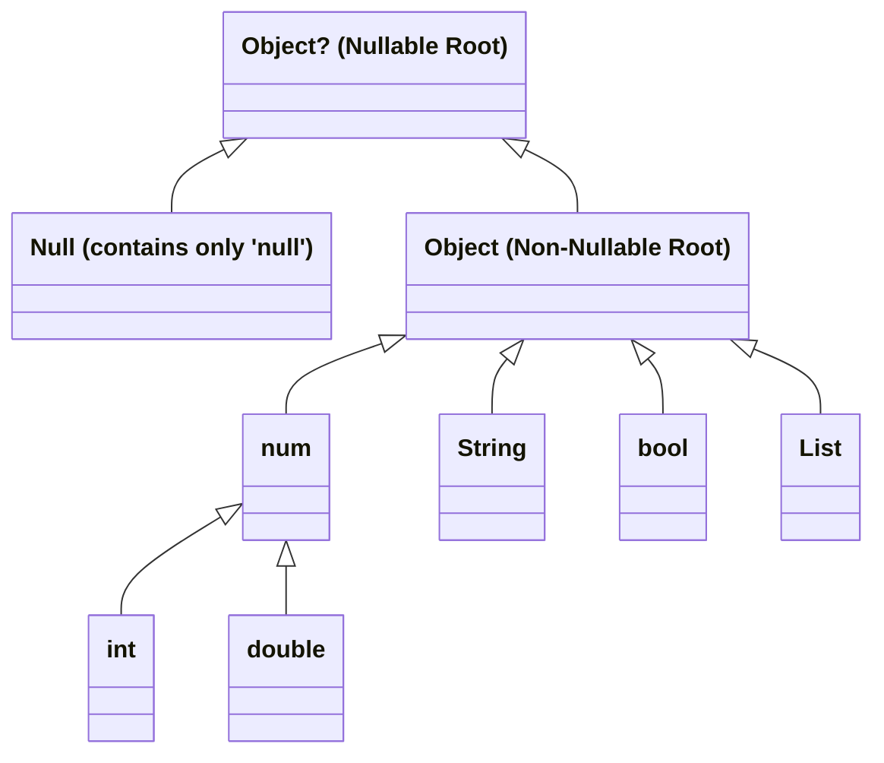

# Variables, Types, and Type Inference in Dart

> **Module:** 01-dart-fundamentals  
> **Subsection:** 01-basics-and-syntax  
> **Prerequisites:** Basic programming familiarity  
> **Official References:** [dart.dev/language/variables](https://dart.dev/language/variables) | [dart.dev/language/type-system](https://dart.dev/language/type-system)

---

## 1. Introduction

Dart is a **strongly typed, statically checked language**. This means every expression evaluates to a specific type determined at compile time. However, unlike older statically typed languages like Java or C++, Dart incorporates modern **local type inference**, allowing you to write clean, concise code without explicitly repeating type names everywhere.

### Why Do We Need Type Inference?
1. **Reduces Boilerplate:** You don't need to write redundant type declarations like `Map<String, List<UserProfile>> map = Map<String, List<UserProfile>>();`.
2. **Preserves Type Safety:** The compiler still statically locks the type to prevent type mismatch bugs.
3. **Developer Velocity:** Speeds up authoring code while retaining full IDE autocompletion and compiler checks.

### Where Is It Used in Real Development?
- **Flutter Widget Trees:** Storing controller instances, theme references, and calculated layout dimensions.
- **Data Parsing:** Typing incoming JSON data from REST APIs or local SQLite databases.
- **State Holders:** Holding state values in Riverpod, Provider, or BLoC state containers.

---

## 2. Core Concepts

### Static Typing vs. Dynamic Typing
- In **static typing**, type checking happens at **compile time**. Type mismatches are caught before code ever runs.
- In **dynamic typing**, type checking happens at **runtime**. A variable can hold any value, and type errors trigger runtime crashes (`NoSuchMethodError`).

### The Dart Type Hierarchy
In Dart, **everything is an object**, including primitive numbers (`int`, `double`), booleans (`bool`), and functions. All classes inherit directly or indirectly from `Object?` (the nullable root) and `Object` (the non-nullable root of all non-null values).



### Key Keywords: `var`, `dynamic`, `Object`, and `Object?`
1. **`var` (Type Inference):** Tells the compiler: *"Infer the static type from the assigned value on the right-hand side."* Once inferred, the type is fixed and cannot change.
2. **`dynamic` (Disable Static Checking):** Explicitly tells the Dart analyzer: *"Do not check types at compile time. I will accept full responsibility for runtime method calls."*
3. **`Object` (Non-nullable Any):** The root of all non-null objects. You can reassign any non-null value to it, but you can only call methods defined on `Object` (e.g., `toString()`, `hashCode`, `==`) unless you downcast or type-check.
4. **`Object?` (Nullable Any):** Can hold any object, including `null`.

---

## 3. Syntax and Implementation

```dart
// bin/variables_demo.dart

void main() {
  // 1. Explicit Typing
  String greeting = 'Hello, Dart!';
  int releaseYear = 2024;
  double version = 3.3;
  bool isProductionReady = true;

  // 2. Type Inference with 'var'
  var framework = 'Flutter'; // Inferred as String
  // framework = 100; // COMPILATION ERROR: A value of type 'int' can't be assigned to 'String'

  // 3. 'dynamic' Keyword
  dynamic flexibleValue = 'Initial text';
  print('dynamic as string: $flexibleValue');
  flexibleValue = 42; // Allowed at compile time
  print('dynamic as int: $flexibleValue');
  flexibleValue = [1, 2, 3]; // Allowed at compile time
  print('dynamic as list: $flexibleValue');

  // 4. 'Object' vs 'Object?'
  Object nonNullableAny = 'A valid string';
  // nonNullableAny = null; // COMPILATION ERROR: The value 'null' cannot be assigned to 'Object'
  
  Object? nullableAny = 'A valid string';
  nullableAny = null; // Perfectly valid

  // 5. Type Promotion with 'is'
  checkAndPrintLength(greeting);
  checkAndPrintLength(42);
}

void checkAndPrintLength(Object value) {
  if (value is String) {
    // Dart automatically PROMOTES 'value' from Object to String inside this if-block!
    print('String length: ${value.length}');
  } else {
    print('Not a string. toString(): ${value.toString()}');
  }
}
```

### Expected Output
```text
dynamic as string: Initial text
dynamic as int: 42
dynamic as list: [1, 2, 3]
String length: 12
Not a string. toString(): 42
```

### Common Mistakes
- **Mistake 1: Declaring `var x;` without initialization.**  
  If you write `var x;` without an initial value, Dart does **not** infer a specific type—it falls back to `dynamic` (`var x;` is equivalent to `dynamic x;`). Always initialize variables or provide explicit types.
- **Mistake 2: Overusing `dynamic` to bypass type checks.**  
  Using `dynamic` strips away compile-time safety and IDE autocomplete. If an API returns unstructured data, prefer `Object?` with pattern matching or explicit validation.

---

## 4. Practical Example: Safe API Response Parser

```dart
// lib/user_parser.dart

class User {
  final int id;
  final String name;
  final String email;

  User({required this.id, required this.name, required this.email});

  @override
  String toString() => 'User(id: $id, name: $name, email: $email)';
}

User parseUserData(Map<String, Object?> json) {
  // Validating and extracting properties safely without 'dynamic'
  final idRaw = json['id'];
  final nameRaw = json['name'];
  final emailRaw = json['email'];

  if (idRaw is! int) {
    throw FormatException('Invalid or missing id field');
  }
  if (nameRaw is! String) {
    throw FormatException('Invalid or missing name field');
  }
  if (emailRaw is! String) {
    throw FormatException('Invalid or missing email field');
  }

  // Compiler knows idRaw is int, nameRaw is String, and emailRaw is String
  return User(id: idRaw, name: nameRaw, email: emailRaw);
}

void main() {
  final Map<String, Object?> apiResponse = {
    'id': 101,
    'name': 'Dash Bird',
    'email': 'dash@flutter.dev',
    'active': true,
  };

  final user = parseUserData(apiResponse);
  print('Parsed user: $user');
}
```

---

## 5. Internal Working: Type Promotion & Compiler Mechanics

When you run `dart analyze` or compile your code:
1. **Frontend AST Construction:** The Dart Common Front End (CFE) creates an Abstract Syntax Tree.
2. **Type Inference Pass:** For variables declared with `var`, the compiler inspects the initializer expression. If the expression evaluates to static type `T`, the variable's type is recorded as `T`.
3. **Sound Flow Analysis:** When you write `if (x is String)`, the flow analyzer marks the variable `x` as having promoted type `String` within that specific execution branch.
4. **No Runtime Overhead:** Type inference happens strictly during compilation. At runtime, a variable declared with `var name = 'Dash';` behaves with the exact same memory layout and performance as `String name = 'Dash';`.

---

## 6. Comparison: `var` vs `explicit` vs `dynamic` vs `Object` vs `Object?`

| Feature | `var` (with init) | Explicit Type (`int`, `String`) | `dynamic` | `Object` | `Object?` |
|:---|:---|:---|:---|:---|:---|
| **Compile-time Type Check** | Yes (strict) | Yes (strict) | **No** (disabled) | Yes | Yes |
| **Can reassign different type?** | No | No | **Yes** | Yes (any non-null) | Yes (any, incl. null) |
| **Can assign `null`?** | Only if inferred as nullable | Only if declared with `?` | Yes | **No** | Yes |
| **IDE Autocompletion** | Full | Full | None | Limited to Object methods | Limited to Object methods |
| **Recommended Usage** | Local variables where type is obvious | Public APIs, fields, function params | Interop/Legacy only | When type is truly unknown (non-null) | Unstructured JSON, raw map values |

---

## 7. Interview Preparation

### Frequently Asked Questions

#### Q1: What is the difference between `var`, `dynamic`, and `Object`?
- **Short Answer:** `var` infers a fixed static type at compile time. `dynamic` shuts off compile-time checks and resolves method calls at runtime. `Object` is a statically checked type that can hold any non-null value, but only exposes `Object` methods.
- **Detailed Answer:** When you declare `var a = 'hello';`, `a` is statically typed as `String`. Reassigning an integer fails at compile time. When you declare `dynamic b = 'hello';`, you can reassign `b = 42;` and invoke arbitrary methods like `b.nonExistentMethod()`, which compiles but throws a runtime `NoSuchMethodError`. When you declare `Object c = 'hello';`, you can reassign `c = 42;` (both are Objects), but `c.length` will fail compilation unless you promote or cast `c` with `if (c is String)`.

#### Q2: What happens if you declare `var x;` without an initializer?
- **Short Answer:** It is typed as `dynamic`.
- **Detailed Answer:** Dart requires an expression to infer the type. Without one, `var x;` defaults to `dynamic x;`. This defeats static analysis, so lint rules (`prefer_typing_uninitialized_variables`) flag this.

#### Q3: Scenario Question: Why does `final dynamic data = jsonDecode(response);` cause issues in production?
- **Answer:** While `jsonDecode` returns `dynamic`, leaving the result typed as `dynamic` means any typos in dictionary keys or property accesses bypass the compiler. If the API schema changes or returns an unexpected shape, the app will crash at runtime with an unhandled exception instead of being caught safely by static type checks or domain parsing logic. Prefer typing parsed JSON as `Map<String, Object?>` or mapping into immutable data classes.

---

## 8. Practice Exercises

### Exercise 1 (Beginner): Fix the Type Errors
Inspect the following snippet, identify why it fails, and fix it using idiomatic Dart:
```dart
void main() {
  var count = 10;
  count = 'twenty'; // Fix this
}
```

### Exercise 2 (Intermediate): Implement a Safe Type Evaluator
Write a function `String describeValue(Object? input)` that:
- Returns `"Null value"` if the input is null.
- Returns `"Positive Integer: $input"` if it is an int greater than 0.
- Returns `"String of length ${input.length}"` if it is a string.
- Returns `"Unknown object: $input"` for all other types.

---

## 9. References
- [Dart Official Language Tour: Variables](https://dart.dev/language/variables)
- [Dart Type System Overview](https://dart.dev/language/type-system)
- [Effective Dart: Design & Type Annotations](https://dart.dev/effective-dart/design#types)
