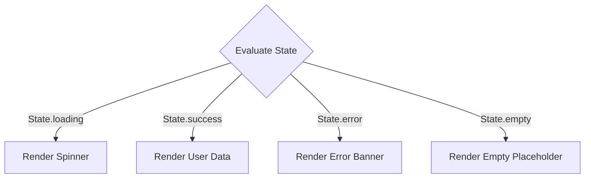

# Conditional Branching in Dart: `if-else`, Ternary, and Switch Expressions

> **Module:** 01-dart-fundamentals  
> **Subsection:** 02-control-flow-and-loops  
> **Prerequisites:** [01-basics-and-syntax/](../01-basics-and-syntax/)  
> **Official References:** [dart.dev/language/branches](https://dart.dev/language/branches)

---

## 1. Introduction

Conditional branching allows a program to execute different execution paths depending on boolean conditions or pattern evaluations. In Dart 3, branching has evolved significantly from classic imperative `if-else` blocks into powerful, declarative **switch expressions** and type-narrowing constructs.

### Why Do We Need Conditional Branching?
1. **Dynamic Execution:** Adapting app behavior based on runtime state (e.g. user authentication, network availability).
2. **State-Driven UI:** Deciding which widget to render in Flutter based on data states (e.g., displaying a spinner vs content vs error message).
3. **Defensive Programming:** Validating arguments, checking bounds, and throwing exceptions on invalid states.

### Where Is It Used in Real Development?
- **Widget Builders:** Selecting UI layouts in Flutter `build()` methods.
- **API Status Routing:** Branching on HTTP status codes (200 OK, 401 Unauthorized, 500 Server Error).
- **Navigation Routing:** Directing users to onboarding, login, or home screens based on authentication status.

---

## 2. Core Concepts

### 1. Traditional `if`, `else if`, and `else`
The foundation of procedural decision-making. Evaluates a boolean expression. In Dart, conditions **must evaluate to a strict `bool`**. Dart does not support "truthy" or "falsy" values (e.g., `if (1)` or `if (object)` will not compile; you must write `if (x != 0)` or `if (object != null)`).

### 2. The Conditional (Ternary) Operator (`? :`)
An inline expression that evaluates a condition and returns one of two values:
```dart
final statusMessage = isConnected ? 'Online' : 'Offline';
```

### 3. Dart 3 Switch Expressions
Dart 3 introduced **switch expressions**, which produce a value directly and enforce **compile-time exhaustiveness checking**:
```dart
final label = switch (connectionState) {
  ConnectionState.none => 'Disconnected',
  ConnectionState.waiting => 'Loading...',
  ConnectionState.active => 'Streaming data',
  ConnectionState.done => 'Completed',
};
```



---

## 3. Syntax and Implementation

```dart
// bin/branching_demo.dart

enum NetworkStatus { connected, disconnected, connecting, error }

void main() {
  // 1. Strict boolean if-else
  int temperature = 28;
  if (temperature > 30) {
    print('Weather: Hot');
  } else if (temperature >= 20) {
    print('Weather: Pleasant');
  } else {
    print('Weather: Cold');
  }

  // 2. Conditional Ternary Expression
  bool hasUnreadNotifications = true;
  String badgeText = hasUnreadNotifications ? 'New alerts available' : 'No new alerts';
  print('Badge: $badgeText');

  // 3. Modern Dart 3 Switch Expression
  NetworkStatus currentStatus = NetworkStatus.connecting;
  
  // Directly evaluates to a String value with exhaustiveness checking
  String statusDescription = switch (currentStatus) {
    NetworkStatus.connected => 'Device is connected to the internet.',
    NetworkStatus.disconnected => 'No network connection detected.',
    NetworkStatus.connecting => 'Establishing handshake...',
    NetworkStatus.error => 'Network adapter failure occurred.',
  };
  print('Network state: $statusDescription');

  // 4. Guard Clauses in Switch Expressions
  int userScore = 85;
  String grade = switch (userScore) {
    >= 90 => 'A (Exceptional)',
    >= 80 when userScore < 90 => 'B (Proficient)',
    >= 70 => 'C (Average)',
    _ => 'D (Needs Improvement)', // Wildcard fallback
  };
  print('Grade: $grade');
}
```

### Expected Output
```text
Weather: Pleasant
Badge: New alerts available
Network state: Establishing handshake...
Grade: B (Proficient)
```

### Common Mistakes
- **Mistake 1: Relying on JavaScript/Python-style truthiness.**  
  `String? name; if (name) { ... }` causes a compilation error. In Dart, conditions must strictly evaluate to `bool`: `if (name != null)`.
- **Mistake 2: Missing cases in switch expressions.**  
  If you switch over an enum or sealed class and omit a case without providing a default wildcard (`_`), the Dart compiler will refuse to compile your code.

---

## 4. Practical Example: Flutter UI State Resolver

```dart
// lib/ui_state_resolver.dart

sealed class UiState {}
class Loading extends UiState {}
class Success extends UiState {
  final List<String> items;
  Success(this.items);
}
class ErrorState extends UiState {
  final String message;
  ErrorState(this.message);
}

// Declarative UI state resolution
String renderUiState(UiState state) {
  return switch (state) {
    Loading() => 'Rendering CircularProgressIndicator()',
    Success(items: final data) when data.isEmpty => 'Rendering EmptyStateView("No items found")',
    Success(items: final data) => 'Rendering ListView.builder(itemCount: ${data.length})',
    ErrorState(message: final err) => 'Rendering ErrorBanner("$err")',
  };
}

void main() {
  print(renderUiState(Loading()));
  print(renderUiState(Success(['Item 1', 'Item 2'])));
  print(renderUiState(Success([])));
  print(renderUiState(ErrorState('Failed to fetch data from server')));
}
```

---

## 5. Comparison: `if-else` vs Ternary vs Switch Expression

| Feature | `if-else` Statement | Ternary Operator (`? :`) | Dart 3 Switch Expression |
|:---|:---|:---|:---|
| **Form** | Statement (does not return value) | Expression (returns value) | Expression (returns value) |
| **Exhaustiveness Check** | No | Yes (must have both branches) | **Yes (enforced by compiler)** |
| **Complex Logic / Blocks** | Best suited for multi-line statements | Limited to simple expressions | Best for mapping states to values |
| **Pattern Matching** | Supported via `if-case` | No | **Full pattern matching & guards** |
| **Recommended Usage** | Side-effects, logging, control flow | Simple binary value selection | State machines, sealed types, enums |

---

## 6. Interview Preparation

### Frequently Asked Questions

#### Q1: What is the difference between a switch statement and a switch expression in Dart 3?
- **Short Answer:** A switch statement is an imperative control flow structure composed of `case ...: break;` blocks that execute code statements. A switch expression is a declarative expression using `=>` that produces a value and requires exhaustive coverage of all possible input states.
- **Detailed Answer:** In switch statements, missing cases do not prevent compilation unless linted, and variables must be assigned inside case blocks. Switch expressions return a value directly (e.g. `final color = switch(type) { ... };`), allow pattern matching directly in the arms, support `when` guard clauses, and cause compile-time errors if any enum, boolean, or sealed class branch is omitted.

#### Q2: What are guard clauses in Dart switch expressions?
- **Answer:** A guard clause uses the `when` keyword following a pattern to evaluate an arbitrary boolean condition before matching that branch. For example:
  ```dart
  case final score when score > 100 => 'Bonus points';
  ```
  If the `when` condition evaluates to `false`, the switch continues checking subsequent patterns.

---

## 7. Practice Exercises

### Exercise 1 (Beginner): Ternary Refactor
Refactor this `if-else` into a single ternary expression:
```dart
String getDiscount(bool isVip) {
  if (isVip) {
    return '20% Off';
  } else {
    return 'No Discount';
  }
}
```

### Exercise 2 (Intermediate): Sealed Class Switch Expression
Create an enum `OrderStatus { pending, shipped, delivered, cancelled }` and write a function `bool canCancelOrder(OrderStatus status)` using a Dart 3 switch expression that returns `true` only for `pending`.

---

## 8. References
- [Dart Official Language Guide: Branches](https://dart.dev/language/branches)
- [Dart Patterns & Switch Expressions](https://dart.dev/language/patterns)
