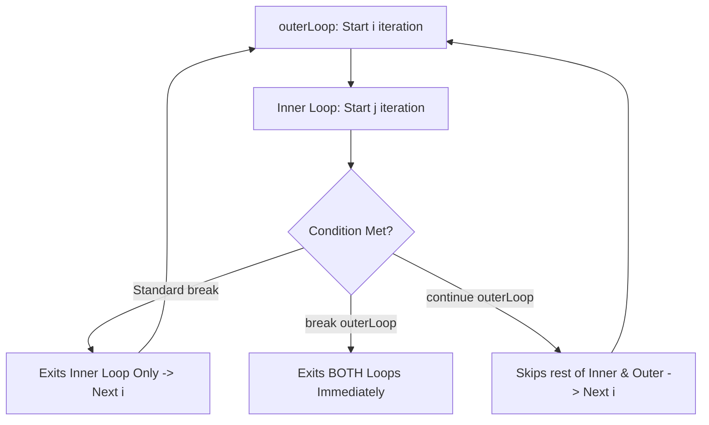

# Labels with Loops and Jump Statements in Dart

> **Module:** 01-dart-fundamentals  
> **Subsection:** 02-control-flow-and-loops  
> **Prerequisites:** [loops-and-iteration.md](./loops-and-iteration.md)  
> **Official References:** [dart.dev/language/branches#switch-statements](https://dart.dev/language/branches#switch-statements) | [dart.dev/language/loops](https://dart.dev/language/loops)

---

## 1. Introduction

In deeply nested loops, standard `break` and `continue` statements only affect the **innermost** loop in which they reside. When an algorithm requires terminating or skipping an **outer** loop from within an inner loop, procedural code often becomes cluttered with boolean flags.

Dart provides **labeled loops**, allowing you to attach an identifier label to any enclosing loop and target that specific loop directly with `break` or `continue`.

### Why Do We Need Labels?
1. **Clean Multi-Level Loop Exits:** Exits nested loops immediately without needing awkward boolean flags (`bool found = false; if (found) break;`).
2. **Matrix & Grid Algorithms:** Essential for search algorithms traversing 2D grids, game boards, or pixel arrays.
3. **Switch Statement Fall-Through:** Enables deliberate, controlled fall-through in switch statements using `continue labelName;`.

### Where Is It Used in Real Development?
- **Search Operations:** Searching for an item across multiple categories and immediately returning or stopping.
- **Parsing Multidimensional Data:** Processing CSV tables, spreadsheets, or nested JSON structures.
- **State Machine Transitions:** Jumping between related state branches in lexers or state machines.

---

## 2. Core Concepts

### Label Syntax
A label is an identifier followed by a colon (`:`) placed immediately before a loop statement:

```dart
outerLoop:
for (int i = 0; i < 5; i++) {
  for (int j = 0; j < 5; j++) {
    if (shouldStop) {
      break outerLoop; // Terminates BOTH inner and outer loops!
    }
  }
}
```



### The Rules of Dart Labels
1. **No Arbitrary `goto`:** Dart does **not** have a generic `goto` keyword. Labels can **only** be targeted by `break` or `continue`.
2. **Scope Limitation:** A label is only visible to statements inside the block it labels. You cannot jump into a loop from the outside.
3. **Switch Case Fall-Through:** Dart forbids implicit fall-through between switch cases. To intentionally fall through, Dart allows labeling a case:
   ```dart
   switch (status) {
     case 'retry':
       prepareRetry();
       continue processLabel; // Jumps to processLabel
     processLabel:
     case 'process':
       executeTask();
       break;
   }
   ```

---

## 3. Syntax and Implementation

```dart
// bin/labels_demo.dart

void main() {
  print('--- 1. Labeled break in 2D Search ---');
  findCoordinatesInMatrix();

  print('\n--- 2. Labeled continue in Matrix Filtering ---');
  filterMatrixRows();

  print('\n--- 3. Labeled continue in Switch Fall-Through ---');
  handleAppStatus('refresh');
}

void findCoordinatesInMatrix() {
  final matrix = [
    [10, 20, 30],
    [40, 99, 60], // Target is 99 at row 1, col 1
    [70, 80, 90],
  ];
  const target = 99;

  rowLoop:
  for (int row = 0; row < matrix.length; row++) {
    for (int col = 0; col < matrix[row].length; col++) {
      print('Inspecting [$row][$col]: ${matrix[row][col]}');
      if (matrix[row][col] == target) {
        print('SUCCESS: Found target $target at ($row, $col)!');
        break rowLoop; // Exits rowLoop completely!
      }
    }
  }
}

void filterMatrixRows() {
  final data = [
    [1, 2, 3],
    [-1, 4, 5], // Negative number detected; skip entire row
    [7, 8, 9],
  ];

  rowProcessor:
  for (int r = 0; r < data.length; r++) {
    for (int c = 0; c < data[r].length; c++) {
      if (data[r][c] < 0) {
        print('Row $r contains invalid negative value (${data[r][c]}). Skipping row...');
        continue rowProcessor; // Skips remainder of this inner loop AND outer row iteration
      }
    }
    print('Row $r processed successfully: ${data[r]}');
  }
}

void handleAppStatus(String action) {
  switch (action) {
    case 'refresh':
      print('Action: Refreshing cache...');
      continue logLabel; // Fall-through to logLabel
    logLabel:
    case 'log':
      print('Action: Writing audit log entry.');
      break;
    default:
      print('Action: Unknown command.');
  }
}
```

### Expected Output
```text
--- 1. Labeled break in 2D Search ---
Inspecting [0][0]: 10
Inspecting [0][1]: 20
Inspecting [0][2]: 30
Inspecting [1][0]: 40
Inspecting [1][1]: 99
SUCCESS: Found target 99 at (1, 1)!

--- 2. Labeled continue in Matrix Filtering ---
Row 0 processed successfully: [1, 2, 3]
Row 1 contains invalid negative value (-1). Skipping row...
Row 2 processed successfully: [7, 8, 9]

--- 3. Labeled continue in Switch Fall-Through ---
Action: Refreshing cache...
Action: Writing audit log entry.
```

### Common Mistakes
- **Mistake 1: Overusing labels instead of extracting a function.**  
  If you find yourself using labels across complex loops, extracting the nested loops into an isolated helper function with an immediate `return` statement is often clearer and more testable.
- **Mistake 2: Attaching labels to invalid statements.**  
  Placing a label on an `if` statement or assignment will not allow you to `continue` or `break` to it; labels only work on `for`, `while`, `do-while`, and `switch` case clauses.

---

## 4. Comparison: Standard `break` vs Labeled `break`

| Feature | Standard `break` | Labeled `break labelName;` |
|:---|:---|:---|
| **Scope of Termination** | Only the immediate innermost loop | The explicitly targeted loop |
| **Requires Enclosing Identifier** | No | Yes (`labelName:`) |
| **Cleanliness in Nested Loops** | Often requires helper boolean flags | Eliminates flags completely |
| **Alternative Idiom** | Extract to method with `return` | Extract to method with `return` |

---

## 5. Interview Preparation

### Frequently Asked Questions

#### Q1: Does Dart have a `goto` statement?
- **Answer:** **No.** Dart does not have an unrestricted `goto` statement. It only supports structured jumping via labeled `break` and labeled `continue`. This guarantees that control flow cannot jump into uninitialized variable scopes or arbitrary instructions.

#### Q2: How does Dart handle switch statement fall-through compared to C++ or Java?
- **Answer:** In C++ and Java, if you omit `break;`, execution automatically and silently falls through to the next case—a notorious source of bugs. In Dart, non-empty switch cases **forbid** implicit fall-through; omitting `break`, `return`, `throw`, or `continue` is a compile-time error. If deliberate fall-through is required, you must explicitly use `continue labelName;`.

---

## 6. Practice Exercises

### Exercise 1 (Beginner): 2D Grid Item Finder
Given a 2D list of strings representing a warehouse:
```dart
final warehouse = [
  ['Aisle1_Bin1', 'Aisle1_Bin2'],
  ['Aisle2_Bin1', 'Aisle2_TARGET', 'Aisle2_Bin3'],
  ['Aisle3_Bin1'],
];
```
Use a labeled loop to search for `'Aisle2_TARGET'` and print its aisle and bin index, terminating immediately when found.

---

## 7. References
- [Dart Language Guide: Control Flow](https://dart.dev/language/loops)
- [Dart Language Guide: Branches and Switch](https://dart.dev/language/branches)
