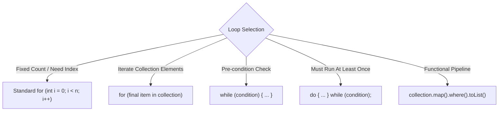

# Loops and Iteration in Dart

> **Module:** 01-dart-fundamentals  
> **Subsection:** 02-control-flow-and-loops  
> **Prerequisites:** [conditional-branching.md](./conditional-branching.md)  
> **Official References:** [dart.dev/language/loops](https://dart.dev/language/loops)

---

## 1. Introduction

Iteration enables a program to execute a block of code repeatedly across collections, ranges, or until a specific termination condition is reached. Dart provides traditional counter loops, idiomatic collection iterators, condition-driven loops, and higher-order iteration methods.

### Why Do We Need Iteration?
1. **Data Processing:** Traversing, filtering, mapping, and aggregating records from APIs, databases, or local files.
2. **Dynamic UI Generation:** Generating lists of widgets, menu items, or table rows in Flutter.
3. **Polling & Retry Logic:** Retrying failed network requests with exponential backoff until success or max attempts.

### Where Is It Used in Real Development?
- **Batch Processing:** Processing a queue of background analytics events.
- **Form Validation:** Iterating across a list of input validators to verify user submission.
- **Matrix Calculations:** Traversing 2D game grids or image pixel buffers.

---

## 2. Core Concepts

### The 5 Primary Iteration Mechanisms in Dart



1. **Standard `for` loop:** Counter-based iteration with initialization, condition, and increment expressions.
2. **`for-in` loop:** The idiomatic Dart loop for traversing any object implementing `Iterable<E>` (Lists, Sets, Maps).
3. **`while` loop:** Evaluates condition *before* executing the body. If false initially, executes zero times.
4. **`do-while` loop:** Executes the body *first*, then evaluates the condition. Guaranteed to run at least once.
5. **Control Statements:**
   - `break`: Immediately exits the nearest enclosing loop.
   - `continue`: Skips the remainder of the current loop iteration and proceeds to the next iteration.

---

## 3. Syntax and Implementation

```dart
// bin/loops_demo.dart

void main() {
  // 1. Standard Indexed for loop
  print('--- 1. Standard for loop ---');
  for (int i = 1; i <= 3; i++) {
    print('Counter: $i');
  }

  // 2. Idiomatic for-in loop
  print('\n--- 2. for-in loop ---');
  final frameworkComponents = ['Flutter Engine', 'Dart VM', 'Impeller'];
  for (final component in frameworkComponents) {
    print('Component: $component');
  }

  // 3. while loop
  print('\n--- 3. while loop ---');
  int attempts = 0;
  while (attempts < 3) {
    attempts++;
    print('Connection attempt #$attempts');
  }

  // 4. do-while loop
  print('\n--- 4. do-while loop ---');
  int executionCounter = 10;
  do {
    print('Runs at least once, even though counter is $executionCounter');
    executionCounter++;
  } while (executionCounter < 5);

  // 5. break and continue
  print('\n--- 5. break and continue ---');
  for (int i = 1; i <= 6; i++) {
    if (i == 2) {
      continue; // Skip 2
    }
    if (i == 5) {
      break; // Terminate at 5
    }
    print('Number: $i');
  }
}
```

### Expected Output
```text
--- 1. Standard for loop ---
Counter: 1
Counter: 2
Counter: 3

--- 2. for-in loop ---
Component: Flutter Engine
Component: Dart VM
Component: Impeller

--- 3. while loop ---
Connection attempt #1
Connection attempt #2
Connection attempt #3

--- 4. do-while loop ---
Runs at least once, even though counter is 10

--- 5. break and continue ---
Number: 1
Number: 3
Number: 4
```

### Common Mistakes
- **Mistake 1: Concurrent modification exception (`ConcurrentModificationError`).**  
  Modifying a list (adding or removing items) *while* iterating over it with a `for-in` loop throws a runtime error. If you need to remove items, use `list.removeWhere(...)` or iterate over a copy (`for (final item in [...list])`).
- **Mistake 2: Using `forEach` with asynchronous callbacks (`async/await`).**  
  `list.forEach((item) async { await syncItem(item); });` **does not wait** for the futures to complete. `forEach` ignores the returned `Future`. Always use a standard `for (final item in list)` loop when executing asynchronous operations sequentially.

---

## 4. Practical Example: Network Retry Engine

```dart
// lib/retry_engine.dart

import 'dart:math';

class NetworkException implements Exception {
  final String message;
  NetworkException(this.message);
  @override
  String toString() => message;
}

Future<String> fetchUserDataWithRetry({int maxRetries = 3}) async {
  int attempt = 0;
  
  while (attempt < maxRetries) {
    attempt++;
    try {
      print('Attempt $attempt: Sending request to server...');
      
      // Simulate network operation (fails first 2 times, succeeds on 3rd)
      if (attempt < 3) {
        throw NetworkException('HTTP 503: Service Unavailable');
      }
      
      return 'User payload: {id: 42, role: "Senior Developer"}';
    } catch (e) {
      print('Caught failure on attempt $attempt: $e');
      if (attempt >= maxRetries) {
        rethrow; // Exhausted retries
      }
      // Exponential backoff delay
      final delayMillis = pow(2, attempt) * 100;
      print('Backing off for ${delayMillis}ms before next retry...');
      await Future.delayed(Duration(milliseconds: delayMillis.toInt()));
    }
  }

  throw NetworkException('Unexpected loop termination');
}

void main() async {
  try {
    final result = await fetchUserDataWithRetry();
    print('Final Success: $result');
  } catch (e) {
    print('Fatal Error: $e');
  }
}
```

---

## 5. Internal Working: The `Iterable` and `Iterator` Protocol

When you write `for (final element in collection)`, the Dart compiler translates this under the hood using Dart's **Iterator Protocol**:

```dart
// How 'for-in' executes under the hood:
final iterator = collection.iterator;
while (iterator.moveNext()) {
  final element = iterator.current;
  // Body executes here
}
```

1. **`Iterable<E>` interface:** Any class that provides an `Iterator<E> get iterator;`.
2. **`Iterator<E>` interface:** Contains:
   - `bool moveNext()`: Advances to the next element, returning `false` when exhausted.
   - `E get current`: Returns the current element.

---

## 6. Comparison of Iteration Methods

| Loop Type | Best Suited For | Handles Async/Await? | Guarantees At Least 1 Run? | Modifying Collection? |
|:---|:---|:---:|:---:|:---:|
| **`for-in`** | Standard traversal of lists, sets, maps | **Yes** (`await` pauses iteration) | No | Throws error if modified |
| **Standard `for`** | When index `i` is explicitly required | **Yes** | No | Allowed with caution |
| **`while`** | Indefinite loops based on state | **Yes** | No | Allowed |
| **`do-while`** | Menus, tasks that must execute $\ge 1$ time | **Yes** | **Yes** | Allowed |
| **`.forEach()`** | Simple, synchronous side effects (logging) | **No** (ignores return Future) | No | Throws error if modified |

---

## 7. Interview Preparation

### Frequently Asked Questions

#### Q1: Why should you avoid using `.forEach()` when running asynchronous code?
- **Answer:** The `.forEach()` method on `Iterable` accepts a `void Function(T element)`. If you pass an `async` closure, the return type becomes `Future<void>`, but `.forEach()` cannot `await` it. It executes all callbacks concurrently without waiting for any of them to complete. If you need sequential asynchronous execution, always use a `for-in` loop:
  ```dart
  // WRONG:
  items.forEach((item) async => await save(item));

  // CORRECT:
  for (final item in items) {
    await save(item);
  }
  ```

#### Q2: What is the time complexity of looking up elements by index in `List` vs iterating a `Set`?
- **Answer:** Accessing a `List` by index (`list[i]`) is $O(1)$ constant time because lists in Dart are backed by contiguous arrays in memory. Iterating a `Set` via `for-in` requires traversing the underlying hash table structure, which is $O(n)$ where $n$ is the capacity/number of elements.

---

## 8. Practice Exercises

### Exercise 1 (Beginner): Fibonacci Generator
Write a `for` loop that prints the first 10 numbers of the Fibonacci sequence ($0, 1, 1, 2, 3, 5, 8, \dots$).

### Exercise 2 (Intermediate): Safe Collection Removal
Given a `List<int> numbers = [1, 2, 3, 4, 5, 6, 7, 8, 9, 10];`, write code that removes all odd numbers without throwing a `ConcurrentModificationError`.

---

## 9. References
- [Dart Official Language Guide: Loops](https://dart.dev/language/loops)
- [Dart API Reference: Iterable](https://api.dart.dev/stable/dart-core/Iterable-class.html)
