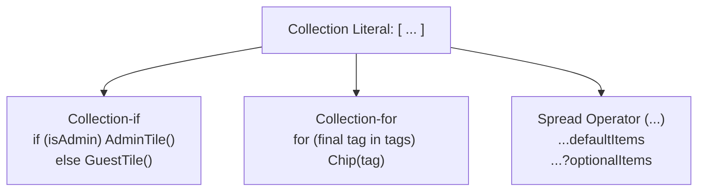

# Collection Operators in Dart: Collection-if, Collection-for, and Spread

> **Module:** 01-dart-fundamentals  
> **Subsection:** 03-collections-and-generics  
> **Prerequisites:** [lists-sets-and-maps.md](./lists-sets-and-maps.md)  
> **Official References:** [dart.dev/language/collections#control-flow-operators](https://dart.dev/language/collections#control-flow-operators)

---

## 1. Introduction

Prior to Dart 2.3, building collections with conditional elements or dynamic repetitions required imperative, multi-line code with temporary variables and manual `.add()` or `.addAll()` invocations.

Dart introduced **Control Flow Collection Operators**:
- **Collection-if** (`if (condition) element`)
- **Collection-for** (`for (var x in iterable) element`)
- **Spread Operator** (`...` and `...?`)

These declarative operators fundamentally revolutionized Flutter development, allowing developers to construct complex, reactive widget trees inline without breaking the declarative hierarchy.

### Why Do We Need Them?
1. **Declarative UI Assembly:** Eliminates awkward imperative builder helper methods when constructing Flutter widget lists.
2. **Immutable Collection Construction:** Allows building completely `const` or `final` collections with compile-time or declarative conditions.
3. **Readability:** Keeps the layout structure visually aligned with its conditional logic.

### Where Is It Used in Real Development?
- **Conditional Widgets:** Showing admin buttons, badges, or notification icons only when specific conditions are met.
- **Mapping Data to Widgets:** Dynamically converting domain models into UI widgets (`[for (final item in cartItems) CartItemTile(item)]`).
- **Merging Component Lists:** Unpacking action buttons, header slivers, or tab bar configurations.

---

## 2. Core Concepts



### 1. Collection-if
Inserts an element into the collection only if the boolean expression evaluates to `true`. Also supports an optional `else` branch:
```dart
final navItems = [
  'Home',
  'Profile',
  if (isVipUser) 'VIP Lounge' else 'Upgrade to VIP',
];
```

### 2. Collection-for
Iterates over an `Iterable` and inserts the generated element for each iteration directly into the enclosing collection:
```dart
final chipLabels = [
  for (final role in userRoles) 'Role: ${role.name.toUpperCase()}',
];
```

### 3. Spread (`...`) and Null-Aware Spread (`...?`)
Unpacks and inserts all elements of another collection into the target collection:
- `...iterable`: Expands elements.
- `...?nullableIterable`: Safely expands elements if non-null; if null, inserts nothing and produces no error.

---

## 3. Syntax and Implementation

```dart
// bin/collection_operators_demo.dart

void main() {
  const bool isLoggedIn = true;
  const bool isModerator = false;
  final List<String> categories = ['Mobile', 'Web', 'Cloud'];
  List<String>? betaFeatures; // null

  // 1. Combining Collection-if, Collection-for, and Spread in a List
  final dynamicDrawerMenu = [
    'Header Banner',
    if (isLoggedIn) 'Dashboard',
    if (isModerator) 'Moderation Queue' else 'Contact Support',
    // Collection-for
    for (final cat in categories) 'Category: $cat',
    // Null-safe spread operator
    ...?betaFeatures,
    'Settings',
  ];

  print('--- Generated Drawer Menu ---');
  for (final item in dynamicDrawerMenu) {
    print(' • $item');
  }

  // 2. Collection Operators inside Maps
  final Map<String, String> userMetadata = {
    'platform': 'Flutter',
    if (isLoggedIn) 'auth_status': 'authenticated',
    for (int i = 1; i <= 2; i++) 'slot_$i': 'assigned',
  };
  print('\nUser Metadata Map: $userMetadata');

  // 3. Collection Operators inside Sets
  final Set<String> permissions = {
    'READ',
    if (isLoggedIn) 'WRITE',
    if (isModerator) 'BAN_USER',
  };
  print('User Permissions Set: $permissions');
}
```

### Expected Output
```text
--- Generated Drawer Menu ---
 • Header Banner
 • Dashboard
 • Contact Support
 • Category: Mobile
 • Category: Web
 • Category: Cloud
 • Settings

User Metadata Map: {platform: Flutter, auth_status: authenticated, slot_1: assigned, slot_2: assigned}
User Permissions Set: {READ, WRITE}
```

### Common Mistakes
- **Mistake 1: Forgetting null-aware spread (`...?`) on nullable collections.**  
  Writing `[...nullableList]` throws an unhandled exception (`Null check operator used on a null value` or null dereference) if `nullableList` is `null`. Always use `...?nullableList`.
- **Mistake 2: Confusing collection-if with ternary inside collections.**  
  - Ternary requires an explicit fallback (`condition ? A : B`). If you don't want an alternative, writing `condition ? A : null` inserts `null` into the list (`[Item1, null, Item2]`), which will crash Flutter layout widgets expecting non-null children!
  - Collection-if (`if (condition) A`) inserts **nothing** when the condition is `false`.

---

## 4. Practical Example: Flutter AppBar Action Builder

```dart
// lib/app_bar_actions.dart

class ActionButton {
  final String label;
  final bool isDestructive;
  ActionButton(this.label, {this.isDestructive = false});
}

List<String> buildAppBarActions({
  required bool isEditing,
  required bool hasChanges,
  required List<String>? pluginActions,
}) {
  return [
    'Search Icon',
    if (isEditing) ...[
      // Combining collection-if with spread to inject multiple widgets!
      if (hasChanges) 'Save Changes Button',
      'Discard Changes Button',
    ] else ...[
      'Edit Profile Button',
      'Share Profile Button',
    ],
    ...?pluginActions,
    'Overflow Menu (Three Dots)',
  ];
}

void main() {
  print('Viewing Mode:');
  print(buildAppBarActions(isEditing: false, hasChanges: false, pluginActions: null));

  print('\nEditing Mode with Changes:');
  print(buildAppBarActions(isEditing: true, hasChanges: true, pluginActions: ['Spellcheck']));
}
```

---

## 5. Comparison: Imperative `.add()` vs Declarative Collection Operators

```dart
// Traditional Imperative Approach (Clunky, mutable, multi-line)
List<String> buildMenuImperative(bool isVip) {
  final list = <String>[];
  list.add('Home');
  if (isVip) {
    list.add('VIP Lounge');
  }
  return list;
}

// Modern Declarative Approach (Clean, expressions, const-compatible)
List<String> buildMenuDeclarative(bool isVip) => [
  'Home',
  if (isVip) 'VIP Lounge',
];
```

| Dimension | Imperative `.add()` / `.addAll()` | Declarative Collection Operators |
|:---|:---|:---|
| **Programming Paradigm** | Imperative (step-by-step commands) | Declarative (structural expression) |
| **Flutter Widget Tree Compatibility** | Poor (requires helper functions) | **Native (in-line in `children: [ ... ]`)** |
| **Supports `const` Collections?** | No (mutates list) | **Yes** (when condition is compile-time) |
| **Null-Handling** | Requires manual null-check `if (x != null)` | **Built-in via `...?`** |

---

## 6. Interview Preparation

### Frequently Asked Questions

#### Q1: What is the difference between `[condition ? WidgetA() : null]` and `[if (condition) WidgetA()]` in a Flutter Column?
- **Short Answer:** The ternary expression inserts a `null` element into the list if false, whereas collection-if inserts nothing.
- **Detailed Answer:** In Flutter, passing `null` into a `Column(children: [...])` will trigger a runtime framework crash because Flutter's `children` parameter requires a `List<Widget>`, not `List<Widget?>`. If you use the ternary operator, you must either filter out nulls or provide a placeholder widget (like `SizedBox.shrink()`). Collection-if cleanly resolves this by inserting 0 elements when false.

#### Q2: Can you nest collection-if and collection-for inside a collection-if?
- **Answer:** **Yes.** Dart supports arbitrary nesting of collection operators. You can write:
  ```dart
  final items = [
    if (hasData)
      for (final category in categories)
        if (category.isActive) ...category.items,
  ];
  ```

---

## 7. Practice Exercises

### Exercise 1 (Beginner): Dynamic Breadcrumb Generator
Write a function `List<String> buildBreadcrumbs(String section, String? subsection)` that:
- Starts with `'Home'`.
- Includes `section`.
- Includes `subsection` only if it is non-null.

### Exercise 2 (Intermediate): Tab Filter Mapper
Given a list of enums `[Filter.all, Filter.unread, Filter.archived]`, use a collection-for and collection-if to generate a list of strings that capitalizes each filter name, but excludes `Filter.archived` if user is a standard guest.

---

## 8. References
- [Dart Language Guide: Control Flow in Collections](https://dart.dev/language/collections#control-flow-operators)
- [Dart Official Blog: Making Dart a Better Language for UI](https://medium.com/dartlang/making-dart-a-better-language-for-ui-f1c3f3fe5408)
