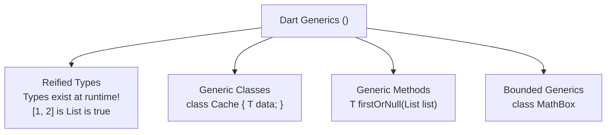

# Generics and Type Variance in Dart

> **Module:** 01-dart-fundamentals  
> **Subsection:** 03-collections-and-generics  
> **Prerequisites:** [lists-sets-and-maps.md](./lists-sets-and-maps.md)  
> **Official References:** [dart.dev/language/generics](https://dart.dev/language/generics)

---

## 1. Introduction

Generics allow you to write reusable, type-safe classes, interfaces, and methods that work across different data types while preserving compile-time type verification. Instead of duplicating logic for every type (e.g., `IntStack`, `StringStack`) or resorting to unsafe `Object` or `dynamic` typing, generics use **type parameters** (such as `<T>`).

### Why Do We Need Generics?
1. **Type Safety Without Duplication:** Write algorithms once and reuse them across any type while preventing type mismatch bugs.
2. **Reification (Runtime Type Preservation):** Unlike Java (which erases generic types at runtime), Dart generics are **reified**—their type information is preserved and verifiable at runtime.
3. **IDE Code Completion:** Enables IDEs to infer and autocomplete methods on generic contents.

### Where Is It Used in Real Development?
- **State Management:** `StateNotifier<T>`, `AsyncValue<T>`, `Bloc<Event, State>`.
- **API Clients:** Generic HTTP envelopes like `ApiResponse<T>` or `Result<Success, Failure>`.
- **Flutter Widgets:** `ValueNotifier<T>`, `DropdownButton<T>`, `FutureBuilder<T>`, `StreamBuilder<T>`.

---

## 2. Core Concepts



### 1. Type Parameters
A placeholder letter representing a type specified during instantiation:
- `T`: Type
- `E`: Element (collections)
- `K, V`: Key and Value (maps)
- `R`: Return type

### 2. Reified Generics vs. Type Erasure
In Java, generic type arguments are stripped during compilation ("type erasure"). In Dart, generic types are **reified**—meaning the type argument is stored directly on the heap object and persists throughout execution.
- `final list = <String>[];`
- `list is List<String>` evaluates to `true` at runtime!
- `list is List<int>` evaluates to `false` at runtime!

### 3. Bounded Generics (`<T extends BaseClass>`)
Restricts the types that can be substituted for `T`. The type argument must be a subtype of the bounding class:
```dart
class NumericCalculator<T extends num> {
  T add(T a, T b) => (a + b) as T;
}
```

---

## 3. Syntax and Implementation

```dart
// bin/generics_demo.dart

// 1. Generic Class
class MemoryCache<T> {
  final Map<String, T> _cache = {};

  void put(String key, T value) {
    _cache[key] = value;
  }

  T? get(String key) => _cache[key];

  bool contains(String key) => _cache.containsKey(key);

  @override
  String toString() => 'MemoryCache<$T> count=${_cache.length}';
}

// 2. Generic Method
T extractFirstElement<T>(List<T> items) {
  if (items.isEmpty) {
    throw StateError('Cannot extract first element from an empty list');
  }
  return items.first;
}

// 3. Bounded Generic Class (<T extends Comparable<T>>)
class PriorityContainer<T extends Comparable<T>> {
  final List<T> _items = [];

  void insert(T item) {
    _items.add(item);
    _items.sort(); // Requires Comparable!
  }

  T? get highestPriority => _items.isNotEmpty ? _items.last : null;
}

void main() {
  // Using Generic Class with String
  final stringCache = MemoryCache<String>();
  stringCache.put('auth_token', 'jwt_token_secret_123');
  print('Retrieved token: ${stringCache.get('auth_token')}');

  // Using Generic Method
  final numbers = [10, 20, 30];
  final firstNumber = extractFirstElement(numbers); // T inferred as int
  print('First number: $firstNumber (${firstNumber.runtimeType})');

  // Testing Reification at Runtime
  testReification();

  // Bounded Generics
  final priorityQueue = PriorityContainer<int>();
  priorityQueue.insert(50);
  priorityQueue.insert(100);
  priorityQueue.insert(25);
  print('Highest priority element: ${priorityQueue.highestPriority}');
}

void testReification() {
  final dynamic list = <String>['Flutter', 'Dart'];
  print('\n--- Testing Reified Types ---');
  print('Is list a List<String>? ${list is List<String>}'); // true!
  print('Is list a List<int>?    ${list is List<int>}');    // false!
}
```

### Expected Output
```text
Retrieved token: jwt_token_secret_123
First number: 10 (int)

--- Testing Reified Types ---
Is list a List<String>? true
Is list a List<int>?    false
Highest priority element: 100
```

### Common Mistakes
- **Mistake 1: Covariant array/list mutation crash.**  
  Dart allows covariance (e.g. assigning `List<String>` to `List<Object>`), but modifying it with an invalid type will throw a runtime `TypeError`:
  ```dart
  List<String> strings = ['a', 'b'];
  List<Object> objects = strings; // Allowed at compile time (covariant)
  objects.add(100); // CRASH AT RUNTIME: TypeError: 100 is not a subtype of String
  ```
- **Mistake 2: Missing bounds when calling methods on `T`.**  
  Writing `T min(T a, T b) => a < b ? a : b;` will fail compilation because plain `<T>` only has `Object` methods. You must write `<T extends Comparable<T>>`.

---

## 4. Practical Example: Generic Result Monad for Network Operations

```dart
// lib/result.dart

sealed class Result<T> {}

class Success<T> extends Result<T> {
  final T data;
  Success(this.data);
}

class Failure<T> extends Result<T> {
  final String errorMessage;
  final int? statusCode;
  Failure(this.errorMessage, {this.statusCode});
}

// Simulating API call returning a generic Result<T>
Future<Result<Map<String, String>>> fetchUserProfile(int userId) async {
  if (userId <= 0) {
    return Failure('Invalid user ID provided', statusCode: 400);
  }
  return Success({
    'id': '$userId',
    'username': 'senior_flutter_dev',
    'status': 'active',
  });
}

void main() async {
  final result = await fetchUserProfile(101);

  // Pattern matching on generic sealed Result
  switch (result) {
    case Success(:final data):
      print('User profile loaded: $data');
    case Failure(:final errorMessage, :final statusCode):
      print('Error $statusCode: $errorMessage');
  }
}
```

---

## 5. Comparison: Dart Reified Generics vs Java Type Erasure

| Characteristic | Dart Reified Generics | Java Generics (Type Erasure) |
|:---|:---|:---|
| **Runtime Type Representation** | Stored on object in memory | Erased to `Object` or raw type |
| **`list is List<String>` check** | **Valid & accurate at runtime** | Compile-time error or warning |
| **Instantiation with Type** | `new T()` not supported, but type persists | Requires passing `Class<T>` object |
| **Performance Overhead** | Minimal heap header cost | Zero runtime type storage |
| **Type Safety Guarantee** | Enforced at compile-time and runtime | Enforced at compile-time only |

---

## 6. Interview Preparation

### Frequently Asked Questions

#### Q1: What does it mean that Dart generics are "reified"?
- **Short Answer:** It means type argument information is preserved and accessible at runtime, not erased by the compiler.
- **Detailed Answer:** In languages with type erasure (like Java), `List<String>` and `List<int>` both become plain `List` at runtime, meaning you cannot test `if (list is List<String>)`. In Dart, generics are reified. If you create a `List<String>`, its type descriptor contains `String` at runtime. Dart can perform runtime type testing (`x is T`), runtime casting, and throw runtime type errors if an improper type is added to a covariant collection.

#### Q2: What is bounded quantification (bounded generics)?
- **Answer:** Bounded generics constrain the types that can be passed to a type parameter using the `extends` keyword (e.g. `<T extends num>`). This informs the compiler that any type substituted for `T` is guaranteed to have all methods and properties defined on `num` (such as `toDouble()`, `isNegative`, `+`), enabling type-safe mathematical or domain operations on generic instances.

---

## 7. Practice Exercises

### Exercise 1 (Beginner): Generic Stack
Implement a generic `Stack<T>` class with:
- `void push(T item)`
- `T pop()` (throws `StateError` if empty)
- `T get peek`
- `bool get isEmpty`

### Exercise 2 (Intermediate): Generic Cache with TTL
Build a `TimedCache<K, V>` class that stores items along with a timestamp and provides a method `V? get(K key, {Duration maxAge})` that returns `null` if the item has expired.

---

## 8. References
- [Dart Official Language Guide: Generics](https://dart.dev/language/generics)
- [Dart Language Specification: Reified Types](https://dart.dev/guides/language/spec)
