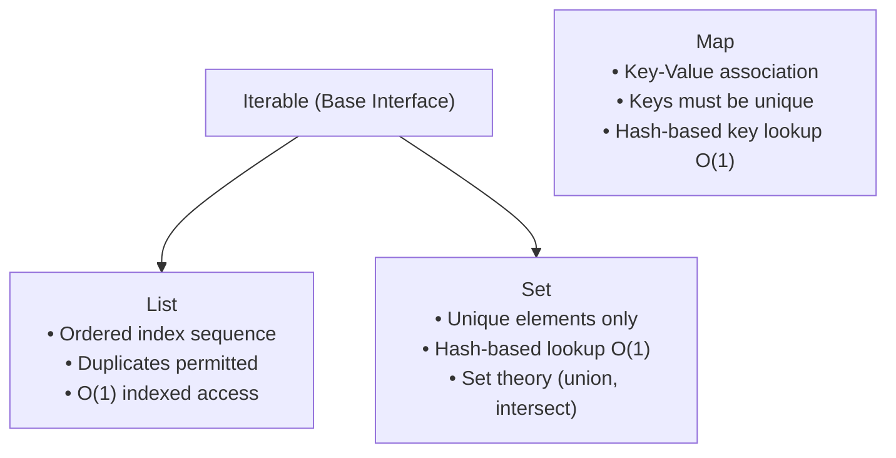

# Lists, Sets, and Maps in Dart: Deep Dive

> **Module:** 01-dart-fundamentals  
> **Subsection:** 03-collections-and-generics  
> **Prerequisites:** [01-basics-and-syntax/](../01-basics-and-syntax/)  
> **Official References:** [dart.dev/language/collections](https://dart.dev/language/collections) | [api.dart.dev/stable/dart-core/dart-core-library.html](https://api.dart.dev/stable/dart-core/dart-core-library.html)

---

## 1. Introduction

Collections are specialized data structures that group multiple values into a single unit. In Dart, collections are **first-class citizens** with native language syntax support, powerful transformation pipelines (`Iterable`), and tight integration with Flutter's declarative UI system.

### Why Do We Need Collections?
1. **Data Organization:** Structuring lists of items, unique user permissions, or key-value lookups.
2. **State Modeling:** Maintaining reactive state arrays in Flutter state managers.
3. **API Data Transfer:** Serialization and deserialization of JSON objects (which map directly to Dart `Map<String, dynamic>` and `List<dynamic>`).

### Where Is It Used in Real Development?
- **`List`:** Supplying `children` widgets to `Column`, `Row`, and `ListView.builder`.
- **`Set`:** Storing selected filter IDs, unique tags, or cached visited routes where duplicates are forbidden.
- **`Map`:** JSON payloads, headers, query parameters, route navigators, and dictionary lookup caches.

---

## 2. Core Concepts



### 1. `List<E>`
An ordered collection of elements accessible by a zero-based integer index.
- **Growable vs Fixed-Length:** By default, list literals `[1, 2, 3]` are growable. Fixed-length lists can be allocated via `List.filled(5, 0, growable: false)`.
- **Time Complexity:** Indexed read `list[i]` is $O(1)$. Appending `list.add()` is amortized $O(1)$. Inserting at the start `list.insert(0, item)` is $O(n)$ because subsequent elements must shift in memory.

### 2. `Set<E>`
An unordered collection of unique elements.
- Uses `hashCode` and `operator ==` to ensure no two identical items exist.
- Supports mathematical set operations: `union()`, `intersection()`, and `difference()`.
- Default implementation is `LinkedHashSet`, which preserves insertion order during iteration.

### 3. `Map<K, V>`
An associative container linking unique keys to values.
- Keys must implement consistent `operator ==` and `hashCode`.
- Default implementation is `LinkedHashMap`, preserving insertion order.

---

## 3. Syntax and Implementation

```dart
// bin/collections_demo.dart

void main() {
  // ==========================================
  // 1. LIST OPERATIONS
  // ==========================================
  print('--- 1. List Operations ---');
  final List<String> fruits = ['Apple', 'Banana', 'Cherry'];
  fruits.add('Date');
  fruits.addAll(['Elderberry', 'Fig']);

  print('First fruit: ${fruits.first}');
  print('Last fruit: ${fruits.last}');
  print('Element at index 2: ${fruits[2]}');

  // Sorting
  fruits.sort((a, b) => a.compareTo(b));
  print('Sorted fruits: $fruits');

  // Functional transformations
  final uppercaseFruits = fruits.map((f) => f.toUpperCase()).toList();
  print('Uppercase: $uppercaseFruits');

  // ==========================================
  // 2. SET OPERATIONS
  // ==========================================
  print('\n--- 2. Set Operations ---');
  final Set<String> rolesAdmin = {'READ', 'WRITE', 'DELETE'};
  final Set<String> rolesEditor = {'READ', 'WRITE', 'PUBLISH'};

  // Set Theory Operations
  final commonRoles = rolesAdmin.intersection(rolesEditor);
  final allRoles = rolesAdmin.union(rolesEditor);
  final adminExclusive = rolesAdmin.difference(rolesEditor);

  print('Intersection (Common): $commonRoles'); // {READ, WRITE}
  print('Union (All): $allRoles');             // {READ, WRITE, DELETE, PUBLISH}
  print('Difference (Admin only): $adminExclusive'); // {DELETE}

  // Deduplication
  final numbersWithDuplicates = [1, 2, 2, 3, 4, 4, 4, 5];
  final uniqueNumbers = numbersWithDuplicates.toSet().toList();
  print('Deduplicated list: $uniqueNumbers');

  // ==========================================
  // 3. MAP OPERATIONS
  // ==========================================
  print('\n--- 3. Map Operations ---');
  final Map<String, int> productPrices = {
    'Keyboard': 75,
    'Mouse': 25,
    'Monitor': 250,
  };

  // Safe lookup with default
  productPrices['Headphones'] = 60;
  final mousePrice = productPrices['Mouse']; // 25
  final webCamPrice = productPrices['Webcam'] ?? 0; // Fallback 0

  print('Mouse price: \$$mousePrice');
  print('Webcam price: \$$webCamPrice');

  // Iterating map entries
  for (final MapEntry(:key, :value) in productPrices.entries) {
    print('Product: $key costs \$$value');
  }
}
```

### Expected Output
```text
--- 1. List Operations ---
First fruit: Apple
Last fruit: Fig
Element at index 2: Cherry
Sorted fruits: [Apple, Banana, Cherry, Date, Elderberry, Fig]
Uppercase: [APPLE, BANANA, CHERRY, DATE, ELDERBERRY, FIG]

--- 2. Set Operations ---
Intersection (Common): {READ, WRITE}
Union (All): {READ, WRITE, DELETE, PUBLISH}
Difference (Admin only): {DELETE}
Deduplicated list: [1, 2, 3, 4, 5]

--- 3. Map Operations ---
Mouse price: $25
Webcam price: $0
Product: Keyboard costs $75
Product: Mouse costs $25
Product: Monitor costs $250
Product: Headphones costs $60
```

### Common Mistakes
- **Mistake 1: Setting custom objects as Set elements or Map keys without overriding `operator ==` and `hashCode`.**  
  Dart defaults to identity equality (`identical`). Two distinct instances with identical fields will be treated as separate keys unless `==` and `hashCode` are overridden!
- **Mistake 2: Calling `growable: false` list modification methods.**  
  `List.filled(3, 0, growable: false).add(1);` throws `Unsupported operation: Cannot add to a fixed-length list`.

---

## 4. Practical Example: In-Memory Tag & Filter Cache

```dart
// lib/tag_cache.dart

class Article {
  final int id;
  final String title;
  final Set<String> tags;

  Article(this.id, this.title, this.tags);
}

class ArticleRepository {
  final Map<int, Article> _articleStore = {};

  void saveArticle(Article article) {
    _articleStore[article.id] = article;
  }

  // Find articles matching ANY of the requested filter tags
  List<Article> findByTags(Set<String> searchTags) {
    return _articleStore.values.where((article) {
      // Check if article tags have any overlap with search tags
      return article.tags.intersection(searchTags).isNotEmpty;
    }).toList();
  }
}

void main() {
  final repo = ArticleRepository();
  repo.saveArticle(Article(1, 'Mastering Dart 3', {'dart', 'programming', 'basics'}));
  repo.saveArticle(Article(2, 'Flutter Impeller Deep Dive', {'flutter', 'rendering', 'performance'}));
  repo.saveArticle(Article(3, 'Riverpod State Management', {'flutter', 'state', 'architecture'}));

  final flutterArticles = repo.findByTags({'flutter'});
  print('Flutter articles found (${flutterArticles.length}):');
  for (final a in flutterArticles) {
    print(' - ${a.title}');
  }
}
```

---

## 5. Comparison: `List` vs `Set` vs `Map`

| Dimension | `List<E>` | `Set<E>` | `Map<K, V>` |
|:---|:---|:---|:---|
| **Element Structure** | Single value `E` | Single value `E` | Key-Value pair `K: V` |
| **Duplicates Permitted?** | **Yes** | **No** (Unique values only) | **Keys: No** (Unique), Values: Yes |
| **Ordering** | Strict index order ($0 \dots n-1$) | Insertion order (`LinkedHashSet`) | Insertion order (`LinkedHashMap`) |
| **Indexed Access (`[i]`)** | $O(1)$ constant time | Not supported (must iterate) | Not supported (lookup by key: `[key]`) |
| **Search / Contains (`contains`)** | $O(n)$ linear scan | $O(1)$ hash lookup | $O(1)$ key lookup (`containsKey`) |
| **Common Use Case** | Ordered feeds, rows, children | ID deduplication, tag matching | Dictionaries, JSON payloads, caches |

---

## 6. Interview Preparation

### Frequently Asked Questions

#### Q1: Why must custom classes override both `==` and `hashCode` when used in Sets or as Map keys?
- **Answer:** Sets and Maps use hash tables for $O(1)$ lookup. When checking if an object exists, the container calculates the object's `hashCode` to find the correct hash bucket. If a bucket contains items, it uses `operator ==` to identify the exact match. If two objects are equal according to `==`, they **must** have identical hash codes; otherwise, the container will look in the wrong hash bucket and fail to find the existing object.

#### Q2: What is the difference between `list.map()` and `for-in` loop with `list.add()`?
- **Answer:** `list.map()` is a lazy functional transformation that returns an `Iterable`. It does not allocate a new list in memory until `.toList()` is explicitly invoked. This allows chaining multiple operations (`.map().where().take(5)`) without generating intermediate lists in memory, reducing GC pressure.

---

## 7. Practice Exercises

### Exercise 1 (Beginner): Frequency Counter
Given a `List<String> words = ['apple', 'banana', 'apple', 'orange', 'banana', 'apple'];`, create a `Map<String, int>` that counts the frequency of each word.

### Exercise 2 (Intermediate): Set Operations
Given two sets of user IDs:
```dart
final activeToday = {101, 102, 105, 108};
final activeYesterday = {100, 101, 102, 109};
```
Write queries to find:
1. Users active on **both** days.
2. Users who were active yesterday but **not** today (churned).
3. The total unique users across both days.

---

## 8. References
- [Dart Official Language Guide: Collections](https://dart.dev/language/collections)
- [Effective Dart: Collections](https://dart.dev/effective-dart/usage#collections)
