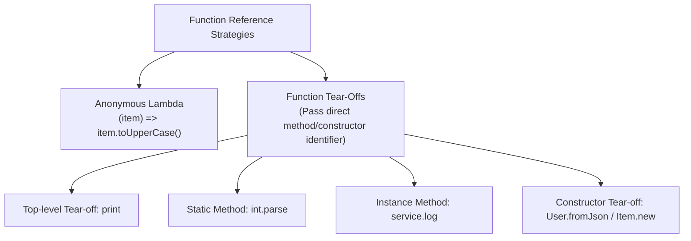

# Anonymous Functions and Tear-Offs in Dart

> **Module:** 01-dart-fundamentals  
> **Subsection:** 04-functions-and-closures  
> **Prerequisites:** [first-class-functions-and-typedefs.md](./first-class-functions-and-typedefs.md)  
> **Official References:** [dart.dev/language/functions#anonymous-functions](https://dart.dev/language/functions#anonymous-functions)

---

## 1. Introduction

When working with higher-order functions or event handlers, declaring a full named function for a single trivial operation creates unnecessary clutter. Dart allows declaring **anonymous functions** (also known as *lambdas* or *function literals*).

Furthermore, when an anonymous function does nothing more than invoke an existing method with the exact same arguments, Dart offers a cleaner, higher-performance alternative: **Function and Constructor Tear-Offs**.

### Why Do We Need Them?
1. **Concise Callbacks:** Eliminates boilerplates for short event handlers and collection mappings.
2. **Performance Optimization (Tear-offs):** Tear-offs avoid allocating an unnecessary intermediate wrapper closure on the heap.
3. **Idiomatic Clean Code:** `list.map(User.fromJson)` is far more legible than `list.map((json) => User.fromJson(json))`.

---

## 2. Core Concepts



### 1. Anonymous Functions (Lambdas)
A function without an identifier name:
```dart
// Block body syntax:
(int a, int b) {
  return a + b;
}

// Arrow syntax:
(int a, int b) => a + b
```

### 2. Function Tear-Offs
A **tear-off** occurs when you refer to a function, method, or constructor by its name without calling it (without parentheses `()`). Dart automatically extracts the function as a first-class closure object.
- **Top-Level Tear-off:** `print` instead of `(msg) => print(msg)`
- **Static Method Tear-off:** `int.parse` instead of `(str) => int.parse(str)`
- **Instance Method Tear-off:** `object.handler` instead of `() => object.handler()`
- **Constructor Tear-off:** `User.new` or `User.fromJson` instead of `(json) => User.fromJson(json)`

---

## 3. Syntax and Implementation

```dart
// bin/tear_offs_demo.dart

class User {
  final int id;
  final String username;

  // Unnamed constructor (accessible via User.new)
  User(this.id, this.username);

  // Named constructor
  User.fromJson(Map<String, Object?> json)
      : id = json['id'] as int,
        username = json['username'] as String;

  void printSummary() {
    print('User #$id: $username');
  }

  @override
  String toString() => 'User($id, $username)';
}

void main() {
  final rawNumbers = ['10', '25', '42', '100'];

  // ==========================================
  // 1. Lambda vs Static Method Tear-off
  // ==========================================
  // Redundant Lambda:
  final parsedViaLambda = rawNumbers.map((s) => int.parse(s)).toList();
  
  // Clean Static Method Tear-off:
  final parsedViaTearOff = rawNumbers.map(int.parse).toList();
  print('Parsed Numbers: $parsedViaTearOff');

  // ==========================================
  // 2. Top-Level Tear-off
  // ==========================================
  print('\nPrinting elements with tear-off:');
  // Pass 'print' directly!
  parsedViaTearOff.forEach(print);

  // ==========================================
  // 3. Constructor Tear-off (Dart 2.15+)
  // ==========================================
  final mockJsonList = [
    {'id': 1, 'username': 'alice'},
    {'id': 2, 'username': 'bob'},
  ];

  // Redundant Lambda:
  // final users = mockJsonList.map((json) => User.fromJson(json)).toList();

  // Idiomatic Constructor Tear-off:
  final users = mockJsonList.map(User.fromJson).toList();
  print('\nDeserialized Users: $users');

  // ==========================================
  // 4. Instance Method Tear-off
  // ==========================================
  final firstUser = users.first;
  // Extracting instance method into a callback
  final VoidCallback summaryAction = firstUser.printSummary;
  summaryAction(); // Calls firstUser.printSummary()
}

typedef VoidCallback = void Function();
```

### Expected Output
```text
Parsed Numbers: [10, 25, 42, 100]

Printing elements with tear-off:
10
25
42
100

Deserialized Users: [User(1, alice), User(2, bob)]
User #1: alice
```

### Common Mistakes
- **Mistake 1: Invoking the tear-off accidentally.**  
  `rawNumbers.map(int.parse())` fails compilation because `int.parse()` attempts to execute the method without arguments instead of passing the function reference.
- **Mistake 2: Writing redundant lambdas (lint rule: `unnecessary_lambdas`).**  
  Writing `(e) => print(e)` triggers a warning from Dart analyzer if the `unnecessary_lambdas` lint is enabled. Replace it with `print`.
- **Mistake 3: Incompatible argument signatures in tear-offs.**  
  If a method takes 2 arguments, you cannot pass it as a tear-off to a higher-order function that only provides 1 argument.

---

## 4. Comparison: Lambda vs. Function Tear-Off

| Feature | Anonymous Lambda | Function Tear-Off |
|:---|:---|:---|
| **Syntax** | `(item) => target.action(item)` | `target.action` |
| **Object Allocation** | Creates a new closure wrapper object | Directly references target method closure |
| **Constructor Usage** | `(x) => User(x)` | `User.new` |
| **Readability** | Noisy with parameter repetition | **Clean, concise, and idiomatic** |
| **Extra Logic Allowed?** | Yes (can add logs, fallbacks, transforms) | No (strict 1:1 signature pass-through) |

---

## 5. Interview Preparation

### Frequently Asked Questions

#### Q1: What is a Constructor Tear-off and when was it introduced to Dart?
- **Answer:** Constructor tear-offs were introduced in Dart 2.15. They allow developers to treat constructors as first-class functions without needing a wrapping lambda. Unnamed constructors are accessed via `.new` (e.g. `List.generate(5, Item.new)`), and named constructors are accessed via `.namedConstructor` (e.g. `jsonList.map(User.fromJson)`).

#### Q2: What is the performance benefit of using a tear-off over an anonymous lambda?
- **Answer:** When you write `(item) => print(item)`, the Dart VM allocates an anonymous closure instance on the heap to wrap the `print` call. When you use the tear-off `print`, the VM bypasses the intermediate closure allocation and passes the function pointer directly, reducing memory allocation churn and garbage collection pressure in hot loops.

---

## 6. Practice Exercises

### Exercise 1 (Beginner): Refactor to Tear-Offs
Refactor these three expressions to use tear-offs:
1. `strings.map((s) => double.parse(s))`
2. `values.forEach((v) => print(v))`
3. `ids.map((id) => UserId(id))` (where `UserId(this.id)`)

---

## 7. References
- [Dart Official Language Guide: Tear-offs](https://dart.dev/language/functions#tear-offs)
- [Dart 2.15 Release Notes: Constructor Tear-offs](https://medium.com/dartlang/dart-2-15-7e7a5984649b)
