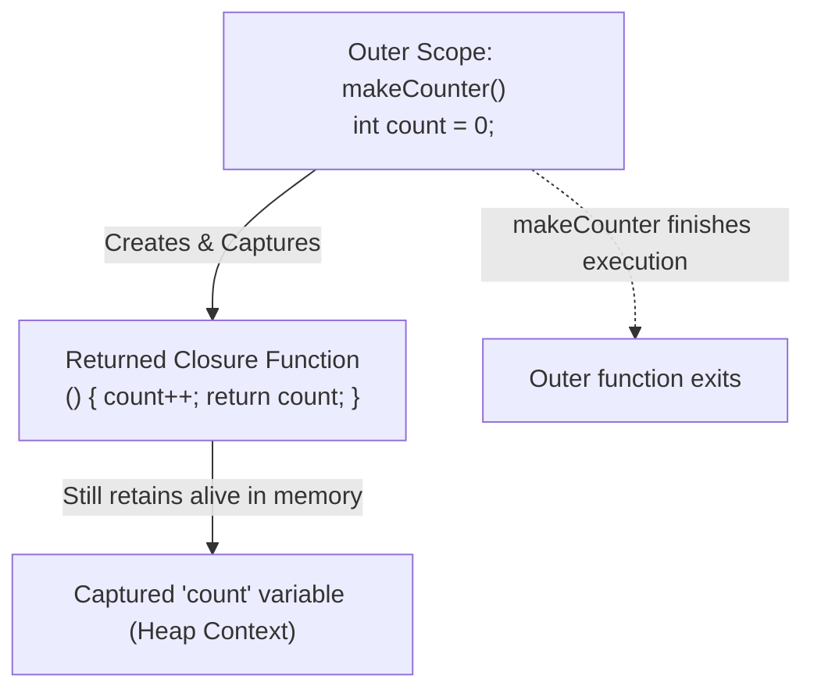

# Closures and Lexical Scope in Dart

> **Module:** 01-dart-fundamentals  
> **Subsection:** 04-functions-and-closures  
> **Prerequisites:** [function-syntax-and-parameters.md](./function-syntax-and-parameters.md)  
> **Official References:** [dart.dev/language/functions#lexical-scope](https://dart.dev/language/functions#lexical-scope) | [dart.dev/language/functions#lexical-closures](https://dart.dev/language/functions#lexical-closures)

---

## 1. Introduction

Dart is a **lexically scoped language**. This means the scope of variables is determined statically by the physical layout of the code blocks (curly braces `{ }`).

A **closure** is a function object that has access to variables in its enclosing lexical scope, **even when the function is executed outside of its original scope**. Closures "close over" the environment in which they were created.

### Why Do We Need Closures?
1. **Encapsulation & State Preservation:** Creating private, self-contained state without declaring full classes.
2. **Factory Functions:** Generating specialized callback functions pre-configured with environmental state.
3. **Flutter UI Callbacks:** Passing custom widget interaction logic while capturing references to local variables, `BuildContext`, or controller instances.

---

## 2. Core Concepts



### 1. Lexical Scope
Scope follows curly brace nesting:
- Code inside an inner block can see variables declared in all outer enclosing blocks.
- Code in an outer block **cannot** see variables declared inside inner child blocks.

### 2. Lexical Closures & Variable Capture
When a function accesses a variable from an outer scope and is passed elsewhere or returned:
- The Dart VM allocates a special **Context Frame** on the heap to store the captured variable.
- The captured variable remains alive in memory for as long as the closure reference exists, even after the outer function has completed its execution.

### 3. Memory Leak Danger
Because closures hold references to captured variables, capturing large objects (such as `BuildContext`, widget state, or heavy image buffers) in long-lived closures or uncancelled listeners will **prevent the garbage collector from freeing that memory**.

---

## 3. Syntax and Implementation

```dart
// bin/closures_demo.dart

// Function returning a closure that captures the private variable 'counter'
int Function() createCounter([int initialValue = 0]) {
  int counter = initialValue;

  // The returned anonymous function is a CLOSURE!
  return () {
    counter++;
    return counter;
  };
}

// Function generating a greeting closure pre-configured with a prefix
String Function(String name) createGreeter(String prefix) {
  return (String name) => '$prefix, $name!';
}

void main() {
  // 1. Independent State via Closures
  final counterA = createCounter(0);
  final counterB = createCounter(100);

  print('Counter A: ${counterA()}'); // 1
  print('Counter A: ${counterA()}'); // 2
  print('Counter A: ${counterA()}'); // 3

  // Counter B maintains its OWN isolated captured state!
  print('Counter B: ${counterB()}'); // 101
  print('Counter B: ${counterB()}'); // 102

  // 2. Pre-configured Function Generators
  final englishGreeter = createGreeter('Good morning');
  final spanishGreeter = createGreeter('Buenos días');

  print(englishGreeter('Dash'));
  print(spanishGreeter('Dash'));

  // 3. Closures inside Loops (Per-Iteration Scoping in Dart)
  final List<void Function()> callbacks = [];
  for (int i = 0; i < 3; i++) {
    // In Dart, 'i' is freshly scoped per loop iteration!
    callbacks.add(() => print('Captured iteration index: $i'));
  }

  print('\nExecuting stored loop closures:');
  for (final cb in callbacks) {
    cb();
  }
}
```

### Expected Output
```text
Counter A: 1
Counter A: 2
Counter A: 3
Counter B: 101
Counter B: 102
Good morning, Dash!
Buenos días, Dash!

Executing stored loop closures:
Captured iteration index: 0
Captured iteration index: 1
Captured iteration index: 2
```

### Common Mistakes
- **Mistake 1: Capturing `BuildContext` across asynchronous gaps.**  
  ```dart
  // DANGEROUS:
  ElevatedButton(
    onPressed: () async {
      await Future.delayed(Duration(seconds: 2));
      // If widget was disposed during the 2-second wait, context is invalid!
      Navigator.of(context).pop(); // Warning: Do not use BuildContext across async gaps
    },
    child: Text('Delayed Exit'),
  );
  // FIX: Check 'if (!context.mounted) return;' before using context!
  ```
- **Mistake 2: Leaking closures in event streams.**  
  Adding a closure as a listener to a stream or `ChangeNotifier` without removing it inside `dispose()` prevents the entire widget State from being garbage-collected.

---

## 4. Practical Example: Rate-Limiting Debouncer Closure

```dart
// lib/debouncer.dart

import 'dart:async';

typedef ActionCallback = void Function();

// Function generating a debounced action runner
ActionCallback createDebouncer(Duration delay) {
  Timer? timer;

  return () {
    // If a previous timer was running, cancel it
    timer?.cancel();

    // Start a fresh timer
    timer = Timer(delay, () {
      print('[Debouncer] Executing action after ${delay.inMilliseconds}ms of silence!');
    });
  };
}

void main() async {
  final onSearchTextChanged = createDebouncer(Duration(milliseconds: 300));

  print('Simulating rapid keystrokes...');
  onSearchTextChanged(); // Call 1 (cancelled)
  await Future.delayed(Duration(milliseconds: 50));
  onSearchTextChanged(); // Call 2 (cancelled)
  await Future.delayed(Duration(milliseconds: 50));
  onSearchTextChanged(); // Call 3 (Allowed to complete!)

  // Wait for debouncer to fire
  await Future.delayed(Duration(milliseconds: 400));
}
```

---

## 5. Comparison: Standard Function vs. Lexical Closure

| Feature | Standard Global / Static Function | Lexical Closure |
|:---|:---|:---|
| **Access to Enclosing Scope** | None (only parameters and globals) | **Full access to enclosing lexical block** |
| **State Retention** | Stateless (no memory between calls) | **Can maintain state across invocations** |
| **Memory Allocation** | Static code segment | Heap allocated context object |
| **Lifecycle** | Static (app lifespan) | Exists as long as closure is referenced |

---

## 6. Interview Preparation

### Frequently Asked Questions

#### Q1: How does Dart handle loop variables inside closures compared to JavaScript (pre-ES6)?
- **Answer:** In older JavaScript (using `var`), loop variables shared a single binding for the entire loop, meaning closures created inside the loop all printed the final terminal value. In Dart, each iteration of a `for` loop introduces a **fresh, isolated binding** for the loop variable. A closure created inside iteration `i` captures that specific iteration's value, correctly printing `0, 1, 2`.

#### Q2: What causes memory leaks when using closures in Flutter State objects?
- **Answer:** If a closure inside a `StatefulWidget` refers to an instance variable or method (which implicitly captures `this`), and that closure is registered as a listener on a long-lived or global singleton service (like an EventBus or singleton Provider), the service holds a strong reference to the closure. Because the closure captured `this`, the entire `State` object and its widget subtree cannot be garbage-collected, creating a severe memory leak.

---

## 7. Practice Exercises

### Exercise 1 (Beginner): Multiplier Closure
Write a function `int Function(int) createMultiplier(int factor)` that captures `factor` and returns a function multiplying its argument by that factor.

### Exercise 2 (Intermediate): Secure Vault Closure
Create a function `Map<String, Function> createVault(String masterPassword)` that returns a map containing two closures:
1. `bool verify(String pass)`
2. `void updatePassword(String oldPass, String newPass)`  
The actual password must remain completely private inside the enclosing lexical scope.

---

## 8. References
- [Dart Official Language Guide: Lexical Scope & Closures](https://dart.dev/language/functions#lexical-closures)
- [Flutter Architectural Best Practices: Avoiding Memory Leaks](https://docs.flutter.dev/perf/best-practices)
