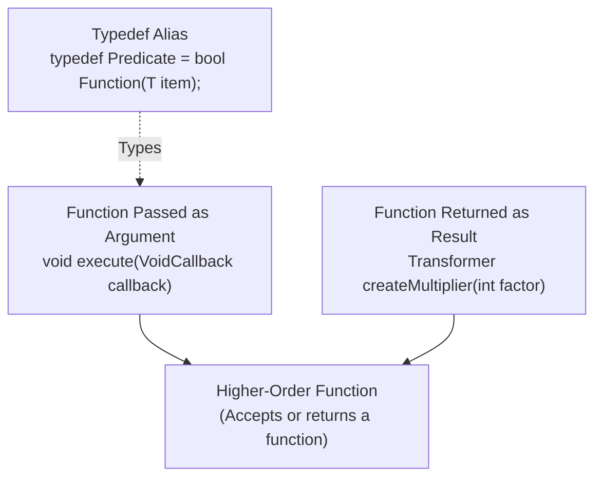

# First-Class Functions and Typedefs in Dart

> **Module:** 01-dart-fundamentals  
> **Subsection:** 04-functions-and-closures  
> **Prerequisites:** [function-syntax-and-parameters.md](./function-syntax-and-parameters.md)  
> **Official References:** [dart.dev/language/typedefs](https://dart.dev/language/typedefs) | [dart.dev/language/functions#functions-as-first-class-objects](https://dart.dev/language/functions#functions-as-first-class-objects)

---

## 1. Introduction

In computer science, a programming language is said to have **first-class functions** if it treats functions as first-class citizens. In Dart, functions are genuine objects of type `Function`. They can be stored in variables, placed inside collections, passed as arguments to other functions, and returned from functions.

To keep function signatures clean, readable, and reusable, Dart provides **`typedef`** (type aliases), which allow developers to give meaningful names to complex function types.

### Why Do We Need First-Class Functions and Typedefs?
1. **Event-Driven Architectures:** Facilitates asynchronous callbacks (e.g. `onPressed`, `onChanged`, network completion handlers).
2. **Modular Decoupling:** Allows higher-order functions (like `.map()`, `.where()`, `.sort()`) to operate on generic data without hardcoding business rules.
3. **Readable Type Aliases:** Replaces convoluted function type signatures like `Widget Function(BuildContext, int, Animation<double>)` with a clean alias.

### Where Is It Used in Real Development?
- **Flutter Callbacks:** `VoidCallback` (no-arg, no-return callback), `ValueChanged<T>` (single argument callback).
- **Builders:** `ItemWidgetBuilder`, `TransitionBuilder`, `WidgetBuilder`.
- **Interceptors & Middlewares:** Chaining request and response transforms in networking clients.

---

## 2. Core Concepts



### 1. Higher-Order Functions
A function that does at least one of the following:
- Takes one or more functions as arguments (e.g. `list.where((item) => item.isValid)`).
- Returns a function as its result.

### 2. Typedefs (Type Aliases)
A `typedef` gives a type alias to any function or data type.
- **Modern Syntax (Recommended):**
  ```dart
  typedef MathOperation = int Function(int a, int b);
  typedef Predicate<T> = bool Function(T item);
  ```
- Any function whose parameter types and return type match the signature satisfies the `typedef`.

### 3. Built-In Common Typedefs in Flutter & Dart
- `VoidCallback` = `void Function()`
- `ValueChanged<T>` = `void Function(T value)`
- `ValueGetter<T>` = `T Function()`

---

## 3. Syntax and Implementation

```dart
// bin/first_class_functions_demo.dart

// 1. Defining Modern Typedefs
typedef IntCalculator = int Function(int x, int y);
typedef StringValidator = bool Function(String input);
typedef Transformer<T> = T Function(T element);

// 2. Higher-Order Function: Passing Function as Parameter
int executeMathOperation(int a, int b, IntCalculator operation) {
  print('--> Executing math operation on ($a, $b)...');
  return operation(a, b);
}

// 3. Higher-Order Function: Returning a Function
Transformer<int> createMultiplier(int factor) {
  // Returns an anonymous function that multiplies by the captured factor
  return (int value) => value * factor;
}

// Standard concrete functions matching the typedef
int add(int a, int b) => a + b;
int multiply(int a, int b) => a * b;

void main() {
  // 1. Passing named functions
  final sum = executeMathOperation(10, 5, add);
  print('Sum: $sum');

  final product = executeMathOperation(10, 5, multiply);
  print('Product: $product');

  // 2. Passing inline anonymous functions
  final difference = executeMathOperation(10, 5, (x, y) => x - y);
  print('Difference: $difference');

  // 3. Utilizing Returned Functions
  final triple = createMultiplier(3);
  print('Triple of 10: ${triple(10)}');
  print('Triple of 25: ${triple(25)}');

  // 4. Storing Functions in Collections
  final List<StringValidator> validators = [
    (str) => str.isNotEmpty,
    (str) => str.length >= 8,
    (str) => str.contains('@'),
  ];

  final testEmail = 'user@flutter.dev';
  final isValid = validators.every((validate) => validate(testEmail));
  print('Is "$testEmail" valid? $isValid');
}
```

### Expected Output
```text
--> Executing math operation on (10, 5)...
Sum: 15
--> Executing math operation on (10, 5)...
Product: 50
--> Executing math operation on (10, 5)...
Difference: 5
Triple of 10: 30
Triple of 25: 75
Is "user@flutter.dev" valid? true
```

### Common Mistakes
- **Mistake 1: Invoking the callback instead of passing it.**  
  ```dart
  // WRONG: 'handleClick()' executes immediately and passes the returned value (void)
  ElevatedButton(onPressed: handleClick(), child: Text('Submit'));

  // CORRECT: 'handleClick' passes the function reference itself
  ElevatedButton(onPressed: handleClick, child: Text('Submit'));
  ```
- **Mistake 2: Missing the `Function` keyword in modern typedefs.**  
  Writing `typedef Validator = bool(String);` is legacy pre-Dart 2 syntax. Modern Dart requires `typedef Validator = bool Function(String);`.

---

## 4. Practical Example: Event Listener & Notification System

```dart
// lib/event_bus.dart

typedef EventListener<T> = void Function(T eventData);

class SimpleEventBus<T> {
  final List<EventListener<T>> _listeners = [];

  // Register listener
  void subscribe(EventListener<T> listener) {
    _listeners.add(listener);
  }

  // Unregister listener
  void unsubscribe(EventListener<T> listener) {
    _listeners.remove(listener);
  }

  // Emit event to all registered listeners
  void emit(T event) {
    for (final listener in _listeners) {
      listener(event); // Invoking first-class function
    }
  }
}

void main() {
  final authEvents = SimpleEventBus<String>();

  // Subscriber 1: Analytics
  authEvents.subscribe((event) {
    print('[Analytics Service] Logged event: $event');
  });

  // Subscriber 2: UI Snackbar
  authEvents.subscribe((event) {
    print('[UI Notification] Showing snackbar: $event');
  });

  // Emitting event
  authEvents.emit('USER_LOGGED_IN');
}
```

---

## 5. Comparison: Inline Function Type vs Typedef Alias

```dart
// Inline (Verbose, difficult to maintain across multiple methods)
void registerUser(void Function(String token, int expiresAt) onComplete) { ... }

// Typedef (Clean, reusable, self-documenting)
typedef AuthCallback = void Function(String token, int expiresAt);
void registerUser(AuthCallback onComplete) { ... }
```

| Dimension | Inline Function Type Signature | `typedef` Type Alias |
|:---|:---|:---|
| **Syntax** | `void Function(T, R)` | `typedef Name<T, R> = void Function(T, R)` |
| **Reusability** | None (must duplicate signature) | **Universal across multiple classes & files** |
| **Refactoring** | Difficult (must update everywhere) | **Effortless (single source of truth)** |
| **Readability** | Clutters parameter lists | **Clean and expressive** |

---

## 6. Interview Preparation

### Frequently Asked Questions

#### Q1: What is a `VoidCallback` in Flutter and how is it defined?
- **Answer:** `VoidCallback` is a typedef defined in Flutter's foundational library as:
  ```dart
  typedef VoidCallback = void Function();
  ```
  It represents any callback function that takes **no parameters** and returns **no value** (`void`). It is universally used for click and gesture handlers such as `ElevatedButton.onPressed` and `GestureDetector.onTap`.

#### Q2: Can a function be passed as a tear-off instead of an anonymous lambda?
- **Answer:** **Yes.** If a function's parameters and return type match the expected callback signature, you can pass its name directly as a **tear-off** (e.g. `items.forEach(print)` instead of `items.forEach((item) => print(item))`). Tear-offs are evaluated cleanly and avoid creating unnecessary intermediate closure wrapper objects in memory.

---

## 7. Practice Exercises

### Exercise 1 (Beginner): Custom Filter
Define a typedef `StringFilter = bool Function(String str);`. Write a function `List<String> applyFilter(List<String> list, StringFilter filter)` and call it to filter names starting with `'A'`.

### Exercise 2 (Intermediate): Pipeline Runner
Build a `Pipeline<T>` class that accepts a list of `Transformer<T>` functions and executes them sequentially on an initial input value.

---

## 8. References
- [Dart Official Language Guide: Typedefs](https://dart.dev/language/typedefs)
- [Dart Language Tour: Functions](https://dart.dev/language/functions)
