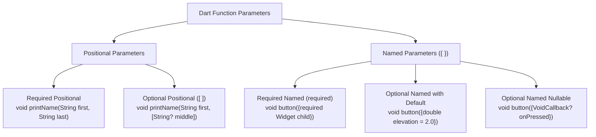

# Function Syntax and Parameters in Dart

> **Module:** 01-dart-fundamentals  
> **Subsection:** 04-functions-and-closures  
> **Prerequisites:** [01-basics-and-syntax/](../01-basics-and-syntax/)  
> **Official References:** [dart.dev/language/functions](https://dart.dev/language/functions)

---

## 1. Introduction

In Dart, functions are the fundamental building blocks of executable logic. Dart treats functions as **first-class objects**, meaning they can be assigned to variables, passed as arguments to other functions, and returned from functions.

Dart's parameter system is exceptionally expressive, offering both **positional** and **named** parameters, optional defaults, and compile-time `required` enforcement. This parameter architecture is the foundational pillar behind Flutter's intuitive, declarative widget API design.

### Why Do We Need Named and Optional Parameters?
1. **Self-Documenting Code:** Eliminates the "boolean flag trap" (e.g. `createUser('Dash', true, false, 42)` becomes `createUser('Dash', isAdmin: true, notify: false, age: 42)`).
2. **Flexible API Evolution:** New optional parameters can be added to functions without breaking existing callers.
3. **Flutter Widget Configuration:** Enables configuring widgets with hundreds of optional styling properties while specifying only the properties you care about.

---

## 2. Core Concepts



### Parameter Rules & Constraints
1. **Positional Parameters:** Order matters. Callers pass values in the exact sequence declared.
   - **Optional Positional (`[ ]`):** Wrapped in square brackets at the end of the parameter list.
2. **Named Parameters (`{ }`):** Order does **not** matter. Callers specify parameter names explicitly at call sites (`paramName: value`).
   - If a named parameter is non-nullable and has no default value, it **must** be marked with the `required` keyword.
3. **Mutual Exclusivity:** A function cannot have **both** optional positional parameters (`[...]`) and named parameters (`{...}`). You must choose one strategy for optional arguments.
4. **Arrow Syntax (`=> expr`):** A concise shorthand for functions whose body contains exactly **one single expression**. The expression is evaluated and automatically returned.

---

## 3. Syntax and Implementation

```dart
// bin/functions_demo.dart

// 1. Standard Function with Required Positional Parameters
int calculateRectangleArea(int width, int height) {
  return width * height;
}

// 2. Arrow Syntax (Single Expression Shorthand)
int calculateSquareArea(int side) => side * side;

// 3. Optional Positional Parameters (enclosed in [ ])
String formatFullName(String firstName, String lastName, [String? middleName, String title = 'Mx.']) {
  if (middleName != null) {
    return '$title $firstName $middleName $lastName';
  }
  return '$title $firstName $lastName';
}

// 4. Named Parameters (enclosed in { }) with required and defaults
void configureNetworkClient({
  required String baseUrl,
  int timeoutSeconds = 30, // Default value
  bool enableLogging = false, // Default value
  Map<String, String>? customHeaders, // Optional nullable
}) {
  print('Network Client Initialized:');
  print(' • Base URL: $baseUrl');
  print(' • Timeout: ${timeoutSeconds}s');
  print(' • Logging Enabled: $enableLogging');
  print(' • Headers: ${customHeaders ?? "None"}');
}

void main() {
  // Positional calls
  print('Rectangle Area: ${calculateRectangleArea(10, 5)}');
  print('Square Area:    ${calculateSquareArea(4)}');

  // Optional positional calls
  print(formatFullName('Ada', 'Lovelace'));
  print(formatFullName('James', 'Kirk', 'Tiberius', 'Captain'));

  // Named parameter call (order is flexible!)
  print('\n--- Named Parameters ---');
  configureNetworkClient(
    enableLogging: true,
    baseUrl: 'https://api.flutter.dev',
    customHeaders: {'Authorization': 'Bearer token123'},
  );
}
```

### Expected Output
```text
Rectangle Area: 50
Square Area:    16
Mx. Ada Lovelace
Captain James Tiberius Kirk

--- Named Parameters ---
Network Client Initialized:
 • Base URL: https://api.flutter.dev
 • Timeout: 30s
 • Logging Enabled: true
 • Headers: {Authorization: Bearer token123}
```

### Common Mistakes
- **Mistake 1: Attempting to use statements inside arrow syntax (`=>`).**  
  `void log(String msg) => if (msg.isNotEmpty) print(msg);` is invalid because `if` is a statement, not an expression. Use curly braces `{ if (...) ... }` or a ternary expression.
- **Mistake 2: Mixing `[...]` and `{...}` in the same signature.**  
  `void test(int a, [int b], {int c})` fails compilation.
- **Mistake 3: Omitting `required` on non-nullable named parameters without defaults.**  
  `void setAge({int age})` will fail compilation under sound null safety because `age` can be omitted, leaving it as `null`. You must either write `{required int age}`, `{int age = 0}`, or `{int? age}`.

---

## 4. Practical Example: Flutter-Style Widget Builder API

```dart
// lib/dialog_builder.dart

class CustomDialogConfig {
  final String title;
  final String content;
  final String confirmText;
  final String? cancelText;
  final bool isDismissible;

  // Named constructor with Flutter conventions
  const CustomDialogConfig({
    required this.title,
    required this.content,
    this.confirmText = 'OK',
    this.cancelText,
    this.isDismissible = true,
  });

  @override
  String toString() =>
      'Dialog(title: "$title", confirm: "$confirmText", cancel: "$cancelText", dismissible: $isDismissible)';
}

void main() {
  // Clean, self-documenting call site
  const confirmationDialog = CustomDialogConfig(
    title: 'Delete Project?',
    content: 'This operation cannot be undone.',
    confirmText: 'Delete Permanently',
    cancelText: 'Cancel',
    isDismissible: false,
  );

  print('Constructed Dialog: $confirmationDialog');
}
```

---

## 5. Comparison: Positional vs. Named Parameters

| Feature | Required Positional | Optional Positional `[ ]` | Named `{ }` |
|:---|:---|:---|:---|
| **Syntax Declaration** | `fn(int a)` | `fn([int a = 0])` | `fn({required int a})` or `fn({int a = 0})` |
| **Call Site Syntax** | `fn(10)` | `fn(10)` | `fn(a: 10)` |
| **Order Dependent?** | **Strictly Yes** | **Strictly Yes** | **No** (any order) |
| **Self-Documenting at Call Site?** | Poor | Poor | **Excellent** |
| **Default Values Supported?** | No | Yes | Yes |
| **Primary Flutter Usage** | Simple 1-argument utilities | Rare | **Universal across all Widgets** |

---

## 6. Interview Preparation

### Frequently Asked Questions

#### Q1: Why does Flutter heavily prefer named parameters over positional parameters?
- **Short Answer:** Readability and maintainability.
- **Detailed Answer:** Flutter UI widgets often take 10 to 30 configuration properties (padding, margins, alignment, decorations, callbacks). If positional parameters were used, developers would have to pass arguments in a strict, unreadable sequence with dozens of `null` placeholders. Named parameters allow developers to specify only the properties they care about in any order, with clear labels at the call site.

#### Q2: What is the difference between an expression and a statement in the context of Dart arrow syntax?
- **Answer:** An **expression** evaluates to a value (e.g. `1 + 1`, `'hello'.toUpperCase()`, `condition ? a : b`). A **statement** performs an action or controls flow but does not evaluate to a value (e.g. `if-else` blocks, `while` loops, variable declarations `int x = 5;`). Arrow syntax (`=>`) only accepts a single expression.

---

## 7. Practice Exercises

### Exercise 1 (Beginner): Arrow Syntax Conversion
Convert this function to a single line using arrow syntax (`=>`):
```dart
bool isEvenNumber(int number) {
  return number % 2 == 0;
}
```

### Exercise 2 (Intermediate): Flexible Logger Function
Write a function `void logMessage(String message, {String level = 'INFO', DateTime? timestamp, bool showPrefix = true})` that:
- Defaults level to `'INFO'`.
- Uses current `DateTime.now()` if `timestamp` is omitted.
- Prints `[LEVEL] [TIMESTAMP] message` if `showPrefix` is true; otherwise prints just the message.

---

## 8. References
- [Dart Official Language Guide: Functions](https://dart.dev/language/functions)
- [Effective Dart: Design (Parameter Ordering)](https://dart.dev/effective-dart/design#parameters)
