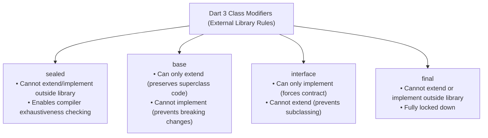

# Class Modifiers in Dart 3: `sealed`, `base`, `interface`, `final`

> **Module:** 01-dart-fundamentals  
> **Subsection:** 05-oop-and-type-system  
> **Prerequisites:** [interfaces-and-abstract-classes.md](./interfaces-and-abstract-classes.md)  
> **Official References:** [dart.dev/language/class-modifiers](https://dart.dev/language/class-modifiers)

---

## 1. Introduction

Prior to Dart 3, every class in Dart could be extended, implemented, or instantiated by any code anywhere, unless manually restricted through convoluted private constructors. This lack of control made it difficult for library authors to guarantee backward compatibility, maintain state machine invariants, or enforce algebraic data types (ADTs).

**Dart 3 introduced Class Modifiers**, giving developers precise, fine-grained control over how classes can be consumed across library boundaries.

### Why Do We Need Class Modifiers?
1. **Exhaustive Pattern Matching (`sealed`):** Enables the compiler to guarantee at compile time that every possible state or subclass has been handled in a switch expression.
2. **API Stability (`interface`, `base`, `final`):** Protects library authors from breaking changes when adding new methods to a class.
3. **Algebraic Data Types:** Facilitates clean, expressive modeling of domain states (Success, Error, Loading) without external packages.

---

## 2. Core Concepts



### The 6 Class Modifiers in Detail

1. **`sealed` Class:**
   - Designed for defining a **closed, finite set of subtypes** within the same library file.
   - Cannot be instantiated directly (implicitly abstract).
   - Cannot be extended or implemented outside its library.
   - **Superpower:** Gives switch expressions **exhaustiveness checking**. If you omit any subtype in a switch expression, compilation fails!
2. **`base` Class:**
   - Enforces inheritance. External code can **only `extend`** the class, ensuring that the base class's private state, constructors, and method implementations are always preserved.
   - External code **cannot `implement`** a `base` class.
3. **`interface` Class:**
   - Enforces the pure contract pattern. External code can **only `implement`** the interface.
   - External code **cannot `extend`** it. Adding new methods to an `interface class` safely alerts implementers at compile time.
4. **`final` Class:**
   - Completely closes the class hierarchy. External code can neither `extend` nor `implement` the class.
5. **`mixin class`:**
   - A class that can be used both as a normal class (`extends`) and as a mixin (`with`). It cannot have an `extends` clause or declare generative constructors.

---

## 3. Syntax and Implementation

```dart
// bin/class_modifiers_demo.dart

// ==========================================
// 1. SEALED CLASS (Algebraic Data Types)
// ==========================================
sealed class AuthState {}

class Unauthenticated extends AuthState {}

class Authenticating extends AuthState {}

class Authenticated extends AuthState {
  final String userId;
  final String email;
  Authenticated({required this.userId, required this.email});
}

class AuthError extends AuthState {
  final String message;
  AuthError(this.message);
}

// Exhaustive Switch Expression (Compile-time verified!)
String renderAuthBanner(AuthState state) {
  return switch (state) {
    Unauthenticated() => 'Please sign in to access your dashboard.',
    Authenticating() => 'Signing in, please wait...',
    Authenticated(:final email) => 'Welcome back, $email!',
    AuthError(:final message) => 'Authentication failed: $message',
    // No default '_' needed because all 4 sealed subtypes are handled!
  };
}

// ==========================================
// 2. BASE CLASS (Must be extended, cannot be implemented)
// ==========================================
base class SecureStorageService {
  void writeToken(String token) {
    print('Secure token written to OS keychain.');
  }
}

// ==========================================
// 3. INTERFACE CLASS (Must be implemented, cannot be extended)
// ==========================================
interface class AnalyticsTracker {
  void trackEvent(String eventName) {
    print('Tracking event: $eventName');
  }
}

// ==========================================
// 4. FINAL CLASS (Completely locked outside library)
// ==========================================
final class SystemKernelConfig {
  final String version = '1.0.0-core';
}

void main() {
  // Testing Sealed Exhaustiveness
  print(renderAuthBanner(Unauthenticated()));
  print(renderAuthBanner(Authenticating()));
  print(renderAuthBanner(Authenticated(userId: 'usr_101', email: 'dev@flutter.dev')));
  print(renderAuthBanner(AuthError('Invalid credentials provided.')));
}
```

### Expected Output
```text
Please sign in to access your dashboard.
Signing in, please wait...
Welcome back, dev@flutter.dev!
Authentication failed: Invalid credentials provided.
```

### Common Mistakes
- **Mistake 1: Subclassing a `sealed` class in another file.**  
  All direct subclasses of a `sealed` class **must** be declared in the exact same library file where the `sealed` class is declared. Defining a subclass in another file causes a compilation error.
- **Mistake 2: Omitting a subtype in a `switch` over a `sealed` class.**  
  If you add a new subtype `class SessionExpired extends AuthState {}` to the file, every switch expression operating on `AuthState` across your entire project will immediately light up with compiler errors until handled.

---

## 4. Capability Matrix Across Library Boundaries

| Modifier | Can Instantiate? | Can Extend Outside? | Can Implement Outside? | Can Mix In Outside? | Exhaustive in Switch? |
|:---|:---:|:---:|:---:|:---:|:---:|
| **`class`** (standard) | Yes | Yes | Yes | No | No |
| **`base class`** | Yes | **Yes** | **No** | No | No |
| **`interface class`** | Yes | **No** | **Yes** | No | No |
| **`final class`** | Yes | **No** | **No** | No | No |
| **`sealed class`** | **No** (Implicitly abstract) | **No** (Same file only) | **No** (Same file only) | No | **Yes (Compile-time)** |
| **`mixin class`** | Yes | Yes | Yes | **Yes** | No |

---

## 5. Interview Preparation

### Frequently Asked Questions

#### Q1: Why is `sealed class` revolutionary for state management in Flutter?
- **Answer:** Before Dart 3, state modeling (like BLoC or Riverpod states) required third-party packages or manual runtime checks. With `sealed class`, the Dart compiler knows the complete, closed set of all possible states. In your UI `build()` method, a switch expression over a sealed state guarantees that if a developer adds a new state (e.g. `EmptyState`), the compiler flags all unhandled UI branches at compile time, eliminating missing state bugs.

#### Q2: What problem does the `base class` modifier solve for library authors?
- **Answer:** If a library author publishes a class and users `implement` it, any future addition of a method to that class is a **breaking change** that breaks all user code (because `implements` requires implementing all methods). By marking the class as `base class`, the author forbids `implements` while allowing `extends`. The author can now safely add concrete methods to the base class without breaking subclasses.

---

## 6. Practice Exercises

### Exercise 1 (Beginner): Sealed Network State
Create a `sealed class NetworkResult<T>` with three subclasses: `Success<T>`, `Failure<T>`, and `Loading<T>`. Write a function that handles all three exhaustively in a switch expression.

---

## 7. References
- [Dart Official Language Guide: Class Modifiers](https://dart.dev/language/class-modifiers)
- [Dart 3 Deep Dive on Patterns and Sealed Classes](https://medium.com/dartlang/dart-3-alpha-f1458e6dcb4a)
