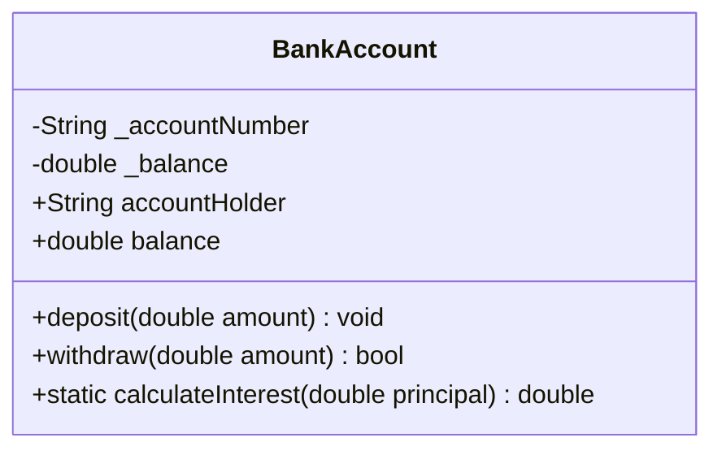

# Classes and Objects in Dart

> **Module:** 01-dart-fundamentals  
> **Subsection:** 05-oop-and-type-system  
> **Prerequisites:** [01-basics-and-syntax/](../01-basics-and-syntax/)  
> **Official References:** [dart.dev/language/classes](https://dart.dev/language/classes) | [dart.dev/language/methods](https://dart.dev/language/methods)

---

## 1. Introduction

Dart is a pure **Object-Oriented Programming (OOP)** language. Every value in Dart is an object, and every object is an instance of a class. All classes ultimately descend from the root class `Object` (or `Object?`).

Dart's approach to OOP combines classical class-based inheritance with modern conveniences such as **implicit interfaces**, **mixins**, and **library-level encapsulation**.

### Why Do We Need Classes and Objects?
1. **Encapsulation:** Bundles state (fields) and behavior (methods) together while shielding internal representation from unauthorized outside manipulation.
2. **Domain Modeling:** Models real-world entities (e.g. `User`, `Product`, `Transaction`) cleanly within your application architecture.
3. **Flutter Widget Blueprinting:** Every Flutter widget (`StatelessWidget`, `StatefulWidget`, `InheritedWidget`) is an immutable or lifecycle-managed class.

---

## 2. Core Concepts



### 1. Library-Level Encapsulation (Privacy via `_`)
Unlike Java, C++, or C# which use keywords like `private`, `protected`, and `public`, Dart enforces privacy using a **leading underscore (`_`)**:
- Any identifier starting with `_` (e.g., `_balance`, `_fetchData()`) is **private to its containing library (file)**.
- **Crucial Nuance:** Privacy in Dart is at the **library (file) level**, not class level. Two classes defined in the same `.dart` file can access each other's `_private` members.

### 2. Getters and Setters (`get` and `set`)
Getters and setters allow you to wrap property access with custom validation or computation without breaking public API contracts:
```dart
double get balance => _balance;
set balance(double value) {
  if (value < 0) throw ArgumentError('Balance cannot be negative');
  _balance = value;
}
```

### 3. Static Members
Static variables and methods belong to the **class itself** rather than any individual instance. They are loaded lazily into memory and are ideal for global constants, utilities, and cache containers.

---

## 3. Syntax and Implementation

```dart
// bin/classes_demo.dart

class BankAccount {
  // Public instance field
  final String accountHolder;

  // Private instance field (library-private)
  final String _accountNumber;
  double _balance;

  // Static constant
  static const double minimumOpeningDeposit = 25.0;

  // Constructor
  BankAccount({
    required this.accountHolder,
    required String accountNumber,
    double initialDeposit = minimumOpeningDeposit,
  })  : _accountNumber = accountNumber,
        _balance = initialDeposit {
    if (initialDeposit < minimumOpeningDeposit) {
      throw ArgumentError('Opening deposit must be at least \$$minimumOpeningDeposit');
    }
  }

  // Getter: Exposes balance in read-only manner
  double get balance => _balance;

  // Getter: Formatted masked account number
  String get maskedAccountNumber {
    final last4 = _accountNumber.substring(_accountNumber.length - 4);
    return '****-****-$last4';
  }

  // Instance Method: Deposit
  void deposit(double amount) {
    if (amount <= 0) {
      throw ArgumentError('Deposit amount must be positive');
    }
    _balance += amount;
    print('Deposited \$$amount into $maskedAccountNumber. New Balance: \$$_balance');
  }

  // Instance Method: Withdraw
  bool withdraw(double amount) {
    if (amount <= 0 || amount > _balance) {
      print('Withdrawal of \$$amount rejected. Insufficient funds.');
      return false;
    }
    _balance -= amount;
    print('Withdrew \$$amount from $maskedAccountNumber. Remaining Balance: \$$_balance');
    return true;
  }

  // Static Helper Method
  static double estimateInterest(double principal, double annualRatePercent, int years) {
    return principal * (annualRatePercent / 100) * years;
  }

  @override
  String toString() => 'BankAccount(holder: $accountHolder, account: $maskedAccountNumber, balance: \$$_balance)';
}

void main() {
  final account = BankAccount(
    accountHolder: 'Dash Bird',
    accountNumber: '123456789012',
    initialDeposit: 150.0,
  );

  print('Account Summary: $account');
  print('Masked Number:   ${account.maskedAccountNumber}');
  print('Current Balance: \$${account.balance}');

  account.deposit(50.0);
  account.withdraw(75.0);
  account.withdraw(500.0); // Fails safely

  // Calling static method
  final interest = BankAccount.estimateInterest(account.balance, 5.0, 3);
  print('Estimated 3-Year 5% Interest: \$$interest');
}
```

### Expected Output
```text
Account Summary: BankAccount(holder: Dash Bird, account: ****-****-9012, balance: $150.0)
Masked Number:   ****-****-9012
Current Balance: $150.0
Deposited $50.0 into ****-****-9012. New Balance: $200.0
Withdrew $75.0 from ****-****-9012. Remaining Balance: $125.0
Withdrawal of $500.0 rejected. Insufficient funds.
Estimated 3-Year 5% Interest: $18.75
```

### Common Mistakes
- **Mistake 1: Looking for `private` or `public` keywords.**  
  Dart does not have `private` or `public`. Writing `private String name;` will fail compilation. Use `_name`.
- **Mistake 2: Writing redundant getters and setters.**  
  If a getter/setter merely gets and sets a private field without any logic or validation:
  ```dart
  // AVOID THIS REDUNDANT BOILERPLATE:
  int _count = 0;
  int get count => _count;
  set count(int val) => _count = val;

  // IDIOMATIC DART:
  int count = 0; // Use a public field directly!
  ```
  In Dart, you can turn a public field into a getter/setter pair later without breaking external call sites.

---

## 4. Comparison: Dart Library Privacy vs Java Class Modifiers

| Dimension | Dart Encapsulation | Java / C# Encapsulation |
|:---|:---|:---|
| **Privacy Scope** | **Library (file) level** | Class level |
| **Privacy Indicator** | Leading underscore prefix (`_`) | Explicit keywords (`private`, `protected`) |
| **Same File Access** | Multiple classes in same file can access private fields | Cannot access private fields of sibling classes |
| **Package-Private** | Export / part files control visibility | Default package-private access |
| **Field to Getter Migration** | Seamless without breaking client call sites | Requires recompiling or refactoring clients |

---

## 5. Interview Preparation

### Frequently Asked Questions

#### Q1: How does encapsulation in Dart differ from Java or C++?
- **Short Answer:** Dart does not have `private` or `protected` keywords. Privacy is indicated with a leading underscore (`_`) and is enforced at the **library (file) level**, not at the class level.
- **Detailed Answer:** In Java, a `private` member cannot be accessed by any other class, even if both reside in the same file. In Dart, any class in the same file can access `_private` fields of another class in that file. To make a member truly private from external code in Dart, it must be declared with a leading underscore and placed in its own library/file.

#### Q2: What is the uniform access principle in Dart regarding fields and getters?
- **Answer:** In Dart, calling a getter looks identical to accessing a public field (both use `object.propertyName`). You never write `object.getPropertyName()`. This allows starting with a simple public field and later replacing it with a getter and setter if validation or lazy computation becomes necessary, without changing a single line of client calling code.

---

## 6. Practice Exercises

### Exercise 1 (Beginner): Temperature Converter Class
Create a `Temperature` class with:
- A private field `double _celsius`.
- A getter `double get fahrenheit` that computes `(_celsius * 9 / 5) + 32`.
- A setter `set fahrenheit(double f)` that converts back and updates `_celsius`.

---

## 7. References
- [Dart Official Language Guide: Classes](https://dart.dev/language/classes)
- [Effective Dart: Design (Members & Properties)](https://dart.dev/effective-dart/design#members)
