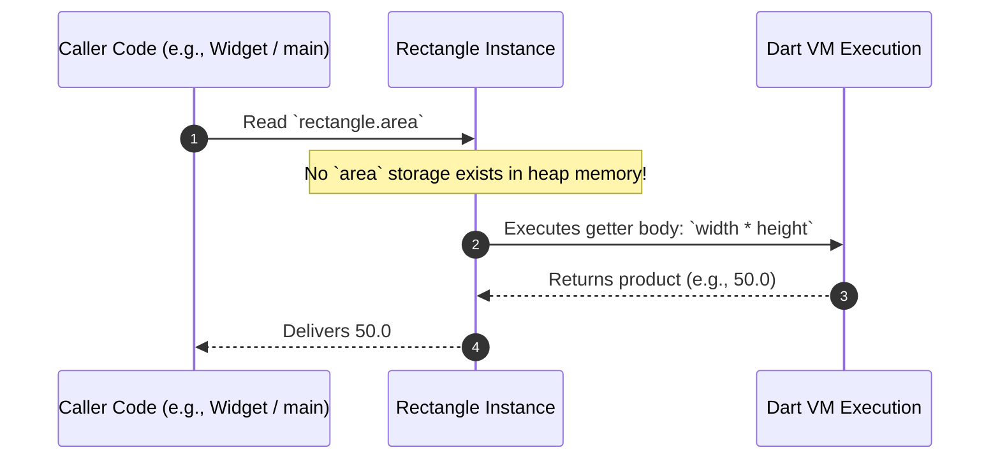
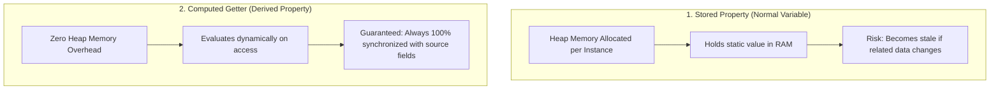
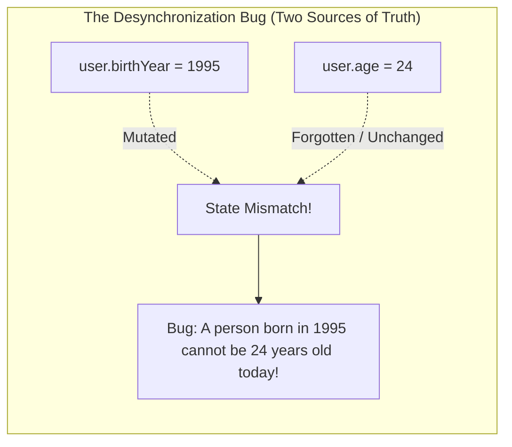
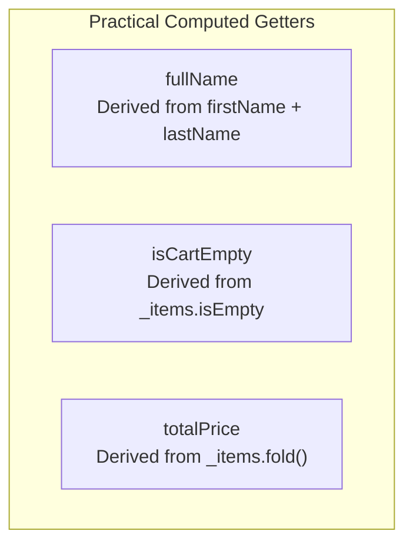
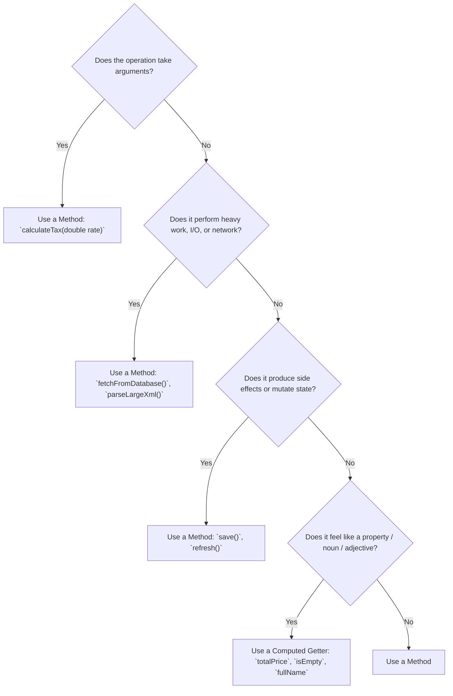

# Computed Getters in Dart & Flutter: Comprehensive Guide

> **Module:** 01-dart-fundamentals  
> **Subsection:** 05-oop-and-type-system  
> **Prerequisites:** [classes-and-objects.md](./classes-and-objects.md)  
> **Official References:** [dart.dev/language/methods#getters-and-setters](https://dart.dev/language/methods#getters-and-setters) | [dart.dev/effective-dart/design#getters](https://dart.dev/effective-dart/design#getters)

---

## 1. Introduction: What Are Computed Getters?

### 1.1 What Is a Getter in Dart?
In Dart, a **getter** is a special method that retrieves the value of a property. Unlike standard methods, getters take **zero arguments** and are accessed using standard property dot notation **without parentheses**:

```dart
// Accessing a getter looks identical to accessing a variable:
print(user.fullName); // Correct: dot notation without ()
// print(user.fullName()); // Syntax Error! Getters are not invoked with ()
```

Getters are declared using the `get` keyword between the return type and the identifier:

```dart
ReturnType get propertyName => expression;
// OR with a block body:
ReturnType get propertyName {
  // statements
  return value;
}
```

---

### 1.2 What Is a Computed Getter?
A **computed getter** (also called a *derived property* or *virtual property*) is a getter whose return value is **calculated dynamically on the fly** from other existing fields or expressions, rather than merely returning a private backing field.

```dart
class Rectangle {
  double width;
  double height;

  Rectangle(this.width, this.height);

  // Computed Getter: calculates area dynamically whenever accessed
  double get area => width * height;
}
```

Notice that `Rectangle` does **not** store an `area` variable. Instead, whenever any code reads `rectangle.area`, Dart executes the multiplication `width * height` at that exact moment and returns the fresh result.

---

### 1.3 How Does Dart Execute a Getter?
Under the hood, Dart does not distinguish between fields and getters for outside consumers. This is known as the **Uniform Access Principle**:
- When you read `object.someField`, Dart invokes an implicit getter generated by the compiler.
- When you define an explicit `get someProperty => ...`, Dart compiles it into a regular instance method call without parameter brackets.



---

### 1.4 Does a Computed Getter Store Its Result in Memory?
**No.** A computed getter allocates **zero instance memory (0 bytes of heap state)** in your object. 

- It does **not** cache or memorize the result by default.
- Every single time you access the getter, its body runs anew.
- If you access `rectangle.area` five times in a loop, Dart performs the multiplication five times.

---

### 1.5 Stored Property vs. Computed Getter



| Dimension | Stored Property (`double area = 50.0;`) | Computed Getter (`double get area => width * height;`) |
|:---|:---|:---|
| **Memory Allocation** | Allocates storage in every object instance (8 bytes for double) | **0 bytes** of instance state; only executable bytecode |
| **Calculation Timing** | Calculated once during assignment | Calculated **on demand** every time property is read |
| **Data Freshness** | Can become out-of-sync if source dependencies change | **Always fresh**; reflects latest values of its dependencies |
| **Execution Cost on Read** | Immediate $O(1)$ memory lookup | Runs getter code ($O(1)$ for simple arithmetic/string interpolation) |
| **Mutation** | Can be reassigned directly (`rect.area = 100;`) | Read-only unless accompanied by an explicit `set area(...)` |

---

## 2. Real-World Case Study: Birth Year vs. Age

To understand why computed getters are vital in software architecture, let us analyze a common mistake made by beginner developers: **storing two mutually dependent values in memory**.

### 2.1 The Bad Approach: Storing Two Dependent Values

```dart
class User {
  int birthYear;
  int age;

  User({required this.birthYear, required this.age});
}
```

#### What goes wrong here? (The Synchronization Problem)
Imagine this scenario in production code:

```dart
void main() {
  final user = User(birthYear: 2000, age: 24);

  // Scenario A: The user corrects a typo in their profile
  user.birthYear = 1995;

  print(user.birthYear); // 1995
  print(user.age);       // 24  <-- BUG! State desynchronization!
}
```



1. **State Desynchronization:** We created **two separate sources of truth** for the same underlying fact. Whenever `birthYear` is updated, `age` becomes stale unless the developer remembers to manually update `age` everywhere in the codebase.
2. **Temporal Invalidation:** Even if `birthYear` never changes, as time moves forward and New Year's Day passes, the stored `age` integer becomes incorrect.

---

### 2.2 The Better Approach: Computed Getter (Single Source of Truth)

By eliminating the stored `age` variable and replacing it with a computed getter, we establish a **Single Source of Truth (SSOT)**:

```dart
class User {
  int birthYear;

  User({required this.birthYear});

  // Computed Getter: Derived dynamically from birthYear
  int get approximateAge => DateTime.now().year - birthYear;
}

void main() {
  final user = User(birthYear: 2000);
  print(user.approximateAge); // 24 (assuming current year is 2024)

  // When birthYear changes, approximateAge is immediately and automatically correct!
  user.birthYear = 1995;
  print(user.approximateAge); // 29 (instant synchronization with ZERO extra code!)
}
```

#### Why This Approach Avoids Bugs:
- It is physically impossible for `approximateAge` to be out of sync with `birthYear`.
- The object uses less memory (no integer slot for `age`).
- There is only one place to test, update, and maintain.

---

### 2.3 Beyond Approximate Age: Exact Age Calculation

`DateTime.now().year - birthYear` is only an **approximate** age because it assumes the user has already celebrated their birthday in the current calendar year. If someone was born on December 31, 2000, and today is June 1, 2024, they are still 23 years old, not 24!

Here is how an experienced engineer writes the exact age computed getter:

```dart
class User {
  final String name;
  final DateTime birthDate;

  User({required this.name, required this.birthDate});

  /// Computed getter calculating exact calendar age
  int get age {
    final today = DateTime.now();
    int calculatedAge = today.year - birthDate.year;

    // If birthday hasn't occurred yet this year, subtract 1
    final hasHadBirthdayThisYear = today.month > birthDate.month ||
        (today.month == birthDate.month && today.day >= birthDate.day);

    if (!hasHadBirthdayThisYear) {
      calculatedAge--;
    }

    return calculatedAge;
  }
}
```

---

## 3. Practical Dart Examples

Let us dissect three common production patterns where computed getters shine.



### 3.1 Example 1: Full Name

```dart
class UserProfile {
  String firstName;
  String lastName;

  UserProfile({required this.firstName, required this.lastName});

  // Computed Getter
  String get fullName => '$firstName $lastName';
}
```

- **What data is stored?** Two separate strings: `firstName` and `lastName`.
- **What value is calculated?** A concatenated string containing both names separated by a space.
- **Why is a getter suitable?** String interpolation is extremely cheap ($O(1)$) and `fullName` conceptually represents a property of the user, not an action.
- **What problem does it prevent?** Prevents having to manually update a `fullName` variable whenever the user edits their first name or last name in a profile settings screen.

---

### 3.2 Example 2: Empty Cart Check

```dart
class CartItem {
  final String name;
  final double price;
  const CartItem(this.name, this.price);
}

class ShoppingCart {
  final List<CartItem> _items = [];

  // Computed Getter: Encapsulates collection state
  bool get isCartEmpty => _items.isEmpty;

  void addItem(CartItem item) => _items.add(item);
  void clear() => _items.clear();
}
```

- **What data is stored?** The internal list `_items`.
- **What value is calculated?** A boolean indicating whether `_items.length == 0`.
- **Why is a getter suitable?** `_items.isEmpty` is an instantaneous $O(1)$ property check.
- **What problem does it prevent?** Eliminates maintaining a separate `bool isEmpty` flag that would have to be manually toggled inside `addItem()`, `removeItem()`, and `clear()`. Forgetting to update such a flag is a notorious source of UI display bugs.

---

### 3.3 Example 3: Total Price Calculation

```dart
class OrderItem {
  final String title;
  final double price;
  final int quantity;

  const OrderItem({required this.title, required this.price, required this.quantity});

  // Computed Getter for single line-item subtotal:
  double get subtotal => price * quantity;
}

class Order {
  final List<OrderItem> items;

  Order(this.items);

  // Computed Getter: Aggregates collection values
  double get totalPrice =>
      items.fold(0.0, (sum, item) => sum + item.subtotal);
}
```

- **What data is stored?** A list of `OrderItem` objects, each with `price` and `quantity`.
- **What value is calculated?** The cumulative financial sum using `fold()`.
- **Why is a getter suitable?** The total price of an order is inherently derived from its items. Reading `order.totalPrice` reads like natural English.
- **What problem does it prevent?** Prevents price discrepancies. If an item quantity changes or an item is deleted, `totalPrice` automatically calculates the exact new sum without manual recalculation routines.

---

## 4. In-Depth Concepts & Architectural Comparisons

### 4.1 Computed Getters vs. Normal (Backing Field) Getters

Not all getters are computed getters! In Dart, getters are frequently used simply to expose a private variable in a read-only fashion:

```dart
class BankAccount {
  // Stored private field
  double _balance;

  BankAccount(this._balance);

  // 1. Normal Getter (Backing Field Wrapper):
  // Does NO calculation. Simply returns the stored _balance.
  double get balance => _balance;

  // 2. Computed Getter:
  // Performs dynamic calculation from other data. No _interestAccrued field exists!
  double get interestAccrued => _balance * 0.05;
}
```

---

### 4.2 Getters vs. Methods: How to Choose?

A classic dilemma for developers is: *"Should this be `double get total` or `double getTotal()`?"*

The official Dart style guide (**Effective Dart**) provides clear rules:



| Criterion | Computed Getter (`get value`) | Method (`value()`) |
|:---|:---|:---|
| **Syntax** | Property access: `user.age` | Function call: `user.calculateAge()` |
| **Parameters** | **Never** takes parameters | Can take 0 or more parameters |
| **Side Effects** | **Must be side-effect free** (reading property should not mutate other state) | May have side effects (modifying fields, logging, sending events) |
| **Performance Expectation** | Expected to be **fast ($O(1)$ or small iteration)** | Caller expects potential computation or delay |
| **Semantics** | Noun or adjective representing an **attribute** | Verb representing an **action** |

---

### 4.3 Getters vs. Setters

- A **Getter** defines how a property is read: `Type get name => ...;`
- A **Setter** defines how a property is written: `set name(Type value) { ... }`

You can pair a computed getter with a custom setter to create flexible virtual properties:

```dart
class Temperature {
  double celsius;

  Temperature(this.celsius);

  // Computed Getter: Fahrenheit derived from Celsius
  double get fahrenheit => (celsius * 9 / 5) + 32;

  // Computed Setter: Translates incoming Fahrenheit back into stored Celsius!
  set fahrenheit(double value) {
    celsius = (value - 32) * 5 / 9;
  }
}

void main() {
  final temp = Temperature(0);
  print(temp.fahrenheit); // 32.0

  // Mutating the virtual property:
  temp.fahrenheit = 212.0;
  print(temp.celsius);    // 100.0 (Celsius updated automatically!)
}
```

---

### 4.4 When to Use vs. When NOT to Use Computed Getters

#### ✅ When TO Use Computed Getters:
1. **Lightweight derived state:** Combining strings, booleans, simple arithmetic, or small list checks (`isEmpty`, `length`).
2. **Boolean UI conditions:** `bool get isSubmitEnabled => isEmailValid && isPasswordValid;`
3. **Enum formatting / Badges:** `String get statusBadge => switch (status) { ... };`
4. **Encapsulating collections:** Exposing `bool get hasItems => _items.isNotEmpty;` without exposing the mutable list itself.

#### ❌ When NOT to Use Computed Getters:
1. **Asynchronous Operations:** Getters are strictly synchronous. A getter cannot return `Future<T>` cleanly in UI property bindings:
   ```dart
   // ❌ BAD PRACTICE: Looks like a cheap property, but hides network latency!
   Future<User> get currentUser => api.fetchUser(); 
   // ✅ GOOD: Use an explicit method name indicating network work:
   Future<User> fetchCurrentUser() => api.fetchUser();
   ```
2. **Expensive $O(N^2)$ or Heavy CPU Algorithms:** If computing the value takes 50 milliseconds (e.g., sorting 100,000 items or processing an image), using a getter is dangerous because callers expect property access to be instantaneous.
3. **Operations with Side Effects:** Accessing a getter should never increment counters, write to disk, or trigger network analytics.

---

### 4.5 The Caching & Memoization Pattern for Expensive Getters

If a calculation is moderately expensive (e.g., parsing a complex regex or transforming a dataset) and accessed frequently, you can cache (memoize) the computed result and invalidate it only when source inputs mutate:

```dart
class Document {
  String _content;
  int? _cachedWordCount; // Cache variable

  Document(this._content);

  set content(String newContent) {
    _content = newContent;
    _cachedWordCount = null; // Invalidate cache when content changes!
  }

  // Memoized Getter: Calculates once, then returns cached value
  int get wordCount {
    _cachedWordCount ??= _content.trim().split(RegExp(r'\s+')).length;
    return _cachedWordCount!;
  }
}
```

---

## 5. Flutter Applications: Enhancing UI Readability & Maintainability

Flutter is a **declarative framework**. Your UI is a direct mathematical projection of your state:

$$\text{UI} = f(\text{State})$$

Computed getters are the secret weapon of clean Flutter architectures. They prevent your widget `build()` methods from becoming bloated with raw business logic and nested ternary operators.


---

### 5.1 Flutter Example 1: Form Validation & Submit Button State

#### The Ugly Way (Logic cluttered inside the widget tree):
```dart
// ❌ Cluttered build() method:
ElevatedButton(
  onPressed: (_email.contains('@') && _password.length >= 8 && _agreeToTerms)
      ? () => _submit()
      : null,
  child: const Text('Register'),
)
```

#### The Clean Architecture Way (Using Computed Getters in State/Controller):
```dart
class RegistrationFormState {
  String email = '';
  String password = '';
  bool agreeToTerms = false;

  // Clean Computed Getters:
  bool get isEmailValid => email.contains('@') && email.contains('.');
  bool get isPasswordValid => password.length >= 8;
  
  // High-level composite getter:
  bool get canSubmit => isEmailValid && isPasswordValid && agreeToTerms;
  
  // UI helper getter:
  String? get passwordErrorText {
    if (password.isEmpty) return null;
    if (!isPasswordValid) return 'Password must be at least 8 characters';
    return null;
  }
}

// In Flutter Widget:
Widget build(BuildContext context) {
  return Column(
    children: [
      TextField(
        decoration: InputDecoration(errorText: form.passwordErrorText),
        onChanged: (val) => setState(() => form.password = val),
      ),
      ElevatedButton(
        // Crystal-clear intent!
        onPressed: form.canSubmit ? _submit : null,
        child: const Text('Register'),
      ),
    ],
  );
}
```

---

### 5.2 Flutter Example 2: Dynamic UI Theming & Status Badges

Computed getters allow UI models to declare their own visual representations cleanly:

```dart
enum OrderStatus { pending, shipped, delivered, cancelled }

class OrderSummary {
  final String orderId;
  final OrderStatus status;

  OrderSummary({required this.orderId, required this.status});

  // Computed Getter: returns visual Material 3 color based on state
  Color get statusColor => switch (status) {
        OrderStatus.pending => Colors.orange,
        OrderStatus.shipped => Colors.blue,
        OrderStatus.delivered => Colors.green,
        OrderStatus.cancelled => Colors.red,
      };

  // Computed Getter: human-readable label
  String get statusLabel => switch (status) {
        OrderStatus.pending => 'Awaiting Shipment',
        OrderStatus.shipped => 'In Transit',
        OrderStatus.delivered => 'Delivered',
        OrderStatus.cancelled => 'Cancelled by Customer',
      };
}

// In Flutter Widget:
Widget build(BuildContext context) {
  return Chip(
    label: Text(order.statusLabel),
    backgroundColor: order.statusColor.withOpacity(0.15),
    labelStyle: TextStyle(color: order.statusColor, fontWeight: FontWeight.bold),
  );
}
```

---

### 5.3 Flutter Example 3: Filtered Lists in View Models

In state management (such as ChangeNotifier, Riverpod, or BLoC), computed getters derive filtered sub-lists on the fly without duplicating items in RAM:

```dart
class Task {
  final String title;
  final bool isCompleted;
  const Task(this.title, {this.isCompleted = false});
}

class TaskListViewModel extends ChangeNotifier {
  final List<Task> _tasks = [];

  List<Task> get allTasks => List.unmodifiable(_tasks);

  // Computed Getters for active and completed tabs:
  List<Task> get pendingTasks =>
      _tasks.where((t) => !t.isCompleted).toList();

  List<Task> get completedTasks =>
      _tasks.where((t) => t.isCompleted).toList();

  int get pendingCount => pendingTasks.length;
  
  double get completionPercentage =>
      _tasks.isEmpty ? 0.0 : completedTasks.length / _tasks.length;
}
```

---

## 6. Common Mistakes & Pitfalls (Watch Out!)

### Mistake 1: Accidental Infinite Recursion (Stack Overflow)
A very common beginner typo is naming a getter identically to an internal expression without using a distinct backing field:

```dart
// ❌ WRONG: Infinite loop! The getter calls ITSELF until memory exhausts!
class BadCounter {
  int get count => count + 1; // Crash: Stack Overflow!
}

// ✅ CORRECT: Reference a distinct backing variable or dependency
class GoodCounter {
  int _internalCount = 0;
  int get count => _internalCount + 1;
}
```

---

### Mistake 2: Mutating State Inside a Getter
A getter should **never** alter the state of the object. Calling a getter must be idempotent (calling it 10 times in a row should produce the same result and leave the system in the same state).

```dart
// ❌ WRONG: Reading a property modifies other state!
class BadAccount {
  int _accessCount = 0;
  double _balance = 100.0;

  double get balance {
    _accessCount++; // VIOLATION! Side effect inside a getter!
    return _balance;
  }
}
```

---

### Mistake 3: Expensive Computations in Flutter `build()` Getters
In Flutter, widget `build()` methods are executed up to 60 or 120 times every second during animations or scrolling. If a getter performs heavy parsing or sorting, frame drops (jank) will occur:

```dart
// ❌ DANGEROUS: Re-sorting 5,000 items on every single frame tick!
List<Item> get sortedItems {
  final list = List<Item>.from(_rawItems);
  list.sort((a, b) => a.heavyComparison(b));
  return list;
}

// ✅ SOLUTION: Sort once when data changes, or memoize using a cached field!
```

---

## 7. High-Frequency Interview Questions

### Q1: What happens under the hood when you access a computed getter in Dart?
**Answer:**  
In Dart, accessing a getter is syntactically identical to accessing a public field (e.g. `obj.total`), but under the hood the Dart compiler translates the property read into an argument-free method invocation. The body of the getter executes synchronously on the call stack, computing and returning the value immediately without reading from a stored memory offset.

---

### Q2: How does a computed getter help maintain a "Single Source of Truth"?
**Answer:**  
By deriving secondary or dependent values (such as `fullName` from `firstName` and `lastName`, or `age` from `birthDate`) dynamically, you eliminate the need to store and manually synchronize multiple related variables. If the underlying source data changes, the computed getter automatically reflects the updated reality on its next access, preventing state desynchronization bugs.

---

### Q3: When should you prefer a zero-argument method over a computed getter?
**Answer:**  
Follow the **Effective Dart** conventions: prefer a method when the operation is computationally expensive (e.g. $> O(1)$ complexity like sorting a large collection), performs I/O or network requests, returns a `Future`, has observable side effects, or where the concept represents a verb/action rather than an inherent property/noun of the object.

---

## 8. Practice Exercises

Try solving these exercises on your own before checking the hints and solutions below!

### 8.1 Beginner Exercises

1. **Circle Geometry:**  
   Create a `Circle` class with a `double radius` field. Add two computed getters:
   - `diameter`: returns $2 \times \text{radius}$.
   - `circumference`: returns $2 \times \pi \times \text{radius}$ (use `3.14159` or `dart:math`).

2. **Temperature Converter:**  
   Create a `WeatherReport` class that holds `double temperatureInCelsius`. Add a computed getter `temperatureInFahrenheit` that calculates $(C \times 9/5) + 32$.

3. **Greeting Generator:**  
   Create a `Customer` class with `String name` and `bool isVip`. Add a computed getter `greeting` that returns `"Welcome back, VIP [Name]!"` if `isVip` is true, or `"Welcome, [Name]!"` otherwise.

4. **Discounted Price:**  
   Create a `Product` class with `double originalPrice` and `double discountPercentage` (e.g., `20.0` for 20%). Add a computed getter `finalPrice` that calculates the discounted total.

5. **Word Counter:**  
   Create a `Tweet` class that stores `String text`. Add a computed getter `remainingCharacters` that calculates $280 - \text{text.length}$.

---

### 8.2 Intermediate Exercises

6. **BMI Health Calculator:**  
   Create a `HealthProfile` class taking `double weightInKg` and `double heightInMeters`. Add:
   - Computed getter `bmi`: calculated as $\frac{\text{weight}}{\text{height}^2}$.
   - Computed getter `category`: returns `'Underweight'` if BMI $< 18.5$, `'Normal'` if $18.5 \le \text{BMI} < 25$, `'Overweight'` if $25 \le \text{BMI} < 30$, and `'Obese'` otherwise.

7. **Paginated Feed Model:**  
   Create a `FeedState` class containing `List<String> allPosts` and `int itemsPerPage = 10`. Add a computed getter `totalPages` that calculates the total number of pages required (rounded up), returning `0` if `allPosts` is empty.

8. **Flutter Form Validation Suite:**  
   Create a `CheckoutFormValidator` class with fields `String cardNumber`, `String expiryDate`, and `String cvv`. Implement three individual validation computed getters (`isCardNumberValid`, `isExpiryValid`, `isCvvValid`), and one composite computed getter `isReadyForPayment`.

---

### 8.3 Hints

- *Hint for Exercise 1:* Use standard multiplication. Arrow syntax `=>` makes one-line math very clean.
- *Hint for Exercise 4:* Discount amount is `originalPrice * (discountPercentage / 100)`.
- *Hint for Exercise 6:* Use Dart 3 pattern matching or a clean `if-else` chain inside the `category` getter.
- *Hint for Exercise 7:* Integer division ceiling can be calculated with `(allPosts.length / itemsPerPage).ceil()`.

---

### 8.4 Solutions

<details>
<summary>👉 Click to view solutions</summary>

#### Solution 1: Circle
```dart
import 'dart:math' as math;

class Circle {
  double radius;
  Circle(this.radius);

  double get diameter => radius * 2;
  double get circumference => 2 * math.pi * radius;
}
```

#### Solution 2: Weather Report
```dart
class WeatherReport {
  double temperatureInCelsius;
  WeatherReport(this.temperatureInCelsius);

  double get temperatureInFahrenheit => (temperatureInCelsius * 9 / 5) + 32;
}
```

#### Solution 3: Customer Greeting
```dart
class Customer {
  String name;
  bool isVip;

  Customer(this.name, {this.isVip = false});

  String get greeting =>
      isVip ? 'Welcome back, VIP $name!' : 'Welcome, $name!';
}
```

#### Solution 4: Product Discount
```dart
class Product {
  double originalPrice;
  double discountPercentage;

  Product(this.originalPrice, this.discountPercentage);

  double get finalPrice =>
      originalPrice * (1 - (discountPercentage / 100));
}
```

#### Solution 5: Tweet Counter
```dart
class Tweet {
  String text;
  Tweet(this.text);

  int get remainingCharacters => 280 - text.length;
}
```

#### Solution 6: BMI Health Calculator
```dart
class HealthProfile {
  double weightInKg;
  double heightInMeters;

  HealthProfile({required this.weightInKg, required this.heightInMeters});

  double get bmi {
    if (heightInMeters <= 0) return 0.0;
    return weightInKg / (heightInMeters * heightInMeters);
  }

  String get category => switch (bmi) {
        < 18.5 => 'Underweight',
        >= 18.5 && < 25.0 => 'Normal',
        >= 25.0 && < 30.0 => 'Overweight',
        _ => 'Obese',
      };
}
```

#### Solution 7: Paginated Feed
```dart
class FeedState {
  final List<String> allPosts;
  final int itemsPerPage;

  FeedState(this.allPosts, {this.itemsPerPage = 10});

  int get totalPages {
    if (allPosts.isEmpty || itemsPerPage <= 0) return 0;
    return (allPosts.length / itemsPerPage).ceil();
  }
}
```

#### Solution 8: Checkout Form Validator
```dart
class CheckoutFormValidator {
  String cardNumber = '';
  String expiryDate = '';
  String cvv = '';

  bool get isCardNumberValid =>
      cardNumber.replaceAll(' ', '').length == 16 &&
      int.tryParse(cardNumber.replaceAll(' ', '')) != null;

  bool get isExpiryValid =>
      RegExp(r'^(0[1-9]|1[0-2])\/?([0-9]{2})$').hasMatch(expiryDate);

  bool get isCvvValid =>
      cvv.length == 3 && int.tryParse(cvv) != null;

  bool get isReadyForPayment =>
      isCardNumberValid && isExpiryValid && isCvvValid;
}
```

</details>

---

## 9. Quick Revision & Cheat Sheet

```dart
class QuickCheatSheet {
  String first = 'Jane';
  String last = 'Doe';
  final List<double> prices = [10.0, 25.0];

  // 1. One-line arrow syntax (cheap $O(1)$ operations)
  String get fullName => '$first $last';

  // 2. Block syntax (multi-step logic)
  double get totalWithTax {
    final subtotal = prices.fold(0.0, (sum, p) => sum + p);
    return subtotal * 1.08;
  }

  // 3. Dynamic boolean flags for UI
  bool get hasItems => prices.isNotEmpty;
}
```

### Key Takeaways:
1. **Computed getters calculate values on demand** when accessed and store **no** instance state in memory.
2. **They enforce a Single Source of Truth**, eliminating bugs where two dependent variables fall out of sync.
3. **Use getters for cheap, side-effect-free properties** ($O(1)$). Use methods for expensive computations, network calls, or actions with side effects.
4. **In Flutter, computed getters keep `build()` methods clean and declarative**, making widgets readable, robust, and easy to maintain.
