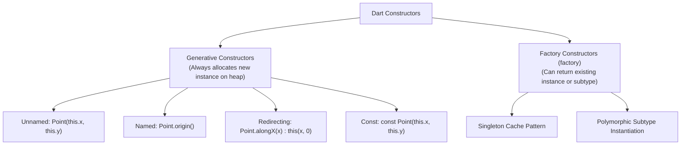

# Constructors in Dart: A Deep Dive

> **Module:** 01-dart-fundamentals  
> **Subsection:** 05-oop-and-type-system  
> **Prerequisites:** [classes-and-objects.md](./classes-and-objects.md)  
> **Official References:** [dart.dev/language/constructors](https://dart.dev/language/constructors)

---

## 1. Introduction

Constructors are special member functions responsible for initializing newly allocated instances of a class. Dart provides one of the most flexible and sophisticated constructor systems among modern languages, featuring **named constructors**, **redirecting constructors**, **constant constructors**, and **factory constructors**.

### Why Do We Need Multiple Constructor Flavors?
1. **Multiple Ways to Instantiate:** Unlike Java or C++ (which rely on method overloading with identical constructor names), Dart provides **named constructors** to clarify intent (e.g. `User.fromJson(map)`, `User.anonymous()`).
2. **Compile-Time Performance:** **`const` constructors** create canonicalized, immutable objects to optimize Flutter rebuilds.
3. **Flexible Instance Resolution:** **`factory` constructors** allow returning existing cached instances (Singleton pattern) or returning instances of a subclass without changing call-site syntax.

---

## 2. Core Concepts



### 1. Initializing Formals (`this.field`)
Dart provides syntax sugar to assign constructor arguments directly to instance fields without manual assignment boilerplate:
```dart
Point(this.x, this.y); // Directly sets fields before constructor body executes
```

### 2. Named Constructors
Disambiguates multiple initialization pathways:
```dart
User.guest() : id = '0', name = 'Guest';
User.fromJson(Map<String, Object?> json) : ...;
```

### 3. Redirecting Constructors
Delegates initialization to another constructor within the same class using `this(...)`:
```dart
Point.origin() : this(0, 0); // Redirects to unnamed generative constructor
```

### 4. Constant Constructors (`const`)
If all instance fields in a class are `final`, the constructor can be declared with `const`. Instances created with `const` are canonicalized in memory.

### 5. Factory Constructors (`factory`)
Unlike generative constructors (which *always* allocate and initialize a fresh instance of the class), a **factory constructor**:
- Does **not** automatically allocate an instance.
- **Must** return an instance of the class (or a subtype).
- Can return an existing instance from a cache or map (Singletons).
- Can return instances of different subclasses based on input parameters.

---

## 3. Syntax and Implementation

```dart
// bin/constructors_demo.dart

abstract class Logger {
  void log(String message);

  // Factory constructor returning different concrete implementations!
  factory Logger.create({bool isProduction = false}) {
    if (isProduction) {
      return ProductionFileLogger._();
    } else {
      return ConsoleLogger._();
    }
  }

  // Factory constructor implementing a Singleton Cache
  static final Map<String, NamedLogger> _namedCache = {};
  factory Logger.named(String name) {
    return _namedCache.putIfAbsent(name, () => NamedLogger._internal(name));
  }
}

class ConsoleLogger implements Logger {
  ConsoleLogger._(); // Private named constructor
  @override
  void log(String message) => print('[Console Debug] $message');
}

class ProductionFileLogger implements Logger {
  ProductionFileLogger._();
  @override
  void log(String message) => print('[Production File Append] $message');
}

class NamedLogger implements Logger {
  final String name;
  NamedLogger._internal(this.name); // Private named constructor

  @override
  void log(String message) => print('[$name] $message');
}

class Point {
  final int x;
  final int y;

  // 1. Const Generative Constructor with initializing formals
  const Point(this.x, this.y);

  // 2. Named Constructor
  const Point.fromCoordinates({required this.x, required this.y});

  // 3. Redirecting Constructor
  const Point.origin() : this(0, 0);

  // 4. Redirecting to named constructor
  const Point.horizontal(int x) : this.fromCoordinates(x: x, y: 0);

  @override
  String toString() => 'Point($x, $y)';
}

void main() {
  // 1. Using Generative & Redirecting Constructors
  const p1 = Point(10, 20);
  const p2 = Point.origin();
  const p3 = Point.horizontal(5);
  print('Points: $p1, $p2, $p3');

  // 2. Factory Constructor: Polymorphic Subtype Creation
  final debugLog = Logger.create(isProduction: false);
  final prodLog = Logger.create(isProduction: true);
  debugLog.log('App starting up in debug mode');
  prodLog.log('Critical telemetry dispatched');

  // 3. Factory Constructor: Singleton / Caching
  final loggerA = Logger.named('AuthService');
  final loggerB = Logger.named('AuthService');
  print('Are loggerA and loggerB identical singleton instances? ${identical(loggerA, loggerB)}'); // true!
}
```

### Expected Output
```text
Points: Point(10, 20), Point(0, 0), Point(5, 0)
[Console Debug] App starting up in debug mode
[Production File Append] Critical telemetry dispatched
Are loggerA and loggerB identical singleton instances? true
```

### Common Mistakes
- **Mistake 1: Trying to access `this` inside a factory constructor.**  
  Factory constructors do not have a newly allocated instance of `this` provided automatically. You must explicitly construct and `return` an instance.
- **Mistake 2: Forgetting to return an object from a factory constructor.**  
  Unlike generative constructors (which have no return statement), a `factory` constructor **must** return an instance using the `return` keyword.
- **Mistake 3: Having a constructor body in a redirecting constructor.**  
  A redirecting constructor cannot have a body `{ ... }`. It must terminate immediately after the redirection `: this(...)`.

---

## 4. Comparison: Generative vs. Factory Constructors

| Feature | Generative Constructor | Factory Constructor (`factory`) |
|:---|:---|:---|
| **Memory Allocation** | Always allocates fresh memory on heap | Can return existing or cached instance |
| **Return Statement** | **Forbidden** (implicitly returns instance) | **Required** (must explicitly `return`) |
| **Return Subtypes?** | No (strictly creates enclosing class) | **Yes** (can return any subtype) |
| **Can be `const`?** | Yes | No (factories execute at runtime) |
| **Has access to `this`?** | Yes (in constructor body) | **No** |
| **Primary Use Cases** | Standard object creation, Flutter widgets | Singletons, caching, polymorphic factories |

---

## 5. Interview Preparation

### Frequently Asked Questions

#### Q1: What is the difference between a factory constructor and a static method in Dart?
- **Short Answer:** A factory constructor looks and behaves syntactically like a normal constructor at call sites (`MyClass()`), can satisfy interfaces, and participates in constructor tear-offs.
- **Detailed Answer:** At call sites, a factory constructor is invoked with constructor syntax (`final client = HttpClient();`), shielding client code from knowing whether the object is a new instance, a cached singleton, or a subclass. A static method must be called explicitly (`HttpClient.create()`). Furthermore, factory constructors can be unnamed (`factory ClassName()`), allowing a class to enforce caching or subtype dispatch through the standard default constructor.

#### Q2: Can a class have both generative and factory constructors?
- **Answer:** **Yes.** In fact, this is the standard pattern. A class often declares a private generative constructor (e.g. `MyClass._internal()`) to perform the actual field initialization, while exposing a public factory constructor (e.g. `factory MyClass()`) that checks a cache and delegates to the private generative constructor when needed.

---

## 6. Practice Exercises

### Exercise 1 (Beginner): Named & Redirecting Constructors
Create a `Rectangle` class with `final double width` and `final double height`.
- Provide an unnamed constructor `Rectangle(this.width, this.height)`.
- Provide a redirecting named constructor `Rectangle.square(double size)` that redirects to the unnamed constructor.

### Exercise 2 (Intermediate): Singleton Factory Pattern
Implement a `DatabaseConnection` class using a `factory DatabaseConnection()` constructor that ensures only a single instance of `DatabaseConnection` is ever created across the lifetime of the program.

---

## 7. References
- [Dart Language Guide: Constructors](https://dart.dev/language/constructors)
- [Dart Language Guide: Factory Constructors](https://dart.dev/language/constructors#factory-constructors)
