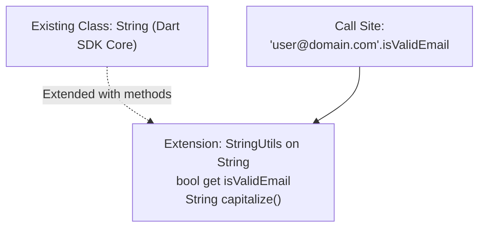

# Extension Methods in Dart

> **Module:** 01-dart-fundamentals  
> **Subsection:** 05-oop-and-type-system  
> **Prerequisites:** [classes-and-objects.md](./classes-and-objects.md)  
> **Official References:** [dart.dev/language/extension-methods](https://dart.dev/language/extension-methods)

---

## 1. Introduction

In traditional object-oriented programming, adding functionality to an existing class requires either modifying the class's source code (impossible for standard SDK or third-party library classes like `String` or `BuildContext`) or creating verbose static utility classes (e.g. `StringUtils.capitalize(str)`).

Dart provides **Extension Methods**, allowing you to add new methods, getters, setters, and operators to **any existing type** without modifying the original class or resorting to subclassing.

### Why Do We Need Extension Methods?
1. **Fluid Fluent API Syntax:** Enables natural dot-notation calls (`'hello'.toCapitalized()`) instead of clumsy wrapper functions (`StringUtils.capitalize('hello')`).
2. **Flutter Context Ergonomics:** Supercharges `BuildContext` with convenient shortcuts like `context.theme`, `context.screenWidth`, and `context.pop()`.
3. **Domain-Specific Utilities:** Extends core collections, numbers, or `DateTime` objects with clean domain-specific business rules.

---

## 2. Core Concepts



### 1. Extension Syntax
Extensions are declared using the `extension` keyword, specifying a target type using the `on` clause:
```dart
extension StringExtensions on String {
  String capitalize() {
    if (isEmpty) return this;
    return '${this[0].toUpperCase()}${substring(1)}';
  }
}
```

### 2. Static Resolution (The Golden Rule)
Extension methods are resolved **statically at compile time**, based on the **static type** of the variable, not its runtime type.
- If a variable is typed as `dynamic`, extension methods **cannot be called** on it!
- If an extension method has the exact same name as an instance method on the class, the class's **instance method always wins**.

### 3. Generic Extensions
You can constrain extensions to generic types:
```dart
extension ListExtensions<T> on List<T> {
  T? get secondOrNull => length >= 2 ? this[1] : null;
}
```

---

## 3. Syntax and Implementation

```dart
// bin/extensions_demo.dart

// 1. Extension on String
extension StringUtils on String {
  // Getter extension
  bool get isValidEmail => contains('@') && contains('.');

  // Method extension
  String capitalize() {
    if (isEmpty) return this;
    return '${this[0].toUpperCase()}${substring(1)}';
  }

  // Operator extension!
  String operator *(int count) => List.filled(count, this).join(' ');
}

// 2. Generic Extension on List<T>
extension CollectionExtensions<T> on List<T> {
  T? get secondOrNull => length >= 2 ? this[1] : null;

  void printNumberedList() {
    for (int i = 0; i < length; i++) {
      print('  ${i + 1}. ${this[i]}');
    }
  }
}

// 3. Extension on DateTime
extension DateTimeFormatting on DateTime {
  String toDateString() => '$year-${month.toString().padLeft(2, '0')}-${day.toString().padLeft(2, '0')}';
}

void main() {
  // 1. Using String extensions
  final emailInput = 'developer@flutter.dev';
  final rawName = 'flutter';

  print('Is "$emailInput" a valid email? ${emailInput.isValidEmail}');
  print('Capitalized: ${rawName.capitalize()}');
  print('Repeated: ${"Dart" * 3}');

  // 2. Using Generic Collection extension
  final frameworks = ['Flutter', 'React Native', 'SwiftUI'];
  print('\nSecond item: ${frameworks.secondOrNull}');
  print('Frameworks roster:');
  frameworks.printNumberedList();

  // 3. Using DateTime extension
  final today = DateTime.now();
  print('\nFormatted Today: ${today.toDateString()}');

  // 4. Demonstrating Static Resolution
  demonstrateStaticResolution();
}

void demonstrateStaticResolution() {
  final String normalStr = 'dash';
  print('\nStatic call: ${normalStr.capitalize()}');

  final dynamic dynamicStr = 'dash';
  // dynamicStr.capitalize(); // RUNTIME ERROR: NoSuchMethodError! (Extensions do not work on dynamic)
}
```

### Expected Output
```text
Is "developer@flutter.dev" a valid email? true
Capitalized: Flutter
Repeated: Dart Dart Dart

Second item: React Native
Frameworks roster:
  1. Flutter
  2. React Native
  3. SwiftUI

Formatted Today: 2026-11-04

Static call: Dash
```

### Common Mistakes
- **Mistake 1: Calling extension methods on `dynamic` variables.**  
  Because extension methods are resolved statically at compile time, the Dart compiler cannot bind them to variables typed as `dynamic`. Always ensure variables have a concrete static type.
- **Mistake 2: Conflict between two imported extensions.**  
  If two imported libraries define an extension with the same method on `String`, you must disambiguate at the call site by wrapping the receiver with the extension name:
  ```dart
  StringUtils(myString).capitalize();
  ```

---

## 4. Practical Example: Flutter `BuildContext` Extension Suite

In production Flutter applications, extension methods on `BuildContext` drastically clean up widget code:

```dart
// lib/context_extensions.dart

class MockBuildContext {
  final Map<String, Object?> _data = {
    'primaryColor': '0xFF02569B',
    'screenWidth': 1080.0,
    'locale': 'en_US',
  };

  Object? lookup(String key) => _data[key];
}

// Enterprise BuildContext extension
extension ContextExtensions on MockBuildContext {
  double get screenWidth => lookup('screenWidth') as double;
  String get primaryColor => lookup('primaryColor') as String;
  String get locale => lookup('locale') as String;

  void showToast(String message) {
    print('Toast on screen ($screenWidth px width): $message');
  }
}

void main() {
  final context = MockBuildContext();

  // Clean, expressive calls directly on context!
  print('Screen Width: ${context.screenWidth}px');
  print('Theme Color:  ${context.primaryColor}');
  context.showToast('Project created successfully!');
}
```

---

## 5. Comparison: Extension Methods vs. Static Utility Class

```dart
// Static Utility Approach:
final email = 'test@domain.com';
final isValid = ValidationUtils.isValidEmail(email);

// Extension Method Approach:
final isValid = email.isValidEmail;
```

| Dimension | Static Utility Class (`Utils.method(x)`) | Extension Method (`x.method()`) |
|:---|:---|:---|
| **Syntax** | Prefix procedural call | **Natural fluent dot notation** |
| **Chaining** | Awkward nesting: `B(A(x))` | **Linear chaining: `x.doA().doB()`** |
| **Discoverability** | Low (must know utility class name) | **High (appears in IDE autocomplete on `.` )** |
| **Dynamic Dispatch** | Works on dynamic if called statically | **Does not work on `dynamic`** |

---

## 6. Interview Preparation

### Frequently Asked Questions

#### Q1: Why can you not invoke an extension method on a variable typed as `dynamic`?
- **Answer:** Extension methods are not true virtual methods placed into the class's dispatch table. Instead, the Dart compiler "desugars" an extension call `str.capitalize()` into a static function call `StringUtils$capitalize(str)`. Because this transformation occurs during static compilation, the compiler must know the static type of the variable to determine which extension applies. With `dynamic`, static type checking is disabled, so the compiler cannot bind the extension.

#### Q2: Can an extension method add stateful instance variables to an existing class?
- **Answer:** **No.** Extension methods can only add methods, getters, setters, and operators. They **cannot** add instance fields with backing storage to a class because that would alter the object's physical memory layout on the heap. You can, however, declare static fields or use an `Expando` to attach external metadata.

---

## 7. Practice Exercises

### Exercise 1 (Beginner): Int Duration Extension
Create an extension on `int` that provides getters:
- `Duration get seconds => Duration(seconds: this);`
- `Duration get minutes => Duration(minutes: this);`  
Verify by printing `5.minutes.inSeconds`.

---

## 8. References
- [Dart Official Language Guide: Extension Methods](https://dart.dev/language/extension-methods)
- [Effective Dart: Usage (Extensions)](https://dart.dev/effective-dart/usage#extension-methods)
