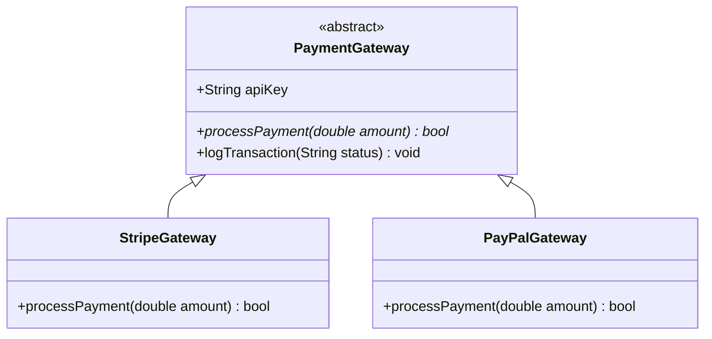

# Inheritance and Polymorphism in Dart

> **Module:** 01-dart-fundamentals  
> **Subsection:** 05-oop-and-type-system  
> **Prerequisites:** [classes-and-objects.md](./classes-and-objects.md)  
> **Official References:** [dart.dev/language/extend](https://dart.dev/language/extend) | [dart.dev/language/methods#abstract-methods](https://dart.dev/language/methods#abstract-methods)

---

## 1. Introduction

Inheritance allows a class (the subclass or derived class) to inherit fields, getters, setters, and methods from another class (the superclass or base class).

**Polymorphism** (Greek for *"many forms"*) allows objects of different concrete subclasses to be treated uniformly through their common superclass type, while dynamically executing their specific overridden behavior at runtime.

### Why Do We Need Inheritance and Polymorphism?
1. **Code Reuse:** Shared logic (e.g. logging, error recovery, base styling) is implemented once in a base class and inherited by all children.
2. **Open-Closed Principle (SOLID):** Systems can be extended with new subclasses without modifying existing client code.
3. **Flutter Framework Foundation:** Every Flutter UI widget extends `StatelessWidget` or `StatefulWidget`, overriding the polymorphic `Widget build(BuildContext context)` method.

---

## 2. Core Concepts



### 1. Single Inheritance (`extends`)
Dart supports **single inheritance**: a class can extend at most one superclass. (To achieve multiple composition, Dart utilizes **mixins** and **implicit interfaces**).

### 2. Method Overriding (`@override`)
A subclass can redefine a method from its superclass by prefixing it with the `@override` annotation. The annotation instructs the Dart compiler to verify that the method actually exists in the superclass, preventing subtle typos.

### 3. Concrete vs. Abstract Methods
- **Concrete Method:** Has a full body `{ ... }` implementing behavior. Subclasses can use it as-is or override it.
- **Abstract Method:** Has no body (ends with a semicolon `;`). Forces subclasses to provide a concrete implementation.

### 4. Calling Superclass Methods (`super.method()`)
A subclass can augment superclass behavior rather than replacing it entirely by invoking `super.method()`. In Flutter, this is mandatory when overriding lifecycle methods like `initState()` and `dispose()`.

---

## 3. Syntax and Implementation

```dart
// bin/inheritance_demo.dart

// Abstract Base Class
abstract class PaymentGateway {
  final String gatewayName;
  final String environment;

  PaymentGateway({required this.gatewayName, this.environment = 'sandbox'});

  // Abstract method: Every gateway MUST implement this
  bool processPayment(double amount);

  // Concrete method: Reusable logic shared across all gateways
  void logAuditTrail(String action, double amount, bool success) {
    final status = success ? 'SUCCESS' : 'FAILED';
    print('[$gatewayName - $environment] $action of \$$amount -> $status');
  }
}

// Subclass 1: Stripe
class StripeGateway extends PaymentGateway {
  final String publishableKey;

  StripeGateway({required this.publishableKey, super.environment})
      : super(gatewayName: 'Stripe Payments');

  @override
  bool processPayment(double amount) {
    print('Connecting to Stripe API with token ($publishableKey)...');
    // Business logic
    final isSuccess = amount <= 5000.0; // Simulate limit
    logAuditTrail('Charge', amount, isSuccess); // Reusing superclass method
    return isSuccess;
  }
}

// Subclass 2: PayPal
class PayPalGateway extends PaymentGateway {
  final String merchantId;

  PayPalGateway({required this.merchantId, super.environment})
      : super(gatewayName: 'PayPal Express');

  @override
  bool processPayment(double amount) {
    print('Redirecting to PayPal Merchant Portal ($merchantId)...');
    // Business logic
    const isSuccess = true;
    logAuditTrail('Express Checkout', amount, isSuccess);
    return isSuccess;
  }
}

// Polymorphic Client Function
void checkoutOrder(PaymentGateway gateway, double orderTotal) {
  print('\nInitiating checkout for \$$orderTotal...');
  // Dynamic dispatch executes the specific gateway's implementation!
  final completed = gateway.processPayment(orderTotal);
  if (completed) {
    print('Order finalized successfully.');
  } else {
    print('Payment failed. Please try a different card.');
  }
}

void main() {
  final stripe = StripeGateway(publishableKey: 'pk_live_stripe_999', environment: 'production');
  final paypal = PayPalGateway(merchantId: 'merchant_paypal_007');

  // Polymorphic execution
  checkoutOrder(stripe, 150.0);
  checkoutOrder(paypal, 85.0);
  checkoutOrder(stripe, 9999.0); // Exceeds Stripe simulated limit
}
```

### Expected Output
```text
Initiating checkout for $150.0...
Connecting to Stripe API with token (pk_live_stripe_999)...
[Stripe Payments - production] Charge of $150.0 -> SUCCESS
Order finalized successfully.

Initiating checkout for $85.0...
Redirecting to PayPal Merchant Portal (merchant_paypal_007)...
[PayPal Express - sandbox] Express Checkout of $85.0 -> SUCCESS
Order finalized successfully.

Initiating checkout for $9999.0...
Connecting to Stripe API with token (pk_live_stripe_999)...
[Stripe Payments - production] Charge of $9999.0 -> FAILED
Payment failed. Please try a different card.
```

### Common Mistakes
- **Mistake 1: Forgetting to call `super.initState()` or `super.dispose()` in Flutter.**  
  In Flutter `State` classes, omitting `super.initState()` or `super.dispose()` prevents framework lifecycle registrations and cleanups, causing memory leaks and animation ticker bugs.
- **Mistake 2: Violating the Liskov Substitution Principle (LSP).**  
  A subclass should always be substitutable for its superclass without breaking client assumptions. Do not override a method to throw `UnimplementedError` simply because your subclass does not support a feature of its parent.

---

## 4. Internal Working: Dynamic Dispatch (vtable)

When `gateway.processPayment(150.0)` is called:
1. The compiler checks that `processPayment` is a valid method on static type `PaymentGateway`.
2. At runtime, Dart uses **Dynamic Dispatch** (Virtual Method Table lookup). It inspects the actual runtime instance (`StripeGateway` or `PayPalGateway`), looks up the method address in that class's dispatch table, and executes the concrete implementation.

---

## 5. Comparison: `extends` vs Composition

| Dimension | Class Inheritance (`extends`) | Object Composition (Has-a) |
|:---|:---|:---|
| **Relationship** | "Is-a" relationship (`Circle` is a `Shape`) | "Has-a" relationship (`Car` has an `Engine`) |
| **Coupling** | Tight coupling (subclass bound to parent) | Loose coupling (components easily swapped) |
| **Flexibility** | Fixed at compile time | Dynamic at runtime |
| **Flutter Philosophy** | Used for framework base classes (`Widget`) | **Preferred for building UI (Composition over Inheritance)** |

---

## 6. Interview Preparation

### Frequently Asked Questions

#### Q1: What is the purpose of the `@override` annotation? Is it mandatory?
- **Answer:** The `@override` annotation is **not strictly mandatory** by the Dart language specification, but it is **strongly recommended** and enforced by Flutter lint rules (`annotate_overrides`). Its purpose is defensive compilation: if you make a typo in the method name or if the superclass method signature changes, the compiler flags an error because you are not actually overriding anything.

#### Q2: What is the `covariant` keyword in Dart method parameters?
- **Answer:** By default, Dart enforces type-safe parameter overriding. If a superclass method accepts `Animal`, a subclass method cannot narrow it to `Cat` because client code could pass a `Dog` to the superclass reference. The `covariant` keyword explicitly allows a subclass to narrow a parameter type to a subtype, moving the responsibility of verifying the type to runtime.

---

## 7. Practice Exercises

### Exercise 1 (Beginner): Vehicle Hierarchy
Create a base class `Vehicle` with `int speed` and a concrete method `void accelerate()`. Create a subclass `Bicycle` that overrides `accelerate()` to increase speed by 2, and `SportsCar` that increases speed by 20.

---

## 8. References
- [Dart Official Language Guide: Extending a Class](https://dart.dev/language/extend)
- [Dart Effective Dart: Design (Inheritance)](https://dart.dev/effective-dart/design#inheritance)
