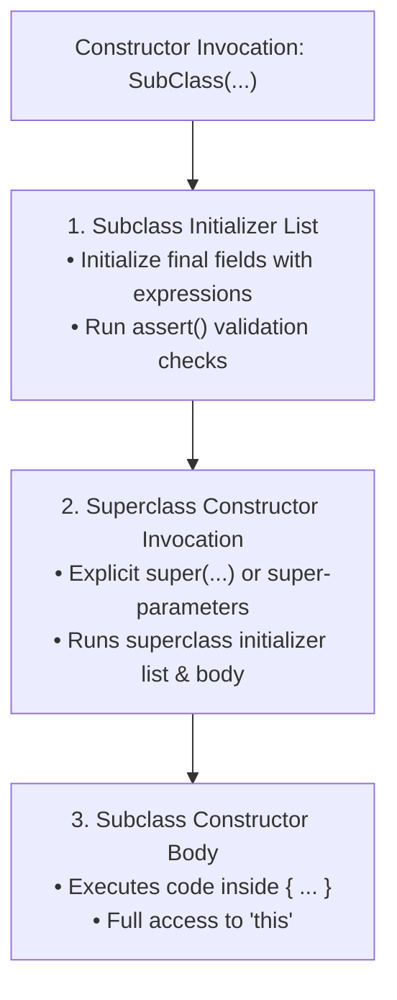

# Initializer Lists and Super-Parameters in Dart

> **Module:** 01-dart-fundamentals  
> **Subsection:** 05-oop-and-type-system  
> **Prerequisites:** [constructors-deep-dive.md](./constructors-deep-dive.md)  
> **Official References:** [dart.dev/language/constructors#initializer-list](https://dart.dev/language/constructors#initializer-list) | [dart.dev/language/constructors#super-parameters](https://dart.dev/language/constructors#super-parameters)

---

## 1. Introduction

When an object is instantiated, its `final` instance variables must be initialized before the constructor body runs. In Dart, this is accomplished via the **Initializer List**—a comma-separated list of field initializations and assertion statements placed between the constructor signature and its body.

Furthermore, Dart 3 introduced **Super-Parameters** (`super.key`, `super.name`), eliminating the repetitive boilerplate of declaring parameters only to immediately forward them to a superclass constructor.

### Why Do We Need Initializer Lists and Super-Parameters?
1. **Guaranteed Final Initialization:** Assigns values to `final` fields before any constructor logic can observe an uninitialized state.
2. **Defensive Debug Invariants:** Executes `assert()` statements in debug mode to catch programming errors immediately.
3. **Massive Boilerplate Reduction (Super-parameters):** Reduces Flutter widget constructor boilerplate by over 60%.

---

## 2. Core Concepts



### Initializer List Execution Phases
1. **Field Evaluation:** Fields are evaluated from left to right.
2. **No `this` Access:** You **cannot** access `this` or call instance methods inside the initializer list because the object is not yet fully formed.
3. **Assertions:** You can place `assert(condition, message)` statements inside the initializer list to validate incoming arguments during development.
4. **Super Invocation:** If calling an explicit superclass constructor, `super(...)` must be placed at the **end** of the initializer list.

### Modern Dart 3 Super-Parameters
Prior to Dart 2.17 / Dart 3, passing parameters to a superclass required verbose duplication:
```dart
// Pre-Dart 3 (Verbose Boilerplate):
class CustomButton extends StatelessWidget {
  final String label;
  const CustomButton({Key? key, required this.label}) : super(key: key);
}

// Modern Dart 3 (Idiomatic & Clean):
class CustomButton extends StatelessWidget {
  final String label;
  const CustomButton({super.key, required this.label});
}
```

---

## 3. Syntax and Implementation

```dart
// bin/initializer_list_demo.dart

class Shape {
  final String name;
  final String color;

  Shape({required this.name, required this.color}) {
    print('--> Shape constructor executed for: $name ($color)');
  }
}

class Circle extends Shape {
  final double radius;
  final double area; // Calculated final field!

  // Initializer List Demonstration:
  // 1. Initializing formals: this.radius
  // 2. Super-parameters: super.color
  // 3. Initializer list expression: area = ...
  // 4. Assert check: assert(radius > 0)
  Circle({
    required this.radius,
    required super.color, // Forwarded directly to Shape!
  })  : assert(radius > 0, 'Radius must be greater than zero'),
        area = 3.14159265359 * radius * radius,
        super(name: 'Circle') {
    print('--> Circle constructor body executed. Area = $area');
  }

  @override
  String toString() => 'Circle(color: $color, radius: $radius, area: ${area.toStringAsFixed(2)})';
}

void main() {
  print('--- Creating valid Circle ---');
  final validCircle = Circle(radius: 5.0, color: 'Emerald Green');
  print('Constructed: $validCircle\n');

  // Demonstrating Assertion Failure
  try {
    print('--- Attempting to create invalid Circle ---');
    Circle(radius: -2.0, color: 'Red');
  } catch (e) {
    print('Caught validation failure: $e');
  }
}
```

### Expected Output
```text
--- Creating valid Circle ---
--> Shape constructor executed for: Circle (Emerald Green)
--> Circle constructor body executed. Area = 78.54
Constructed: Circle(color: Emerald Green, radius: 5.0, area: 78.54)

--- Attempting to create invalid Circle ---
Caught validation failure: 'package:.../Circle.dart': Failed assertion: line ...: 'radius > 0': Radius must be greater than zero
```

### Common Mistakes
- **Mistake 1: Attempting to call instance methods in the initializer list.**  
  `MyClass(int x) : y = calculateY(x);` will fail if `calculateY` is an instance method. It must either be a `static` method, a top-level function, or a pure arithmetic expression.
- **Mistake 2: Placing `super(...)` before field initializations.**  
  In the initializer list, `super(...)` must always be the final entry.
- **Mistake 3: Manually forwarding parameters when super-parameters are available.**  
  Avoid `MyWidget({Key? key}) : super(key: key)`. Always prefer `MyWidget({super.key})`.

---

## 4. Practical Example: Flutter Widget Constructor Pattern

```dart
// lib/user_avatar.dart

abstract class Widget {
  final String? key;
  const Widget({this.key});
}

class UserAvatar extends Widget {
  final String imageUrl;
  final double size;
  final bool isOnline;

  // Modern Flutter constructor pattern with super-parameters & assertions
  const UserAvatar({
    super.key, // Passes 'key' straight to Widget superclass!
    required this.imageUrl,
    this.size = 48.0,
    this.isOnline = false,
  }) : assert(size >= 16.0 && size <= 256.0, 'Avatar size must be between 16 and 256 px');

  @override
  String toString() => 'UserAvatar(key: $key, size: ${size}px, online: $isOnline)';
}

void main() {
  const avatar = UserAvatar(
    key: 'avatar_user_101',
    imageUrl: 'https://cdn.domain.com/user.png',
    size: 64.0,
    isOnline: true,
  );
  print('Initialized Widget: $avatar');
}
```

---

## 5. Comparison: Pre-Dart 3 vs. Modern Dart 3 Super-Parameters

```dart
// Pre-Dart 3 (Tedious and repetitive)
class Employee extends Person {
  final String role;
  Employee(String name, int age, this.role) : super(name, age);
}

// Modern Dart 3 (Succinct and type-safe)
class Employee extends Person {
  final String role;
  Employee(super.name, super.age, this.role);
}
```

| Dimension | Manual Super Forwarding | Dart 3 Super-Parameters |
|:---|:---|:---|
| **Syntax** | `: super(name: name, key: key)` | `super.name, super.key` |
| **Type Repetition** | Must duplicate the type of super parameters | **Inferred automatically from superclass** |
| **Refactoring Burden** | Updating superclass param types requires changing subclasses | **Subclasses automatically adopt new super types** |
| **Readability** | High visual noise | **Extremely concise** |

---

## 6. Interview Preparation

### Frequently Asked Questions

#### Q1: In what exact order do constructors and initializer lists execute in an inheritance hierarchy?
- **Answer:**
  1. The subclass's initializer list evaluates (calculating fields, assertions).
  2. The superclass constructor is invoked (either implicitly or via explicit `super(...)`).
  3. The superclass initializer list evaluates.
  4. The superclass constructor body executes.
  5. Finally, the subclass constructor body executes.

#### Q2: Can you access `this` inside an initializer list?
- **Answer:** **No.** Inside an initializer list, the object is only partially constructed and its superclass has not yet run. Permitting `this` or instance method calls would allow code to observe uninitialized fields and violate sound type-safety guarantees.

---

## 7. Practice Exercises

### Exercise 1 (Beginner): Super-Parameter Refactor
Refactor this pre-Dart 3 constructor to use super-parameters:
```dart
class Car extends Vehicle {
  final int horsepower;
  Car({String? vin, required String make, required this.horsepower})
      : super(vin: vin, make: make);
}
```

### Exercise 2 (Intermediate): Initializer List Invariants
Create a `DateRange` class with `final DateTime start` and `final DateTime end`.
- In the initializer list, calculate `final Duration duration`.
- Add an `assert` in the initializer list verifying that `end.isAfter(start)`.

---

## 8. References
- [Dart Official Language Guide: Initializer List](https://dart.dev/language/constructors#initializer-list)
- [Dart Language Guide: Super Parameters](https://dart.dev/language/constructors#super-parameters)
