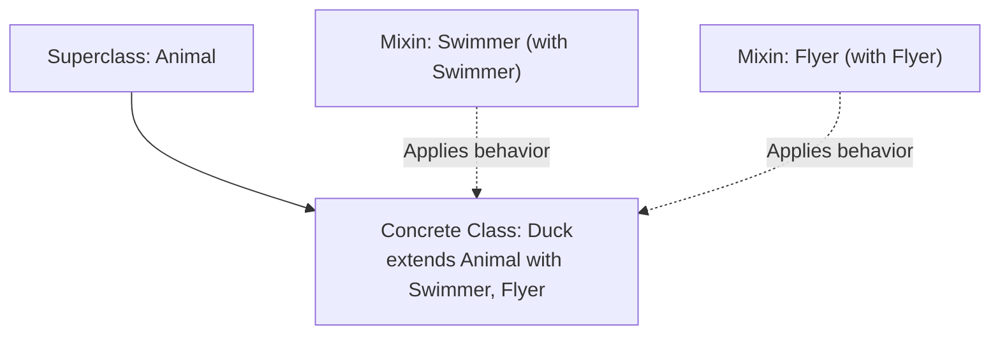

# Mixins and Multiple Composition in Dart

> **Module:** 01-dart-fundamentals  
> **Subsection:** 05-oop-and-type-system  
> **Prerequisites:** [interfaces-and-abstract-classes.md](./interfaces-and-abstract-classes.md)  
> **Official References:** [dart.dev/language/mixins](https://dart.dev/language/mixins)

---

## 1. Introduction

Traditional multiple inheritance (inheriting code from multiple superclasses) introduces severe architectural ambiguities, most notoriously the **"Diamond Problem"** (where a subclass inherits two conflicting implementations of the same method from different parent paths).

To allow powerful, reusable code composition across unrelated class hierarchies without the risks of multiple inheritance, Dart provides **Mixins**. A mixin is a way of reusing a class's code in multiple class hierarchies.

### Why Do We Need Mixins?
1. **Cross-Cutting Code Reuse:** Share behavior (e.g. logging, validation, animation tickers) across classes that do not share the same inheritance root.
2. **Eliminates the Diamond Problem:** Dart resolves method conflicts deterministically through a linear, well-defined composition order.
3. **Flutter Framework Mechanics:** Essential for Flutter stateful capabilities (e.g. `TickerProviderStateMixin`, `WidgetsBindingObserver`, `AutomaticKeepAliveClientMixin`).

---

## 2. Core Concepts



### 1. Declaring a Mixin (`mixin`)
Mixins are declared using the dedicated `mixin` keyword.
- **Strict Rule:** A mixin **cannot declare generative constructors**. A mixin cannot be directly instantiated on its own.

### 2. Applying Mixins (`with`)
A class applies one or more mixins using the `with` keyword immediately after `extends` (if extending a class):
```dart
class Duck extends Bird with Swimmer, Flyer { ... }
```

### 3. Restricting Mixin Application (`on`)
To constrain which classes are allowed to use a mixin, use the `on` keyword. This specifies that the mixin can only be applied to classes that extend or implement a specific base type:
```dart
mixin LifecycleLogger on State<StatefulWidget> { ... }
```

### 4. Linearization Order (Rightmost Wins)
When multiple mixins implement the same method, Dart resolves method calls using **Linearization**. Dart builds a linear inheritance chain from left to right, meaning the **rightmost mixin takes precedence** and overrides methods from earlier mixins.

---

## 3. Syntax and Implementation

```dart
// bin/mixins_demo.dart

// 1. Standalone Mixin: Logging
mixin DiagnosticLogger {
  void logInfo(String message) {
    print('[DIAGNOSTIC] ${DateTime.now().toIso8601String()} -> $message');
  }
}

// 2. Standalone Mixin: Validation
mixin FormValidator {
  bool isValidEmail(String email) {
    return email.contains('@') && email.contains('.');
  }

  bool isSecurePassword(String password) {
    return password.length >= 8;
  }
}

// 3. Constrained Mixin using 'on'
abstract class Device {
  final String deviceId;
  Device(this.deviceId);
}

// Can ONLY be used on classes that extend Device!
mixin BatteryMonitor on Device {
  int _batteryLevel = 100;

  int get batteryLevel => _batteryLevel;

  void drainBattery(int amount) {
    _batteryLevel = (_batteryLevel - amount).clamp(0, 100);
    print('Device $deviceId battery level: $_batteryLevel%');
  }
}

// 4. Concrete Class combining extends with multiple mixins
class SmartPhone extends Device with DiagnosticLogger, FormValidator, BatteryMonitor {
  final String modelName;

  SmartPhone({required super.deviceId, required this.modelName});

  void registerUser(String email, String password) {
    logInfo('Validating user registration for $modelName ($deviceId)...');

    if (!isValidEmail(email)) {
      logInfo('Registration failed: Invalid email format.');
      return;
    }
    if (!isSecurePassword(password)) {
      logInfo('Registration failed: Password too short.');
      return;
    }

    logInfo('User registered successfully.');
    drainBattery(5); // Consumes power
  }
}

void main() {
  final phone = SmartPhone(deviceId: 'DEV_PIXEL_99', modelName: 'Pixel 9 Pro');

  print('Current Battery: ${phone.batteryLevel}%');
  phone.registerUser('invalid-email', '1234');
  phone.registerUser('lead_engineer@flutter.dev', 'super_secret_password_2026');
  print('Final Battery:   ${phone.batteryLevel}%');
}
```

### Expected Output
```text
Current Battery: 100%
[DIAGNOSTIC] ... -> Validating user registration for Pixel 9 Pro (DEV_PIXEL_99)...
[DIAGNOSTIC] ... -> Registration failed: Invalid email format.
[DIAGNOSTIC] ... -> Validating user registration for Pixel 9 Pro (DEV_PIXEL_99)...
[DIAGNOSTIC] ... -> User registered successfully.
Device DEV_PIXEL_99 battery level: 95%
Final Battery:   95%
```

### Common Mistakes
- **Mistake 1: Declaring a constructor in a mixin.**  
  `mixin AuthMixin { AuthMixin(); }` causes a compilation error: *Mixins can't declare constructors*.
- **Mistake 2: Applying an `on` constrained mixin to an incompatible class.**  
  If `mixin M on BaseClass`, attempting `class Other with M` will fail compilation unless `Other extends BaseClass`.

---

## 4. Comparison: `extends` vs `implements` vs `with`

| Keyword | Purpose | Code Reuse? | Can have constructors? | Target Count |
|:---|:---|:---:|:---:|:---:|
| **`extends`** | Classical Single Inheritance ("Is-a") | **Yes** (Inherits implementations) | Yes | **Single (1 class only)** |
| **`implements`** | Interface Contract ("Adheres-to") | **No** (Inherits 0 code) | Yes (on target) | **Multiple (unlimited)** |
| **`with`** | Mixin Composition ("Shares-behavior") | **Yes** (Inherits concrete behavior) | **No** (Never has constructors) | **Multiple (unlimited)** |

---

## 5. Interview Preparation

### Frequently Asked Questions

#### Q1: How does Dart resolve method conflicts when two mixins implement the same method?
- **Answer:** Dart resolves conflicts through **Linearization (Rightmost Wins)**. Dart arranges the inheritance chain so that the mixin applied last (farthest to the right in the `with` clause) sits closest to the concrete subclass. If both `MixinA` and `MixinB` define `void execute()`, writing `class C extends Base with MixinA, MixinB` results in `MixinB.execute()` being called. Calling `super.execute()` inside `MixinB` delegates to `MixinA.execute()`.

#### Q2: Why are mixins heavily used in Flutter State classes (e.g. `TickerProviderStateMixin`)?
- **Answer:** `StatefulWidget` states must extend `State<T>`, consuming their single `extends` inheritance slot. However, explicit animations require an internal `Ticker` to synchronize frame updates with the device screen refresh rate (60/120 Hz). Flutter provides `TickerProviderStateMixin` as a mixin so that any `State` class can easily gain animation ticker capabilities via the `with` keyword without needing multiple inheritance.

---

## 6. Practice Exercises

### Exercise 1 (Beginner): Logging Mixin
Create a mixin `TimestampLogger` with a method `void log(String text)` that prints the current timestamp prepended to the text. Apply it to an `OrderProcessor` class.

---

## 7. References
- [Dart Official Language Guide: Mixins](https://dart.dev/language/mixins)
- [Flutter API: TickerProviderStateMixin](https://api.flutter.dev/flutter/widgets/TickerProviderStateMixin-mixin.html)
