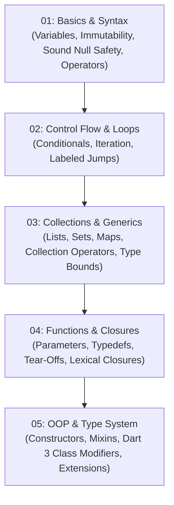

# Module 01: Dart Fundamentals

Welcome to **Module 01: Dart Fundamentals**. This module provides a comprehensive, ground-up foundation in the Dart programming language (Dart 3.x+). Mastery of these core semantics is essential for building scalable, high-performance Flutter applications.

---

## 🗺️ Module Subsections

### 1. [01-basics-and-syntax/](./01-basics-and-syntax/)
- **[variables-types-and-inference.md](./01-basics-and-syntax/variables-types-and-inference.md):** Type inference, static vs dynamic typing, `var`, `dynamic`, `Object`, and `Object?`.
- **[immutability-final-vs-const.md](./01-basics-and-syntax/immutability-final-vs-const.md):** Runtime immutability vs compile-time constants, memory canonicalization.
- **[null-safety-deep-dive.md](./01-basics-and-syntax/null-safety-deep-dive.md):** Sound null safety, `?`, assertion `!`, late initialization, and null-coalescing.
- **[operators-and-expressions.md](./01-basics-and-syntax/operators-and-expressions.md):** Arithmetic, type testing (`is`/`as`), cascade (`..`), and spread (`...`) operators.

### 2. [02-control-flow-and-loops/](./02-control-flow-and-loops/)
- **[conditional-branching.md](./02-control-flow-and-loops/conditional-branching.md):** `if-else`, ternary expressions, and switch statements.
- **[loops-and-iteration.md](./02-control-flow-and-loops/loops-and-iteration.md):** `for`, `for-in`, `while`, `do-while`, and `forEach`.
- **[labels-break-continue.md](./02-control-flow-and-loops/labels-break-continue.md):** Nested loop control using labeled break and continue statements.

### 3. [03-collections-and-generics/](./03-collections-and-generics/)
- **[lists-sets-and-maps.md](./03-collections-and-generics/lists-sets-and-maps.md):** Deep dive into Dart collection types, complexity characteristics, and key operations.
- **[collection-operators.md](./03-collections-and-generics/collection-operators.md):** Collection-if, collection-for, and collection-spread (`...`).
- **[generics-and-type-variance.md](./03-collections-and-generics/generics-and-type-variance.md):** Type parameters, bounded generics (`<T extends Comparable<T>>`), and generic methods.

### 4. [04-functions-and-closures/](./04-functions-and-closures/)
- **[function-syntax-and-parameters.md](./04-functions-and-closures/function-syntax-and-parameters.md):** Positional, named, optional, required, and arrow functions.
- **[first-class-functions-and-typedefs.md](./04-functions-and-closures/first-class-functions-and-typedefs.md):** First-class citizen functions, callback signatures, and modern `typedef`.
- **[anonymous-functions-and-tear-offs.md](./04-functions-and-closures/anonymous-functions-and-tear-offs.md):** Lambdas and performance-optimized function tear-offs.
- **[closures-and-lexical-scope.md](./04-functions-and-closures/closures-and-lexical-scope.md):** Variable capture, lexical scope, and memory retention mechanics.

### 5. [05-oop-and-type-system/](./05-oop-and-type-system/)
- **[classes-and-objects.md](./05-oop-and-type-system/classes-and-objects.md):** Encapsulation, fields, getters, setters, and class structures.
- **[constructors-deep-dive.md](./05-oop-and-type-system/constructors-deep-dive.md):** Generative, named, redirecting, const, and factory constructors.
- **[initializer-lists-and-super.md](./05-oop-and-type-system/initializer-lists-and-super.md):** Initializer lists, assertion checks, and modern Dart 3 super-parameters.
- **[inheritance-and-polymorphism.md](./05-oop-and-type-system/inheritance-and-polymorphism.md):** `extends`, `@override`, polymorphism, concrete vs abstract methods.
- **[interfaces-and-abstract-classes.md](./05-oop-and-type-system/interfaces-and-abstract-classes.md):** Implicit interfaces, `implements` vs `extends`, interface contracts.
- **[mixins-and-multiple-composition.md](./05-oop-and-type-system/mixins-and-multiple-composition.md):** `mixin`, `with`, `on` constraints, linearization hierarchy.
- **[class-modifiers-dart-3.md](./05-oop-and-type-system/class-modifiers-dart-3.md):** Dart 3 class modifiers: `sealed`, `base`, `interface`, `final`.
- **[extension-methods.md](./05-oop-and-type-system/extension-methods.md):** Adding utility APIs to existing classes without subclassing.

---

## 🎯 Learning Objectives

By completing Module 01, you will:
1. Write type-safe, expressive, and idiomatically correct Dart 3 code.
2. Leverage sound null safety to eliminate runtime null-pointer crashes entirely.
3. Master object composition through constructors, mixins, and Dart 3 class modifiers.
4. Understand memory implications of closures, constant canonicalization, and collection mutability.
