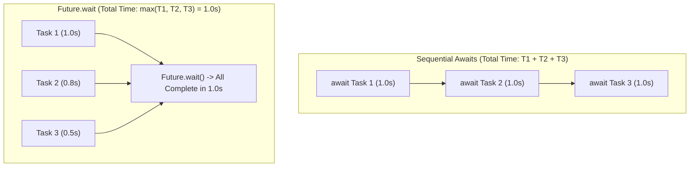

# Advanced Future API Methods and Combinators in Dart

> **Module:** 02-advanced-dart  
> **Subsection:** 01-asynchronous-programming  
> **Prerequisites:** [futures-and-async-await.md](./futures-and-async-await.md)  
> **Official References:** [api.dart.dev/stable/dart-async/Future-class.html](https://api.dart.dev/stable/dart-async/Future-class.html)

---

## 1. Introduction

While basic `async` and `await` handle sequential asynchronous workflows, real-world applications frequently require **concurrent execution**, **racing operations**, and **batch coordination**.

The `Future` class provides a rich suite of factory constructors and combinators:
- **`Future.wait()`**: Executes multiple futures in parallel and waits for all of them to complete.
- **`Future.any()`**: Races multiple futures, completing with the first one that finishes.
- **`Future.forEach()`**: Sequentially processes items in an iterable asynchronously.
- **`Future.delayed()`**: Schedules a task to execute after a specified duration.
- **`Future.value()` / `Future.error()`**: Creates pre-completed futures.

### Why Do We Need Future Combinators?
1. **Accelerates Page Loads:** Fetching dashboard data (user profile, notifications, metrics) concurrently in parallel instead of sequentially cuts total load time dramatically.
2. **Racing Operations:** Trying multiple redundant mirrors or falling back to a cached response if a remote request exceeds a fast threshold.
3. **Coordinated Error Handling:** Aggregating results and errors across multi-step asynchronous batch workflows.

---

## 2. Core Concepts



### 1. `Future.wait<T>(List<Future<T>> futures)`
Takes an iterable of futures and returns a single `Future<List<T>>` that completes when **all** input futures have completed.
- **`eagerError` parameter:**
  - If `false` (default): Waits for all futures to finish even if one throws an error, before rethrowing the first encountered error.
  - If `true`: Immediately completes with an error the moment *any* single future fails, without waiting for the others.

### 2. `Future.any<T>(List<Future<T>> futures)`
Races all provided futures. Completes with the value or error of the **first** future to complete. Subsequent completions from slower futures are discarded.

### 3. `Future.forEach<T>(Iterable<T> elements, FutureOr Function(T) action)`
Iterates over elements and executes `action` on each element **one after another (sequentially)**, awaiting each before proceeding to the next.

---

## 3. Syntax and Implementation

```dart
// bin/future_combinators_demo.dart

import 'dart:async';

// Simulated API Endpoints
Future<String> fetchUserProfile() async {
  await Future.delayed(const Duration(milliseconds: 300));
  return 'User: Dash (Admin)';
}

Future<int> fetchUnreadCount() async {
  await Future.delayed(const Duration(milliseconds: 200));
  return 5;
}

Future<List<String>> fetchRecentOrders() async {
  await Future.delayed(const Duration(milliseconds: 400));
  return ['Order #101', 'Order #102'];
}

// Simulated mirror servers with different response times
Future<String> fetchFromMirror(String serverName, int delayMs) async {
  await Future.delayed(Duration(milliseconds: delayMs));
  return 'Data from $serverName';
}

void main() async {
  // ==========================================
  // 1. Future.wait: Parallel Concurrent Loading
  // ==========================================
  print('--- 1. Future.wait (Parallel Aggregation) ---');
  final stopwatch = Stopwatch()..start();

  // All 3 futures are initiated concurrently!
  final results = await Future.wait([
    fetchUserProfile(),
    fetchUnreadCount(),
    fetchRecentOrders(),
  ]);

  stopwatch.stop();
  print('Loaded in ${stopwatch.elapsedMilliseconds}ms:');
  print(' • Profile: ${results[0]}');
  print(' • Unread Alerts: ${results[1]}');
  print(' • Orders: ${results[2]}');

  // ==========================================
  // 2. Future.any: Racing Operations
  // ==========================================
  print('\n--- 2. Future.any (Racing Fastest Server) ---');
  final fastestResponse = await Future.any([
    fetchFromMirror('Mirror A (US-East)', 600),
    fetchFromMirror('Mirror B (EU-West)', 150), // Fastest!
    fetchFromMirror('Mirror C (AP-South)', 450),
  ]);
  print('Winner: $fastestResponse');

  // ==========================================
  // 3. Pre-completed Futures
  // ==========================================
  print('\n--- 3. Future.value and Future.error ---');
  final cachedFuture = Future.value('Cached Token');
  print('Cached value ready: ${await cachedFuture}');
}
```

### Expected Output
```text
--- 1. Future.wait (Parallel Aggregation) ---
Loaded in 405ms:
 • Profile: User: Dash (Admin)
 • Unread Alerts: 5
 • Orders: [Order #101, Order #102]

--- 2. Future.any (Racing Fastest Server) ---
Winner: Data from Mirror B (EU-West)

--- 3. Future.value and Future.error ---
Cached value ready: Cached Token
```

### Common Mistakes
- **Mistake 1: Sequential awaiting inside loops instead of `Future.wait`.**  
  ```dart
  // SLOW (10 items x 200ms = 2000ms):
  for (final id in ids) {
    await fetch(id);
  }

  // FAST (All 10 items in parallel = 200ms total):
  await Future.wait(ids.map(fetch));
  ```
- **Mistake 2: Type mismatch in `Future.wait`.**  
  If futures return different types (e.g. `String`, `int`, `List`), `Future.wait` infers the return type as `List<Object?>`. You must cast or use Dart 3 Records if strict type checking is required.

---

## 4. Practical Example: Dashboard Parallel Aggregator with Records

```dart
// lib/dashboard_loader.dart

import 'dart:async';

// Strongly-typed Dashboard Record
typedef DashboardData = ({
  String profile,
  int unreadNotifications,
  List<String> orders,
});

Future<DashboardData> loadDashboardData() async {
  // Firing all three futures concurrently
  final profileFuture = Future.delayed(const Duration(milliseconds: 300), () => 'Alice Developer');
  final notificationsFuture = Future.delayed(const Duration(milliseconds: 150), () => 3);
  final ordersFuture = Future.delayed(const Duration(milliseconds: 250), () => ['Widget Kit', 'Dart Pro']);

  // Awaiting via Future.wait while maintaining strict types via Records
  final results = await Future.wait([
    profileFuture,
    notificationsFuture,
    ordersFuture,
  ]);

  return (
    profile: results[0] as String,
    unreadNotifications: results[1] as int,
    orders: results[2] as List<String>,
  );
}

void main() async {
  final dashboard = await loadDashboardData();
  print('User:          ${dashboard.profile}');
  print('Notifications: ${dashboard.unreadNotifications}');
  print('Orders:        ${dashboard.orders}');
}
```

---

## 5. Comparison: `Future.wait` vs `Future.any` vs Sequential Await

| Feature | Sequential `await` | `Future.wait()` | `Future.any()` |
|:---|:---|:---|:---|
| **Execution Mode** | One after another | **Concurrent / Parallel** | **Concurrent / Racing** |
| **Total Duration** | Sum of all task times ($T_1 + T_2 + \dots$) | **Duration of longest task ($\max(T_i)$)** | **Duration of fastest task ($\min(T_i)$)** |
| **Return Value** | Value of single task | `List<T>` of all task results | Value of the single winning task |
| **Error Behavior** | First error stops subsequent tasks | Waits for all (or fails eagerly) | Completes with first error/value |
| **Primary Use Case** | Dependent steps (login $\to$ fetch token) | Independent parallel data loading | CDN mirror racing, fast timeouts |

---

## 6. Interview Preparation

### Frequently Asked Questions

#### Q1: What happens if one of the futures in `Future.wait()` fails?
- **Answer:** By default (`eagerError: false`), `Future.wait()` allows all other pending futures in the list to complete before it completes with an error (rethrowing the error from the first failed future). If `eagerError: true` is passed, `Future.wait()` immediately completes with the error as soon as any single future fails, but the remaining futures will continue running in the background unless explicitly cancelled.

#### Q2: What is the difference between `Future.delayed(Duration.zero, callback)` and invoking `callback()` directly?
- **Answer:** Invoking `callback()` executes immediately and synchronously within the current stack frame. Passing `Duration.zero` to `Future.delayed()` schedules the callback to execute on Dart's **Event Queue**. The current synchronous code and any scheduled microtasks will finish running completely before the zero-delay callback is executed.

---

## 7. Practice Exercises

### Exercise 1 (Beginner): Parallel Asset Preloader
Write an async function that uses `Future.wait()` to preload 3 asset files (`'fonts.ttf'`, `'images.png'`, `'config.json'`), printing the total elapsed time.

### Exercise 2 (Intermediate): Fast Timeout Mirror
Write a function `Future<String> fetchFastest(List<Future<String>> mirrors, Duration timeout)` that races the mirrors using `Future.any()` and throws a `TimeoutException` if no mirror responds within `timeout`.

---

## 8. References
- [Dart API: Future Class Documentation](https://api.dart.dev/stable/dart-async/Future-class.html)
- [Effective Dart: Asynchronous Programming](https://dart.dev/effective-dart/usage#async)
