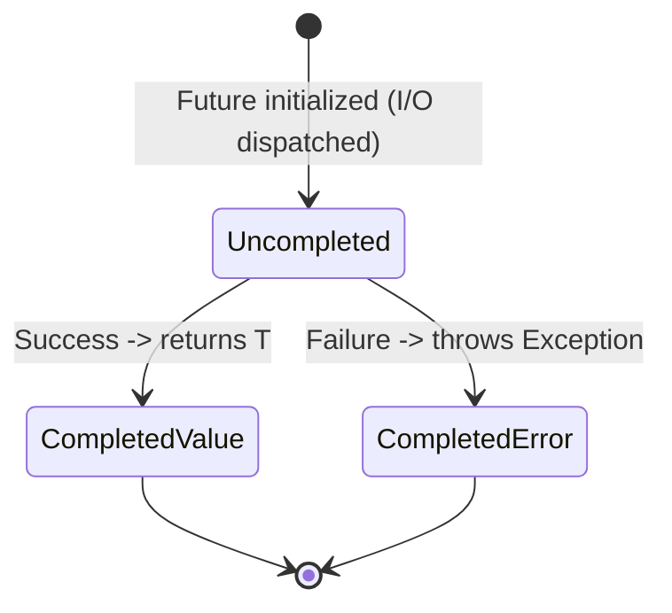

# Futures and Async/Await in Dart

> **Module:** 02-advanced-dart  
> **Subsection:** 01-asynchronous-programming  
> **Prerequisites:** [01-dart-fundamentals/](../../01-dart-fundamentals/)  
> **Official References:** [dart.dev/codelabs/async-await](https://dart.dev/codelabs/async-await) | [api.dart.dev/stable/dart-async/Future-class.html](https://api.dart.dev/stable/dart-async/Future-class.html)

---

## 1. Introduction

In modern applications, operations such as querying a remote REST API, reading a file from disk, or querying an SQLite database take significant time (milliseconds to seconds). In a synchronous execution model, waiting for these operations would **freeze the thread**, locking up the Flutter UI, dropping frames, and producing an unresponsive "Application Not Responding" (ANR) crash.

Dart executes code in a **single thread**, but achieves non-blocking execution through **asynchronous programming** using `Future<T>` and the `async` / `await` syntax.

### Why Do We Need Futures and Async/Await?
1. **Non-Blocking UI:** The main UI thread remains responsive (scrolling, animating) while background I/O operations execute.
2. **Sequential Readability:** `async` and `await` allow writing asynchronous code that looks and behaves like clean, linear synchronous code, eliminating "callback hell".
3. **Structured Error Handling:** Standard `try`, `catch`, and `finally` blocks handle both synchronous and asynchronous errors uniformly.

---

## 2. Core Concepts



### 1. The Three States of a `Future<T>`
1. **Uncompleted (Pending):** The operation is currently in flight. Code awaiting the future is suspended.
2. **Completed with a Value:** The operation succeeded and produced a value of type `T`.
3. **Completed with an Error:** The operation failed and threw an exception/error.

### 2. The `async` and `await` Keywords
- **`async`:** Placed before a function body to indicate that it executes asynchronously. An `async` function **always returns a `Future<T>`** (even if you return a plain `T`, Dart automatically wraps it in `Future<T>`).
- **`await`:** Placed before an expression returning a `Future`. It **suspends** the execution of the current `async` function until the Future completes.
  - **Crucial Note:** `await` **does not block the underlying thread**. It yields execution back to the Dart Event Loop, allowing other tasks (such as rendering UI frames or handling user taps) to execute while waiting.

---

## 3. Syntax and Implementation

```dart
// bin/futures_demo.dart

import 'dart:async';

// 1. Simulating an Asynchronous Operation
Future<String> fetchUserRole(int userId) async {
  print('--> [Network] Fetching role for user #$userId...');
  
  // Simulating 1.5 seconds of network latency
  await Future.delayed(const Duration(milliseconds: 1500));

  if (userId <= 0) {
    throw ArgumentError('User ID must be positive');
  }

  return 'Senior Software Architect';
}

// 2. Consuming Futures with async/await and try/catch
Future<void> displayUserProfile(int userId) async {
  print('Step 1: Starting profile load...');

  try {
    // 'await' pauses this function and yields to the event loop
    final role = await fetchUserRole(userId);
    print('Step 2: Successfully loaded role: "$role"');
  } on ArgumentError catch (e, stackTrace) {
    print('Step 2 (Handled): Invalid user ID: $e');
  } catch (e) {
    print('Step 2 (Unhandled fallback): Unknown error: $e');
  } finally {
    print('Step 3: Cleanup executed (Finally block).');
  }
}

void main() async {
  print('=== Main program started ===');

  // Successful invocation
  await displayUserProfile(101);

  print('\n----------------------------------------\n');

  // Failure invocation
  await displayUserProfile(-5);

  print('=== Main program completed ===');
}
```

### Expected Output
```text
=== Main program started ===
Step 1: Starting profile load...
--> [Network] Fetching role for user #101...
Step 2: Successfully loaded role: "Senior Software Architect"
Step 3: Cleanup executed (Finally block).

----------------------------------------

Step 1: Starting profile load...
--> [Network] Fetching role for user #-5...
Step 2 (Handled): Invalid user ID: Invalid argument(s): User ID must be positive
Step 3: Cleanup executed (Finally block).
=== Main program completed ===
```

### Common Mistakes
- **Mistake 1: Forgetting the `await` keyword.**  
  ```dart
  // WRONG: 'role' is of type Future<String>, not String!
  final role = fetchUserRole(101);
  print(role.toUpperCase()); // COMPILATION ERROR: Class 'Future' has no instance method 'toUpperCase'

  // CORRECT:
  final role = await fetchUserRole(101);
  ```
- **Mistake 2: Mixing `.then()` chains with `async/await`.**  
  Mixing `.then().catchError()` callbacks with `await` in the same function creates fragmented error handling. Stick to `async/await` and `try/catch`.
- **Mistake 3: Unnecessary sequential awaits.**  
  Awaiting independent calls in sequence doubles waiting time:
  ```dart
  // SLOW (Sequential: 2 seconds total):
  final user = await fetchUser();
  final products = await fetchProducts();

  // FAST (Concurrent: 1 second total):
  final results = await Future.wait([fetchUser(), fetchProducts()]);
  ```

---

## 4. Practical Example: Resilient Weather API Client

```dart
// lib/weather_service.dart

import 'dart:async';

class WeatherReport {
  final String city;
  final double temperatureCelsius;
  final String condition;

  WeatherReport({required this.city, required this.temperatureCelsius, required this.condition});

  @override
  String toString() => '$city: ${temperatureCelsius.toStringAsFixed(1)}°C ($condition)';
}

class WeatherService {
  Future<WeatherReport> getWeather(String city) async {
    // Attaching a timeout to prevent hanging forever
    return await _fetchFromRemoteServer(city).timeout(
      const Duration(seconds: 2),
      onTimeout: () => throw TimeoutException('Weather server took too long to respond'),
    );
  }

  Future<WeatherReport> _fetchFromRemoteServer(String city) async {
    await Future.delayed(const Duration(milliseconds: 500));
    return WeatherReport(city: city, temperatureCelsius: 22.4, condition: 'Partly Cloudy');
  }
}

void main() async {
  final service = WeatherService();
  try {
    final report = await service.getWeather('San Francisco');
    print('Weather loaded: $report');
  } catch (e) {
    print('Weather fetch failed: $e');
  }
}
```

---

## 5. Comparison: `async/await` vs `.then() / .catchError()`

```dart
// Legacy Callback Approach (.then):
fetchUser()
    .then((user) => fetchOrders(user))
    .then((orders) => print(orders))
    .catchError((e) => print('Error: $e'));

// Modern Imperative Approach (async/await):
try {
  final user = await fetchUser();
  final orders = await fetchOrders(user);
  print(orders);
} catch (e) {
  print('Error: $e');
}
```

| Dimension | `.then() / .catchError()` | `async / await` |
|:---|:---|:---|
| **Syntax Style** | Functional chaining / callbacks | Imperative sequential flow |
| **Error Handling** | Nested `.catchError()` callbacks | Standard `try / catch / finally` |
| **Variable Scoping** | Intermediate variables trapped in closures | Local variables accessible across all steps |
| **Debuggability** | Fragmented stack traces | **Linear step-by-step debugger stepping** |

---

## 6. Interview Preparation

### Frequently Asked Questions

#### Q1: Does the `await` keyword block the execution thread in Dart?
- **Short Answer:** No.
- **Detailed Answer:** Dart runs in a single-threaded isolate. When an `await` expression is encountered, execution of the current function is paused and converted into a listener callback registered with the event loop. The thread is immediately freed to process other events, such as rendering the next 60/120 FPS UI frame or responding to user taps. When the awaited Future completes, the remainder of the async function is posted to the event queue to resume execution.

#### Q2: What is the return type of an `async` function that doesn't return anything?
- **Answer:** An `async` function that returns no value must be typed as `Future<void>`. (Avoid typing it as `void`, because calling an `async void` function prevents callers from `await`ing its completion or catching exceptions thrown inside it, unless it is a top-level event handler like a button `onPressed` callback).

---

## 7. Practice Exercises

### Exercise 1 (Beginner): Countdown Timer
Write an `async` function `Future<void> countdown(int seconds)` that uses `await Future.delayed(...)` to print a countdown from `seconds` down to 1, followed by `"Liftoff!"`.

### Exercise 2 (Intermediate): Asynchronous Safe Fallback
Write a function `Future<String> fetchConfigWithFallback()` that calls a primary async source. If the primary source fails or takes more than 1 second, catch the failure and return a cached fallback string `'DEFAULT_CONFIG'`.

---

## 8. References
- [Dart Official Codelab: Asynchronous Programming](https://dart.dev/codelabs/async-await)
- [Dart API: Future](https://api.dart.dev/stable/dart-async/Future-class.html)
