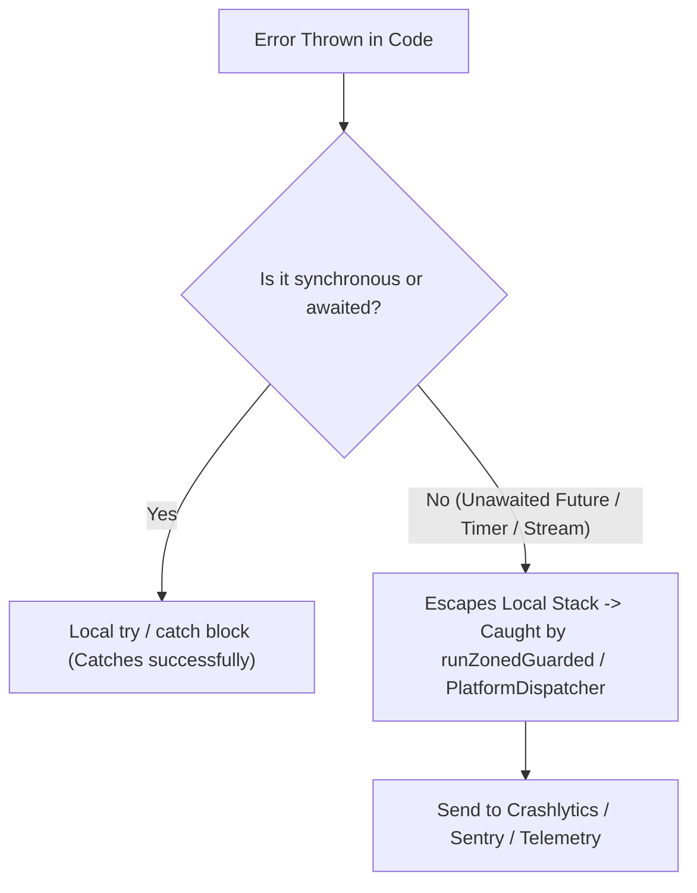

# Unhandled Asynchronous Errors and Zones in Dart

> **Module:** 02-advanced-dart  
> **Subsection:** 01-asynchronous-programming  
> **Prerequisites:** [futures-and-async-await.md](./futures-and-async-await.md)  
> **Official References:** [dart.dev/articles/libraries/zones](https://dart.dev/articles/libraries/zones) | [docs.flutter.dev/testing/errors](https://docs.flutter.dev/testing/errors)

---

## 1. Introduction

In synchronous programming, wrapping code in a standard `try-catch` block catches all thrown exceptions. In asynchronous programming, however, errors can be thrown inside **unawaited futures**, **background timer callbacks**, or **asynchronous streams** long after the original `try-catch` block has exited.

If an asynchronous error is unhandled, it escapes the local call stack, prints an `Unhandled exception` error to the console, and can crash or destabilize the application.

Dart provides **Zones**—asynchronous execution environments that can intercept, track, and catch all unhandled synchronous and asynchronous exceptions globally.

### Why Do We Need Zones and Global Error Handling?
1. **Crash Reporting:** Forwarding unhandled production crashes and stack traces to analytics tools (e.g. Firebase Crashlytics, Sentry, Datadog).
2. **Prevent Silent Failures:** Catching errors in unawaited futures or background timers that would otherwise be lost.
3. **Graceful UI Recovery:** Presenting friendly fallback error screens to users instead of a frozen or black screen.

---

## 2. Core Concepts



### 1. What is a `Zone`?
A `Zone` is an execution context that encapsulates asynchronous operations. Every Dart program starts in the **Root Zone**. When a timer is created, a microtask is scheduled, or a future is chained, it inherits the current zone. You can create child zones to override behavior, inject contextual data, or intercept uncaught errors.

### 2. `runZonedGuarded`
The primary utility function for error isolation:
```dart
runZonedGuarded(() {
  // App initialization and execution
}, (Object error, StackTrace stack) {
  // Global error handler for any uncaught exception!
});
```

### 3. Flutter Modern Error Routing (Flutter 3.x+)
In modern Flutter, error handling is split across two primary layers:
1. **`FlutterError.onError`:** Catches framework-level errors (errors during `build()`, layout, or painting).
2. **`PlatformDispatcher.instance.onError`:** Catches asynchronous errors from the underlying Dart VM (timers, unawaited futures, platform channels).

---

## 3. Syntax and Implementation

```dart
// bin/unhandled_errors_demo.dart

import 'dart:async';

void triggerUnawaitedAsyncError() {
  // Fire-and-forget unawaited future
  Future.delayed(const Duration(milliseconds: 100), () {
    throw StateError('Unawaited background task failed unexpectedly!');
  });
}

void triggerTimerError() {
  Timer(const Duration(milliseconds: 200), () {
    throw FormatException('Timer payload corrupted');
  });
}

void main() {
  print('=== Global Zone Setup ===');

  // Enclosing execution inside a guarded zone
  runZonedGuarded(() async {
    print('1. App started inside runZonedGuarded.');

    // Local try-catch CANNOT catch this error because it is unawaited!
    try {
      triggerUnawaitedAsyncError();
      triggerTimerError();
    } catch (e) {
      print('This local catch will NEVER run for unawaited futures!');
    }

    print('2. Main synchronous flow completed.');
    
    // Keep process alive long enough to catch async errors
    await Future.delayed(const Duration(milliseconds: 500));
  }, (error, stackTrace) {
    // THIS GLOBAL HANDLER CATCHES EVERYTHING!
    print('\n[GLOBAL ZONE INTERCEPTOR]');
    print('Caught Unhandled Error: $error');
    print('First line of stack trace: ${stackTrace.toString().split('\n').first}');
  });
}
```

### Expected Output
```text
=== Global Zone Setup ===
1. App started inside runZonedGuarded.
2. Main synchronous flow completed.

[GLOBAL ZONE INTERCEPTOR]
Caught Unhandled Error: Bad state: Unawaited background task failed unexpectedly!
First line of stack trace: #0      triggerUnawaitedAsyncError.<anonymous closure> (...)

[GLOBAL ZONE INTERCEPTOR]
Caught Unhandled Error: FormatException: Timer payload corrupted
First line of stack trace: #0      triggerTimerError.<anonymous closure> (...)
```

### Common Mistakes
- **Mistake 1: Assuming `try/catch` catches unawaited async calls.**  
  ```dart
  // DANGEROUS MISTAKE:
  try {
    saveDataToServer(); // Forgot 'await'!
  } catch (e) {
    // If saveDataToServer fails, this catch block NEVER executes!
  }
  ```
- **Mistake 2: Calling `runZonedGuarded` in modern Flutter when `PlatformDispatcher.onError` is sufficient.**  
  In Flutter 3.3+, `PlatformDispatcher.instance.onError` is the official modern recommendation for catching uncaught Dart errors, avoiding the overhead of creating additional Zone layers unless zone-scoped variables are explicitly needed.

---

## 4. Practical Example: Production Flutter Global Error Handler

```dart
// lib/production_error_handler.dart

import 'dart:async';
import 'dart:ui';

// Mock Crashlytics client
class CrashlyticsService {
  static void recordError(Object error, StackTrace stack, {String? reason}) {
    print('[CRASHLYTICS TELEMETRY] Logged to cloud: $error (Reason: $reason)');
  }
}

void setupGlobalErrorHandling() {
  // 1. Catch Flutter Framework UI / Layout errors
  // FlutterError.onError = (FlutterErrorDetails details) {
  //   CrashlyticsService.recordError(details.exception, details.stack ?? StackTrace.current, reason: 'Flutter UI Error');
  // };

  // 2. Catch Asynchronous Dart VM / Platform errors (Modern Flutter 3+)
  PlatformDispatcher.instance.onError = (Object error, StackTrace stack) {
    CrashlyticsService.recordError(error, stack, reason: 'PlatformDispatcher Root Error');
    return true; // Return true to indicate error was handled
  };
}

void main() {
  setupGlobalErrorHandling();
  print('Global production error telemetry initialized.');
}
```

---

## 5. Comparison: Local Try/Catch vs. PlatformDispatcher vs. `runZonedGuarded`

| Mechanism | Scope | What It Catches | Best Used For |
|:---|:---|:---|:---|
| **`try / catch`** | Local block | Synchronous code and **awaited** Futures | Known points of failure (parsing, HTTP calls) |
| **`PlatformDispatcher.onError`** | Entire App | Unhandled asynchronous Dart exceptions | Global crash telemetry in Flutter 3.x+ |
| **`runZonedGuarded`** | Zone scope | Unhandled async & sync exceptions in zone | CLI tools, custom zone contextual data |
| **`FlutterError.onError`** | Framework level | Widget build, layout, and rendering exceptions | Red screen of death (RenderFlex overflows) |

---

## 6. Interview Preparation

### Frequently Asked Questions

#### Q1: Why does a local `try-catch` block fail to catch an error thrown inside a `Timer`?
- **Answer:** A `Timer` registers a callback to be executed on the Dart **Event Queue** in the future. The synchronous function containing the `try-catch` finishes executing and pops off the call stack immediately. When the timer fires milliseconds later, it is executed as a brand new event loop entry with its own fresh stack frame, completely outside the scope of the original `try-catch` block.

#### Q2: What is the recommended way to catch unhandled errors in modern Flutter 3.x applications?
- **Answer:** Combine `FlutterError.onError` (for framework and UI layout exceptions) with `PlatformDispatcher.instance.onError` (for uncaught asynchronous Dart errors). Setting `PlatformDispatcher.instance.onError` avoids the performance overhead of running the entire app inside a custom zone (`runZonedGuarded`), while guaranteeing complete crash reporting coverage.

---

## 7. Practice Exercises

### Exercise 1 (Beginner): Unawaited Future Trap
Write a small script demonstrating that an unawaited Future throwing an error crashes the script unless intercepted by `runZonedGuarded`.

---

## 8. References
- [Dart Language Articles: Zones](https://dart.dev/articles/libraries/zones)
- [Flutter Official Docs: Handling Errors in Flutter](https://docs.flutter.dev/testing/errors)
