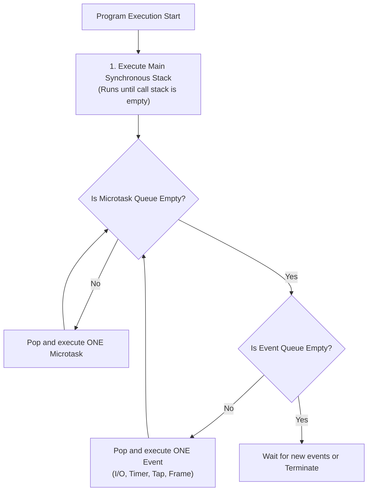

# Event Loop Mechanics in Dart: Microtask Queue vs Event Queue

> **Module:** 02-advanced-dart  
> **Subsection:** 02-event-loop-and-microtasks  
> **Prerequisites:** [01-asynchronous-programming/](../01-asynchronous-programming/)  
> **Official References:** [dart.dev/articles/libraries/event-loop](https://dart.dev/articles/libraries/event-loop)

---

## 1. Introduction

Dart code runs in a **single-threaded Isolate**. There is no shared memory between threads and no multi-threaded lock contention within an isolate. Despite this single-threaded model, Dart applications perform I/O operations, stream real-time data, and render 120 FPS animations without freezing.

This non-blocking execution is powered entirely by the **Dart Event Loop**. Understanding how the event loop prioritizes tasks between its **Microtask Queue** and **Event Queue** is one of the most critical topics for senior Flutter developers.

### Why Do We Need to Understand the Event Loop?
1. **Predict Execution Order:** Eliminate subtle race conditions and timing bugs between timers, microtasks, and futures.
2. **Prevent Frame Drops (Jank):** Ensure heavy computations or endless microtask queues don't starve the event loop from rendering the next frame within the 16.6ms (60 FPS) or 8.3ms (120 FPS) frame budget.
3. **Master Senior Technical Interviews:** Event loop execution order is one of the highest-frequency senior Dart interview topics.

---

## 2. Core Concepts



### The Two Queues

#### 1. The Microtask Queue (High Priority)
- Contains internal, short-lived tasks that must execute **immediately after the current synchronous code finishes**, but **before** the event loop yields control back to the event queue.
- Used internally by Dart for completing certain Future transformations and object disposals.
- **Rule:** The event loop **drains the microtask queue completely** before it touches a single event from the event queue!

#### 2. The Event Queue (Standard Priority)
- Contains external events and scheduled asynchronous callbacks:
  - User touch gestures and taps.
  - Device I/O (file read/write, network response packets).
  - Timer callbacks (`Future.delayed`, `Timer`).
  - Messages arriving from other Isolates (`ReceivePort`).
  - Flutter UI draw frame requests.

### The Chronological Order of Execution
1. **Synchronous code** currently executing on the call stack.
2. **Microtask Queue:** Drained until 100% empty.
3. **Event Queue:** Exactly **one** event is popped and executed.
4. **Re-check Microtask Queue:** If processing that event generated any microtasks, they are drained immediately before the next event is popped!

---

## 3. Syntax and Implementation

```dart
// bin/event_loop_demo.dart

import 'dart:async';

void main() {
  print('1. Synchronous Main Start');

  // Scheduled on the Event Queue (standard timer)
  Timer(Duration.zero, () {
    print('8. Event: Timer Duration.zero');
  });

  // Scheduled on the Event Queue (standard Future)
  Future(() {
    print('7. Event: Standard Future');
  });

  // Scheduled on the Microtask Queue via scheduleMicrotask
  scheduleMicrotask(() {
    print('4. Microtask: scheduleMicrotask 1');
  });

  // Scheduled on the Microtask Queue via Future.microtask
  Future.microtask(() {
    print('5. Microtask: Future.microtask 2');
  });

  // Chained Future: Completes synchronously, but then callback runs on microtask queue
  Future.value('6. Microtask: Future.value.then').then((value) {
    print(value);
  });

  // Synchronous code in main
  print('2. Synchronous Main Middle');

  scheduleMicrotask(() {
    print('3. Microtask: scheduleMicrotask 0 (scheduled before main ends)');
  });

  print('2b. Synchronous Main End');
}
```

### Expected Output
```text
1. Synchronous Main Start
2. Synchronous Main Middle
2b. Synchronous Main End
4. Microtask: scheduleMicrotask 1
5. Microtask: Future.microtask 2
6. Microtask: Future.value.then
3. Microtask: scheduleMicrotask 0 (scheduled before main ends)
8. Event: Timer Duration.zero
7. Event: Standard Future
```
*(Notice: All synchronous code prints first. Then ALL microtasks print in FIFO order. Only after the microtask queue is completely empty does the event queue process the Timer and standard Future!)*

### Common Mistakes
- **Mistake 1: Microtask Starvation (Freezing the App).**  
  If a microtask continuously schedules another microtask recursively:
  ```dart
  // DANGEROUS: Starves the event queue permanently!
  void endlessMicrotask() {
    scheduleMicrotask(endlessMicrotask);
  }
  ```
  Because the event loop refuses to process the event queue until the microtask queue is empty, the UI will freeze, touch inputs will be ignored, and animations will stop.
- **Mistake 2: Assuming `Future.delayed(Duration.zero)` runs before microtasks.**  
  `Future.delayed(Duration.zero)` is posted to the **Event Queue**, not the microtask queue. It will always run *after* all pending microtasks.

---

## 4. Comparison: Event Queue vs Microtask Queue

| Dimension | Microtask Queue | Event Queue |
|:---|:---|:---|
| **Priority** | **Highest (Immediate)** | Standard |
| **API Methods** | `scheduleMicrotask()`, `Future.microtask()` | `Future()`, `Future.delayed()`, `Timer` |
| **Drain Policy** | Drained completely before next event | **Processed one single event at a time** |
| **Typical Content** | Cleanups, internal async resolutions | Taps, Gestures, I/O, Timers, UI Frame Draws |
| **Risk of Misuse** | High (Can starve and freeze UI) | Low (Interleaved cooperatively) |

---

## 5. Interview Preparation

### Frequently Asked Questions

#### Q1: Walk through what happens when `main()` calls `scheduleMicrotask()` and `Future()`?
- **Answer:**
  1. The synchronous statements inside `main()` execute sequentially on the call stack.
  2. `scheduleMicrotask()` places its closure into the **Microtask Queue**.
  3. `Future()` places its closure into the **Event Queue**.
  4. Once `main()` finishes and the synchronous stack unwinds, the Event Loop checks the Microtask Queue. Seeing an entry, it executes the microtask closure immediately.
  5. The Event Loop checks the Microtask Queue again. Being empty, it checks the Event Queue and executes the `Future()` closure.

#### Q2: What causes "UI Jank" in Flutter in relation to the Event Loop?
- **Answer:** Flutter's rendering engine schedules a frame-rendering task onto the Event Queue at 60 or 120 Hz (every 16.6ms or 8.3ms). If the main isolate executes a synchronous computation (like parsing a huge 10MB JSON string) or gets bogged down in a deep microtask queue that takes 50ms, the event loop cannot process the frame-rendering event in time. The display hardware refreshes without new frame data, resulting in a dropped frame (jank).

---

## 6. Practice Exercises

### Exercise 1 (Intermediate): Predict the Sequence
Write down the exact console output order without executing the code:
```dart
void main() {
  print('A');
  Future(() => print('B'));
  scheduleMicrotask(() => print('C'));
  Future.microtask(() => print('D'));
  Future.delayed(Duration.zero, () => print('E'));
  print('F');
}
```
*(Answer check: A, F, C, D, B, E)*

---

## 7. References
- [Dart Official Article: The Event Loop and Dart](https://dart.dev/articles/libraries/event-loop)
- [Flutter Docs: Performance Profiling](https://docs.flutter.dev/perf/best-practices)
