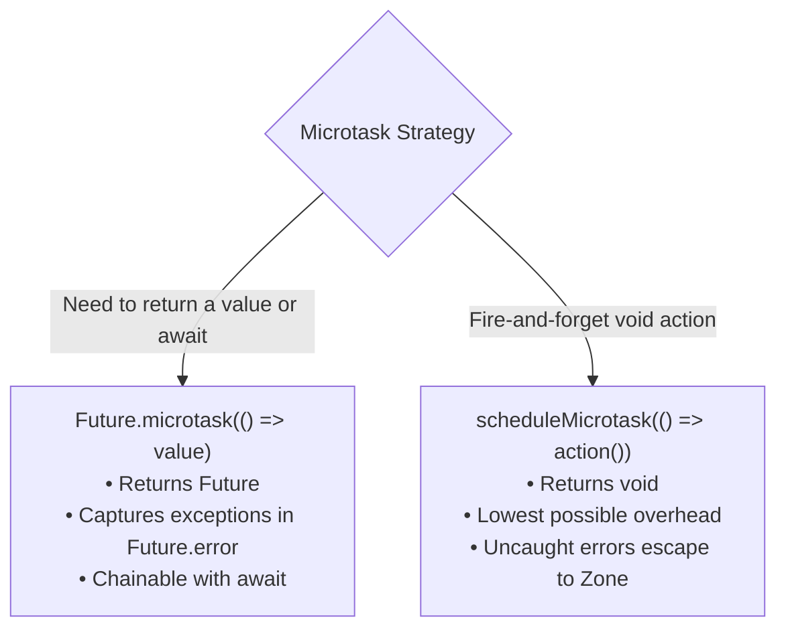

# Microtask Execution in Dart: `scheduleMicrotask` vs `Future.microtask`

> **Module:** 02-advanced-dart  
> **Subsection:** 02-event-loop-and-microtasks  
> **Prerequisites:** [event-loop-mechanics.md](./event-loop-mechanics.md)  
> **Official References:** [api.dart.dev/stable/dart-async/scheduleMicrotask.html](https://api.dart.dev/stable/dart-async/scheduleMicrotask.html) | [api.dart.dev/stable/dart-async/Future/Future.microtask.html](https://api.dart.dev/stable/dart-async/Future/Future.microtask.html)

---

## 1. Introduction

In high-performance Dart and Flutter development, you occasionally need to defer execution until the current synchronous function finishes, but **before** the event loop yields control to external events (like user taps, timers, or I/O).

Dart provides two primary ways to schedule tasks directly onto the high-priority Microtask Queue:
1. **`scheduleMicrotask()`**: A lightweight, fire-and-forget function accepting a `void Function()` callback.
2. **`Future.microtask()`**: A constructor that returns a `Future<T>`, allowing callers to `await` the microtask's result and catch exceptions cleanly.

### Why Do We Need Microtasks?
1. **Batching Rapid Notifications:** Coalescing multiple synchronous state changes into a single notification event before rendering begins.
2. **Deterministic Precedence:** Executing internal teardown or state updates before any pending network responses or timer events can execute.
3. **Flutter Internals:** Heavily used within Flutter's layout and rendering pipeline to schedule element reconciliation passes.

---

## 2. Core Concepts



### 1. `scheduleMicrotask(void Function() callback)`
- Located in `dart:async`.
- Extremely lightweight with minimal memory overhead.
- Returns `void`. You cannot `await` it.
- If the callback throws an uncaught exception, it escapes to the current `Zone`'s unhandled error handler.

### 2. `Future.microtask(FutureOr<T> Function() computation)`
- Returns a `Future<T>`.
- Allows callers to use `await Future.microtask(...)`.
- Any exception thrown inside the computation is captured and passed to the returned Future as an error completion, making it safe for `try-catch`.

---

## 3. Syntax and Implementation

```dart
// bin/microtasks_demo.dart

import 'dart:async';

void main() async {
  print('1. Synchronous main start');

  // 1. Using scheduleMicrotask (Fire-and-forget)
  scheduleMicrotask(() {
    print('3. scheduleMicrotask executed');
  });

  // 2. Using Future.microtask (Awaitable with return value)
  final microtaskResult = await Future.microtask(() {
    print('4. Future.microtask computing value...');
    return 42 * 2;
  });
  print('5. Future.microtask returned: $microtaskResult');

  // 3. Error Handling Comparison
  testMicrotaskErrors();

  print('2. Synchronous main end');
}

void testMicrotaskErrors() {
  // Future.microtask safely wraps errors in the Future
  Future.microtask(() {
    throw StateError('Calculated failure inside microtask');
  }).catchError((e) {
    print('6. Safely caught error via Future.microtask: $e');
  });
}
```

### Expected Output
```text
1. Synchronous main start
3. scheduleMicrotask executed
4. Future.microtask computing value...
5. Future.microtask returned: 84
2. Synchronous main end
6. Safely caught error via Future.microtask: Bad state: Calculated failure inside microtask
```

### Common Mistakes
- **Mistake 1: Using microtasks for heavy computations.**  
  Because the microtask queue is drained before anything on the event queue can run, putting a heavy calculation in a microtask will block UI frame rendering and user gestures, causing severe jank. Heavy CPU work must be moved to an **Isolate**.
- **Mistake 2: Relying on `scheduleMicrotask` when you need to handle errors locally.**  
  Errors in `scheduleMicrotask` cannot be caught with `try/catch`. Use `Future.microtask()`.

---

## 4. Practical Example: Notification Batching Buffer

```dart
// lib/notification_batcher.dart

import 'dart:async';

class StateNotifier {
  final List<String> _pendingChanges = [];
  bool _isScheduled = false;

  void notifyChange(String change) {
    _pendingChanges.add(change);

    // If a microtask is already scheduled, don't schedule another one!
    if (!_isScheduled) {
      _isScheduled = true;
      scheduleMicrotask(_flushChanges);
    }
  }

  void _flushChanges() {
    print('\n[Batch Flush] Disagreeing ${_pendingChanges.length} buffered changes:');
    for (final change in _pendingChanges) {
      print(' • Applied: $change');
    }
    _pendingChanges.clear();
    _isScheduled = false;
  }
}

void main() {
  final notifier = StateNotifier();

  print('Applying 3 rapid synchronous updates...');
  notifier.notifyChange('Update 1: User name changed');
  notifier.notifyChange('Update 2: User avatar updated');
  notifier.notifyChange('Update 3: User role upgraded');

  print('Synchronous method finished. Event loop will now drain microtask queue...');
}
```

---

## 5. Comparison: `scheduleMicrotask` vs `Future.microtask` vs `Future()`

| Feature | `scheduleMicrotask()` | `Future.microtask()` | `Future()` |
|:---|:---|:---|:---|
| **Target Queue** | **Microtask Queue** | **Microtask Queue** | **Event Queue** |
| **Return Type** | `void` | `Future<T>` | `Future<T>` |
| **Can `await`?** | No | **Yes** | **Yes** |
| **Error Handling** | Unhandled errors go to Zone | Contained in returned Future | Contained in returned Future |
| **Execution Priority** | Immediate (precedes event queue) | Immediate (precedes event queue) | Standard (interleaved) |

---

## 6. Interview Preparation

### Frequently Asked Questions

#### Q1: When should you choose `scheduleMicrotask` over `Future()`?
- **Answer:** Use `scheduleMicrotask` when you want a small piece of code to run asynchronously as soon as the current synchronous call stack unwinds, but **before** yielding control to any I/O, timers, or UI events on the event queue. Use `Future()` when you want the event loop to have an opportunity to process other events (like user interactions or UI paints) before running your callback.

---

## 7. Practice Exercises

### Exercise 1 (Beginner): Microtask Pipeline
Write a script that queues 3 microtasks using `scheduleMicrotask`, demonstrating they run in strict First-In-First-Out (FIFO) order before a `Future.delayed(Duration.zero)`.

---

## 8. References
- [Dart API: scheduleMicrotask](https://api.dart.dev/stable/dart-async/scheduleMicrotask.html)
- [Dart API: Future.microtask](https://api.dart.dev/stable/dart-async/Future/Future.microtask.html)
