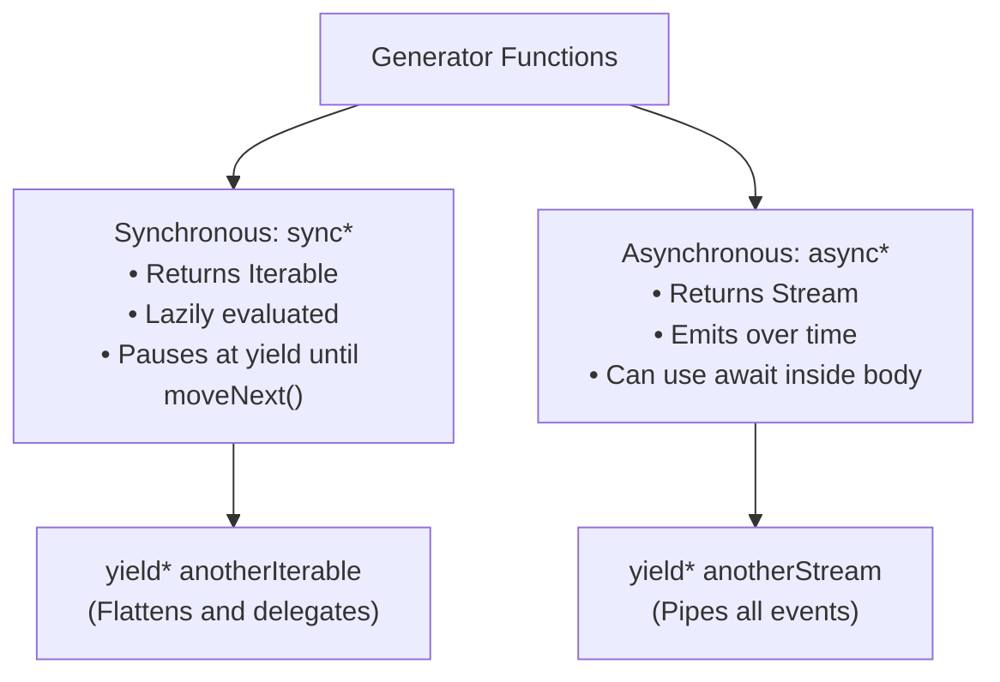

# Generators in Dart: `sync*` and `async*`

> **Module:** 02-advanced-dart  
> **Subsection:** 03-streams-and-generators  
> **Prerequisites:** [stream-fundamentals.md](./stream-fundamentals.md)  
> **Official References:** [dart.dev/language/functions#generators](https://dart.dev/language/functions#generators)

---

## 1. Introduction

When you need to lazily produce a sequence of values, building an entire list in memory beforehand wastes memory and forces callers to wait for the entire generation process to complete.

Dart provides **Generator Functions**:
- **Synchronous Generator (`sync*`)**: Lazily returns an `Iterable<T>`.
- **Asynchronous Generator (`async*`)**: Lazily returns a `Stream<T>`.

Generators use the **`yield`** keyword to emit values one at a time on demand. When an item is yielded, execution pauses until the caller requests the next value. To delegate emission to an entire collection or another stream, Dart provides **`yield*`**.

### Why Do We Need Generators?
1. **Lazy On-Demand Evaluation:** Infinite sequences or large datasets only calculate the values the caller actually reads.
2. **Memory Efficiency:** Avoids allocating huge arrays in RAM when processing large files, database queries, or calculations.
3. **Clean Stream Creation:** An `async*` function replaces hundreds of lines of complex `StreamController` boilerplate with a simple, readable loop.

---

## 2. Core Concepts



### 1. Synchronous Generators (`sync*`)
- Function marked with `sync*`.
- **Must return `Iterable<T>`**.
- Emits values using `yield value;`.
- **Lazy Execution:** The body of a `sync*` function **does not run** when called! It only executes when the consumer calls `iterator.moveNext()` or loops over it with `for-in`.

### 2. Asynchronous Generators (`async*`)
- Function marked with `async*`.
- **Must return `Stream<T>`**.
- Emits values using `yield value;`.
- Can freely use `await` inside the body to wait for asynchronous tasks before yielding the next item.

### 3. Delegating Generators (`yield*`)
- The `yield*` (yield-each) operator delegates emission to another collection or stream:
  - In `sync*`: `yield* someIterable;` emits all elements of `someIterable` one by one.
  - In `async*`: `yield* someStream;` pipes all events from `someStream` directly to the output stream.

---

## 3. Syntax and Implementation

```dart
// bin/generators_demo.dart

import 'dart:async';

// 1. Synchronous Generator (sync*)
Iterable<int> countUpTo(int max) sync* {
  print('--> [sync*] Generator started execution');
  for (int i = 1; i <= max; i++) {
    print('--> [sync*] Yielding $i');
    yield i; // Pauses here until caller asks for next element!
  }
  print('--> [sync*] Generator finished');
}

// 2. Synchronous Generator with yield* delegation
Iterable<int> generateSeries() sync* {
  yield 0;
  yield* countUpTo(3); // Delegates to countUpTo
  yield 99;
}

// 3. Asynchronous Generator (async*)
Stream<int> countdownTimer(int seconds) async* {
  print('--> [async*] Countdown stream initialized');
  for (int i = seconds; i > 0; i--) {
    // We can use await inside async*!
    await Future.delayed(const Duration(milliseconds: 200));
    yield i;
  }
  await Future.delayed(const Duration(milliseconds: 200));
  print('--> [async*] Countdown complete!');
}

void main() async {
  // ==========================================
  // 1. Testing Lazy sync* Generator
  // ==========================================
  print('--- 1. Testing sync* ---');
  final sequence = countUpTo(3);
  print('Function called. Has generator executed yet? (Notice NO logs yet!)');

  for (final num in sequence) {
    print('Consumer received: $num');
  }

  // ==========================================
  // 2. Testing yield* Delegation
  // ==========================================
  print('\n--- 2. Testing yield* ---');
  final series = generateSeries().toList();
  print('Series result: $series');

  // ==========================================
  // 3. Testing async* Stream Generator
  // ==========================================
  print('\n--- 3. Testing async* ---');
  await for (final remaining in countdownTimer(3)) {
    print('T-minus: $remaining seconds');
  }
}
```

### Expected Output
```text
--- 1. Testing sync* ---
Function called. Has generator executed yet? (Notice NO logs yet!)
--> [sync*] Generator started execution
--> [sync*] Yielding 1
Consumer received: 1
--> [sync*] Yielding 2
Consumer received: 2
--> [sync*] Yielding 3
Consumer received: 3
--> [sync*] Generator finished

--- 2. Testing yield* ---
--> [sync*] Generator started execution
--> [sync*] Yielding 1
--> [sync*] Yielding 2
--> [sync*] Yielding 3
--> [sync*] Generator finished
Series result: [0, 1, 2, 3, 99]

--- 3. Testing async* ---
--> [async*] Countdown stream initialized
T-minus: 3 seconds
T-minus: 2 seconds
T-minus: 1 seconds
--> [async*] Countdown complete!
```

### Common Mistakes
- **Mistake 1: Using `return value;` inside a generator.**  
  Generators cannot return a value with `return`. A bare `return;` is allowed to terminate generation early, but to emit values you must use `yield`.
- **Mistake 2: Forgetting that `sync*` is lazy.**  
  If you call a `sync*` function that has side effects (like logging), those side effects will **not occur** until the returned `Iterable` is actually iterated with `for-in` or `.toList()`.

---

## 4. Practical Example: Paginated Network Stream via `async*` and `yield*`

```dart
// lib/paginated_fetcher.dart

import 'dart:async';

// Simulating a paginated API response
Future<List<String>> fetchPage(int pageNumber) async {
  await Future.delayed(const Duration(milliseconds: 100));
  if (pageNumber > 3) return []; // Only 3 pages exist
  return ['User_${pageNumber}_A', 'User_${pageNumber}_B'];
}

// Asynchronous generator emitting items across all pages as a continuous Stream
Stream<String> fetchAllUsersStream() async* {
  int page = 1;
  while (true) {
    print('Fetching page $page from API...');
    final pageUsers = await fetchPage(page);

    if (pageUsers.isEmpty) {
      break; // Reached end of remote data
    }

    // Emit all users from this page one by one
    yield* Stream.fromIterable(pageUsers);
    page++;
  }
}

void main() async {
  print('Subscribing to paginated stream...');
  await for (final user in fetchAllUsersStream()) {
    print('Received user: $user');
  }
  print('All pages successfully consumed.');
}
```

---

## 5. Comparison: `sync*` vs `async*` vs Standard Function

| Feature | Standard Function | `sync*` Generator | `async*` Generator |
|:---|:---|:---|:---|
| **Return Type** | `T` or `List<T>` | **`Iterable<T>`** | **`Stream<T>`** |
| **Emission Keyword** | `return` | **`yield`** | **`yield`** |
| **Delegation Keyword** | Method call | **`yield*`** | **`yield*`** |
| **Can use `await`?** | Only if `async` | **No** (Synchronous only) | **Yes** |
| **Evaluation Timing** | Eager (Runs immediately) | **Lazy (On `moveNext()`)** | **Lazy (On `stream.listen`)** |

---

## 6. Interview Preparation

### Frequently Asked Questions

#### Q1: What is the difference between `yield` and `yield*` in Dart?
- **Answer:** `yield` emits a **single value** into the generated `Iterable` or `Stream`. `yield*` emits **all elements** of another `Iterable` or `Stream` by delegating control to it. Writing `yield* stream;` is equivalent to looping over the stream and yielding every event individually, but with compiler-level performance optimizations.

#### Q2: What happens if an `async*` stream consumer cancels its subscription early?
- **Answer:** When a listener cancels its subscription to an `async*` stream, the generator function pauses execution at its next `yield` statement, executes any enclosing `finally` blocks, and terminates cleanly. This provides automatic resource cleanup if a consumer only needs the first few items (e.g. `stream.take(3)`).

---

## 7. Practice Exercises

### Exercise 1 (Beginner): Infinite Even Number Generator
Create a `sync*` generator `Iterable<int> getEvenNumbers()` that generates infinite even numbers ($0, 2, 4, 6, \dots$). In `main()`, use `.take(5).toList()` to print the first 5 even numbers without hanging in an infinite loop.

---

## 8. References
- [Dart Language Guide: Generator Functions](https://dart.dev/language/functions#generators)
- [Dart Language Tour: Iterables & Streams](https://dart.dev/language/collections)
