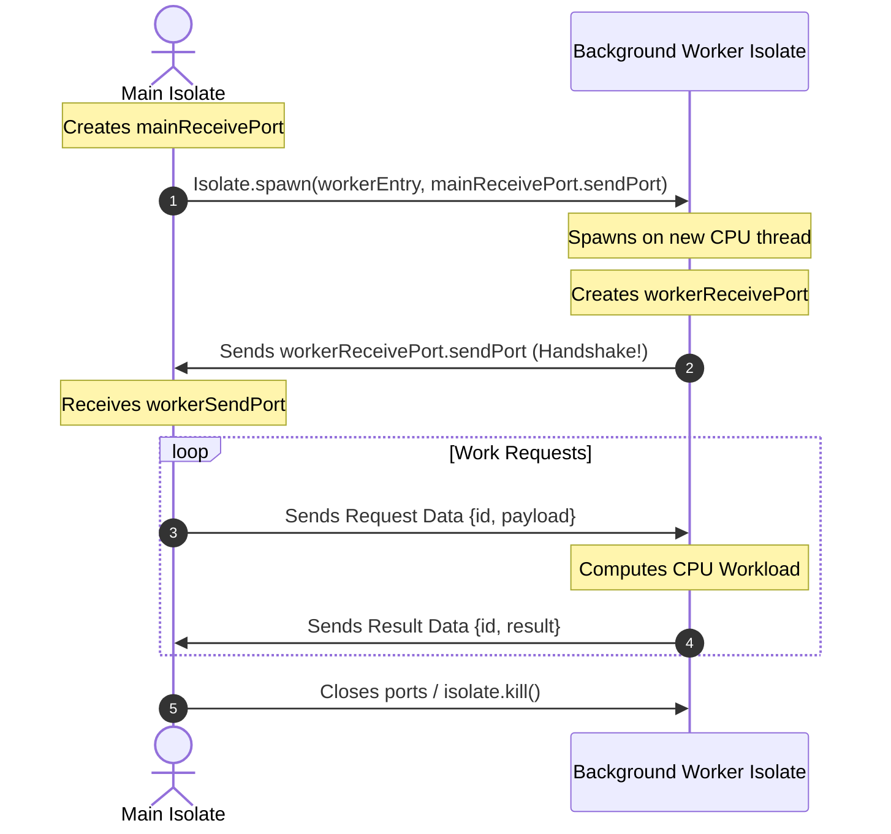

# Isolate Spawning and Two-Way Port Communication in Dart

> **Module:** 02-advanced-dart  
> **Subsection:** 04-concurrency-and-isolates  
> **Prerequisites:** [isolates-vs-threads.md](./isolates-vs-threads.md)  
> **Official References:** [api.dart.dev/stable/dart-isolate/Isolate-class.html](https://api.dart.dev/stable/dart-isolate/Isolate-class.html) | [api.dart.dev/stable/dart-isolate/ReceivePort-class.html](https://api.dart.dev/stable/dart-isolate/ReceivePort-class.html)

---

## 1. Introduction

When you need a **long-running background worker** that remains alive to process multiple requests continuously (such as an audio playback decoder, database indexing worker, or continuous telemetry encoder), creating and destroying isolates for every single task is inefficient.

Dart provides low-level isolate APIs:
- **`Isolate.spawn()`**: Spawns an independent isolate that executes a specified entrypoint function.
- **`ReceivePort`**: A stream-like receiver that listens for incoming messages.
- **`SendPort`**: A message transmitter used to post messages across the isolate boundary.

Establishing a persistent two-way communication channel requires a standard **Handshake Protocol**.

---

## 2. Core Concepts



### The Handshake Sequence
1. The **Main Isolate** creates a `ReceivePort` (`mainReceivePort`).
2. The Main Isolate calls `Isolate.spawn(entrypoint, mainReceivePort.sendPort)`, passing its `SendPort`.
3. The **Worker Isolate** starts up and receives the main isolate's `SendPort`.
4. The Worker Isolate creates its own `ReceivePort` (`workerReceivePort`) and immediately sends its `sendPort` back to the main isolate through the received port.
5. The Main Isolate receives the worker's `SendPort`. Both isolates now have a direct handle to message each other bi-directionally!

---

## 3. Syntax and Implementation

```dart
// bin/isolate_ports_demo.dart

import 'dart:async';
import 'dart:isolate';

// Message types for structured communication
class MathTask {
  final int id;
  final int number;
  MathTask(this.id, this.number);
}

class MathResult {
  final int id;
  final int computedValue;
  MathResult(this.id, this.computedValue);
}

// 1. Worker Isolate Entrypoint
void workerEntrypoint(SendPort sendPortToMain) {
  // Create worker's own receive port
  final workerReceivePort = ReceivePort();

  // Handshake Step: Send worker's SendPort back to main
  sendPortToMain.send(workerReceivePort.sendPort);

  // Listen for tasks from main isolate
  workerReceivePort.listen((message) {
    if (message is MathTask) {
      print('--> [Worker Isolate] Processing task #${message.id} (fibonacci of ${message.number})...');
      final result = _calculateFibonacci(message.number);
      
      // Reply with result
      sendPortToMain.send(MathResult(message.id, result));
    } else if (message == 'SHUTDOWN') {
      print('--> [Worker Isolate] Shutting down worker...');
      workerReceivePort.close();
    }
  });
}

// Heavy recursive CPU calculation
int _calculateFibonacci(int n) {
  if (n <= 1) return n;
  return _calculateFibonacci(n - 1) + _calculateFibonacci(n - 2);
}

// 2. Main Coordinator Class
class BackgroundWorkerClient {
  late Isolate _isolate;
  late ReceivePort _mainReceivePort;
  late SendPort _workerSendPort;
  final Completer<void> _handshakeCompleter = Completer<void>();

  final Map<int, Completer<int>> _pendingTasks = {};
  int _taskIdCounter = 0;

  Future<void> initialize() async {
    _mainReceivePort = ReceivePort();

    // Listen to messages from worker
    _mainReceivePort.listen((message) {
      if (message is SendPort) {
        // Handshake response received!
        _workerSendPort = message;
        _handshakeCompleter.complete();
      } else if (message is MathResult) {
        // Result received for pending task
        final completer = _pendingTasks.remove(message.id);
        completer?.complete(message.computedValue);
      }
    });

    // Spawn background isolate
    _isolate = await Isolate.spawn(workerEntrypoint, _mainReceivePort.sendPort);
    await _handshakeCompleter.future;
    print('[Main Isolate] Bi-directional handshake established successfully.');
  }

  Future<int> computeFibonacci(int n) async {
    final taskId = ++_taskIdCounter;
    final completer = Completer<int>();
    _pendingTasks[taskId] = completer;

    // Dispatch task across isolate boundary
    _workerSendPort.send(MathTask(taskId, n));
    return completer.future;
  }

  void dispose() {
    _workerSendPort.send('SHUTDOWN');
    _mainReceivePort.close();
    _isolate.kill(priority: Isolate.immediate);
    print('[Main Isolate] Background worker disposed.');
  }
}

void main() async {
  final client = BackgroundWorkerClient();
  await client.initialize();

  // Dispatch multiple parallel tasks to background worker
  print('[Main Isolate] Dispatching tasks to background isolate...');
  final res1 = client.computeFibonacci(35);
  final res2 = client.computeFibonacci(38);

  print('[Main Isolate] UI remains completely responsive and non-blocking!');

  final result1 = await res1;
  print('[Main Isolate] Received Result 1: $result1');

  final result2 = await res2;
  print('[Main Isolate] Received Result 2: $result2');

  client.dispose();
}
```

### Expected Output
```text
[Main Isolate] Bi-directional handshake established successfully.
[Main Isolate] Dispatching tasks to background isolate...
[Main Isolate] UI remains completely responsive and non-blocking!
--> [Worker Isolate] Processing task #1 (fibonacci of 35)...
--> [Worker Isolate] Processing task #2 (fibonacci of 38)...
[Main Isolate] Received Result 1: 9227465
[Main Isolate] Received Result 2: 39088169
--> [Worker Isolate] Shutting down worker...
[Main Isolate] Background worker disposed.
```

### Common Mistakes
- **Mistake 1: Forgetting to close the `ReceivePort`.**  
  An open `ReceivePort` keeps the Dart Event Loop active. If you do not call `receivePort.close()`, your Dart CLI script or test runner will **hang forever** without exiting.
- **Mistake 2: Spawning an isolate for a fast 1ms task.**  
  Spawning an isolate has an overhead of roughly 10–30ms to allocate memory and initialize the isolate runtime. For simple tasks, the overhead of spawning exceeds the computation time! Use isolates only for tasks exceeding 8–16ms of CPU work.

---

## 4. Comparison: `Isolate.spawn` vs `Isolate.run`

| Dimension | `Isolate.spawn` (with Ports) | `Isolate.run` |
|:---|:---|:---|
| **Lifespan** | **Long-lived worker** (stays alive in background) | **One-off short-lived execution** |
| **Setup Complexity** | Complex (handshake, ports, completers) | **Trivial single-line call (`await Isolate.run(...)`)** |
| **Throughput** | High for continuous streams of work | Overhead per invocation |
| **Best Used For** | Audio decoding, continuous telemetry, socket piping | Heavy one-off parsing (large JSON, image crop) |

---

## 5. Interview Preparation

### Frequently Asked Questions

#### Q1: What is the purpose of `ReceivePort` and `SendPort`?
- **Answer:** Because Dart isolates have completely independent memory heaps, they cannot communicate via shared variables or pointers. `ReceivePort` and `SendPort` provide a type-safe, asynchronous message-passing conduit. A `ReceivePort` acts as a stream consumer that receives messages, while its associated `SendPort` acts as a sender that can be passed to another isolate to post messages into that stream.

---

## 6. Practice Exercises

### Exercise 1 (Intermediate): Prime Number Isolate Worker
Build an isolate worker using `Isolate.spawn` and ports that accepts an integer range `(int min, int max)` and returns all prime numbers within that range without blocking the main program.

---

## 7. References
- [Dart API: Isolate Class](https://api.dart.dev/stable/dart-isolate/Isolate-class.html)
- [Dart Official Concurrency Guide](https://dart.dev/language/concurrency)
