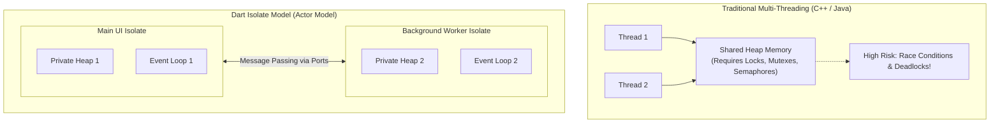
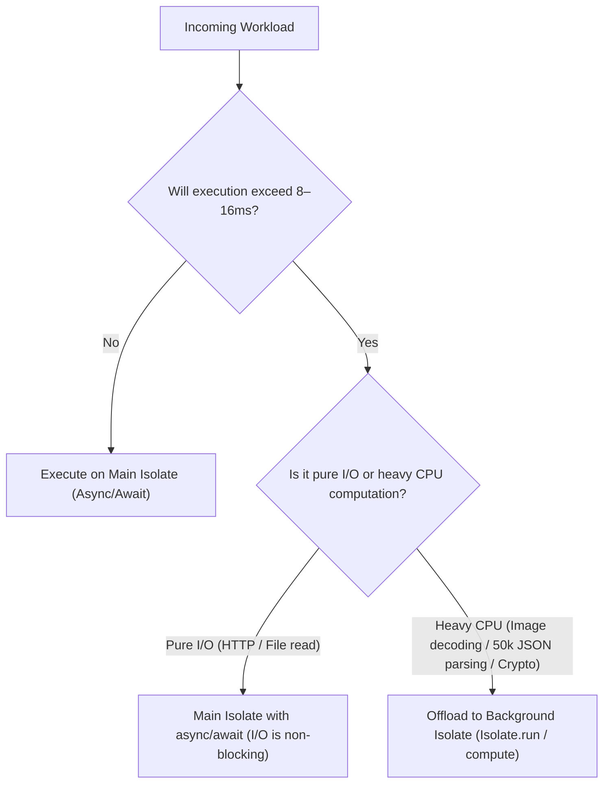

# Isolates vs. Traditional Threads: Concurrency in Dart

> **Module:** 02-advanced-dart  
> **Subsection:** 04-concurrency-and-isolates  
> **Prerequisites:** [event-loop-mechanics.md](../02-event-loop-and-microtasks/event-loop-mechanics.md)  
> **Official References:** [dart.dev/language/concurrency](https://dart.dev/language/concurrency)

---

## 1. Introduction

In traditional multi-threaded programming languages (such as C++, Java, or C#), multiple threads run concurrently within the **same shared memory space**. While this enables fast data sharing, it introduces the most notorious, difficult-to-debug classes of software defects: **race conditions**, **deadlocks**, **thread starvation**, and **memory corruption**. Preventing these issues requires complex synchronization primitives like mutexes, locks, semaphores, and synchronized blocks.

Dart takes a radically safer, modern approach: **The Isolate Model (Actor Model of Concurrency)**.

In Dart, **all code runs inside an Isolate**. An Isolate is an independent worker with its **own private memory heap**, its **own single-threaded event loop**, and its **own garbage collector**.

### Why Do We Need Isolates?
1. **Zero Lock Contention:** Because memory is completely isolated, race conditions on shared state are **physically impossible**. You never need mutexes or locks in Dart.
2. **True Hardware Multi-Core Parallelism:** Multiple Isolates execute on distinct physical CPU cores simultaneously.
3. **Smooth UI Rendering:** Heavy computations (such as image filtering, JSON deserialization of 20MB files, or cryptography) can be offloaded to a background isolate without dropping a single frame of the 60/120 FPS UI thread.

---

## 2. Core Concepts

### 1. Memory Isolation
No two isolates ever share mutable state. When an isolate sends an object to another isolate, Dart either:
- **Copies** the object deeply across the isolate boundary (standard message passing), or
- Performs a **zero-copy pointer transfer** if the object is an unshared primitive or `TransferableTypedData`.

### 2. The Actor Model
Isolates adhere to the **Actor Model**:
- Each isolate acts as an independent entity (actor).
- Isolates can only communicate by sending asynchronous messages to each other.
- An isolate processes incoming messages sequentially via its own Event Loop.

### 3. What Objects Can Be Sent Across Isolates?
Most standard Dart types can be sent across isolates:
- Primitive values (`null`, `bool`, `int`, `double`, `String`).
- Collections (`List`, `Map`, `Set`) containing sendable values.
- `SendPort` instances (allowing two-way handshake communication channels).
- Instances of user-defined classes (serialized deeply by the Dart VM).
- **Cannot be sent:** Native OS resources (open database connections, active network sockets), closures with non-top-level scope, or Flutter `Widget` / `BuildContext` objects!

---

## 3. Comparison: Traditional OS Threads vs. Dart Isolates

| Dimension | Traditional Threads (Java, C++) | Dart Isolates |
|:---|:---|:---|
| **Memory Architecture** | **Shared Memory** across all threads | **Isolated Private Heaps** (Zero sharing) |
| **Data Races & Deadlocks** | High risk; requires explicit locking | **Impossible by design** |
| **Synchronization** | Mutexes, Locks, Atomics, Volatiles | **Asynchronous Message Passing (`SendPort`)** |
| **Garbage Collection** | "Stop-the-world" across all threads | **Independent GC per isolate** (No UI freezes) |
| **Communication Overhead** | $O(1)$ pointer reading | Message copying (or zero-copy buffer transfer) |
| **Multi-Core Utilization** | Uses all available CPU cores | **Uses all available CPU cores** |

---

## 4. When to Use an Isolate in Flutter

### Safe on Main Isolate:
- Querying a REST API using `http` or `dio` (I/O is non-blocking at the OS level).
- Writing a small string to `SharedPreferences`.
- Animating UI widgets and handling touch gestures.

### Must Offload to a Background Isolate:
- Deserializing large JSON payloads (e.g. 5MB+ array of 10,000 entities).
- Resizing, cropping, or compressing raw camera images.
- Generating encryption keys (AES, RSA) or computing cryptographic hashes.
- Executing pathfinding or physics calculations for 2D game loops.

---

## 5. Interview Preparation

### Frequently Asked Questions

#### Q1: Why does Dart use Isolates instead of shared-memory threads?
- **Short Answer:** To guarantee safety, eliminate race conditions/deadlocks, and ensure independent garbage collection that prevents UI frame drops.
- **Detailed Answer:** In shared-memory systems, locks and mutexes introduce synchronization bugs and stop-the-world garbage collection pauses that ruin fluid UI rendering. By isolating memory heaps, Dart eliminates the need for locks and allows each isolate to run its own garbage collector independently. If a background isolate triggers a heavy GC cycle, the main UI isolate continues rendering at 60/120 FPS completely unaffected.

#### Q2: Can two isolates access the same global variable?
- **Answer:** **No.** Global and static variables in Dart are **top-level per isolate**. If Isolate A modifies a global variable `int counter = 0;` to `100`, the global variable `counter` in Isolate B remains `0`. Each isolate has its own independent copy of all static and top-level variables.

---

## 6. References
- [Dart Official Language Guide: Concurrency in Dart](https://dart.dev/language/concurrency)
- [Dart VM Internals: Isolate Architecture](https://github.com/dart-lang/sdk/wiki)
