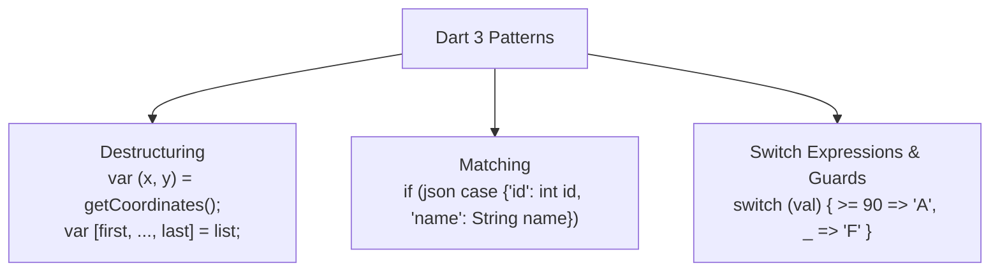

# Pattern Matching and Destructuring in Dart 3

> **Module:** 02-advanced-dart  
> **Subsection:** 05-patterns-records-and-wildcards  
> **Prerequisites:** [records-and-multiple-returns.md](./records-and-multiple-returns.md)  
> **Official References:** [dart.dev/language/patterns](https://dart.dev/language/patterns) | [dart.dev/language/pattern-types](https://dart.dev/language/pattern-types)

---

## 1. Introduction

Prior to Dart 3, inspecting complex nested data structures (such as dynamic JSON maps, lists, or polymorphic objects) required verbose, error-prone manual verification: checking keys, null checks, multiple `if (obj is Type)` checks, and explicit type casts (`as String`).

**Dart 3 introduced Pattern Matching and Destructuring**, allowing you to:
1. **Match** the shape, type, and content of data structures declaratively.
2. **Destructure** (unpack) data into local variables in a single expression.
3. Replace nested `if-else` cascades with clean, expressive **`switch` expressions** and **`if-case`** statements.

---

## 2. Core Concepts



### Pattern Contexts in Dart 3
Patterns can be applied in multiple syntactic positions:
1. **Variable Declaration & Assignment:** `final (a, b) = ('first', 42);`
2. **`if-case` Statements:** `if (response case {'status': 200, 'data': final data}) { ... }`
3. **Switch Statements & Switch Expressions:** Pattern matching with optional `when` guard clauses.

### Core Pattern Types
- **Constant Pattern:** Matches a literal value (`case 200:`, `case 'SUCCESS':`).
- **Relational Pattern:** Compares value using `<`, `<=`, `>`, `>=` (`case >= 18:`).
- **Logical Patterns:** Combines patterns with `||` (OR) and `&&` (AND) (`case 200 || 201:`).
- **List Pattern:** Matches lists by structure and position (`case [var first, ..., var last]:`).
- **Map Pattern:** Matches specific map keys and unpacks their values (`case {'role': 'admin'}:`).
- **Object Pattern:** Matches classes and unpacks getters (`case User(name: final n, age: >= 21):`).
- **Wildcard Pattern (`_`):** Discards a value without binding it to any variable.

---

## 3. Syntax and Implementation

```dart
// bin/patterns_demo.dart

class User {
  final String name;
  final int age;
  final bool isVerified;
  User({required this.name, required this.age, this.isVerified = false});
}

void main() {
  // ==========================================
  // 1. Destructuring Records and Lists
  // ==========================================
  print('--- 1. Destructuring Collections ---');
  final numbers = [10, 20, 30, 40, 50];
  
  // Unpack first element, rest, and last element!
  final [first, ..., last] = numbers;
  print('First: $first, Last: $last');

  // ==========================================
  // 2. Destructuring JSON with if-case
  // ==========================================
  print('\n--- 2. Validating & Destructuring JSON ---');
  final Map<String, Object?> apiPayload = {
    'status': 'success',
    'user': {'id': 101, 'name': 'Dash', 'role': 'Admin'},
  };

  // Checks structure, types, and binds variables in ONE LINE:
  if (apiPayload case {
        'status': 'success',
        'user': {'id': int id, 'name': String name, 'role': String role}
      }) {
    print('Successfully verified API user: $name (ID: $id, Role: $role)');
  } else {
    print('Invalid payload schema received!');
  }

  // ==========================================
  // 3. Object Patterns & Guard Clauses (when)
  // ==========================================
  print('\n--- 3. Object Patterns in Switch Expressions ---');
  final user1 = User(name: 'Alice', age: 25, isVerified: true);
  final user2 = User(name: 'Bob', age: 16, isVerified: false);
  final user3 = User(name: 'Charlie', age: 30, isVerified: false);

  print(evaluateUserAccess(user1));
  print(evaluateUserAccess(user2));
  print(evaluateUserAccess(user3));
}

String evaluateUserAccess(User user) {
  // Pattern matching on object getters!
  return switch (user) {
    User(isVerified: false) => '${user.name} is blocked: Email unverified.',
    User(age: < 18) => '${user.name} is blocked: Must be 18+.',
    User(age: >= 18, isVerified: true) when user.name.startsWith('A') =>
      '${user.name} granted VIP Alpha Access!',
    User(age: >= 18, isVerified: true) => '${user.name} granted Standard Access.',
  };
}
```

### Expected Output
```text
--- 1. Destructuring Collections ---
First: 10, Last: 50

--- 2. Validating & Destructuring JSON ---
Successfully verified API user: Dash (ID: 101, Role: Admin)

--- 3. Object Patterns in Switch Expressions ---
Alice granted VIP Alpha Access!
Bob is blocked: Email unverified.
Charlie is blocked: Email unverified.
```

### Common Mistakes
- **Mistake 1: Confusing `=` with `:` in Object patterns.**  
  When matching object fields, use colon notation: `User(name: final n)`. Using `=` (e.g. `User(name = 'Alice')`) causes a syntax error.
- **Mistake 2: Missing the `case` keyword in `if` pattern matching.**  
  Writing `if (json {'id': 10})` is a syntax error. In Dart 3, pattern matching inside an `if` statement requires the `case` keyword: `if (json case {'id': 10})`.

---

## 4. Comparison: Pre-Dart 3 vs. Dart 3 Pattern Matching

```dart
// Pre-Dart 3 (Verbose, manual casting, fragile)
void handleResponseOld(Map<String, dynamic> json) {
  if (json.containsKey('user') && json['user'] is Map) {
    var userMap = json['user'] as Map;
    if (userMap['id'] is int && userMap['name'] is String) {
      int id = userMap['id'] as int;
      String name = userMap['name'] as String;
      print('User: $name ($id)');
    }
  }
}

// Dart 3 (Declarative, type-safe, 1 line!)
void handleResponseNew(Map<String, Object?> json) {
  if (json case {'user': {'id': int id, 'name': String name}}) {
    print('User: $name ($id)');
  }
}
```

| Dimension | Pre-Dart 3 Manual Validation | Dart 3 Pattern Matching |
|:---|:---|:---|
| **Code Length** | 10–20 lines of nested if-checks | **Single concise expression** |
| **Type Safety** | Relies on runtime casts (`as`) | **Guaranteed by flow analyzer** |
| **Object Unpacking** | Manual variable extractions | **Instant variable binding** |
| **Exhaustiveness** | No compiler checking | **Enforced by switch expressions** |

---

## 5. Interview Preparation

### Frequently Asked Questions

#### Q1: What is an `if-case` statement in Dart 3?
- **Answer:** An `if-case` statement evaluates an expression against a pattern. If the pattern matches (verifying type, shape, or values), the condition evaluates to `true` and any variables defined in the pattern are bound and available inside the `if` block. It eliminates the need for manual type checks and casts when inspecting structured data.

#### Q2: What is the purpose of the `when` clause in a pattern match?
- **Answer:** The `when` clause acts as a **guard condition**. Even if the structure and types match the pattern, the branch will only be selected if the boolean expression following `when` evaluates to `true`. This allows combining structural type matches with arbitrary runtime conditions (e.g. `case User(age: final a) when a % 2 == 0:`).

---

## 6. Practice Exercises

### Exercise 1 (Intermediate): HTTP Response Classifier
Write a switch expression taking an `int statusCode` that returns:
- `'Success'` for 200 through 299 (`>= 200 && <= 299`).
- `'Redirect'` for 300 through 399.
- `'Client Error'` for 400 through 499.
- `'Server Error'` for 500 through 599.
- `'Unknown'` for all other numbers.

---

## 7. References
- [Dart Official Language Guide: Patterns](https://dart.dev/language/patterns)
- [Dart Pattern Types Reference](https://dart.dev/language/pattern-types)
