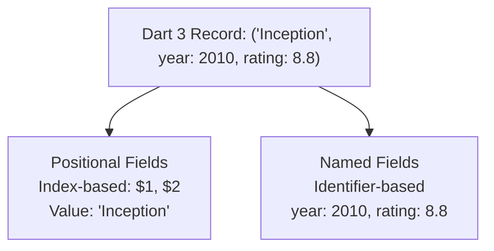
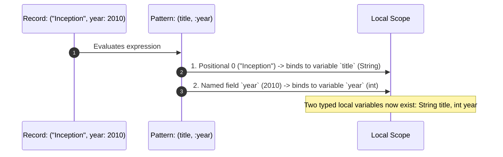
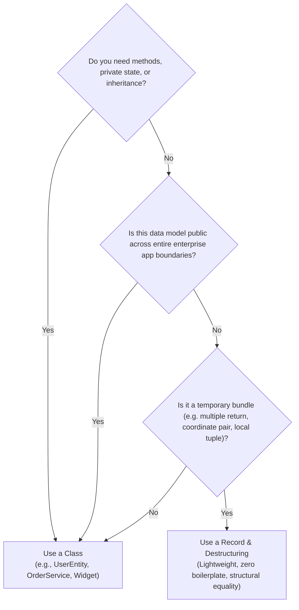

# Dart Record Destructuring: In-Depth Technical Guide

> **Module:** 02-advanced-dart  
> **Subsection:** 05-patterns-records-and-wildcards  
> **Prerequisites:** [records-and-multiple-returns.md](./records-and-multiple-returns.md) | [pattern-matching-and-destructuring.md](./pattern-matching-and-destructuring.md)  
> **Official References:** [dart.dev/language/records](https://dart.dev/language/records) | [dart.dev/language/patterns](https://dart.dev/language/patterns) | [dart.dev/language/variables](https://dart.dev/language/variables)

---

## 1. Introduction

### What Are Dart Records?
Introduced in **Dart 3.0**, a **Record** is an anonymous, immutable, aggregate value type. Records allow developers to bundle multiple values together into a single composite value without having to author boilerplate classes, create loose dynamic maps, or allocate ordered lists.

```dart
// A record bundling a String and an int:
final song = ('Bohemian Rhapsody', 354);
```

### What Is Destructuring?
**Destructuring** (also known as *pattern unpacking*) is the syntactic process of decomposing a composite data structure (like a Record, List, or Map) into its constituent components and binding those individual values directly to distinct local variables in a single, expressive declaration.

```dart
// Destructuring the record into two local variables:
final (title, durationInSeconds) = song;
print(title);             // Bohemian Rhapsody
print(durationInSeconds); // 354
```

### Why Does Dart Support Destructuring?
Prior to Dart 3, unpacking composite data was repetitive, verbose, and manual:

```dart
// Pre-Dart 3 manual unpacking (verbose & error-prone):
final result = getCoordinates();
final latitude = result.$1;
final longitude = result.$2;
```

With Dart 3 record destructuring, this collapses into one clean, declarative statement:
```dart
// Modern Dart 3 destructuring:
final (latitude, longitude) = getCoordinates();
```

Dart added destructuring to:
1. **Eliminate boilerplate:** Avoid accessing positional fields manually via `$1`, `$2`, `$3` or named getters repeatedly.
2. **Improve readability:** Variable declarations mirror the physical shape of the data they consume.
3. **Enhance type safety:** The Dart analyzer performs compile-time shape, arity, and type verification during assignment.

### When Should Developers Use It?
- When consuming functions or methods that return multiple values.
- When handling complex tuple-like pairs (coordinates, min/max bounds, status/payload tuples).
- When processing API responses, JSON schemas, or state tuples in Flutter controllers without creating disposable single-use data transfer classes.
- Inside control-flow statements (`if-case` and `switch` expressions) to branch and extract values simultaneously.

---

## 2. Understanding Dart Records

Before mastering destructuring, you must understand how Dart structures records. Records have two kinds of fields: **positional** and **named**.



### 1. Positional Records
Positional records order their fields strictly by index. Their type annotation wraps field types in parentheses:

```dart
// Record creation:
(String, int) movie = ('Inception', 2010);

// Direct field access via getters:
print(movie.$1); // Inception
print(movie.$2); // 2010
```

### 2. Named Records
Named records place field labels inside curly braces `{}` within the type annotation, and specify `name: value` pairs in the literal:

```dart
// Record creation:
({String title, int year}) movie = (title: 'Inception', year: 2010);

// Direct field access via field names:
print(movie.title); // Inception
print(movie.year);  // 2010
```

### 3. Mixed Positional and Named Records
A record can contain both positional and named fields simultaneously:

```dart
// Type signature: 1 positional String, 2 named fields (int, double)
(String, {int year, double rating}) film = ('Inception', year: 2010, rating: 8.8);

print(film.$1);     // 'Inception'
print(film.year);   // 2010
print(film.rating); // 8.8
```

### 4. Returning Multiple Values from Functions
Records allow functions to return multiple values natively, completely type-safe:

```dart
(double min, double max) getTemperatureRange() {
  // Returning a positional record
  return (14.5, 28.2);
}

({int code, String message}) getResponseStatus() {
  // Returning a named record
  return (code: 200, message: 'OK');
}
```

---

## 3. Record Destructuring: Anatomy and Mechanics

Let us analyze the quintessential Dart destructuring expression line by line:

```dart
var (title, :year) = ("Inception", year: 2010);
```



### Dissecting the Syntax:

| Syntax Element | Role & Meaning |
|:---|:---|
| **`var`** | Begins a **pattern variable declaration**. Tells Dart to infer the types of the newly created variables from the matched record schema. You can also use `final`. |
| **`( ... )` on the left** | This is a **Record Pattern**. It is not constructing a record; it is declaring an extraction blueprint that mirrors the record on the right. |
| **`title`** | An **unnamed positional pattern variable**. Matches the first positional field ($1) of the record (`"Inception"`) and binds it to a new local variable named `title`. |
| **`:year`** | A **named field pattern with shorthand syntax**. This is syntactic sugar for `year: year`. It extracts the record's named field `year` and binds it to a local variable also named `year`. |
| **`("Inception", year: 2010)`** | The **value expression** on the right-hand side that provides the record to be unpacked. |

### Why is `:year` Used Instead of Just `year`?
If Dart allowed writing `(title, year)` without the colon, the compiler would assume `year` is the **second positional field**. 

Because `year: 2010` is a **named field**, writing `year` positionally would trigger a compile-time shape mismatch!

Dart provides two ways to destructure named fields:
1. **Explicit name-to-variable binding:** `(title, year: releaseYear)`  
   Extracts named field `year` into a local variable named `releaseYear`.
2. **Shorthand colon binding:** `(title, :year)`  
   Extracts named field `year` into a local variable named `year` (colon before the name).

---

## 4. Different Destructuring Patterns and Examples

### 1. Positional Record Destructuring

```dart
void main() {
  final song = ('Bohemian Rhapsody', 354);

  // Destructuring into two local variables
  final (title, durationInSeconds) = song;

  print('Title: $title');               // Output: Title: Bohemian Rhapsody
  print('Duration: $durationInSeconds');// Output: Duration: 354
}
```

---

### 2. Named Record Destructuring

You can destructure named fields using either the concise shorthand syntax (`:fieldName`) or by binding the field to a custom variable identifier (`fieldName: customVar`):

```dart
void main() {
  final user = (name: 'Dash', age: 10, role: 'Mascot');

  // Method A: Field-name shorthand (:name, :age)
  final (:name, :age) = user;
  print('$name is $age years old.'); // Output: Dash is 10 years old.

  // Method B: Renaming to custom variable names
  final (role: userRole) = user;
  print('Role: $userRole');          // Output: Role: Mascot
}
```

---

### 3. Mixed Record Destructuring

When a record contains both positional and named fields, the destructuring pattern combines both formats:

```dart
void main() {
  final request = ('POST', endpoint: '/api/v1/auth', timeoutMs: 5000);

  // 'method' matches positional $1
  // ':endpoint' and ':timeoutMs' match named fields
  final (method, :endpoint, :timeoutMs) = request;

  print('Executing $method to $endpoint (Timeout: ${timeoutMs}ms)');
  // Output: Executing POST to /api/v1/auth (Timeout: 5000ms)
}
```

---

### 4. Explicitly Typed Destructuring

You can supply explicit static types to the destructured variables.

> 💡 **Important Dart 3 Grammar Rule:**  
> When declaring *new* variables with explicit types, you **must** prefix the pattern with `var` or `final`. If omitted, Dart treats the statement as an assignment to pre-existing variables.

```dart
void main() {
  // Pattern variable declaration with explicit types:
  final (String title, int duration) = ('Yesterday', 125);

  // Pattern assignment to existing variables:
  String songName;
  int seconds;
  (songName, seconds) = ('Let It Be', 243);

  print('$songName runs for $seconds seconds.');
  // Output: Let It Be runs for 243 seconds.
}
```

---

### 5. Nested Record Destructuring

Destructuring patterns can be nested to arbitrary depths to unpack multi-layered records in a single line:

```dart
void main() {
  // Nested record structure: (String, (String, int))
  final track = ('Imagine', ('John Lennon', 1971));

  // Nested destructuring pattern:
  final (songTitle, (artist, releaseYear)) = track;

  print('$songTitle by $artist released in $releaseYear');
  // Output: Imagine by John Lennon released in 1971
}
```

---

### 6. Ignoring Unwanted Fields Using the Wildcard (`_`)

If a record returns five values but your current scope only requires two, use the wildcard variable `_` to discard the unwanted fields without creating unused variables or triggering linter warnings:

```dart
(String host, int port, String protocol, bool isSecure) getNetworkConfig() {
  return ('192.168.1.1', 8080, 'https', true);
}

void main() {
  // Extract ONLY host and port; ignore protocol and isSecure
  final (host, port, _, _) = getNetworkConfig();

  print('Connecting to $host on port $port');
  // Output: Connecting to 192.168.1.1 on port 8080
}
```

---

### 7. Destructuring Inside Control-Flow Statements

Dart 3 integrates record destructuring directly into `if-case` statements and `switch` expressions:

#### A. In `if-case` Statements:
```dart
void handleAuthResult(dynamic result) {
  // Validates that result matches a specific record shape AND destructures it:
  if (result case (int statusCode, String token) when statusCode == 200) {
    print('Authenticated! Token: $token');
  } else {
    print('Authentication rejected.');
  }
}
```

#### B. In `switch` Expressions:
```dart
String formatJobStatus((String status, {int retryCount}) job) {
  return switch (job) {
    ('SUCCESS', _) => 'Job executed cleanly.',
    ('FAILED', retryCount: >= 3) => 'Aborted: Max retry limit reached.',
    ('FAILED', :final retryCount) => 'Failed. Attempting retry #$retryCount...',
    _ => 'Status unknown.',
  };
}

void main() {
  print(formatJobStatus(('FAILED', retryCount: 1))); 
  // Output: Failed. Attempting retry #1...

  print(formatJobStatus(('FAILED', retryCount: 4))); 
  // Output: Aborted: Max retry limit reached.
}
```

---

## 5. Practical Flutter and Dart Real-World Examples

### Example 1: Coordinates and Geographical Bounding Boxes

```dart
// Pure Dart geometry utility
(double latitude, double longitude) getDeviceLocation() {
  // Simulate sensor acquisition
  return (37.7749, -122.4194);
}

void renderMap() {
  final (lat, lng) = getDeviceLocation();
  print('Centering camera at Latitude: $lat, Longitude: $lng');
}
```

---

### Example 2: Complex API Response Extraction Without Disposable DTOs

Frequently, an internal repository method returns an HTTP status, an optional body, and pagination tokens. Creating a 30-line `class TempApiResponseHolder` is unnecessary overhead when a record with destructuring solves it cleanly:

```dart
import 'dart:convert';

({int statusCode, Map<String, dynamic> data, bool isSuccess}) fetchUserProfile(int userId) {
  if (userId == 42) {
    return (
      statusCode: 200,
      data: {'name': 'Alice Wonder', 'tier': 'Premium'},
      isSuccess: true,
    );
  }
  return (
    statusCode: 404,
    data: {'error': 'User not found'},
    isSuccess: false,
  );
}

void loadScreen() {
  final (:statusCode, :data, :isSuccess) = fetchUserProfile(42);

  if (isSuccess) {
    print('Loaded profile for: ${data['name']} (HTTP $statusCode)');
  } else {
    print('Fetch failed with code: $statusCode');
  }
}
// Output: Loaded profile for: Alice Wonder (HTTP 200)
```

---

### Example 3: Audio Track and Duration Formatting

```dart
(String title, int durationSeconds) getAudioMetadata() {
  return ('Stairway to Heaven', 482);
}

void displayPlayer() {
  final (title, duration) = getAudioMetadata();
  final minutes = duration ~/ 60;
  final remainingSeconds = duration % 60;

  print('Now Playing: $title (${minutes}m ${remainingSeconds}s)');
  // Output: Now Playing: Stairway to Heaven (8m 2s)
}
```

---

### Example 4: Flutter Widget State Tuples

In Flutter, when transforming a list of asynchronous records inside a `FutureBuilder` or Riverpod provider, destructuring enables inline data extraction directly within the `itemBuilder`:

```dart
// Hypothetical Flutter widget excerpt
List<(String productName, double price, int stock)> inventory = [
  ('MacBook Pro M3', 1999.00, 14),
  ('Magic Mouse', 79.00, 50),
];

// Inside ListView.builder:
// ListTile(
//   title: Text(name),
//   subtitle: Text('Price: \$$price | In Stock: $stock'),
// );
void printInventory() {
  for (final (name, price, stock) in inventory) {
    print('Product: $name | \$$price | Stock: $stock units');
  }
}
```

---

## 6. Important Conceptual Differences

Understanding where Records and Destructuring fit into the broader Dart type system prevents architectural mistakes:

| Concept | Primary Purpose | Identity & Equality | Mutability | Defining Characteristic |
|:---|:---|:---|:---|:---|
| **Records** | Grouping heterogeneous values anonymously | **Structural** (`r1 == r2` if all fields equal) | **Immutable** | No class declaration required; lightweight compile-time tuple. |
| **Destructuring** | Extracting values from a structure into variables | N/A (syntactic operation) | Depends on `var` vs `final` | Deconstructs records, lists, maps, or objects. |
| **Classes** | Defining custom domain models and business logic | **Reference** (unless `==` overridden) | Mutable or Immutable | Encapsulates methods, private fields, constructors, inheritance. |
| **Lists** | Storing an ordered sequence of homogeneous items | Reference | Mutable by default | Indexed numerically ($0, 1, 2\dots$); dynamic length. |
| **Maps** | Storing arbitrary dynamic key-value pairs | Reference | Mutable by default | Dynamic keys looked up at runtime; keys can be added/removed. |

---

### When to Use Records vs. Classes



- **Use a Record when:**
  - A private or localized function needs to return 2 to 4 related values.
  - You want structural value equality without adding packages like `equatable` or `@freezed`.
  - The composite data is temporary and consumed immediately by the caller.
- **Use a Class when:**
  - The model represents a central domain entity (e.g. `User`, `Account`, `Product`).
  - You need methods, getters with complex calculations, or private fields (`_privateVar`).
  - You need inheritance, interfaces, or class modifiers (`sealed`, `base`, `abstract`).
  - The object will be serialized to/from JSON across network APIs repeatedly.

---

## 7. Common Mistakes & Anti-Patterns (Watch Out!)

### Mistake 1: Omitting the Colon for Named Field Destructuring
```dart
// ❌ WRONG: Compiler looks for POSITIONAL field 2, which does not exist!
final movie = ("Inception", year: 2010);
final (title, year) = movie; 
// Compile Error: The type '(String, {int year})' has 1 positional field, 
// but the pattern expects 2 positional fields.

// ✅ CORRECT: Use the colon shorthand ':year' or 'year: localYear'
final (title, :year) = movie;
```

---

### Mistake 2: Missing `var` or `final` When Declaring Typed Pattern Variables
```dart
// ❌ WRONG: Dart parses this as an assignment to existing variables, not a declaration!
(String artist, int year) = ('Queen', 1975);
// Compile Error: Variable 'artist' can't be declared in a pattern assignment.

// ✅ CORRECT: Prepend 'final' or 'var' to declare new scoped variables
final (String artist, int year) = ('Queen', 1975);
```

---

### Mistake 3: Field Arity (Count) Mismatch
Records enforce exact arity matching. You cannot match 2 fields from a 3-field positional record without explicitly discarding the remainder:

```dart
final triplet = (10, 20, 30);

// ❌ WRONG: Pattern length (2) != Record length (3)
final (a, b) = triplet; 
// Compile Error: The record has 3 fields, but the pattern expects 2.

// ✅ CORRECT: Use '_' to account for the third field
final (a, b, _) = triplet;
```

---

### Mistake 4: Assuming Destructuring Modifies the Original Record
```dart
var (x, y) = (10, 20);
x = 99; // Mutates local variable 'x' ONLY

// The original record is immutable and remains completely unaffected.
```

---

### Mistake 5: Using Square Brackets `[]` Instead of Parentheses `()`
```dart
// ❌ WRONG: Square brackets destructure Lists, NOT Records!
final [a, b] = (10, 20);
// Compile Error: Matched type '(int, int)' is not a subtype of required type 'List'.

// ✅ CORRECT: Records always use parentheses '()'
final (a, b) = (10, 20);
```

---

## 8. High-Frequency Interview Questions

### Q1: What is the fundamental difference between record construction and record destructuring?
**Answer:**  
Record construction creates an aggregate record value by enclosing values in parentheses on the right side of an assignment:  
`final r = (10, 20);`  
Record destructuring unpacks an existing record by placing a record pattern on the *left* side of an assignment, binding its inner fields to distinct local variables:  
`final (x, y) = r;`

---

### Q2: What is the significance of the colon prefix (`:name`) in record destructuring?
**Answer:**  
The colon prefix is the **field-name shorthand syntax** for named record fields. Writing `(:age)` is exact shorthand for `(age: age)`. It instructs the compiler to extract the named field `age` and bind it to a local variable named `age`. Without the colon, Dart treats the identifier as an extraction from a positional field.

---

### Q3: Do records in Dart have reference equality or structural equality?
**Answer:**  
Records have **built-in structural equality**. Two record instances are equal (`==`) and produce the exact same `hashCode` if they have the same shape (same set of positional and named fields) and their corresponding field values are equal according to their own `==` operators.

---

### Q4: Can a function in Dart return multiple values without using collections or custom classes?
**Answer:**  
Yes. Since Dart 3, functions can return a **Record**. For example: `(int, String) getUserData() => (101, 'Dash');`. The caller can then destructure the returned record in a single line: `final (id, name) = getUserData();`.

---

### Q5: What does the wildcard `_` represent in a record pattern?
**Answer:**  
The underscore `_` is a **wildcard pattern**. It matches any value at that position or field without binding it to a variable, allowing developers to satisfy the required arity of the record while ignoring unwanted data.

---

## 9. Practice Exercises

Test your understanding with these 5 progressive exercises. Try solving them before inspecting the solutions in Section 9.2 below!

### Exercise 1 (Beginner): Unpacking Coordinate Tuples
Given the function `(double, double) getGeoPoint() => (25.2048, 55.2708);`, write a single line of code that destructures the latitude and longitude into two local constants named `lat` and `lng`.

### Exercise 2 (Beginner): Named User Record
Given the named record `final account = (username: 'flutter_dev', followers: 1420);`, use the shorthand destructuring syntax to extract both values into local variables `username` and `followers`.

### Exercise 3 (Intermediate): Skipping Unwanted Metadata
Given a function `(String, int, String, DateTime) getLogEntry()` that returns a log level, status code, message, and timestamp, write a destructuring statement that extracts **only** the `statusCode` (integer) and `message` (String), safely discarding the log level and timestamp.

### Exercise 4 (Intermediate): Nested Record Extraction
Given the nested record:
```dart
final order = (
  orderId: 'ORD-9821',
  customer: (name: 'Sarah Connor', phone: '555-0199'),
  total: 149.50,
);
```
Write a single destructuring statement that extracts `orderId`, the customer's `name` (as `customerName`), and the `total`.

### Exercise 5 (Intermediate): Switch Expression Status Router
Write a function `String describeResult((int, {String status}) payload)` using a Dart 3 `switch` expression that matches and destructures the record:
- If status code is `200` with any status string, return `"Success: $status"`.
- If status code is `404` with any status string, return `"Not Found: $status"`.
- For any other status code, return `"Error (Code: $code): $status"`.

---

### 9.2 Solutions

#### Solution to Exercise 1:
```dart
final (lat, lng) = getGeoPoint();
```

#### Solution to Exercise 2:
```dart
final (:username, :followers) = account;
```

#### Solution to Exercise 3:
```dart
final (_, statusCode, message, _) = getLogEntry();
```

#### Solution to Exercise 4:
```dart
final (:orderId, customer: (name: customerName, phone: _), :total) = order;
```

#### Solution to Exercise 5:
```dart
String describeResult((int, {String status}) payload) {
  return switch (payload) {
    (200, :final status) => 'Success: $status',
    (404, :final status) => 'Not Found: $status',
    (final code, :final status) => 'Error (Code: $code): $status',
  };
}
```

---

## 10. Quick Revision & Cheat Sheet

### Syntax Summary
```dart
// 1. Positional destructuring:
var (a, b) = ('first', 'second');

// 2. Named destructuring (shorthand):
var (:name, :age) = (name: 'Dash', age: 10);

// 3. Named destructuring (renamed):
var (name: myName, age: myAge) = (name: 'Dash', age: 10);

// 4. Mixed destructuring:
var (pos1, :named1) = ('val1', named1: 'val2');

// 5. Explicit typing:
final (String name, int age) = ('Dash', 10);

// 6. Wildcard ignore:
var (first, _, third) = (1, 2, 3);

// 7. Nested:
var (a, (b, c)) = (1, (2, 3));
```

### Core Takeaways:
1. **Records are values; Patterns are blueprints.** Records bundle data together; destructuring patterns unpack them.
2. **Parentheses are mandatory.** Records and record patterns always use `( )`. Lists use `[ ]`, and Maps use `{ }`.
3. **Colons identify named fields.** Use `:fieldName` for shorthand binding, or `fieldName: variable` for custom naming.
4. **Dart 3.0+ Requirement.** Records and pattern destructuring are native to Dart 3.0 and newer (`sdk: '>=3.0.0'`).
5. **Zero runtime overhead.** Record destructuring is evaluated at compile time and translates directly to efficient register or stack variable assignments in AOT machine code.

---

## Official References & Further Reading
- [Dart Official Language Guide: Records](https://dart.dev/language/records)
- [Dart Official Language Guide: Patterns](https://dart.dev/language/patterns)
- [Dart Official Language Guide: Pattern Types](https://dart.dev/language/pattern-types)
- [Dart Official Language Guide: Variables](https://dart.dev/language/variables)
