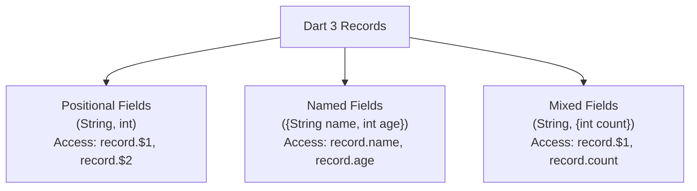

# Records and Multiple Return Values in Dart 3

> **Module:** 02-advanced-dart  
> **Subsection:** 05-patterns-records-and-wildcards  
> **Prerequisites:** [01-dart-fundamentals/](../../01-dart-fundamentals/)  
> **Official References:** [dart.dev/language/records](https://dart.dev/language/records)

---

## 1. Introduction

Prior to Dart 3, if a function needed to return more than one value (for example, coordinates `(latitude, longitude)`, a user and their auth token, or a min and max pair), developers had to choose between awkward compromises:
1. Creating a verbose, dedicated data class (`class CoordinatePair { ... }`).
2. Returning a generic `List<Object>` (losing static typing and field names).
3. Returning a `Map<String, dynamic>` (losing compile-time safety and autocompletion).

**Dart 3 introduced Records**—an anonymous, immutable, aggregate type that bundles multiple values into a single typed unit with **structural equality**.

### Why Do We Need Records?
1. **Multiple Return Values:** Cleanly return pairs, triplets, or complex data bundles from functions without defining boilerplate classes.
2. **Structural Value Equality:** Records with identical fields and values are automatically equal according to `==` and `hashCode`.
3. **Compile-Time Type Safety:** Full static typing and IDE autocompletion for all positional and named fields.

---

## 2. Core Concepts



### 1. Record Syntax
Records are enclosed in parentheses `( )`, with comma-separated fields:
```dart
// Positional Record:
(String, int) user = ('Dash', 10);
print(user.$1); // 'Dash'
print(user.$2); // 10

// Named Record:
({String name, int age}) user = (name: 'Dash', age: 10);
print(user.name); // 'Dash'
```

### 2. Structural Equality
Unlike classes (which default to reference identity unless `==` is manually overridden), records feature **built-in structural equality**:
```dart
final r1 = (1, 'hello');
final r2 = (1, 'hello');
print(r1 == r2); // true!
```

### 3. Immutability
Records are **strictly immutable**. Once created, their fields cannot be reassigned or modified.

---

## 3. Syntax and Implementation

```dart
// bin/records_demo.dart

// 1. Function returning a Positional Record: (double min, double max)
(double, double) calculateMinMax(List<double> numbers) {
  if (numbers.isEmpty) {
    throw ArgumentError('Cannot calculate min/max of empty list');
  }
  double minVal = numbers.first;
  double maxVal = numbers.first;

  for (final n in numbers) {
    if (n < minVal) minVal = n;
    if (n > maxVal) maxVal = n;
  }

  // Returning a record literal!
  return (minVal, maxVal);
}

// 2. Function returning a Named Record with metadata
({String status, int statusCode, List<String> data}) fetchMockApiPayload() {
  return (
    status: 'OK',
    statusCode: 200,
    data: ['Product 1', 'Product 2'],
  );
}

void main() {
  // ==========================================
  // 1. Consuming Positional Records
  // ==========================================
  final scores = [88.5, 94.0, 72.3, 99.1, 65.0];
  final (minScore, maxScore) = calculateMinMax(scores); // Destructuring!

  print('Min Score: $minScore');
  print('Max Score: $maxScore');

  // Direct positional field access ($1, $2)
  final rawRecord = calculateMinMax(scores);
  print('Accessed via \$1 and \$2: ${rawRecord.$1} to ${rawRecord.$2}');

  // ==========================================
  // 2. Consuming Named Records
  // ==========================================
  final response = fetchMockApiPayload();
  print('\nAPI Status:     ${response.status} (${response.statusCode})');
  print('Payload Items:  ${response.data}');

  // ==========================================
  // 3. Structural Equality Verification
  // ==========================================
  final pointA = (x: 10, y: 20);
  final pointB = (x: 10, y: 20);
  final pointC = (x: 15, y: 20);

  print('\nStructural Equality:');
  print('pointA == pointB: ${pointA == pointB}'); // true!
  print('pointA == pointC: ${pointA == pointC}'); // false
}
```

### Expected Output
```text
Min Score: 65.0
Max Score: 99.1
Accessed via $1 and $2: 65.0 to 99.1

API Status:     OK (200)
Payload Items:  [Product 1, Product 2]

Structural Equality:
pointA == pointB: true
pointA == pointC: false
```

### Common Mistakes
- **Mistake 1: Trying to reassign record fields.**  
  `pointA.x = 20;` fails compilation because records are deeply immutable.
- **Mistake 2: Single-element positional records syntax.**  
  In Dart, `(1)` is evaluated as parenthesized integer `1`. To declare a 1-element record, you must include a trailing comma: `(1,)`.

---

## 4. Practical Example: Geolocation & Reverse Geocoding

```dart
// lib/location_service.dart

typedef LatLng = (double latitude, double longitude);

LatLng getCurrentLocation() {
  // Returns latitude and longitude as a clean, typed record
  return (37.7749, -122.4194);
}

({LatLng coordinates, String addressName, bool isAccurate}) getDetailedLocation() {
  return (
    coordinates: (37.7749, -122.4194),
    addressName: 'San Francisco, CA',
    isAccurate: true,
  );
}

void main() {
  final (lat, lng) = getCurrentLocation();
  print('User coordinates: $lat, $lng');

  final info = getDetailedLocation();
  print('Place: ${info.addressName} at (${info.coordinates.$1}, ${info.coordinates.$2})');
}
```

---

## 5. Comparison: Records vs Classes vs Maps

| Feature | Dart 3 Record | Custom Class | `Map<String, dynamic>` |
|:---|:---|:---|:---|
| **Boilerplate** | **Zero (Inline syntax)** | High (Class, constructor, getters) | Low |
| **Type Safety** | **Strict compile-time** | Strict compile-time | **None (Runtime dynamic)** |
| **Equality Check** | **Built-in structural `==`** | Reference identity (unless manual) | Reference identity |
| **Immutability** | **Guaranteed immutable** | Developer's responsibility | Mutable |
| **Methods & Logic** | Data only (No methods) | **Can contain methods & state** | Data only |

---

## 6. Interview Preparation

### Frequently Asked Questions

#### Q1: How do you declare a record with only one positional field?
- **Answer:** You must append a trailing comma: `final single = ('only_element',);`. Without the comma, parentheses are interpreted as grouping operators (e.g. `(42)` is an `int`, while `(42,)` is a `Record` of type `(int,)`).

#### Q2: Can a Record be used as a key in a Map or element in a Set?
- **Answer:** **Yes!** Because records automatically implement sound structural `==` and `hashCode` based on their fields, they can be used immediately as Map keys or Set elements without any custom equality boilerplate:
  ```dart
  final cache = <(int, int), double>{};
  cache[(10, 20)] = 55.4;
  print(cache[(10, 20)]); // 55.4 (Found successfully!)
  ```

---

## 7. Practice Exercises

### Exercise 1 (Beginner): Vector Math
Write a function `(double, double) addVectors((double, double) v1, (double, double) v2)` that takes two 2D vector records and returns their sum as a record.

---

## 8. References
- [Dart Official Language Guide: Records](https://dart.dev/language/records)
- [Dart 3 Launch Announcement: Records and Patterns](https://medium.com/dartlang/announcing-dart-3-53f2f4e9ba35)
