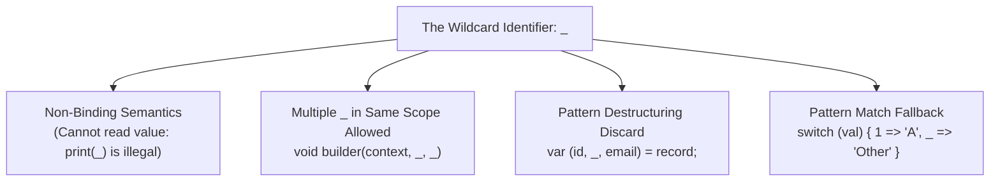

# Wildcard Variables in Dart (Dart 3.7+)

> **Module:** 02-advanced-dart  
> **Subsection:** 05-patterns-records-and-wildcards  
> **Prerequisites:** [pattern-matching-and-destructuring.md](./pattern-matching-and-destructuring.md)  
> **Official References:** [dart.dev/language/wildcards](https://dart.dev/language/wildcards)

---

## 1. Introduction

In software development, you often encounter situations where an API forces you to declare a parameter or variable that you have no intention of using. Common examples include unused `BuildContext` or `Animation` parameters in Flutter widget builders, ignored fields during record destructuring, or unused error objects in `catch` blocks.

Historically in Dart, using an underscore (`_`) declared a real variable named `_`. This meant you could not have two `_` variables in the same scope, and linters complained about unused variables.

**Dart 3.7 introduced True Non-Binding Wildcard Variables (`_`)**. When an identifier is named `_`, it is treated as a **non-binding placeholder** rather than a variable declaration.

### Why Do We Need True Wildcard Variables?
1. **Multiple Wildcards in Same Scope:** You can now declare multiple `_` parameters in the same function without naming collision errors (e.g. `(_, _, index)`).
2. **Intentional Discarding:** Explicitly signals to the compiler, linters, and teammates that a value is intentionally ignored.
3. **Cleaner Pattern Matching:** Easily ignore unwanted elements in records, tuples, and lists during destructuring.

---

## 2. Core Concepts



### The Rules of Non-Binding Wildcards
1. **No Variable Creation:** Declaring `var _ = getValue();` computes the expression but **does not create a variable named `_`**.
2. **Cannot Be Read:** Attempting to read `_` (e.g. `print(_);`) will fail compilation because `_` is not bound to a value.
3. **No Collision:** Because `_` does not introduce a variable into the scope, you can declare as many `_` parameters or variables as needed in the same function:
   ```dart
   void onCallback(int _, String _, bool _) {
     // Perfectly valid in Dart 3.7+!
   }
   ```

---

## 3. Syntax and Implementation

```dart
// bin/wildcards_demo.dart

typedef ItemBuilder = String Function(String context, Object unusedData, int index);

// Function accepting multiple wildcards without name collisions!
void renderList(ItemBuilder builder) {
  for (int i = 0; i < 2; i++) {
    final rendered = builder('FakeContext', 'UnusedPayload', i);
    print('Rendered: $rendered');
  }
}

void main() {
  // ==========================================
  // 1. Multiple Wildcards in Callbacks
  // ==========================================
  print('--- 1. Callbacks with Multiple Wildcards ---');
  // Both the first and second parameters are discarded using '_'
  renderList((_, _, index) => 'List item #$index');

  // ==========================================
  // 2. Wildcards in Pattern Destructuring
  // ==========================================
  print('\n--- 2. Destructuring with Wildcards ---');
  // (userId, internalToken, email, ipAddress)
  final session = (101, 'secret_token_xyz', 'dash@flutter.dev', '192.168.1.1');

  // Discard the internalToken and ipAddress using wildcards!
  final (userId, _, email, _) = session;
  print('Extracted public user info: User #$userId ($email)');

  // ==========================================
  // 3. Wildcards in Catch Blocks
  // ==========================================
  print('\n--- 3. Clean Exception Catch Blocks ---');
  try {
    int.parse('not_a_valid_number');
  } catch (_) {
    // The exception object is discarded cleanly
    print('Caught format error safely without storing exception object.');
  }

  // ==========================================
  // 4. Wildcards in Switch Expressions
  // ==========================================
  print('\n--- 4. Catch-all Pattern Fallback ---');
  int statusCode = 418;
  String statusMessage = switch (statusCode) {
    200 => 'OK',
    404 => 'Not Found',
    500 => 'Internal Error',
    _ => 'Unhandled HTTP Code: $statusCode', // Wildcard catch-all
  };
  print('Status message: $statusMessage');
}
```

### Expected Output
```text
--- 1. Callbacks with Multiple Wildcards ---
Rendered: List item #0
Rendered: List item #1

--- 2. Destructuring with Wildcards ---
Extracted public user info: User #101 (dash@flutter.dev)

--- 3. Clean Exception Catch Blocks ---
Caught format error safely without storing exception object.

--- 4. Catch-all Pattern Fallback ---
Status message: Unhandled HTTP Code: 418
```

### Common Mistakes
- **Mistake 1: Trying to read from `_`.**  
  ```dart
  var _ = 42;
  print(_); // COMPILATION ERROR: Undefined name '_'
  ```
  If you actually need to inspect or print the value, give it a meaningful identifier name (e.g. `unusedValue` or `temp`).

---

## 4. Comparison: Pre-Dart 3.7 vs. Modern Dart 3.7+ Wildcards

| Feature | Pre-Dart 3.7 | Modern Dart 3.7+ |
|:---|:---|:---|
| **Semantics** | Regular variable with special name `_` | **True Non-Binding Placeholder** |
| **Multiple `_` in same scope?** | **No** (Causes `Duplicate definition` error) | **Yes** (Unlimited `_` placeholders) |
| **Can read `_`?** | Yes (`print(_)`) | **No** (Compile-time error) |
| **Linter Warnings** | Required disabling `unused_local_variable` | **Zero warnings (Idiomatic)** |

---

## 5. Interview Preparation

### Frequently Asked Questions

#### Q1: What changed regarding the underscore (`_`) in Dart 3.7?
- **Answer:** Before Dart 3.7, `_` was a regular variable name, meaning declaring two parameters as `(_, _)` caused a duplicate parameter compilation error. Dart 3.7 introduced non-binding wildcard variables: `_` is now recognized as a non-binding placeholder. It can be repeated multiple times in the same parameter list or scope, and does not create an accessible variable in memory.

---

## 6. Practice Exercises

### Exercise 1 (Beginner): Destructuring with Wildcards
Given a 4-element record `('HTTP', 200, 'OK', '127.0.0.1')`, destructure it to extract **only** the status code `200`, discarding all other 3 fields using wildcards.

---

## 7. References
- [Dart Official Language Guide: Wildcard Variables](https://dart.dev/language/wildcards)
- [Dart 3.7 Feature Specification: Non-Binding Wildcards](https://github.com/dart-lang/language/blob/main/accepted/future-releases/wildcard-variables/feature-specification.md)
