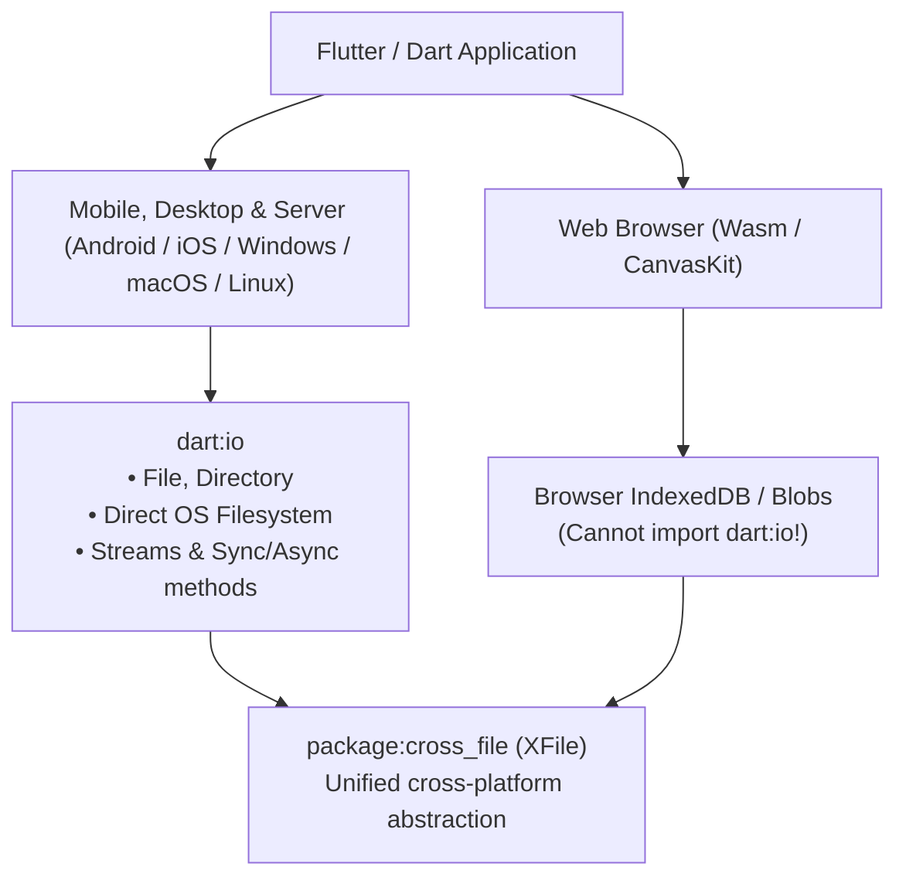

# File I/O and File Systems in Dart (`dart:io` and `XFile`)

> **Module:** 02-advanced-dart  
> **Subsection:** 06-file-io-and-ffi  
> **Prerequisites:** [01-asynchronous-programming/](../01-asynchronous-programming/) | [03-streams-and-generators/](../03-streams-and-generators/)  
> **Official References:** [api.dart.dev/stable/dart-io/dart-io-library.html](https://api.dart.dev/stable/dart-io/dart-io-library.html) | [pub.dev/packages/cross_file](https://pub.dev/packages/cross_file)

---

## 1. Introduction

Interacting with the local file system—reading user documents, caching network images, persisting logs, or writing SQLite databases—is a fundamental requirement of mobile, desktop, and server applications.

Dart provides the **`dart:io`** library for native file system manipulation (`File`, `Directory`, `FileSystemEntity`).

However, **Flutter Web runs inside browser sandboxes where direct access to native OS file paths is prohibited**. To bridge this platform disparity, Flutter applications utilize **`XFile`** (from `package:cross_file`), a unified cross-platform abstraction that operates seamlessly across Android, iOS, Windows, macOS, Linux, and Web.

### Why Do We Need Proper File I/O Architecture?
1. **Thread Responsiveness:** File system reads/writes must run asynchronously to prevent blocking the Flutter UI frame rendering thread.
2. **Cross-Platform Compatibility:** Handling operating system path differences (Windows backslashes `\` vs POSIX forward slashes `/`) cleanly using `package:path`.
3. **Web Portability:** Using `XFile` allows image pickers and camera plugins to work interchangeably on mobile and web browsers.

---

## 2. Core Concepts



### 1. `dart:io` (`File` and `Directory`)
- Provides direct, low-level access to the host operating system's filesystem.
- **Sync vs. Async Methods:**
  - `file.readAsStringSync()`: Blocks the current thread until the file is read. **Avoid on the main UI thread!**
  - `file.readAsString()`: Asynchronous; delegates the I/O operation to the Dart VM's background I/O thread pool and returns a `Future<String>`.
- **Strict Limitation:** **Never import `dart:io` in code that runs on Flutter Web**. Doing so will cause compile-time build failures.

### 2. Cross-Platform Path Handling (`package:path`)
Never hardcode path strings like `'$dir/$fileName'`. Operating systems use different path separators (`\` on Windows, `/` on Linux/macOS/Android/iOS). Always use `path.join(dir, fileName)`.

### 3. `XFile` (`package:cross_file`)
- An abstraction representing a file.
- On native platforms, wraps a `dart:io` `File` with a file path.
- On the web, wraps an in-memory byte buffer or browser `Blob`/URL.
- Standard return type of Flutter plugins like `image_picker` and `file_selector`.

---

## 3. Syntax and Implementation

```dart
// bin/file_io_demo.dart

import 'dart:async';
import 'dart:convert';
import 'dart:io';

// Note: In real projects, import 'package:path/path.dart' as p;
// Here we demonstrate standard dart:io operations

Future<void> main() async {
  print('=== Dart File System Operations ===');

  // 1. Creating a Temporary Directory
  final tempDir = Directory.systemTemp.createTempSync('dart_learning_');
  print('Working directory created: ${tempDir.path}');

  try {
    // 2. Creating and Writing to a File Asynchronously
    final sampleFile = File('${tempDir.path}${Platform.pathSeparator}config.json');
    
    final Map<String, Object?> sampleData = {
      'appName': 'Flutter Dart Learning',
      'version': '1.0.0',
      'isProduction': false,
      'createdAt': DateTime.now().toIso8601String(),
    };

    print('\n--> Writing JSON to file asynchronously...');
    await sampleFile.writeAsString(jsonEncode(sampleData), mode: FileMode.write);
    print('File written successfully. Size: ${await sampleFile.length()} bytes');

    // 3. Reading File Contents Asynchronously
    print('\n--> Reading JSON back from disk...');
    final rawContents = await sampleFile.readAsString();
    final decoded = jsonDecode(rawContents) as Map<String, dynamic>;
    print('Successfully read and decoded:');
    print(' • App: ${decoded['appName']} (v${decoded['version']})');

    // 4. Streaming Large Files (Memory Efficient)
    print('\n--> Streaming file chunks via openRead()...');
    final Stream<List<int>> byteStream = sampleFile.openRead();
    int totalBytesRead = 0;

    await for (final chunk in byteStream) {
      totalBytesRead += chunk.length;
    }
    print('Total bytes streamed: $totalBytesRead');

  } finally {
    // 5. Cleanup
    print('\n--> Cleaning up temporary files...');
    if (tempDir.existsSync()) {
      tempDir.deleteSync(recursive: true);
      print('Temporary directory deleted.');
    }
  }
}
```

### Expected Output
```text
=== Dart File System Operations ===
Working directory created: ...\dart_learning_...

--> Writing JSON to file asynchronously...
File written successfully. Size: 112 bytes

--> Reading JSON back from disk...
Successfully read and decoded:
 • App: Flutter Dart Learning (v1.0.0)

--> Streaming file chunks via openRead()...
Total bytes streamed: 112

--> Cleaning up temporary files...
Temporary directory deleted.
```

### Common Mistakes
- **Mistake 1: Importing `dart:io` in shared web code.**  
  ```dart
  import 'dart:io'; // CRASHES FLUTTER WEB BUILDS!
  ```
  Fix: Use conditional imports, or wrap platform checks, or use `XFile` from `package:cross_file`.
- **Mistake 2: Reading huge 100MB files into memory with `readAsString()`.**  
  Calling `readAsString()` or `readAsBytes()` loads the entire file into heap RAM simultaneously, risking out-of-memory crashes on mobile devices. For large files, always use streaming: `file.openRead().transform(...)`.
- **Mistake 3: Using synchronous file methods on the main thread.**  
  `file.readAsStringSync()` will freeze the Flutter UI, dropping frames while waiting for disk head movement or flash memory access. Always use asynchronous methods (`readAsString()`).

---

## 4. Comparison: `File` (`dart:io`) vs `XFile` (`cross_file`)

| Dimension | `dart:io` `File` | `cross_file` `XFile` |
|:---|:---|:---|
| **Platform Compatibility** | Mobile, Desktop, Server only | **Universal (Mobile, Desktop, Web, Server)** |
| **Flutter Web Support?** | **No (Crashes build)** | **Yes (Full support)** |
| **Underlying Representation** | Direct OS file path pointer | OS path (native) or Blob/Bytes (web) |
| **Reading Bytes** | `file.readAsBytes()` | `xFile.readAsBytes()` |
| **Streaming** | `file.openRead()` | `xFile.openRead()` |
| **Recommended Usage** | Native backend/CLI code, SQLite | Image pickers, file pickers, cross-platform UI |

---

## 5. Interview Preparation

### Frequently Asked Questions

#### Q1: Why does importing `dart:io` break Flutter Web applications?
- **Answer:** Flutter Web compiles Dart code to JavaScript or WebAssembly (Wasm) to run inside web browsers. Web browsers run inside secure sandboxes with no direct access to the underlying operating system's filesystem, POSIX APIs, or raw TCP sockets. Because `dart:io` relies on native C++ OS bindings that do not exist in the browser DOM environment, importing it causes compilation failures.

#### Q2: What is the difference between `readAsBytes()` and `openRead()` on a `File`?
- **Answer:** `readAsBytes()` reads the entire file into memory as a single contiguous `Uint8List`. If the file is 50MB, it consumes 50MB of RAM immediately. `openRead()` returns a `Stream<List<int>>`, reading the file incrementally in small chunks (e.g. 64KB buffers). This allows processing or hashing multi-gigabyte files with virtually zero memory overhead.

---

## 6. Practice Exercises

### Exercise 1 (Intermediate): Rolling File Appender
Create a class `LocalAuditLogger` that appends timestamped log lines to a file on disk using `FileMode.append` asynchronously. Include a method `Future<int> getLogFileSize()` that checks file size.

---

## 7. References
- [Dart API Reference: dart:io Library](https://api.dart.dev/stable/dart-io/dart-io-library.html)
- [Pub.dev: package:cross_file](https://pub.dev/packages/cross_file)
- [Effective Dart: Usage](https://dart.dev/effective-dart/usage)
