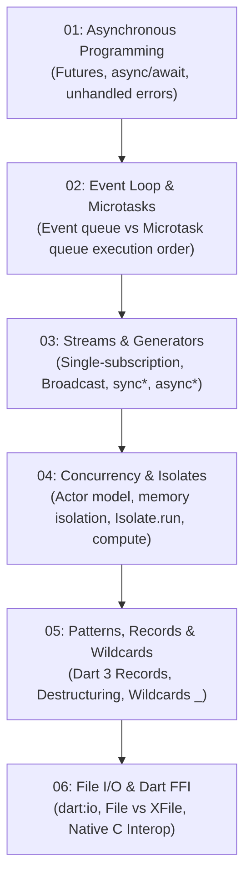

# Module 02: Advanced Dart

Welcome to **Module 02: Advanced Dart**. This module takes you deep into the internal execution runtime of Dart, exploring asynchronous mechanics, the single-threaded event loop, real parallel concurrency via Isolates, modern Dart 3 pattern matching and records, and native interop with C.

---

## 🗺️ Module Subsections

### 1. [01-asynchronous-programming/](./01-asynchronous-programming/)
- **[futures-and-async-await.md](./01-asynchronous-programming/futures-and-async-await.md):** `Future<T>`, the async/await syntax, try/catch/finally, and asynchronous flow.
- **[future-api-methods.md](./01-asynchronous-programming/future-api-methods.md):** `Future.wait`, `Future.forEach`, `Future.any`, `Future.delayed`, and concurrency limits.
- **[unhandled-async-errors.md](./01-asynchronous-programming/unhandled-async-errors.md):** Error zones, `runZonedGuarded`, and catching unhandled asynchronous exceptions.

### 2. [02-event-loop-and-microtasks/](./02-event-loop-and-microtasks/)
- **[event-loop-mechanics.md](./02-event-loop-and-microtasks/event-loop-mechanics.md):** The single-threaded execution model, event queue vs microtask queue.
- **[schedule-microtask-execution.md](./02-event-loop-and-microtasks/schedule-microtask-execution.md):** `scheduleMicrotask`, `Future.microtask`, and avoiding starvation of the event queue.

### 3. [03-streams-and-generators/](./03-streams-and-generators/)
- **[stream-fundamentals.md](./03-streams-and-generators/stream-fundamentals.md):** `Stream<T>`, single-subscription vs broadcast streams, listening, pausing, and cancellation.
- **[stream-controller-and-transformers.md](./03-streams-and-generators/stream-controller-and-transformers.md):** `StreamController`, backpressure, `StreamTransformer`, and pipe.
- **[generators-sync-and-async.md](./03-streams-and-generators/generators-sync-and-async.md):** `sync*` (`Iterable`, `yield`), `async*` (`Stream`, `yield`, `yield*`).

### 4. [04-concurrency-and-isolates/](./04-concurrency-and-isolates/)
- **[isolates-vs-threads.md](./04-concurrency-and-isolates/isolates-vs-threads.md):** Memory isolation, actor model, shared memory vs message passing.
- **[isolate-spawning-and-ports.md](./04-concurrency-and-isolates/isolate-spawning-and-ports.md):** `Isolate.spawn`, `ReceivePort`, `SendPort`, two-way communication channels.
- **[flutter-compute-and-isolate-run.md](./04-concurrency-and-isolates/flutter-compute-and-isolate-run.md):** Modern `Isolate.run` and Flutter's `compute()` for background parsing.

### 5. [05-patterns-records-and-wildcards/](./05-patterns-records-and-wildcards/)
- **[records-and-multiple-returns.md](./05-patterns-records-and-wildcards/records-and-multiple-returns.md):** Dart 3 Records `(int, String)`, anonymous structural types, named fields.
- **[pattern-matching-and-destructuring.md](./05-patterns-records-and-wildcards/pattern-matching-and-destructuring.md):** Destructuring lists, maps, records, objects, and switch expressions.
- **[wildcard-variables.md](./05-patterns-records-and-wildcards/wildcard-variables.md):** Dart 3.7+ non-binding placeholder variables (`_`).

### 6. [06-file-io-and-ffi/](./06-file-io-and-ffi/)
- **[dart-io-file-system.md](./06-file-io-and-ffi/dart-io-file-system.md):** `dart:io`, `File`, `Directory`, `Path`, and cross-platform `XFile`.
- **[native-interop-dart-ffi.md](./06-file-io-and-ffi/native-interop-dart-ffi.md):** Foreign Function Interface (`dart:ffi`), bindings to C libraries, memory pointers.

---

## 🎯 Learning Objectives

By completing Module 02, you will:
1. Master Dart's single-threaded event loop and write non-blocking asynchronous code with confidence.
2. Build reactive data pipelines using single-subscription and broadcast Streams.
3. Offload intensive CPU computations to background Isolates to maintain a silky-smooth 60/120 FPS UI frame rate.
4. Leverage modern Dart 3 Records, Pattern Matching, and Wildcards to write expressive, concise code.
