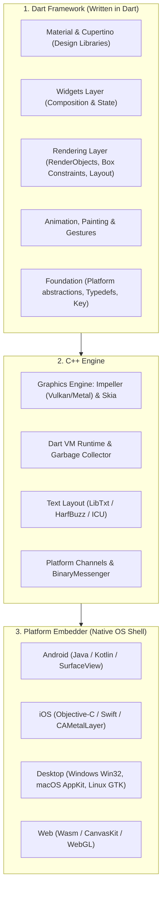
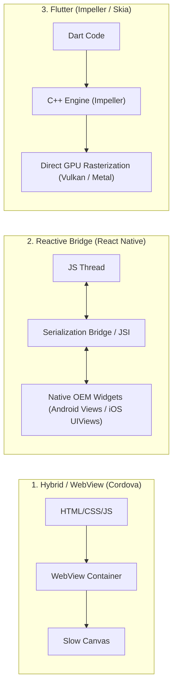
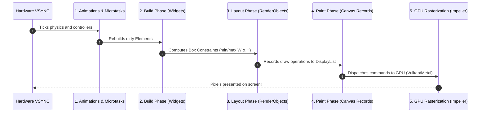

# Flutter Layered Architecture, Engine, and Impeller

> **Module:** 03-flutter-fundamentals  
> **Subsection:** 01-flutter-architecture-and-engine  
> **Prerequisites:** [01-dart-fundamentals/](../../01-dart-fundamentals/) | [02-advanced-dart/](../../02-advanced-dart/)  
> **Official References:** [docs.flutter.dev/resources/architectural-overview](https://docs.flutter.dev/resources/architectural-overview) | [docs.flutter.dev/perf/impeller](https://docs.flutter.dev/perf/impeller)

---

## 1. Introduction

Unlike traditional cross-platform frameworks that translate code into native OEM widgets (like React Native) or render websites inside platform WebViews (like Cordova or Ionic), Flutter is a **self-contained UI toolkit**. Flutter controls every single pixel drawn on the screen, compiling your Dart code into native ARM machine code and drawing directly onto a GPU texture.

Understanding Flutter's layered architecture and its next-generation rendering engine, **Impeller**, is essential for diagnosing rendering performance, avoiding dropped frames, and acing senior technical interviews.

---

## 2. Core Concepts

### The Three Architectural Layers



1. **The Framework (Dart):** The top layer that developers write and interact with daily. Completely replaceable and open source.
2. **The Engine (C++):** Houses the core graphics engine, Dart runtime, text layout algorithms, and input/output plumbing.
3. **The Embedder (Platform Native):** A platform-specific shell (e.g. Java/Kotlin activity on Android, Objective-C/Swift view controller on iOS) that provides a surface for rendering, handles OS lifecycle events, and routes hardware inputs.

---

### Cross-Platform Architecture Comparison



- **Native Development (Android/iOS):** Direct access to OEM widgets, but requires maintaining two separate codebases in Kotlin and Swift.
- **Hybrid / WebView (Cordova, Capacitor):** Wraps a web application inside a native WebView. Slower performance, non-native touch gestures, and styling inconsistencies.
- **Reactive Bridge (React Native):** JavaScript thread coordinates native OEM widgets via an asynchronous bridge or JSI. Bridge serialization bottlenecks can cause stutter during rapid scroll events.
- **Compiled Engine (Flutter):** Bypasses OEM widgets entirely. Uses its own rendering engine to draw buttons, text, and animations directly onto a GPU texture at 60 or 120 FPS.

---

### Graphics Engines: Impeller vs. Skia

For years, Flutter used Google's open-source **Skia** 2D graphics engine. While powerful, Skia compiled shader pipelines at **runtime** when a new drawing operation was first encountered, resulting in noticeable dropped frames—known as **Shader Compilation Jank**.

To permanently eliminate shader jank, the Flutter team developed **Impeller**:
1. **Ahead-of-Time (AOT) Shader Compilation:** All graphics shaders are compiled offline into platform-native shader formats (MSL for iOS Metal, SPIR-V for Android Vulkan) during the `flutter build` step.
2. **Predictable Performance:** Eliminates runtime shader compilation spikes.
3. **Multi-Threading:** Distributes rendering command buffer encoding across CPU worker threads.
4. **Current Status:** Impeller is the **default rendering engine** on iOS (since Flutter 3.10) and Android with Vulkan/OpenGLES (since Flutter 3.16+ / 3.22+).

---

### Compilation Modes: JIT vs. AOT

| Mode | Used In | Compilation Strategy | Capabilities |
|:---|:---|:---|:---|
| **Debug Mode** | `flutter run` | **JIT (Just-In-Time)** | Enables **Hot Reload** (~500ms updates) and source-level debugging |
| **Profile Mode** | `flutter run --profile` | **AOT (Ahead-Of-Time)** | Strips debugging tools, preserves DevTools performance profiling |
| **Release Mode** | `flutter build apk/ipa` | **AOT (Ahead-Of-Time)** | Fully optimized ARM64 native machine code with stripped symbols |

---

## 3. Syntax and Implementation

```dart
// lib/engine_info_demo.dart

import 'package:flutter/foundation.dart';
import 'package:flutter/material.dart';

void main() {
  runApp(const ArchitectureDemoApp());
}

class ArchitectureDemoApp extends StatelessWidget {
  const ArchitectureDemoApp({super.key});

  @override
  Widget build(BuildContext context) {
    return MaterialApp(
      title: 'Flutter Architecture Demo',
      theme: ThemeData(useMaterial3: true, colorSchemeSeed: Colors.blue),
      home: const EngineInfoScreen(),
    );
  }
}

class EngineInfoScreen extends StatelessWidget {
  const EngineInfoScreen({super.key});

  @override
  Widget build(BuildContext context) {
    // Inspecting runtime compilation mode via foundation constants
    final String buildMode = kDebugMode
        ? 'Debug (JIT - Hot Reload Active)'
        : kProfileMode
            ? 'Profile (AOT - Performance Benchmarking)'
            : 'Release (AOT - Highly Optimized ARM64)';

    return Scaffold(
      appBar: AppBar(title: const Text('Flutter Engine Diagnostics')),
      body: Padding(
        padding: const EdgeInsets.all(16.0),
        child: Column(
          crossAxisAlignment: CrossAxisAlignment.start,
          children: [
            _buildDiagnosticCard(
              title: 'Compilation Mode',
              value: buildMode,
              icon: Icons.speed,
            ),
            const SizedBox(height: 12),
            _buildDiagnosticCard(
              title: 'Platform Target',
              value: kIsWeb ? 'Web (CanvasKit / Wasm)' : defaultTargetPlatform.name,
              icon: Icons.devices,
            ),
            const SizedBox(height: 12),
            _buildDiagnosticCard(
              title: 'Rendering Pipeline',
              value: 'Impeller (Metal / Vulkan AOT Shaders)',
              icon: Icons.brush,
            ),
          ],
        ),
      ),
    );
  }

  Widget _buildDiagnosticCard({required String title, required String value, required IconData icon}) {
    return Card(
      elevation: 2,
      child: ListTile(
        leading: Icon(icon, color: Colors.blueAccent),
        title: Text(title, style: const TextStyle(fontWeight: FontWeight.bold)),
        subtitle: Text(value),
      ),
    );
  }
}
```

---

## 4. The 16.6ms Frame Pipeline (Rendering Timeline)

To render a smooth 60 FPS display, Flutter must complete its pipeline within **16.6 milliseconds** (or **8.3ms** for 120 FPS high-refresh rate displays):



---

## 5. Interview Preparation

### Frequently Asked Questions

#### Q1: What causes "Shader Compilation Jank" and how does Impeller solve it?
- **Short Answer:** Skia compiled graphics shaders at runtime the first time an animation or filter appeared, causing dropped frames. Impeller pre-compiles all shaders ahead-of-time (AOT) during app build time.
- **Detailed Answer:** A shader is a small C-like program that executes directly on the GPU to calculate lighting, shadows, blurs, or gradients. In Skia, when an app triggered a novel animation (like an animated bottom sheet with a blur filter), the graphics driver paused the thread to compile the shader into GPU bytecode at runtime, exceeding the 16.6ms frame budget and causing a stutter. Impeller compiles all shaders offline into platform-native shader binaries (MSL for iOS, SPIR-V for Android) at build time, guaranteeing that runtime frame draws never stall on compilation.

#### Q2: How does Flutter achieve "Hot Reload"?
- **Answer:** Hot reload relies on the **Dart VM's JIT (Just-in-Time)** compilation in debug mode. When code is edited, Flutter injects the updated source files directly into the running Dart VM. The VM updates classes with new field definitions and functions, and Flutter triggers a stateful reassemble of the element tree, calling `build()` on existing widget elements without resetting app state or restarting the app.

---

## 6. References
- [Flutter Official Documentation: Architectural Overview](https://docs.flutter.dev/resources/architectural-overview)
- [Flutter Official Documentation: Impeller Rendering Engine](https://docs.flutter.dev/perf/impeller)
- Verification Date: November 2026 (Verified against Flutter 3.22+ stable)
