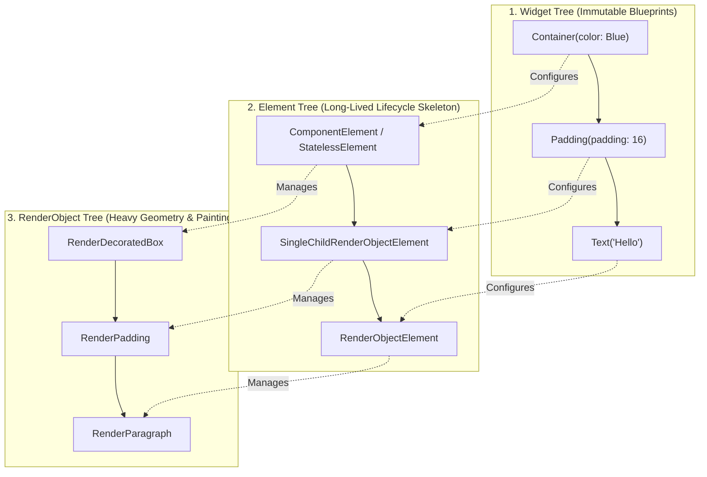
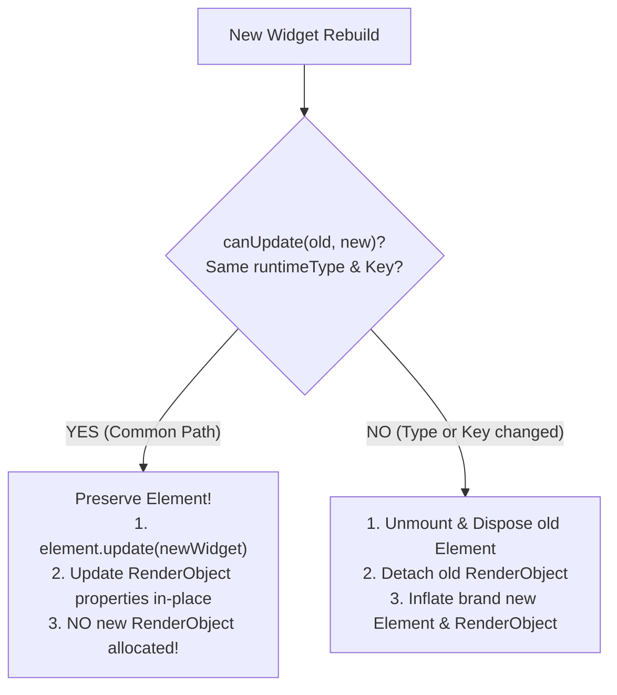

# The Three Trees in Flutter: Widget, Element, and RenderObject

> **Module:** 03-flutter-fundamentals  
> **Subsection:** 02-widget-tree-element-tree-renderobject  
> **Prerequisites:** [01-flutter-architecture-and-engine/layered-architecture.md](../01-flutter-architecture-and-engine/layered-architecture.md)  
> **Official References:** [docs.flutter.dev/resources/architectural-overview#widget-tree](https://docs.flutter.dev/resources/architectural-overview#widget-tree)

---

## 1. Introduction

A common misconception among beginner Flutter developers is that *"Widgets are drawn on the screen."* In reality, **Widgets do not draw anything**. Widgets are merely lightweight, immutable configuration blueprints.

To achieve silky-smooth 60 and 120 FPS animations without garbage collection stutter, Flutter separates its UI hierarchy into **Three Parallel Trees**:
1. **The Widget Tree** (The Configuration)
2. **The Element Tree** (The Lifecycle & Identity Manager)
3. **The RenderObject Tree** (The Layout, Hit-Testing & Painting Engine)

Understanding the interaction between these three trees is the single most important conceptual leap required to transition from a junior to a senior Flutter engineer.

---

## 2. Core Concepts



### 1. The Widget Tree
- **Role:** Immutable configurations (blueprints).
- **Lifecycle:** Extremely short-lived. Widgets are created, destroyed, and rebuilt continuously during animations or `setState()` calls.
- **Cost:** Virtually free to allocate. They hold only constructor parameters (plain data fields).

### 2. The Element Tree
- **Role:** The structural skeleton of the application. An `Element` represents the physical instantiation of a widget at a specific location in the tree.
- **Lifecycle:** **Long-lived**. Elements persist across rebuilds unless the widget's `runtimeType` or `Key` changes.
- **Key Responsibilities:**
  - Holds the state for `StatefulWidget` (`StatefulElement` owns `State<T>`).
  - Acts as the concrete implementation of **`BuildContext`** (every `BuildContext` passed to `build(context)` is literally the `Element` itself!).
  - Manages the creation and updates of `RenderObject`s.

### 3. The RenderObject Tree
- **Role:** Controls geometry, layout calculations, hit-testing, and raster painting.
- **Lifecycle:** Persistent and expensive.
- **Key Responsibilities:**
  - Implements the **Box Constraint protocol** (receives min/max width and height from its parent).
  - Calculates its own dimensions (`size`).
  - Paints pixels onto the GPU canvas via a `PaintingContext`.

---

## 3. The Reconciliation Algorithm (`canUpdate`)

When a parent widget rebuilds, Flutter does **not** discard the existing UI. Instead, it compares the incoming new widget configuration with the existing element using `Widget.canUpdate()`:

```dart
static bool canUpdate(Widget oldWidget, Widget newWidget) {
  return oldWidget.runtimeType == newWidget.runtimeType
      && oldWidget.key == newWidget.key;
}
```



### Why This Design is Brilliant for Performance
Creating lightweight Dart objects (Widgets) is cheap. But creating, laying out, and painting RenderObjects is computationally expensive. Because `canUpdate()` preserves existing `Element`s and `RenderObject`s, updating a button's color simply mutates a property on an existing `RenderDecoratedBox` in memory without touching layout geometry or reallocating trees!

---

## 4. Syntax and Implementation: Inspecting RenderObjects

```dart
// lib/three_trees_demo.dart

import 'package:flutter/material.dart';
import 'package:flutter/rendering.dart';

void main() {
  runApp(const ThreeTreesApp());
}

class ThreeTreesApp extends StatelessWidget {
  const ThreeTreesApp({super.key});

  @override
  Widget build(BuildContext context) {
    return const MaterialApp(
      home: ThreeTreesScreen(),
    );
  }
}

class ThreeTreesScreen extends StatefulWidget {
  const ThreeTreesScreen({super.key});

  @override
  State<ThreeTreesScreen> createState() => _ThreeTreesScreenState();
}

class _ThreeTreesScreenState extends State<ThreeTreesScreen> {
  Color _boxColor = Colors.blue;
  int _counter = 0;

  void _mutateState() {
    setState(() {
      _counter++;
      // Toggling color mutates existing RenderDecoratedBox in-place!
      _boxColor = _boxColor == Colors.blue ? Colors.deepPurple : Colors.blue;
    });
  }

  @override
  Widget build(BuildContext context) {
    // 'context' IS the StatefulElement managing this widget!
    return Scaffold(
      appBar: AppBar(title: const Text('Three Trees in Action')),
      body: Center(
        child: Column(
          mainAxisAlignment: MainAxisAlignment.center,
          children: [
            Text('Rebuild Count: $_counter', style: Theme.of(context).textTheme.headlineSmall),
            const SizedBox(height: 20),
            // Custom widget demonstrating direct RenderObject integration
            AnimatedColorBox(color: _boxColor),
            const SizedBox(height: 20),
            ElevatedButton(
              onPressed: _mutateState,
              child: const Text('Trigger setState() Rebuild'),
            ),
          ],
        ),
      ),
    );
  }
}

/// A custom widget creating a RenderObject directly
class AnimatedColorBox extends LeafRenderObjectWidget {
  final Color color;
  const AnimatedColorBox({super.key, required this.color});

  @override
  RenderObject createRenderObject(BuildContext context) {
    // Called ONCE when element is first inflated
    return RenderColorBox(color);
  }

  @override
  void updateRenderObject(BuildContext context, covariant RenderColorBox renderObject) {
    // Called on every rebuild when canUpdate() returns true!
    renderObject.color = color;
  }
}

/// The actual RenderObject performing layout and painting
class RenderColorBox extends RenderBox {
  Color _color;
  RenderColorBox(this._color);

  set color(Color value) {
    if (_color != value) {
      _color = value;
      markNeedsPaint(); // Requests GPU repaint without triggering layout!
    }
  }

  @override
  void performLayout() {
    // Defining 100x100 fixed size within incoming constraints
    size = constraints.constrain(const Size(120, 120));
  }

  @override
  void paint(PaintingContext context, Offset offset) {
    final Paint paint = Paint()..color = _color;
    // Drawing directly onto the low-level Skia/Impeller Canvas!
    context.canvas.drawRRect(
      RRect.fromRectAndRadius(offset & size, const Radius.circular(16)),
      paint,
    );
  }
}
```

---

## 5. Comparison: Widget vs Element vs RenderObject

| Dimension | Widget | Element | RenderObject |
|:---|:---|:---|:---|
| **Role** | Configuration blueprint | Structural & lifecycle glue | Sizing, layout, hit-testing, paint |
| **Mutability** | **Strictly Immutable (`const`)** | **Mutable (Preserves state)** | **Mutable (Holds dimensions)** |
| **Lifecycle** | Ephemeral (Re-created constantly) | Long-lived (Survives rebuilds) | Long-lived (Survives rebuilds) |
| **Memory Cost** | Cheap (few bytes) | Moderate | Heavy (Geometry & DisplayList) |
| **Direct Access** | Declared in your Dart code | Accessed via `BuildContext` | Accessed via `RenderBox` |
| **Rebuild Action** | New instance allocated | Receives `update(newWidget)` | Mutates properties, repaints |

---

## 6. Interview Preparation

### Frequently Asked Questions

#### Q1: What actually happens under the hood when `setState()` is called?
- **Short Answer:** The `StatefulElement` is marked as dirty and scheduled for rebuild in the next frame.
- **Detailed Answer:**
  1. `setState()` marks the `StatefulElement` owning that state as `_dirty = true`.
  2. The element registers itself with the `BuildOwner` pipeline.
  3. On the next VSync tick, the `BuildOwner` calls `element.rebuild()`.
  4. The element executes `widget.build(this)`.
  5. The new child widget returned by `build()` is compared against the child element using `Widget.canUpdate()`.
  6. If `runtimeType` and `Key` match, the child element is preserved, updated with the new configuration, and its underlying `RenderObject` simply updates its paint or layout parameters.

#### Q2: What is `BuildContext`?
- **Answer:** `BuildContext` is an abstract interface implemented directly by `Element`. When Flutter calls `Widget build(BuildContext context)`, the argument passed as `context` **is literally the Element itself**. It exposes safe methods to query ancestral widgets (e.g. `Theme.of(context)` or `Navigator.of(context)`) and inspect screen positions without giving developers unsafe access to internal element tree pointers.

---

## 7. References
- [Flutter Architectural Overview: Widgets and Elements](https://docs.flutter.dev/resources/architectural-overview#widgets-and-elements)
- [Flutter API Reference: RenderObject](https://api.flutter.dev/flutter/rendering/RenderObject-class.html)
