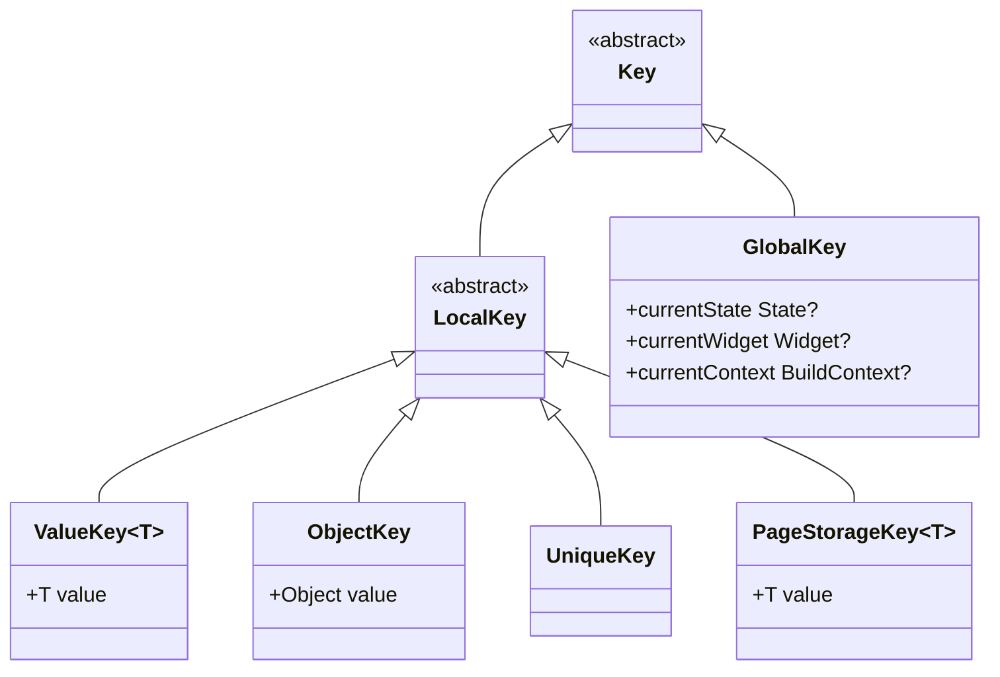
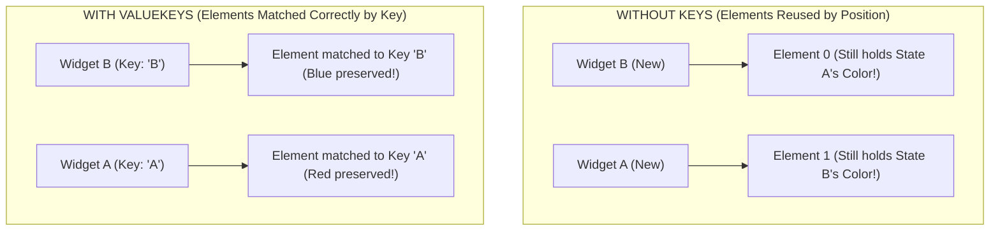

# Keys and Widget Identity in Flutter

> **Module:** 03-flutter-fundamentals  
> **Subsection:** 04-buildcontext-and-keys  
> **Prerequisites:** [02-widget-tree-element-tree-renderobject/the-three-trees.md](../02-widget-tree-element-tree-renderobject/the-three-trees.md)  
> **Official References:** [docs.flutter.dev/ui/widgets/keys](https://docs.flutter.dev/ui/widgets/keys) | [api.flutter.dev/flutter/foundation/Key-class.html](https://api.flutter.dev/flutter/foundation/Key-class.html)

---

## 1. Introduction

Most Flutter widgets are constructed with an optional `Key? key` parameter. In standard static layouts, omitting keys works perfectly fine. However, when working with **dynamically modified collections** (such as reordering, inserting, or deleting items from a `ListView` or `Column`), omitting keys causes infamous, baffling bugs where state remains attached to the wrong visual items.

A **`Key`** controls how the Flutter framework matches widgets to existing elements during reconciliation (`Widget.canUpdate()`).

---

## 2. Core Concepts

### The Key Hierarchy



### 1. `LocalKey`
Scoped within the **same parent widget**. Compares siblings at the same tree depth.
- **`ValueKey<T>`:** Equality is based on value equality (`operator ==`). Ideal when data has a unique ID (e.g. `ValueKey(user.id)`).
- **`ObjectKey`:** Equality is based on object identity (`identical()`).
- **`UniqueKey`:** Generates a completely unique, non-equal key every time it is created. Forces Flutter to discard and recreate the element on every rebuild.
- **`PageStorageKey<T>`:** Stores and restores scroll position (e.g. preserving `ListView` scroll offset when switching tabs in a `BottomNavigationBar`).

### 2. `GlobalKey`
Uniquely identifies an element across the **entire application tree**.
- **Access Child State:** Allows an external parent to access a child's `State` (e.g. `final formKey = GlobalKey<FormState>(); formKey.currentState!.validate()`).
- **Reparenting:** Allows moving a widget from one part of the tree to another without losing its state or destroying its `RenderObject`.
- **Performance Cost:** `GlobalKey`s are expensive because Flutter must track them in a global registry. Use them sparingly.

---

## 3. The Classic "State Swapping" Bug (Why Keys are Mandatory)

Consider two stateful tiles in a `Row` displaying random colors:
- Tile A (Position 0, Color: Red)
- Tile B (Position 1, Color: Blue)

If you swap the order of the widgets in the list to `[Tile B, Tile A]` **without keys**:
1. Flutter calls `Widget.canUpdate(oldWidget, newWidget)`.
2. At position 0, `oldWidget` is `Tile` and `newWidget` is `Tile`. Both have `runtimeType == Tile` and `key == null`.
3. `canUpdate()` returns **`true`**!
4. Flutter reuses Element 0, which still holds the state for **Red**!
5. **The Bug:** The widgets swap order in code, but the colors on the screen **do not move**!



---

## 4. Syntax and Implementation

```dart
// lib/keys_demo.dart

import 'dart:math';
import 'package:flutter/material.dart';

void main() => runApp(const MaterialApp(home: KeysDemoScreen()));

class KeysDemoScreen extends StatefulWidget {
  const KeysDemoScreen({super.key});

  @override
  State<KeysDemoScreen> createState() => _KeysDemoScreenState();
}

class _KeysDemoScreenState extends State<KeysDemoScreen> {
  late List<Widget> _tiles;

  @override
  void initState() {
    super.initState();
    // WITH KEYS: Using ValueKey guarantees state moves with the widget!
    _tiles = [
      const StatefulColorTile(key: ValueKey('Tile_1'), label: 'Tile 1'),
      const StatefulColorTile(key: ValueKey('Tile_2'), label: 'Tile 2'),
    ];
  }

  void _swapTiles() {
    setState(() {
      _tiles.insert(1, _tiles.removeAt(0));
    });
  }

  @override
  Widget build(BuildContext context) {
    return Scaffold(
      appBar: AppBar(title: const Text('Keys & State Preservation')),
      body: Center(
        child: Column(
          mainAxisAlignment: MainAxisAlignment.center,
          children: [
            Row(
              mainAxisAlignment: MainAxisAlignment.center,
              children: _tiles,
            ),
            const SizedBox(height: 32),
            ElevatedButton.icon(
              onPressed: _swapTiles,
              icon: const Icon(Icons.swap_horiz),
              label: const Text('Swap Tiles Order'),
            ),
          ],
        ),
      ),
    );
  }
}

class StatefulColorTile extends StatefulWidget {
  final String label;
  const StatefulColorTile({super.key, required this.label});

  @override
  State<StatefulColorTile> createState() => _StatefulColorTileState();
}

class _StatefulColorTileState extends State<StatefulColorTile> {
  late Color _tileColor;

  @override
  void initState() {
    super.initState();
    // Random color generated ONCE when state is first created
    _tileColor = Color((Random().nextDouble() * 0xFFFFFF).toInt()).withOpacity(1.0);
  }

  @override
  Widget build(BuildContext context) {
    return Container(
      width: 120,
      height: 120,
      margin: const EdgeInsets.all(8),
      decoration: BoxDecoration(
        color: _tileColor,
        borderRadius: BorderRadius.circular(12),
      ),
      child: Center(
        child: Text(
          widget.label,
          style: const TextStyle(color: Colors.white, fontWeight: FontWeight.bold),
        ),
      ),
    );
  }
}
```

---

## 5. Comparison: Key Types Reference

| Key Type | Scope | Equality Mechanism | Primary Use Case |
|:---|:---|:---|:---|
| **`ValueKey<T>`** | Local | `value == other.value` | Items with unique IDs (todos, products) |
| **`ObjectKey`** | Local | `identical(obj, other.obj)` | Objects without primitive IDs |
| **`UniqueKey`** | Local | Always unique (`false`) | Forcing full recreation of an element |
| **`PageStorageKey`** | Local | Persisted to `PageStorage` | Preserving scroll offsets across tabs |
| **`GlobalKey`** | **Global** | Unique across whole app | Accessing FormState, Reparenting widgets |

---

## 6. Interview Preparation

### Frequently Asked Questions

#### Q1: When do you strictly NEED to use a Key in Flutter?
- **Answer:** You strictly need a Key when you are **modifying a collection of stateful widgets of the same runtime type** (e.g. reordering, removing, or inserting items in a `ListView`, `Row`, or `Column`). Without keys, Flutter reuses elements by position rather than identity, causing the mutable state of remaining elements to become desynchronized from their newly assigned widgets.

#### Q2: What are the dangers of overusing `GlobalKey`?
- **Answer:** `GlobalKey`s are heavyweight. Every `GlobalKey` registers itself in a global framework map. Constructing many `GlobalKey`s increases memory overhead, slows down tree traversal during rebuilds, and can cause runtime exceptions if two widgets in the tree are accidentally instantiated with the same `GlobalKey`. Always prefer `LocalKey` (`ValueKey`) unless cross-tree reparenting or external state access is strictly required.

---

## 7. References
- [Flutter Official Guide: When to Use Keys](https://docs.flutter.dev/ui/widgets/keys)
- [Flutter Official Video: When to Use Keys (Google I/O)](https://www.youtube.com/watch?v=kn0EOS-ZiIc)
