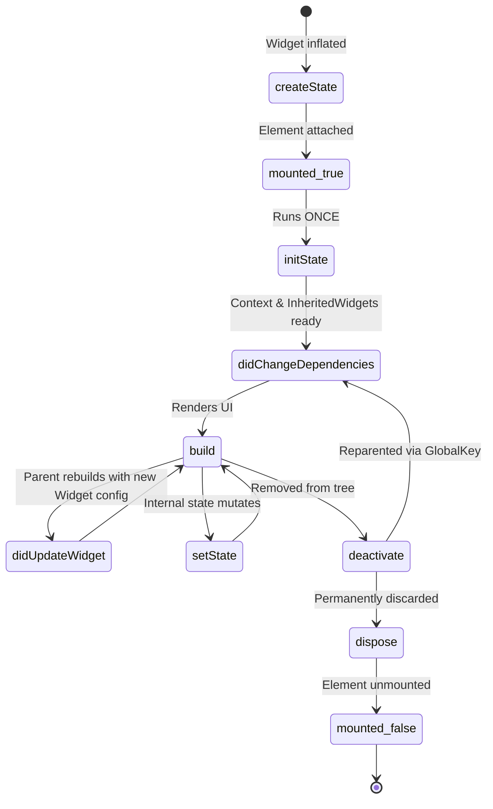
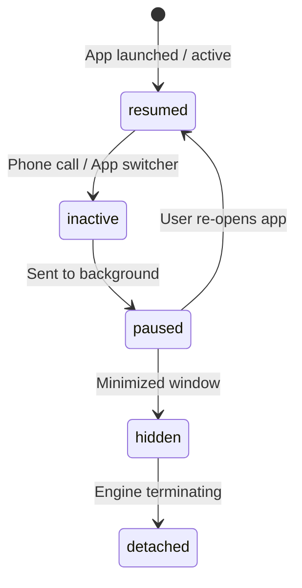

# State Lifecycle and Application Lifecycle in Flutter

> **Module:** 03-flutter-fundamentals  
> **Subsection:** 05-lifecycle-methods  
> **Prerequisites:** [03-stateless-and-stateful-widgets/stateless-vs-stateful.md](../03-stateless-and-stateful-widgets/stateless-vs-stateful.md)  
> **Official References:** [api.flutter.dev/flutter/widgets/State-class.html](https://api.flutter.dev/flutter/widgets/State-class.html) | [api.flutter.dev/flutter/widgets/AppLifecycleListener-class.html](https://api.flutter.dev/flutter/widgets/AppLifecycleListener-class.html)

---

## 1. Introduction

A robust mobile application must manage two distinct lifecycle domains:
1. **The Widget `State` Lifecycle:** The creation, configuration updates, and destruction of individual UI components inside the Flutter widget tree.
2. **The Operating System `AppLifecycle`:** Responding to global device events such as the app moving to the background, incoming phone calls, split-screen mode, or process termination.

Failing to properly manage these lifecycles leads to memory leaks, battery drain, uncancelled stream subscriptions, and crashes caused by calling `setState()` on unmounted elements.

---

## 2. Core Concepts: The `State` Lifecycle Chronology



### The 7 Lifecycle Stages in Detail

1. **`createState()`**: Called once by the framework when inflating the `StatefulWidget` into the element tree.
2. **`initState()`**:
   - Called **exactly once** when the `State` object is inserted into the tree.
   - **Purpose:** Initialize non-context-dependent state (e.g. `AnimationController`, `TextEditingController`, subscribing to streams).
   - **Rule:** Must call `super.initState()`. **Cannot access `InheritedWidget`s** via `BuildContext` here.
3. **`didChangeDependencies()`**:
   - Called immediately after `initState()`, and whenever an `InheritedWidget` that this state depends on (e.g. `Theme.of(context)`) changes.
   - **Purpose:** Safe place to perform initialization that requires `BuildContext`.
4. **`build(BuildContext context)`**:
   - Called frequently (on `setState()`, `didUpdateWidget()`, or parent rebuilds).
   - **Purpose:** Pure, synchronous function returning the widget configuration tree.
5. **`didUpdateWidget(covariant T oldWidget)`**:
   - Called when the parent rebuilds and sends a new widget configuration with the same `runtimeType` and `Key`.
   - **Purpose:** Compare `widget` (new) against `oldWidget` to restart timers, refresh data, or re-run animations if constructor parameters changed.
6. **`deactivate()`**:
   - Called when the `Element` is removed from the tree.
   - Can be temporarily detached and reinserted in the same frame (e.g. when reparented via `GlobalKey`).
7. **`dispose()`**:
   - Called when the `State` object is permanently destroyed and unmounted.
   - **Purpose:** Cancel streams, close `StreamController`s, dispose animation controllers, and unregister listeners.
   - **Rule:** Must call `super.dispose()`.

---

## 3. The Application Lifecycle (`AppLifecycleListener`)

Modern Flutter (Flutter 3.13+) provides **`AppLifecycleListener`** to observe operating system lifecycle states cleanly:



- **`resumed`**: The app is in the foreground, visible to the user, and responding to touch inputs.
- **`inactive`**: The app is in an intermediate state (e.g. receiving a phone call, showing an OS permission dialog, or in the iOS App Switcher).
- **`paused`**: The app is running in the background and not visible to the user.
- **`detached`**: The Flutter engine is running without an active host view.

---

## 4. Syntax and Implementation

```dart
// lib/lifecycle_demo.dart

import 'package:flutter/material.dart';

void main() => runApp(const MaterialApp(home: LifecycleMasterScreen()));

class LifecycleMasterScreen extends StatefulWidget {
  const LifecycleMasterScreen({super.key});

  @override
  State<LifecycleMasterScreen> createState() => _LifecycleMasterScreenState();
}

class _LifecycleMasterScreenState extends State<LifecycleMasterScreen> {
  late final AppLifecycleListener _lifecycleListener;
  AppLifecycleState? _currentAppState;
  int _parameterValue = 10;

  @override
  void initState() {
    super.initState();
    print('1. [Main] initState called.');

    // Setting up OS App Lifecycle Listener (Modern Flutter 3+)
    _lifecycleListener = AppLifecycleListener(
      onStateChange: (state) {
        setState(() => _currentAppState = state);
        print('[OS AppLifecycle] State changed to: $state');
      },
      onResume: () => print('[OS] App resumed to foreground!'),
      onPause: () => print('[OS] App paused in background (save drafts)!'),
    );
  }

  @override
  void dispose() {
    print('7. [Main] dispose called.');
    _lifecycleListener.dispose();
    super.dispose();
  }

  @override
  Widget build(BuildContext context) {
    return Scaffold(
      appBar: AppBar(title: const Text('Lifecycle Master Demonstration')),
      body: Center(
        child: Column(
          mainAxisAlignment: MainAxisAlignment.center,
          children: [
            Text('App State: ${_currentAppState ?? "resumed"}', style: const TextStyle(fontSize: 18, fontWeight: FontWeight.bold)),
            const SizedBox(height: 24),
            LifecycleChildWidget(trackedValue: _parameterValue),
            const SizedBox(height: 24),
            ElevatedButton(
              onPressed: () => setState(() => _parameterValue += 5),
              child: const Text('Update Child Widget Config (didUpdateWidget)'),
            ),
          ],
        ),
      ),
    );
  }
}

class LifecycleChildWidget extends StatefulWidget {
  final int trackedValue;
  const LifecycleChildWidget({super.key, required this.trackedValue});

  @override
  State<LifecycleChildWidget> createState() {
    print('--> [Child] createState called');
    return _LifecycleChildWidgetState();
  }
}

class _LifecycleChildWidgetState extends State<LifecycleChildWidget> {
  late TextEditingController _textController;

  @override
  void initState() {
    super.initState();
    print('2. [Child] initState called (Allocating controller)');
    _textController = TextEditingController(text: 'Initial: ${widget.trackedValue}');
  }

  @override
  void didChangeDependencies() {
    super.didChangeDependencies();
    print('3. [Child] didChangeDependencies called (Context ready)');
  }

  @override
  void didUpdateWidget(covariant LifecycleChildWidget oldWidget) {
    super.didUpdateWidget(oldWidget);
    print('4. [Child] didUpdateWidget called! Old: ${oldWidget.trackedValue}, New: ${widget.trackedValue}');
    if (oldWidget.trackedValue != widget.trackedValue) {
      _textController.text = 'Updated: ${widget.trackedValue}';
    }
  }

  @override
  void deactivate() {
    print('5. [Child] deactivate called');
    super.deactivate();
  }

  @override
  void dispose() {
    print('6. [Child] dispose called (Cleaning up controller)');
    _textController.dispose(); // CRUCIAL: Prevent controller memory leak!
    super.dispose();
  }

  @override
  Widget build(BuildContext context) {
    return Container(
      padding: const EdgeInsets.all(16),
      decoration: BoxDecoration(color: Colors.blue.shade50, borderRadius: BorderRadius.circular(12)),
      child: Column(
        children: [
          Text('Child Value: ${widget.trackedValue}', style: const TextStyle(fontSize: 20)),
          const SizedBox(height: 8),
          Text('Controller Value: ${_textController.text}'),
        ],
      ),
    );
  }
}
```

---

## 5. Comparison: State Lifecycle Methods Summary

| Method | Invocation Frequency | Context Accessible? | Must Call `super`? | Primary Purpose |
|:---|:---:|:---:|:---:|:---|
| **`initState()`** | Exactly once | No (Inherited unsafe) | **Yes (`super.initState()`)** | Controller & animation setup |
| **`didChangeDependencies()`** | $\ge 1$ time | **Yes (Safe)** | **Yes** | InheritedWidget / Theme setup |
| **`build()`** | Many times | **Yes (Direct)** | No | Declarative UI configuration |
| **`didUpdateWidget()`** | On parent rebuild | **Yes** | **Yes** | Reacting to constructor changes |
| **`deactivate()`** | Rare | Yes | **Yes** | Pre-disposal or reparenting |
| **`dispose()`** | Exactly once | No (Element gone) | **Yes (`super.dispose()`)** | Closing streams & controllers |

---

## 6. Interview Preparation

### Frequently Asked Questions

#### Q1: Why is calling `Theme.of(context)` inside `initState()` forbidden?
- **Answer:** In `initState()`, the `StatefulElement` has been created, but it has not yet finished registering itself with the inherited widget dependency tables of the element tree. Calling `Theme.of(context)` tries to register a dependency on an incomplete element link, causing Flutter to throw an assertion error: *"dependOnInheritedWidgetOfExactType() called before initState() completed."* The safe place to read inherited widgets is **`didChangeDependencies()`**.

#### Q2: What is the difference between `didChangeDependencies()` and `didUpdateWidget()`?
- **Answer:**
  - `didChangeDependencies()` is triggered when an **ancestor `InheritedWidget`** changes (e.g. system switches between Light and Dark mode, changing `Theme.of(context)`).
  - `didUpdateWidget()` is triggered when the **direct parent widget rebuilds** and passes a new widget configuration with the same `runtimeType` and `Key` (e.g. parent passes a new `userId` parameter).

---

## 7. References
- [Flutter API: State Class](https://api.flutter.dev/flutter/widgets/State-class.html)
- [Flutter API: AppLifecycleListener](https://api.flutter.dev/flutter/widgets/AppLifecycleListener-class.html)
