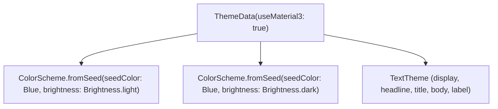
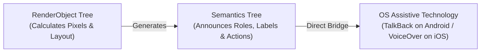

# Modern Theming (Material 3) and Accessibility (A11y) in Flutter

> **Module:** 03-flutter-fundamentals  
> **Subsection:** 06-theming-and-styling  
> **Prerequisites:** [04-buildcontext-and-keys/buildcontext-and-inheritedwidget.md](../04-buildcontext-and-keys/buildcontext-and-inheritedwidget.md)  
> **Official References:** [docs.flutter.dev/ui/design/material](https://docs.flutter.dev/ui/design/material) | [docs.flutter.dev/ui/accessibility-and-internationalization/accessibility](https://docs.flutter.dev/ui/accessibility-and-internationalization/accessibility)

---

## 1. Introduction

Building an enterprise-grade mobile application requires two non-negotiable qualities:
1. **Cohesive Design System & Theming:** Supporting modern design languages (Material 3), tonal palettes, dynamic dark mode, and typography scales without hardcoded colors.
2. **Accessibility (A11y) & Inclusivity:** Ensuring users with visual, motor, or cognitive impairments can navigate your application using screen readers (Android TalkBack, iOS VoiceOver) and assistive technologies.

Flutter integrates both capabilities directly into its framework through **Material 3 `ThemeData`** and the **`Semantics` Tree**.

---

## 2. Core Concepts

### 1. Material 3 Theming Architecture
Modern Flutter (Flutter 3.16+) defaults to **Material 3 (`useMaterial3: true`)**.
- **Tonal Color Schemes from Seed:** Instead of manually defining 30 different shades of primary and secondary colors, Flutter uses `ColorScheme.fromSeed(seedColor: Color)`. The algorithmic engine generates a fully harmonious, mathematically accessible 30-tone palette.
- **The "On-Color" Rule:** Every color role has an accompanying "on" color ensuring legible contrast:
  - `primary` background $\to$ `onPrimary` text/icons.
  - `surface` background $\to$ `onSurface` text/icons.
  - `error` background $\to$ `onError` text/icons.



---

### 2. The Semantics Tree (Accessibility)

In addition to the Widget, Element, and RenderObject trees, Flutter generates a **Fourth Tree: The Semantics Tree**.



- **Screen Readers:** Android TalkBack and iOS VoiceOver do not read pixels or raw RenderObjects; they inspect the **Semantics Tree**.
- **`Semantics` Widget:** Annotates a widget with labels, hints, values, and traits (`button: true`, `toggled: true`).
- **`ExcludeSemantics`:** Hides purely decorative visual elements (background gradients, decorative shapes) to prevent noisy clutter on screen readers.
- **Minimum Touch Targets:** WCAG accessibility guidelines mandate that interactive touch targets be at least **48x48 logical pixels** to accommodate motor impairments.

---

## 3. Syntax and Implementation

```dart
// lib/theming_and_a11y_demo.dart

import 'package:flutter/material.dart';

void main() => runApp(const AccessibleThemedApp());

class AccessibleThemedApp extends StatefulWidget {
  const AccessibleThemedApp({super.key});

  @override
  State<AccessibleThemedApp> createState() => _AccessibleThemedAppState();
}

class _AccessibleThemedAppState extends State<AccessibleThemedApp> {
  ThemeMode _themeMode = ThemeMode.system;

  void _toggleTheme() {
    setState(() {
      _themeMode = _themeMode == ThemeMode.light ? ThemeMode.dark : ThemeMode.light;
    });
  }

  @override
  Widget build(BuildContext context) {
    const seedColor = Color(0xFF005AC1); // Deep Sapphire Blue

    return MaterialApp(
      title: 'Accessible Material 3 App',
      // Modern Light Theme
      theme: ThemeData(
        useMaterial3: true,
        colorScheme: ColorScheme.fromSeed(seedColor: seedColor, brightness: Brightness.light),
      ),
      // Modern Dark Theme
      darkTheme: ThemeData(
        useMaterial3: true,
        colorScheme: ColorScheme.fromSeed(seedColor: seedColor, brightness: Brightness.dark),
      ),
      themeMode: _themeMode,
      home: AccessibleHomeScreen(onToggleTheme: _toggleTheme),
    );
  }
}

class AccessibleHomeScreen extends StatelessWidget {
  final VoidCallback onToggleTheme;
  const AccessibleHomeScreen({super.key, required this.onToggleTheme});

  @override
  Widget build(BuildContext context) {
    final theme = Theme.of(context);
    final colors = theme.colorScheme;

    return Scaffold(
      appBar: AppBar(
        title: const Text('Theming & Accessibility'),
        actions: [
          IconButton(
            icon: Icon(theme.brightness == Brightness.dark ? Icons.light_mode : Icons.dark_mode),
            tooltip: 'Toggle light and dark mode',
            onPressed: onToggleTheme,
          ),
        ],
      ),
      body: Padding(
        padding: const EdgeInsets.all(16.0),
        child: Column(
          crossAxisAlignment: CrossAxisAlignment.start,
          children: [
            Text('Typography Scale', style: theme.textTheme.headlineMedium),
            const SizedBox(height: 8),
            Text(
              'This text automatically adapts to system font sizing and light/dark theme.',
              style: theme.textTheme.bodyLarge?.copyWith(color: colors.onSurfaceVariant),
            ),
            const SizedBox(height: 24),
            // Custom Accessible Component
            const AccessibleCartItemTile(
              productName: 'Flutter Architecture Handbook',
              quantity: 2,
              priceFormatted: '\$49.99',
            ),
          ],
        ),
      ),
    );
  }
}

/// An accessible e-commerce tile with explicit Semantics annotations
class AccessibleCartItemTile extends StatelessWidget {
  final String productName;
  final int quantity;
  final String priceFormatted;

  const AccessibleCartItemTile({
    super.key,
    required this.productName,
    required this.quantity,
    required this.priceFormatted,
  });

  @override
  Widget build(BuildContext context) {
    final colors = Theme.of(context).colorScheme;

    // Wrapping in Semantics creates a single cohesive announcement for TalkBack / VoiceOver!
    return Semantics(
      label: 'Cart item: $productName. Quantity: $quantity. Price: $priceFormatted',
      hint: 'Double tap to view order details',
      button: true,
      child: Card(
        color: colors.surfaceContainerLow,
        child: ListTile(
          leading: ExcludeSemantics(
            // Exclude purely decorative icon to prevent screen reader redundancy
            child: CircleAvatar(
              backgroundColor: colors.primaryContainer,
              child: Icon(Icons.book, color: colors.onPrimaryContainer),
            ),
          ),
          title: Text(productName, style: const TextStyle(fontWeight: FontWeight.bold)),
          subtitle: Text('Qty: $quantity | Total: $priceFormatted'),
          trailing: const Icon(Icons.arrow_forward_ios, size: 16),
          onTap: () {},
        ),
      ),
    );
  }
}
```

---

## 4. Interview Preparation

### Frequently Asked Questions

#### Q1: What is the Semantics Tree in Flutter and how is it used by the OS?
- **Answer:** The Semantics Tree is a specialized tree structure maintained by Flutter parallel to the RenderObject tree. Each node contains semantic descriptions (labels, hints, values, actions, and states like `selected`, `checked`, `disabled`). The Flutter Engine serializes this tree across the platform embedder to native accessibility bridges (Android AccessibilityNodeInfo and iOS UIAccessibilityElement), allowing screen readers to speak the UI hierarchy verbally.

#### Q2: What is the difference between `theme.primaryColor` and `theme.colorScheme.primary` in Material 3?
- **Answer:** `theme.primaryColor` is a legacy Material 2 property that holds an isolated color value. In modern Material 3 (`useMaterial3: true`), all colors are coordinated through `theme.colorScheme`. Accessing `colorScheme.primary` ensures that your UI utilizes the calculated tonal palette, and guarantees the existence of a high-contrast companion `colorScheme.onPrimary` for legible text rendering.

---

## 5. References
- [Flutter Official Documentation: Accessibility in Flutter](https://docs.flutter.dev/ui/accessibility-and-internationalization/accessibility)
- [Flutter Material 3 Specification & Design Guide](https://docs.flutter.dev/ui/design/material)
