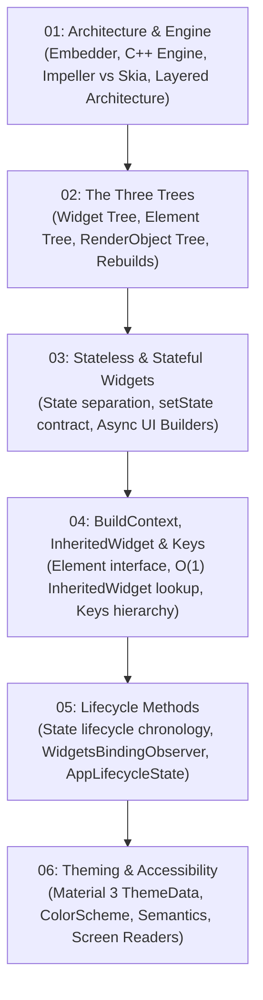

# Module 03: Flutter Fundamentals

Welcome to **Module 03: Flutter Fundamentals**. This module explores the foundational architecture, rendering pipeline, and lifecycle mechanisms that power the Flutter framework.

---

## 🗺️ Module Subsections

### Core Topics Covered in this Module:
1. **[01-flutter-architecture-and-engine/layered-architecture.md](./01-flutter-architecture-and-engine/layered-architecture.md):** The 3 architectural layers (Embedder, Engine, Framework), compilation modes (JIT vs AOT), and Impeller's modern GPU rendering architecture.
2. **[02-widget-tree-element-tree-renderobject/the-three-trees.md](./02-widget-tree-element-tree-renderobject/the-three-trees.md):** The mechanical relationship between Widgets (blueprints), Elements (lifecycle identity), and RenderObjects (layout & paint).
3. **[03-stateless-and-stateful-widgets/stateless-vs-stateful.md](./03-stateless-and-stateful-widgets/stateless-vs-stateful.md):** Immutability of widgets, `State<T>` persistence, `setState()` mechanics, and async builders (`FutureBuilder`, `StreamBuilder`).
4. **[04-buildcontext-and-keys/buildcontext-and-inheritedwidget.md](./04-buildcontext-and-keys/buildcontext-and-inheritedwidget.md):** `BuildContext` as an Element handle, `InheritedWidget` dependency registration, and $O(1)$ ancestor lookups.
5. **[04-buildcontext-and-keys/keys-deep-dive.md](./04-buildcontext-and-keys/keys-deep-dive.md):** Widget identity, preserving state during list reordering, `ValueKey`, `ObjectKey`, `UniqueKey`, and `GlobalKey`.
6. **[05-lifecycle-methods/state-and-app-lifecycle.md](./05-lifecycle-methods/state-and-app-lifecycle.md):** Chronological `State` lifecycle (`initState` $\to$ `didChangeDependencies` $\to$ `build` $\to$ `didUpdateWidget` $\to$ `dispose`), and `AppLifecycleState` (resumed, paused, detached).
7. **[06-theming-and-styling/accessibility-and-theming.md](./06-theming-and-styling/accessibility-and-theming.md):** Material 3 `ThemeData`, dynamic dark mode, and `Semantics` for WCAG accessibility compliance.

---

## 🎯 Learning Objectives

By completing Module 03, you will:
1. Understand how Flutter paints pixels directly onto the screen without native OEM bridge widgets.
2. Master the element reconciliation algorithm (`canUpdate()`) to optimize widget rebuilds.
3. Trace widget and application lifecycle events to prevent memory leaks and handle backgrounding.
4. Implement accessible, themed applications conforming to production design standards.
