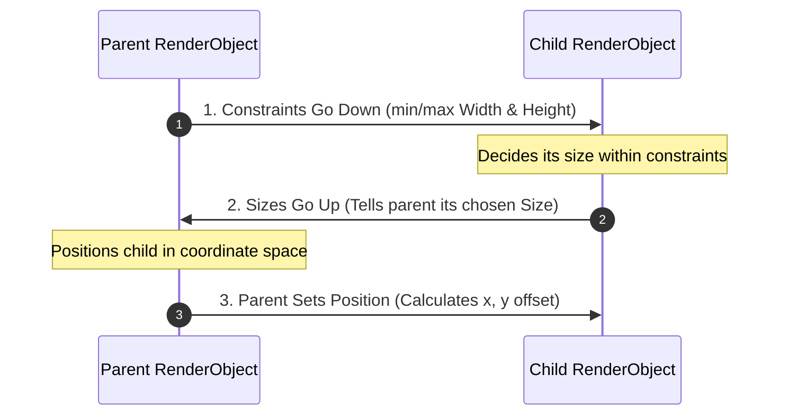
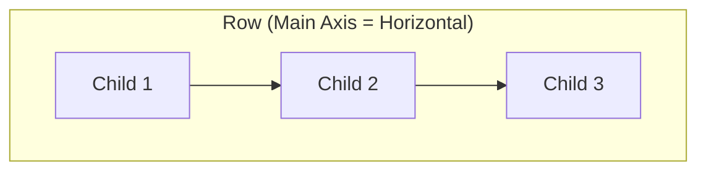
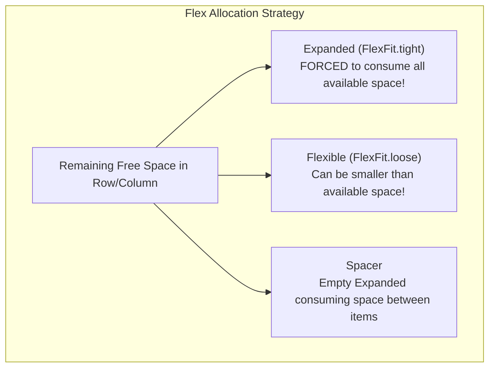

# Box Constraints and Flex Layouts in Flutter

> **Module:** 04-layout-and-widgets  
> **Subsection:** 01-flex-row-column-expanded  
> **Prerequisites:** [03-flutter-fundamentals/02-widget-tree-element-tree-renderobject/the-three-trees.md](../../03-flutter-fundamentals/02-widget-tree-element-tree-renderobject/the-three-trees.md)  
> **Official References:** [docs.flutter.dev/ui/layout/constraints](https://docs.flutter.dev/ui/layout/constraints) | [api.flutter.dev/flutter/rendering/BoxConstraints-class.html](https://api.flutter.dev/flutter/rendering/BoxConstraints-class.html)

---

## 1. Introduction

Almost every developer learning Flutter encounters the dreaded yellow-and-black striped banner:  
**`A RenderFlex overflowed by 42 pixels on the right`**  
or the fatal layout crash:  
**`Vertical viewport was given unbounded height`**.

These errors occur when a developer treats Flutter like CSS or HTML (assuming widgets can decide their own position and size freely). In Flutter, layout follows one immutable, mechanical law:

> **"Constraints go down. Sizes go up. Parent sets position."**

Mastering this three-part rule unlocks complete mastery of the Flutter layout engine.

---

## 2. The Golden Rule of Flutter Layout



1. **Constraints Go Down:** The parent sends a `BoxConstraints` object to the child specifying minimum and maximum allowable width and height.
2. **Sizes Go Up:** The child inspects the constraints and chooses a `Size(width, height)` that fits strictly within those bounds, reporting its size back to the parent.
3. **Parent Sets Position:** The parent places the child at an `Offset(x, y)` relative to its own coordinate space. The child has no control over where it is positioned!

---

## 3. Core Concepts

### 1. Tight vs. Loose vs. Unbounded Constraints
- **Tight Constraints:** `minWidth == maxWidth` and `minHeight == maxHeight`. The child has **no choice**; it is forced to be exactly that size.
  - Example: Screen root passes tight constraints equal to the device screen resolution.
- **Loose Constraints:** `minWidth == 0` and `minHeight == 0`. The child can be as small as `0x0` up to `maxWidth x maxHeight`.
  - Example: `Center` loosens constraints from its parent.
- **Unbounded Constraints:** `maxWidth == double.infinity` or `maxHeight == double.infinity`.
  - Example: Inside a `Row`, width is unbounded ($[0, \infty)$). Inside a `Column` or `SingleChildScrollView`, height is unbounded.

---

### 2. Flex Layouts: `Row`, `Column`, and `Flex`
`Row` and `Column` are subclasses of `Flex`.
- **`Row`:** Main axis is **horizontal**, cross axis is **vertical**.
- **`Column`:** Main axis is **vertical**, cross axis is **horizontal**.



### 3. `Expanded` vs. `Flexible` vs. `Spacer`



- **`Expanded(child: Widget)`:** Syntactic sugar for `Flexible(fit: FlexFit.tight, child: child)`. Forces the child to expand and take up **all remaining free space** along the main axis.
- **`Flexible(fit: FlexFit.loose, child: Widget)`:** Gives the child permission to be *up to* the available free space, but allows the child to shrink to its natural content size if smaller.
- **`Spacer(flex: 1)`:** An empty, non-visual `Expanded` widget used to insert dynamic spacing between widgets.

---

## 4. Diagnosing the Two Classic Layout Bugs

### Bug 1: `A RenderFlex overflowed by X pixels`
- **Cause:** Children inside a `Row` or `Column` collectively exceed the available space along the main axis.
- **Fix:** Wrap the flexible content (e.g. `Text`) inside an `Expanded` or `Flexible` so it wraps or truncates, or wrap the `Row`/`Column` in a scrollable widget (`SingleChildScrollView` or `ListView`).

### Bug 2: `Vertical viewport was given unbounded height`
- **Cause:** Placing a `ListView` (which wants to be infinitely tall) directly inside a `Column` (which gives infinite height constraints to its children).
- **Fix:** Wrap the `ListView` in an **`Expanded`**! The `Expanded` measures the remaining height of the screen and passes **tight bounded height constraints** down to the `ListView`.

---

## 5. Syntax and Implementation

```dart
// lib/constraints_demo.dart

import 'package:flutter/material.dart';

void main() => runApp(const MaterialApp(home: ConstraintsDemoScreen()));

class ConstraintsDemoScreen extends StatelessWidget {
  const ConstraintsDemoScreen({super.key});

  @override
  Widget build(BuildContext context) {
    return Scaffold(
      appBar: AppBar(title: const Text('Box Constraints & Flex Mastery')),
      body: Padding(
        padding: const EdgeInsets.all(16.0),
        child: Column(
          crossAxisAlignment: CrossAxisAlignment.start,
          children: [
            const Text('1. Safe Row with Expanded Text (No Overflow):', style: TextStyle(fontWeight: FontWeight.bold)),
            const SizedBox(height: 8),
            // Safe Row using Expanded to prevent RenderFlex overflow
            Container(
              padding: const EdgeInsets.all(12),
              color: Colors.blue.shade50,
              child: Row(
                children: [
                  const Icon(Icons.info, color: Colors.blue),
                  const SizedBox(width: 12),
                  // Wrapping in Expanded prevents long text from overflowing the screen!
                  Expanded(
                    child: Text(
                      'This is an exceptionally long notification message that automatically wraps to multiple lines without causing RenderFlex overflow.',
                      style: TextStyle(color: Colors.blue.shade900),
                    ),
                  ),
                  const SizedBox(width: 8),
                  const Chip(label: Text('New')),
                ],
              ),
            ),
            const SizedBox(height: 24),
            const Text('2. ListView nested inside Column (Bounded by Expanded):', style: TextStyle(fontWeight: FontWeight.bold)),
            const SizedBox(height: 8),
            // Wrapping ListView in Expanded prevents "unbounded height" crash!
            Expanded(
              child: Container(
                decoration: BoxDecoration(
                  border: Border.all(color: Colors.grey.shade300),
                  borderRadius: BorderRadius.circular(8),
                ),
                child: ListView.builder(
                  itemCount: 15,
                  itemBuilder: (context, index) => ListTile(
                    leading: CircleAvatar(child: Text('${index + 1}')),
                    title: Text('Bounded Scrollable Item #${index + 1}'),
                  ),
                ),
              ),
            ),
          ],
        ),
      ),
    );
  }
}
```

---

## 6. Comparison: `Expanded` vs. `Flexible`

| Dimension | `Expanded` | `Flexible` |
|:---|:---|:---|
| **Underlying Type** | `Flexible(fit: FlexFit.tight)` | `Flexible(fit: FlexFit.loose)` |
| **Space Consumption** | **Forced to take 100% of allocated space** | Takes **only what it needs** (up to max) |
| **Use Case** | Fill remaining space, prevent text overflow | Allow child to size naturally without overflow |
| **Child Widget** | Can be any widget | Must be able to determine its intrinsic size |

---

## 7. Interview Preparation

### Frequently Asked Questions

#### Q1: Explain the statement: "Constraints go down, sizes go up, parent sets position."
- **Answer:** This describes Flutter's one-pass layout protocol:
  1. A parent RenderObject passes `BoxConstraints` (min/max width and height) down to each child.
  2. The child determines its own `Size` respecting those constraints and returns it up to the parent.
  3. The parent receives the child's size and sets the child's coordinate offset position (`x, y`) in the parent's coordinate space. A child can never determine its own position on screen.

#### Q2: Why does `Container(width: 100, height: 100)` fill the entire screen if it is the root child of a Scaffold body without alignment?
- **Answer:** The screen passes **tight constraints** (e.g. `minWidth == 412, maxWidth == 412`) down to its root child. Because the constraints are tight, the `Container` has no choice and is forced to expand to the full screen dimensions, ignoring its own `width: 100` request. To allow the container to honor its requested 100x100 size, you must wrap it in an alignment widget (e.g. `Center`, `Align`) which **loosens** the constraints to `minWidth: 0, minHeight: 0`.

---

## 8. References
- [Flutter Official Documentation: Understanding Constraints](https://docs.flutter.dev/ui/layout/constraints)
- [Flutter API: BoxConstraints](https://api.flutter.dev/flutter/rendering/BoxConstraints-class.html)
