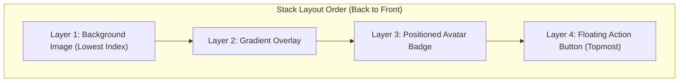

# Stack, Positioned, and IndexedStack in Flutter

> **Module:** 04-layout-and-widgets  
> **Subsection:** 02-stack-and-positioned  
> **Prerequisites:** [01-flex-row-column-expanded/box-constraints-and-flex-layout.md](../01-flex-row-column-expanded/box-constraints-and-flex-layout.md)  
> **Official References:** [api.flutter.dev/flutter/widgets/Stack-class.html](https://api.flutter.dev/flutter/widgets/Stack-class.html) | [api.flutter.dev/flutter/widgets/Positioned-class.html](https://api.flutter.dev/flutter/widgets/Positioned-class.html)

---

## 1. Introduction

While `Row` and `Column` arrange widgets linearly along a single axis, real-world user interfaces frequently require **multi-layer overlapping layouts**—such as badge counters over shopping cart icons, floating action buttons over maps, gradient overlays on hero images, or card banners with overlapping profile avatars.

In Flutter, multi-layer depth positioning is governed by the **`Stack`** widget and its companion positioning widgets: **`Positioned`**, **`Align`**, and **`IndexedStack`**.

---

## 2. Core Concepts



### 1. How Does a `Stack` Calculate Its Size?
A common interview question: *"How does a Stack know how big to be?"*

A `Stack` categorizes its children into two groups:
1. **Non-Positioned Children:** Widgets **not** wrapped in a `Positioned` widget.
2. **Positioned Children:** Widgets wrapped in a `Positioned` widget.

**The Golden Sizing Rule of `Stack`:**
- By default (`StackFit.loose`), the `Stack` **sizes itself to fit its non-positioned children**.
- It then places the `Positioned` children relative to the boundaries established by the non-positioned children.
- **Edge Case:** If a `Stack` contains **only positioned children**, it takes the maximum allowable constraints from its parent (often expanding to fill the whole screen).

---

### 2. `StackFit` Properties
- **`StackFit.loose` (Default):** Constraints passed to non-positioned children are loosened (`minWidth: 0, minHeight: 0`).
- **`StackFit.expand`:** Forces non-positioned children to take the maximum width and height allowed by the parent.
- **`StackFit.passthrough`:** Passes the incoming constraints from the parent to children unchanged.

---

### 3. `Positioned` Widget
Must be an **immediate child** of a `Stack`.
- Controls placement relative to the edges: `top`, `bottom`, `left`, `right`.
- **`Positioned.fill`**: Shorthand that sets `top: 0, bottom: 0, left: 0, right: 0` to stretch a child across the entire stack.

---

### 4. `IndexedStack` (Preserving Tab State)
In a bottom navigation bar, swapping screens using a standard `if-else` or ternary destroys and recreates the unselected screens, losing user input and scroll positions.
- **`IndexedStack`** keeps **all children mounted in the Element tree**, displaying only the child matching `index: activeIndex`.
- **Key Benefit:** Scroll positions, text field inputs, and state are **preserved across tab switches**.

---

## 3. Syntax and Implementation

```dart
// lib/stack_demo.dart

import 'package:flutter/material.dart';

void main() => runApp(const MaterialApp(home: StackDemoScreen()));

class StackDemoScreen extends StatelessWidget {
  const StackDemoScreen({super.key});

  @override
  Widget build(BuildContext context) {
    return Scaffold(
      appBar: AppBar(title: const Text('Stack & Positioned Mastery')),
      body: Center(
        child: Column(
          mainAxisAlignment: MainAxisAlignment.center,
          children: [
            // 1. Overlapping Profile Card with Notification Badge
            const OverlappingAvatarCard(),
            const SizedBox(height: 32),
            // 2. Shopping Cart with Overlapping Badge
            const CartIconWithBadge(unreadCount: 4),
          ],
        ),
      ),
    );
  }
}

class OverlappingAvatarCard extends StatelessWidget {
  const OverlappingAvatarCard({super.key});

  @override
  Widget build(BuildContext context) {
    return SizedBox(
      width: 280,
      height: 180,
      child: Stack(
        clipBehavior: Clip.none, // Allows avatar to overflow outside card bounds!
        alignment: Alignment.center,
        children: [
          // Non-positioned child: Defines the card base
          Positioned.fill(
            top: 40, // Offset to make room for overlapping avatar
            child: Card(
              elevation: 4,
              color: Colors.blue.shade50,
              child: const Padding(
                padding: EdgeInsets.only(top: 48, bottom: 16),
                child: Column(
                  children: [
                    Text('Senior Flutter Architect', style: TextStyle(fontWeight: FontWeight.bold, fontSize: 16)),
                    SizedBox(height: 4),
                    Text('Core Engineering Team', style: TextStyle(color: Colors.grey)),
                  ],
                ),
              ),
            ),
          ),
          // Positioned child: Overlapping top circular avatar
          Positioned(
            top: 0, // Protrudes 40px above the card!
            child: CircleAvatar(
              radius: 40,
              backgroundColor: Colors.blue.shade900,
              child: const CircleAvatar(
                radius: 36,
                backgroundColor: Colors.white,
                child: Icon(Icons.person, size: 48, color: Colors.blue),
              ),
            ),
          ),
        ],
      ),
    );
  }
}

class CartIconWithBadge extends StatelessWidget {
  final int unreadCount;
  const CartIconWithBadge({super.key, required this.unreadCount});

  @override
  Widget build(BuildContext context) {
    return Stack(
      clipBehavior: Clip.none,
      children: [
        IconButton(
          icon: const Icon(Icons.shopping_cart, size: 36),
          onPressed: () {},
        ),
        if (unreadCount > 0)
          Positioned(
            right: 4,
            top: 4,
            child: Container(
              padding: const EdgeInsets.all(4),
              decoration: const BoxDecoration(
                color: Colors.red,
                shape: BoxShape.circle,
              ),
              constraints: const BoxConstraints(minWidth: 20, minHeight: 20),
              child: Center(
                child: Text(
                  '$unreadCount',
                  style: const TextStyle(color: Colors.white, fontSize: 11, fontWeight: FontWeight.bold),
                ),
              ),
            ),
          ),
      ],
    );
  }
}
```

---

## 4. Comparison: `Stack` vs `IndexedStack`

| Dimension | Standard `Stack` | `IndexedStack` |
|:---|:---|:---|
| **Visible Children** | All children rendered on top of each other | **Only ONE child visible at a time** |
| **Element Tree Presence** | All children present | **All children present and mounted** |
| **State Preservation** | Active | **Preserved across index switches** |
| **Primary Use Cases** | Badges, gradient overlays, floating cards | Bottom navigation bars, multi-step wizards |

---

## 5. Interview Preparation

### Frequently Asked Questions

#### Q1: What does `clipBehavior: Clip.none` do on a `Stack`?
- **Answer:** By default, Flutter clips any child that extends outside the bounding box of the `Stack` (`Clip.hardEdge`). Setting `clipBehavior: Clip.none` instructs the rendering engine to allow children to overflow beyond the stack boundaries visually (e.g. an avatar badge protruding above a modal dialog or floating outside a card header). Note that while visually visible, hit-testing (click events) outside the stack bounds requires custom hit-test handling.

#### Q2: What happens if a `Positioned` widget is placed inside a `Column` or `Row`?
- **Answer:** Placing a `Positioned` widget anywhere other than as an immediate child of a `Stack` causes an unhandled runtime layout exception (`Incorrect use of ParentDataWidget`). `Positioned` is a `ParentDataWidget<StackParentData>` and only works when its parent RenderObject is a `RenderStack`.

---

## 6. References
- [Flutter API: Stack Class](https://api.flutter.dev/flutter/widgets/Stack-class.html)
- [Flutter API: IndexedStack](https://api.flutter.dev/flutter/widgets/IndexedStack-class.html)
