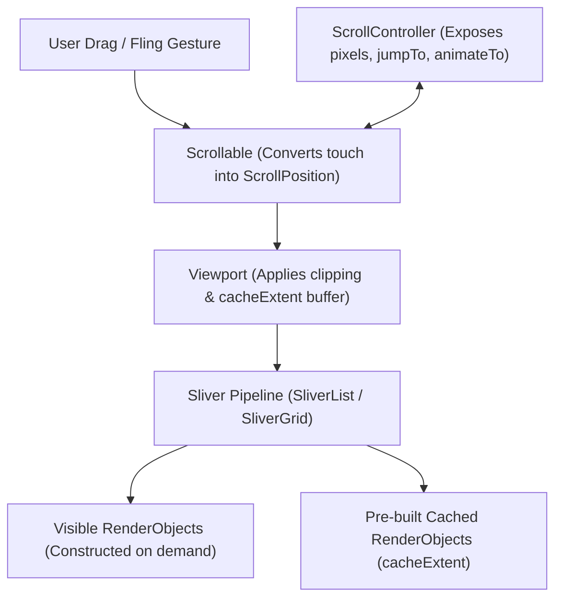

# Scrollable Widgets: ListView, GridView, and Viewport Mechanics

> **Module:** 04-layout-and-widgets  
> **Subsection:** 03-scrollable-widgets-listview-gridview  
> **Prerequisites:** [04-layout-and-widgets/01-flex-row-column-expanded/box-constraints-and-flex-layout.md](../01-flex-row-column-expanded/box-constraints-and-flex-layout.md)  
> **Official References:** [docs.flutter.dev/ui/widgets/scrolling](https://docs.flutter.dev/ui/widgets/scrolling) | [api.flutter.dev/flutter/widgets/ListView-class.html](https://api.flutter.dev/flutter/widgets/ListView-class.html)

---

## 1. Introduction

Mobile screens have finite physical dimensions, but application data (social feeds, shopping items, transaction histories) is virtually infinite. Scrollable widgets solve this mismatch by creating a **Viewport**—a virtual window onto an unbounded scrollable dimension.

In Flutter, scrollable widgets are not simple wrapper divs with overflow auto. They operate via an advanced virtualized rendering pipeline that constructs, lays out, and paints *only* visible elements, recycling memory aggressively through lazy materialization.

---

## 2. Core Concepts & Viewport Mechanics

### The Scrolling Pipeline

When rendering a scrollable list, three architectural components coordinate:
1. **`Scrollable`:** Listens to raw touch gestures (drags, flings) and converts them into scroll offsets via a `ScrollPosition`.
2. **`Viewport`:** Acts as the clipping rectangle. It calculates which portion of the virtual content falls inside the screen bounds plus a pre-rendered buffer area (`cacheExtent`).
3. **`Sliver`:** A slice of the scrollable area that lazily produces `RenderBox` children on demand.



### Virtualization: Why `ListView()` vs `ListView.builder()` Matters

| Property | Default `ListView(children: [...])` | `ListView.builder()` / `ListView.separated()` |
|:---|:---|:---|
| **Instantiation** | Eager (All children built upfront) | Lazy (Only visible + cached children built) |
| **Memory Footprint** | $O(N)$ where $N$ is total items | $O(V)$ where $V$ is visible screen items |
| **Initial Frame Latency** | High (blocks UI thread with 1,000+ widgets) | Instantaneous (pumps only ~10 items initially) |
| **Use Case** | Static lists with < 20 fixed elements (e.g. settings) | Dynamic, unbounded, or network-fetched datasets |

---

## 3. Syntax and Implementation

### 1. `ListView.builder` with `itemExtent` Optimization

When items have a fixed dimension along the scroll axis, declaring `itemExtent` completely skips the dynamic layout measurement step for off-screen items, boosting scroll performance significantly.

```dart
import 'package:flutter/material.dart';

class OptimizedUserList extends StatefulWidget {
  const OptimizedUserList({super.key});

  @override
  State<OptimizedUserList> createState() => _OptimizedUserListState();
}

class _OptimizedUserListState extends State<OptimizedUserList> {
  final ScrollController _scrollController = ScrollController();
  final List<String> _users = List.generate(10000, (index) => 'User #$index');

  @override
  void initState() {
    super.initState();
    _scrollController.addListener(_onScroll);
  }

  void _onScroll() {
    // Detect when user scrolled to the bottom (infinite pagination trigger)
    if (_scrollController.position.pixels >= 
        _scrollController.position.maxScrollExtent - 200) {
      _loadMoreUsers();
    }
  }

  void _loadMoreUsers() {
    // Network fetch logic
  }

  @override
  void dispose() {
    _scrollController.removeListener(_onScroll);
    _scrollController.dispose();
    super.dispose();
  }

  @override
  Widget build(BuildContext context) {
    return Scaffold(
      appBar: AppBar(title: const Text('Virtualized ListView')),
      body: ListView.builder(
        controller: _scrollController,
        itemCount: _users.length,
        // CRITICAL PERFORMANCE BOOST: Skips measurement pass for children
        itemExtent: 72.0,
        // Buffer area in logical pixels before and after visible viewport
        cacheExtent: 200.0,
        itemBuilder: (BuildContext context, int index) {
          return ListTile(
            leading: CircleAvatar(child: Text('${index + 1}')),
            title: Text(_users[index]),
            subtitle: Text('Identity verification ID: ${index * 8421}'),
            trailing: const Icon(Icons.chevron_right),
            onTap: () {},
          );
        },
      ),
    );
  }
}
```

---

### 2. `ListView.separated`: Automatic Dividers Without Index Gymnastics

```dart
ListView.separated(
  itemCount: items.length,
  separatorBuilder: (context, index) => const Divider(
    height: 1, 
    thickness: 1, 
    indent: 16, 
    endIndent: 16,
  ),
  itemBuilder: (context, index) {
    return ListTile(
      title: Text(items[index].title),
    );
  },
)
```

---

### 3. `GridView` and Its Sliver Delegates

Flutter offers two primary grid layout strategies via delegates:
1. **`SliverGridDelegateWithFixedCrossAxisCount`:** Fixes the number of columns regardless of screen width.
2. **`SliverGridDelegateWithMaxCrossAxisExtent`:** Fixes the maximum width of each tile, automatically increasing column count on wider screens (responsive by default).

```dart
import 'package:flutter/material.dart';

class ResponsiveProductGrid extends StatelessWidget {
  final List<String> products;

  const ResponsiveProductGrid({super.key, required this.products});

  @override
  Widget build(BuildContext context) {
    return GridView.builder(
      padding: const EdgeInsets.all(12),
      itemCount: products.length,
      // Adapts smoothly to mobile, tablet, and desktop viewports
      gridDelegate: const SliverGridDelegateWithMaxCrossAxisExtent(
        maxCrossAxisExtent: 220, // Max width per tile in logical pixels
        mainAxisSpacing: 12,     // Vertical gap
        crossAxisSpacing: 12,    // Horizontal gap
        childAspectRatio: 0.75,  // Width / Height ratio (3:4 portrait card)
      ),
      itemBuilder: (context, index) {
        return Card(
          clipBehavior: Clip.antiAlias,
          elevation: 2,
          child: Column(
            crossAxisAlignment: CrossAxisAlignment.stretch,
            children: [
              Expanded(
                child: Container(
                  color: Colors.grey.shade300,
                  child: const Icon(Icons.shopping_bag, size: 48),
                ),
              ),
              Padding(
                padding: const EdgeInsets.all(8.0),
                child: Text(
                  products[index],
                  style: const TextStyle(fontWeight: FontWeight.bold),
                ),
              ),
            ],
          ),
        );
      },
    );
  }
}
```

---

## 4. Common Pitfalls & Anti-Patterns

### Pitfall 1: Unbounded Height Crash Inside `Column`

```dart
// ❌ CRASH: "Vertical viewport was given unbounded height"
Column(
  children: [
    const Text('Recent Items'),
    ListView.builder(
      itemCount: items.length,
      itemBuilder: (context, i) => ListTile(title: Text(items[i])),
    ),
  ],
)
```
**Why it fails:** `Column` gives its children unbounded vertical constraints (`maxHeight = infinity`). `ListView` attempts to expand infinitely along its scroll axis, which violates the layout protocol.

**Solutions:**
1. **Wrap in `Expanded`** (Preferred if the list should fill remaining screen space):
   ```dart
   Column(
     children: [
       const Text('Recent Items'),
       Expanded(
         child: ListView.builder(...),
       ),
     ],
   )
   ```
2. **Set `shrinkWrap: true` and `physics: const NeverScrollableScrollPhysics()`** (Only if the entire screen scrolls via a parent `SingleChildScrollView` and the list is small):
   ```dart
   ListView.builder(
     shrinkWrap: true, // Forces list to calculate its total height upfront
     physics: const NeverScrollableScrollPhysics(), // Disables nested scroll
     ...
   )
   ```
   > ⚠️ **Warning:** `shrinkWrap: true` destroys virtualization! Flutter must evaluate and build all children to calculate the total list height. Avoid on long lists.

---

## 5. Scroll Physics Breakdown

Flutter provides platform-idiomatic and specialized physics:
- **`BouncingScrollPhysics`:** iOS-style rubber-band bounce effect when reaching bounds.
- **`ClampingScrollPhysics`:** Android-style hard stop with edge glow overscroll indicator.
- **`AlwaysScrollableScrollPhysics`:** Ensures scrolling is always enabled even if content doesn't overflow (critical for `RefreshIndicator` pull-to-refresh to function).
- **`PageScrollPhysics`:** Snaps to viewport boundaries (used inside `PageView`).

---

## 6. Interview & Assessment Takeaways

| Interview Question | Concise Verbal Answer |
|:---|:---|
| **What is the difference between `ListView` and `ListView.builder`?** | `ListView` constructs all child widgets eagerly in memory during the initial build pass ($O(N)$). `ListView.builder` virtualizes elements, instantiating only visible children and their cache buffer on demand ($O(\text{visible})$). |
| **Why does `shrinkWrap: true` harm scroll performance?** | It forces the `RenderViewport` to measure every single child widget to compute its total bounding height upfront, disabling lazy virtualization and triggering high memory and frame drops. |
| **How does `itemExtent` improve scroll efficiency?** | When `itemExtent` is provided, the viewport can calculate child scroll offsets using simple arithmetic (`index * itemExtent`), completely bypassing child layout measurement passes. |
