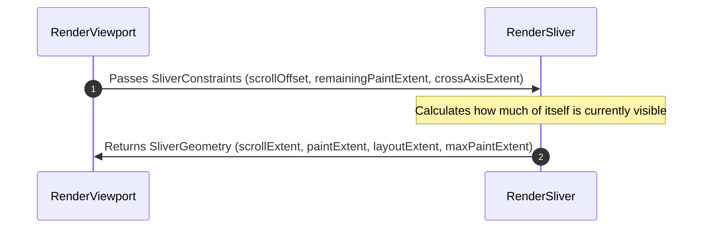

# Slivers and CustomScrollView: Advanced Scroll Architectures

> **Module:** 04-layout-and-widgets  
> **Subsection:** 04-slivers-and-customscrollview  
> **Prerequisites:** [04-layout-and-widgets/03-scrollable-widgets-listview-gridview/scrollables-deep-dive.md](../03-scrollable-widgets-listview-gridview/scrollables-deep-dive.md)  
> **Official References:** [docs.flutter.dev/ui/widgets/scrolling](https://docs.flutter.dev/ui/widgets/scrolling) | [api.flutter.dev/flutter/widgets/CustomScrollView-class.html](https://api.flutter.dev/flutter/widgets/CustomScrollView-class.html)

---

## 1. Introduction

Standard scrollable widgets like `ListView` and `GridView` are box-based widgets that handle a single visual layout pattern. However, modern mobile designs demand rich, coordinated scrolling experiences:
- An image header that collapses into an app bar as you scroll.
- A pinned tab bar that stays anchored to the top of the screen.
- A grid of items followed seamlessly by a continuous list inside a single unified scrollbar.

This is where **Slivers** come in. Slivers are the foundational building blocks of Flutter's scrolling engine.

---

## 2. Theoretical Mechanics: Box Protocol vs. Sliver Protocol

In normal Flutter layout, widgets use the **Box Protocol** (`RenderBox`), which passes `BoxConstraints(minW, maxW, minH, maxH)` and returns a `Size(width, height)`.

Inside a scrollable viewport, widgets use the **Sliver Protocol** (`RenderSliver`):



### Understanding `SliverConstraints` and `SliverGeometry`

- **`SliverConstraints`:**
  - `scrollOffset`: Distance from the start of this sliver to the current scroll position.
  - `remainingPaintExtent`: Amount of remaining visible screen space the viewport has left to fill.
  - `viewportMainAxisExtent`: Total height (or width) of the visible viewport window.
- **`SliverGeometry`:**
  - `scrollExtent`: Total virtual length this sliver occupies in the scroll direction.
  - `paintExtent`: The actual portion of this sliver currently visible on the screen ($0 \le \text{paintExtent} \le \text{remainingPaintExtent}$).
  - `layoutExtent`: Amount of space this sliver takes up before subsequent slivers are positioned.

---

## 3. Syntax and Implementation

### 1. `CustomScrollView` with Collapsing `SliverAppBar` and Mixed Content

```dart
import 'package:flutter/material.dart';

class ProfileSliverScreen extends StatelessWidget {
  const ProfileSliverScreen({super.key});

  @override
  Widget build(BuildContext context) {
    return Scaffold(
      body: CustomScrollView(
        slivers: [
          // 1. Collapsing App Bar with Flexible Space
          SliverAppBar(
            expandedHeight: 250.0,
            pinned: true,   // Keeps the app bar visible at the top when collapsed
            floating: false, // Does not snap back immediately on reverse scroll
            flexibleSpace: FlexibleSpaceBar(
              title: const Text('Elena Rostova', style: TextStyle(color: Colors.white)),
              background: Image.network(
                'https://picsum.photos/800/600',
                fit: BoxFit.cover,
              ),
            ),
            actions: [
              IconButton(icon: const Icon(Icons.settings), onPressed: () {}),
            ],
          ),

          // 2. Converting normal Box widgets into Slivers
          SliverToBoxAdapter(
            child: Padding(
              padding: const EdgeInsets.all(16.0),
              child: Card(
                elevation: 4,
                child: Padding(
                  padding: const EdgeInsets.all(16.0),
                  child: Column(
                    crossAxisAlignment: CrossAxisAlignment.start,
                    children: [
                      Text('Senior Flutter Architect', 
                        style: Theme.of(context).textTheme.titleLarge),
                      const SizedBox(height: 8),
                      const Text('Crafting high-performance cross-platform software systems.'),
                    ],
                  ),
                ),
              ),
            ),
          ),

          // 3. Sliver Grid of User Portfolio Items
          SliverPadding(
            padding: const EdgeInsets.symmetric(horizontal: 16.0),
            sliver: SliverGrid(
              gridDelegate: const SliverGridDelegateWithFixedCrossAxisCount(
                crossAxisCount: 3,
                mainAxisSpacing: 8,
                crossAxisSpacing: 8,
              ),
              delegate: SliverChildBuilderDelegate(
                (context, index) => Container(
                  color: Colors.teal.shade200,
                  alignment: Alignment.center,
                  child: Text('Item $index'),
                ),
                childCount: 6,
              ),
            ),
          ),

          // 4. Section Divider / Subheader
          const SliverToBoxAdapter(
            child: Padding(
              padding: EdgeInsets.fromLTRB(16, 24, 16, 8),
              child: Text('Recent Activity', style: TextStyle(fontSize: 18, fontWeight: FontWeight.bold)),
            ),
          ),

          // 5. Sliver List with Infinite Virtualization
          SliverList(
            delegate: SliverChildBuilderDelegate(
              (context, index) => ListTile(
                leading: CircleAvatar(child: Text('${index + 1}')),
                title: Text('Activity log entry #$index'),
                subtitle: const Text('Completed synchronization with server'),
              ),
              childCount: 30,
            ),
          ),
        ],
      ),
    );
  }
}
```

---

### 2. `SliverAppBar` Configuration Matrix

The visual behavior of `SliverAppBar` is controlled by three boolean flags:

| `pinned` | `floating` | `snap` | Visual Behavior |
|:---:|:---:|:---:|:---|
| `false` | `false` | `false` | Normal scrolling. Scrolls off the top and only returns when scrolling all the way back up. |
| `true` | `false` | `false` | Collapses to standard 56px AppBar height and stays permanently pinned at the top. |
| `false` | `true` | `false` | Scrolls offscreen. As soon as user scrolls down even 1 pixel, the app bar floats back into view immediately. |
| `false` | `true` | `true` | Snapping header: Any downward scroll triggers an automatic animation fully revealing the entire app bar. |
| `true` | `true` | `true` | Snaps immediately into view on downward scroll and stays pinned to top on upward scroll. |

---

### 3. Pinned Tab Bars with `SliverPersistentHeader`

To create a tab bar that scrolls smoothly with the content and then anchors firmly beneath the app bar:

```dart
class _StickyTabBarDelegate extends SliverPersistentHeaderDelegate {
  final TabBar tabBar;

  _StickyTabBarDelegate(this.tabBar);

  @override
  double get minExtent => tabBar.preferredSize.height;
  @override
  double get maxExtent => tabBar.preferredSize.height;

  @override
  Widget build(BuildContext context, double shrinkOffset, bool overlapsContent) {
    return Container(
      color: Theme.of(context).scaffoldBackgroundColor,
      child: tabBar,
    );
  }

  @override
  bool shouldRebuild(covariant _StickyTabBarDelegate oldDelegate) {
    return tabBar != oldDelegate.tabBar;
  }
}

// In CustomScrollView:
SliverPersistentHeader(
  pinned: true,
  delegate: _StickyTabBarDelegate(
    const TabBar(
      tabs: [
        Tab(text: 'Overview'),
        Tab(text: 'Specifications'),
        Tab(text: 'Reviews'),
      ],
    ),
  ),
)
```

---

### 4. `NestedScrollView`: Solving the Nested Scroll Conflict

When each Tab in a `TabBarView` has its own `ListView`, standard `CustomScrollView` fails because inner scrollables steal gestures from the outer viewport. `NestedScrollView` coordinates outer and inner scroll controllers:

```dart
DefaultTabController(
  length: 2,
  child: Scaffold(
    body: NestedScrollView(
      headerSliverBuilder: (BuildContext context, bool innerBoxIsScrolled) {
        return [
          SliverAppBar(
            title: const Text('Nested Scroll Coordination'),
            pinned: true,
            floating: true,
            forceElevated: innerBoxIsScrolled,
            bottom: const TabBar(
              tabs: [Tab(text: 'Feed'), Tab(text: 'Media')],
            ),
          ),
        ];
      },
      body: TabBarView(
        children: [
          // Inner scrollable automatically inherits outer coordinator
          ListView.builder(
            itemCount: 50,
            itemBuilder: (context, i) => ListTile(title: Text('Feed Post #$i')),
          ),
          ListView.builder(
            itemCount: 50,
            itemBuilder: (context, i) => ListTile(title: Text('Media Post #$i')),
          ),
        ],
      ),
    ),
  ),
)
```

---

## 4. Common Pitfalls & Anti-Patterns

### Pitfall 1: Placing Box Widgets Directly in `CustomScrollView.slivers`

```dart
// ❌ CRASH: A RenderBox cannot be passed directly as a sliver!
CustomScrollView(
  slivers: [
    Container(height: 100, color: Colors.blue), // ERROR!
  ],
)
```

**Correction:**
Always wrap Box widgets inside `SliverToBoxAdapter`:
```dart
// ✅ CORRECT:
CustomScrollView(
  slivers: [
    SliverToBoxAdapter(
      child: Container(height: 100, color: Colors.blue),
    ),
  ],
)
```

---

## 5. Interview & Assessment Takeaways

| Interview Question | Concise Verbal Answer |
|:---|:---|
| **What is the fundamental difference between `RenderBox` and `RenderSliver`?** | `RenderBox` operates via a two-dimensional layout protocol passing `BoxConstraints` and returning a fixed `Size`. `RenderSliver` operates via a one-dimensional viewport protocol passing `SliverConstraints` (scroll offsets, viewport height) and returning `SliverGeometry` (paint extent, scroll extent). |
| **Why is `SliverToBoxAdapter` necessary?** | `CustomScrollView` only accepts slivers in its `slivers` list. `SliverToBoxAdapter` acts as an architectural bridge that adapts a 2D box child into the 1D sliver layout protocol. |
| **When would you use `NestedScrollView` instead of `CustomScrollView`?** | When your view contains multiple independent scrollable views (e.g., inside a `TabBarView`) that need to coordinate their scroll offsets with a shared collapsing outer header. |
