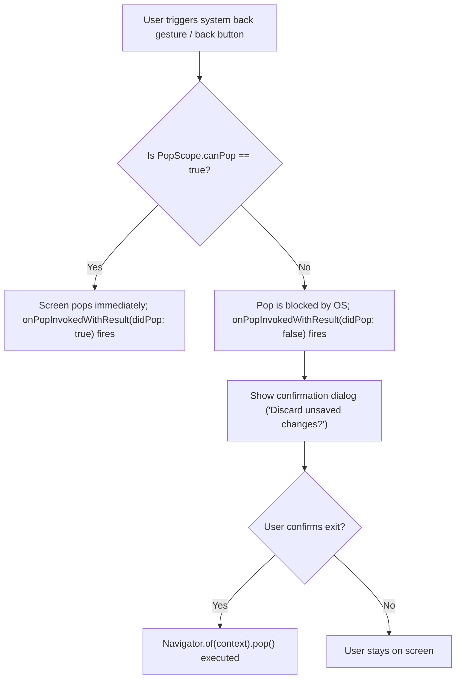

# Forms, Validation, and Modern Navigation Control (PopScope)

> **Module:** 04-layout-and-widgets  
> **Subsection:** 05-input-and-forms  
> **Prerequisites:** [03-flutter-fundamentals/04-buildcontext-and-keys/keys-deep-dive.md](../../03-flutter-fundamentals/04-buildcontext-and-keys/keys-deep-dive.md)  
> **Official References:** [docs.flutter.dev/cookbook/forms](https://docs.flutter.dev/cookbook/forms) | [api.flutter.dev/flutter/widgets/PopScope-class.html](https://api.flutter.dev/flutter/widgets/PopScope-class.html)

---

## 1. Introduction

Capturing, validating, and submitting user input is a core requirement of almost every enterprise mobile app. In Flutter, form handling spans two key layers:
1. **Low-level text rendering and keyboard input:** Driven by `TextField`, `TextEditingController`, and `FocusNode`.
2. **High-level validation and lifecycle grouping:** Managed by `Form`, `TextFormField`, and `GlobalKey<FormState>`.

Furthermore, modern mobile platforms (especially Android 14+ Predictive Back gestures and iOS edge-swipe pops) introduced an architectural shift: the legacy `WillPopScope` widget has been deprecated and replaced by Flutter's synchronous `PopScope`.

---

## 2. Core Concepts: `TextField` vs. `TextFormField`

| Feature | `TextField` | `TextFormField` |
|:---|:---|:---|
| **Form Integration** | Standalone widget; unmanaged by `Form` | Automatically integrates with parent `Form` widget |
| **Validation** | Requires manual `errorText` state management | Declarative `validator: (value) => ...` callback |
| **State Reset & Save** | Manual controller clearing | Built-in `FormState.reset()` and `FormState.save()` |
| **Use Case** | Search bars, single isolated inputs | Multi-field user registration, checkout forms |

---

## 3. The `PopScope` Revolution (Replacing `WillPopScope`)

### Why `WillPopScope` Was Deprecated
In Flutter < 3.12, `WillPopScope` used an asynchronous `Future<bool> onWillPop()` callback. When the user pressed the Android system back button:
1. Android OS had to pause the navigation transition.
2. An asynchronous message hopped over the platform channel to Flutter.
3. Flutter evaluated the future.
4. Flutter sent a boolean back to Android.

This asynchronous round-trip made Android 14's **Predictive Back animation** (where the OS renders a live preview of the previous screen as the user drags their finger from the screen edge) technically impossible.

### How `PopScope` Works
`PopScope` uses a **synchronous** contract:
- `canPop`: A boolean evaluated synchronously by the platform embedder.
- `onPopInvokedWithResult`: A callback invoked after a pop is attempted or completed.



---

## 4. Syntax and Implementation

### Complete Production Form with Validation & `PopScope`

```dart
import 'package:flutter/material.dart';

class RegistrationScreen extends StatefulWidget {
  const RegistrationScreen({super.key});

  @override
  State<RegistrationScreen> createState() => _RegistrationScreenState();
}

class _RegistrationScreenState extends State<RegistrationScreen> {
  final GlobalKey<FormState> _formKey = GlobalKey<FormState>();

  // Text Controllers
  final TextEditingController _nameController = TextEditingController();
  final TextEditingController _emailController = TextEditingController();
  final TextEditingController _passwordController = TextEditingController();

  // Focus Nodes for keyboard traversal
  final FocusNode _emailFocus = FocusNode();
  final FocusNode _passwordFocus = FocusNode();

  bool _isPasswordVisible = false;
  bool _hasUnsavedChanges = false;

  @override
  void initState() {
    super.initState();
    // Track if user has modified input fields
    _nameController.addListener(_markDirty);
    _emailController.addListener(_markDirty);
    _passwordController.addListener(_markDirty);
  }

  void _markDirty() {
    if (!_hasUnsavedChanges) {
      setState(() => _hasUnsavedChanges = true);
    }
  }

  @override
  void dispose() {
    // CRITICAL: Always dispose controllers and focus nodes to prevent memory leaks
    _nameController.dispose();
    _emailController.dispose();
    _passwordController.dispose();
    _emailFocus.dispose();
    _passwordFocus.dispose();
    super.dispose();
  }

  Future<void> _handlePopAttempt(bool didPop) async {
    // If pop was already allowed and performed by the framework, do nothing
    if (didPop) return;

    // If there are unsaved changes, prompt the user before exiting
    final shouldLeave = await showDialog<bool>(
      context: context,
      builder: (ctx) => AlertDialog(
        title: const Text('Discard Changes?'),
        content: const Text('You have unsaved form data. Are you sure you want to exit?'),
        actions: [
          TextButton(
            onPressed: () => Navigator.of(ctx).pop(false),
            child: const Text('Cancel'),
          ),
          FilledButton(
            onPressed: () => Navigator.of(ctx).pop(true),
            child: const Text('Discard'),
          ),
        ],
      ),
    );

    if (shouldLeave == true && mounted) {
      Navigator.of(context).pop();
    }
  }

  void _submitForm() {
    // 1. Validate all children TextFormFields
    if (_formKey.currentState?.validate() ?? false) {
      // 2. Save form state
      _formKey.currentState?.save();

      setState(() => _hasUnsavedChanges = false);

      ScaffoldMessenger.of(context).showSnackBar(
        SnackBar(content: Text('Processing registration for ${_nameController.text}')),
      );
    }
  }

  @override
  Widget build(BuildContext context) {
    return PopScope(
      // canPop is false only when user has typed unsaved content
      canPop: !_hasUnsavedChanges,
      onPopInvokedWithResult: (didPop, result) => _handlePopAttempt(didPop),
      child: Scaffold(
        appBar: AppBar(title: const Text('Secure User Registration')),
        body: SingleChildScrollView(
          padding: const EdgeInsets.all(24.0),
          child: Form(
            key: _formKey,
            autovalidateMode: AutovalidateMode.onUserInteraction,
            child: Column(
              crossAxisAlignment: CrossAxisAlignment.stretch,
              children: [
                // 1. Full Name Field
                TextFormField(
                  controller: _nameController,
                  textInputAction: TextInputAction.next,
                  onFieldSubmitted: (_) => FocusScope.of(context).requestFocus(_emailFocus),
                  decoration: const InputDecoration(
                    labelText: 'Full Name',
                    prefixIcon: Icon(Icons.person),
                    border: OutlineInputBorder(),
                  ),
                  validator: (value) {
                    if (value == null || value.trim().isEmpty) {
                      return 'Full name is required';
                    }
                    if (value.trim().length < 3) {
                      return 'Name must be at least 3 characters';
                    }
                    return null;
                  },
                ),
                const SizedBox(height: 16),

                // 2. Email Address Field
                TextFormField(
                  controller: _emailController,
                  focusNode: _emailFocus,
                  keyboardType: TextInputType.emailAddress,
                  textInputAction: TextInputAction.next,
                  onFieldSubmitted: (_) => FocusScope.of(context).requestFocus(_passwordFocus),
                  decoration: const InputDecoration(
                    labelText: 'Email Address',
                    prefixIcon: Icon(Icons.email),
                    border: OutlineInputBorder(),
                  ),
                  validator: (value) {
                    if (value == null || value.trim().isEmpty) {
                      return 'Email is required';
                    }
                    final emailRegex = RegExp(r'^[\w-\.]+@([\w-]+\.)+[\w-]{2,4}$');
                    if (!emailRegex.hasMatch(value.trim())) {
                      return 'Enter a valid email address';
                    }
                    return null;
                  },
                ),
                const SizedBox(height: 16),

                // 3. Password Field with Visibility Toggle
                TextFormField(
                  controller: _passwordController,
                  focusNode: _passwordFocus,
                  obscureText: !_isPasswordVisible,
                  textInputAction: TextInputAction.done,
                  onFieldSubmitted: (_) => _submitForm(),
                  decoration: InputDecoration(
                    labelText: 'Password',
                    prefixIcon: const Icon(Icons.lock),
                    border: const OutlineInputBorder(),
                    suffixIcon: IconButton(
                      icon: Icon(_isPasswordVisible ? Icons.visibility_off : Icons.visibility),
                      onPressed: () => setState(() => _isPasswordVisible = !_isPasswordVisible),
                    ),
                  ),
                  validator: (value) {
                    if (value == null || value.isEmpty) {
                      return 'Password is required';
                    }
                    if (value.length < 8) {
                      return 'Password must be at least 8 characters';
                    }
                    return null;
                  },
                ),
                const SizedBox(height: 24),

                // 4. Submit Button
                FilledButton.icon(
                  onPressed: _submitForm,
                  icon: const Icon(Icons.check_circle),
                  label: const Text('Create Account', style: TextStyle(fontSize: 16)),
                  style: FilledButton.styleFrom(padding: const EdgeInsets.symmetric(vertical: 16)),
                ),
              ],
            ),
          ),
        ),
      ),
    );
  }
}
```

---

## 5. Common Pitfalls & Anti-Patterns

### Pitfall 1: Leaking `TextEditingController` and `FocusNode`
**Bad:**
```dart
class _BadState extends State<BadWidget> {
  // Initialized but NEVER disposed! Leaks listeners and native text engine connections.
  final controller = TextEditingController();
}
```
**Fix:**
Always implement `dispose()` and call `.dispose()` on all controllers and focus nodes.

### Pitfall 2: Attempting Asynchronous Checks Inside `canPop`
`canPop` is a synchronous boolean getter. You cannot pass an async function to `canPop`. Instead, set `canPop: false`, catch the back invocation in `onPopInvokedWithResult`, show your async dialog, and call `Navigator.of(context).pop()` manually if confirmed.

---

## 6. Interview & Assessment Takeaways

| Interview Question | Concise Verbal Answer |
|:---|:---|
| **Why was `WillPopScope` deprecated in favor of `PopScope`?** | `WillPopScope` relied on an asynchronous `Future<bool>` return, which broke native predictive back gestures on Android 14+. `PopScope` uses synchronous `canPop` evaluation and an `onPopInvokedWithResult` event notification. |
| **How does `GlobalKey<FormState>` validate an entire form?** | It locates the `FormState` Element and invokes `FormState.validate()`, which recursively calls the `validator` callback on every descendant `FormField` in the subtree, updating their error state and returning `true` only if all fields pass. |
| **What is `AutovalidateMode.onUserInteraction`?** | A setting where validation errors are suppressed initially until the user interacts with the field, preventing premature error messages on untouched forms. |
