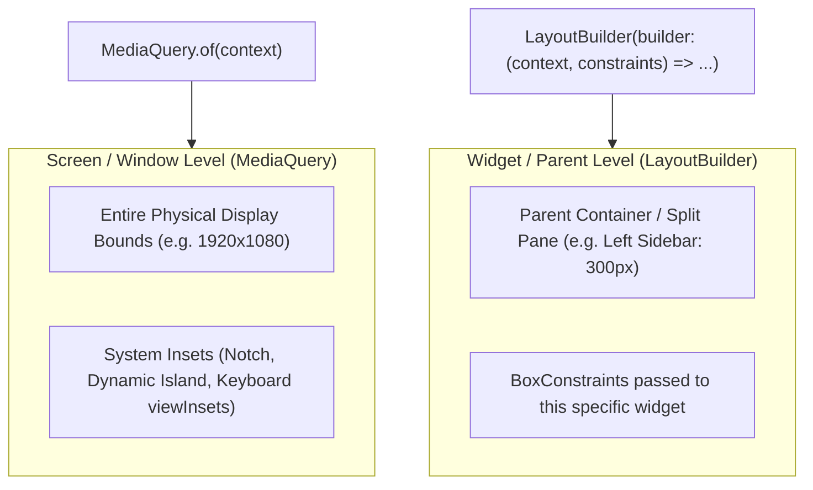

# Responsive and Adaptive Layouts in Flutter

> **Module:** 04-layout-and-widgets  
> **Subsection:** 06-responsive-and-adaptive-layouts  
> **Prerequisites:** [04-layout-and-widgets/01-flex-row-column-expanded/box-constraints-and-flex-layout.md](../01-flex-row-column-expanded/box-constraints-and-flex-layout.md)  
> **Official References:** [docs.flutter.dev/ui/layout/responsive/adaptive-responsive](https://docs.flutter.dev/ui/layout/responsive/adaptive-responsive) | [api.flutter.dev/flutter/widgets/LayoutBuilder-class.html](https://api.flutter.dev/flutter/widgets/LayoutBuilder-class.html)

---

## 1. Introduction

Because Flutter targets six major platforms (iOS, Android, Web, Windows, macOS, Linux) with a single codebase, building for multiple screen sizes and hardware inputs is a mandatory architectural concern.

A professional Flutter app must be both:
1. **Responsive:** Fluidly adjusting visual geometry, column counts, and typography across diverse screen sizes (phones, foldables, tablets, ultrawide desktop monitors).
2. **Adaptive:** Conforming to platform-specific UX paradigms (e.g. Cupertino switches on iOS, Material 3 switches on Android, mouse hover states and scroll wheels on desktop, keyboard shortcuts on macOS/Windows).

---

## 2. Core Concepts: `MediaQuery` vs. `LayoutBuilder`

Developers frequently confuse when to use `MediaQuery` versus `LayoutBuilder`:



| Dimension | `MediaQuery.sizeOf(context)` | `LayoutBuilder` |
|:---|:---|:---|
| **Scope** | Global screen or application window | Local parent widget constraints |
| **Rebuild Trigger** | Whenever device rotates or window resizes | Only when the parent's incoming `BoxConstraints` change |
| **Best Used For** | Determining global layout breakpoints (Mobile vs Desktop) | Building components that adapt based on their available container space |

> 💡 **Flutter 3.10+ Best Practice:** Use `MediaQuery.sizeOf(context)` instead of `MediaQuery.of(context).size`. The modern `sizeOf` method uses inherited model aspects to trigger rebuilds *only* when the screen size changes, ignoring unrelated changes like keyboard insets!

---

## 3. Syntax and Implementation

### 1. Enterprise Breakpoint System and Adaptive Scaffold

```dart
import 'package:flutter/material.dart';

/// Standard Material Design 3 Responsive Breakpoints
class ScreenBreakpoints {
  static const double compact = 600.0;  // Mobile phones (< 600)
  static const double medium = 840.0;   // Tablets & foldables (600 - 840)
  static const double expanded = 1200.0;// Laptops & desktops (> 840)
}

enum DeviceType { compact, medium, expanded }

DeviceType getDeviceType(BuildContext context) {
  final width = MediaQuery.sizeOf(context).width;
  if (width < ScreenBreakpoints.compact) return DeviceType.compact;
  if (width < ScreenBreakpoints.medium) return DeviceType.medium;
  return DeviceType.expanded;
}

class AdaptiveAppScaffold extends StatefulWidget {
  final Widget body;
  final String title;

  const AdaptiveAppScaffold({
    super.key,
    required this.body,
    required this.title,
  });

  @override
  State<AdaptiveAppScaffold> createState() => _AdaptiveAppScaffoldState();
}

class _AdaptiveAppScaffoldState extends State<AdaptiveAppScaffold> {
  int _selectedIndex = 0;

  final List<NavigationDestination> _destinations = const [
    NavigationDestination(icon: Icon(Icons.dashboard_outlined), selectedIcon: Icon(Icons.dashboard), label: 'Dashboard'),
    NavigationDestination(icon: Icon(Icons.analytics_outlined), selectedIcon: Icon(Icons.analytics), label: 'Analytics'),
    NavigationDestination(icon: Icon(Icons.settings_outlined), selectedIcon: Icon(Icons.settings), label: 'Settings'),
  ];

  @override
  Widget build(BuildContext context) {
    final deviceType = getDeviceType(context);

    // 1. Mobile Layout: Bottom Navigation Bar
    if (deviceType == DeviceType.compact) {
      return Scaffold(
        appBar: AppBar(title: Text(widget.title)),
        body: widget.body,
        bottomNavigationBar: NavigationBar(
          selectedIndex: _selectedIndex,
          onDestinationSelected: (idx) => setState(() => _selectedIndex = idx),
          destinations: _destinations,
        ),
      );
    }

    // 2. Tablet Layout: Navigation Rail (Icons only)
    if (deviceType == DeviceType.medium) {
      return Scaffold(
        body: Row(
          children: [
            NavigationRail(
              selectedIndex: _selectedIndex,
              onDestinationSelected: (idx) => setState(() => _selectedIndex = idx),
              labelType: NavigationRailLabelType.selected,
              destinations: _destinations
                  .map((d) => NavigationRailDestination(
                        icon: d.icon,
                        selectedIcon: d.selectedIcon,
                        label: Text(d.label),
                      ))
                  .toList(),
            ),
            const VerticalDivider(thickness: 1, width: 1),
            Expanded(child: widget.body),
          ],
        ),
      );
    }

    // 3. Desktop / Expanded Layout: Extended Navigation Rail or Persistent Drawer
    return Scaffold(
      body: Row(
        children: [
          NavigationRail(
            extended: true, // Shows icons + full text labels
            selectedIndex: _selectedIndex,
            onDestinationSelected: (idx) => setState(() => _selectedIndex = idx),
            destinations: _destinations
                .map((d) => NavigationRailDestination(
                      icon: d.icon,
                      selectedIcon: d.selectedIcon,
                      label: Text(d.label),
                    ))
                .toList(),
          ),
          const VerticalDivider(thickness: 1, width: 1),
          Expanded(child: widget.body),
        ],
      ),
    );
  }
}
```

---

### 2. Master-Detail (Split View) Pattern with `LayoutBuilder`

```dart
class MasterDetailView<T> extends StatelessWidget {
  final List<T> items;
  final Widget Function(BuildContext context, T item, bool isSelected) masterItemBuilder;
  final Widget Function(BuildContext context, T? selectedItem) detailBuilder;
  final T? selectedItem;
  final ValueChanged<T> onItemSelected;

  const MasterDetailView({
    super.key,
    required this.items,
    required this.masterItemBuilder,
    required this.detailBuilder,
    required this.selectedItem,
    required this.onItemSelected,
  });

  @override
  Widget build(BuildContext context) {
    return LayoutBuilder(
      builder: (context, constraints) {
        // If width >= 720, show side-by-side split view
        if (constraints.maxWidth >= 720) {
          return Row(
            children: [
              SizedBox(
                width: 320,
                child: ListView.separated(
                  itemCount: items.length,
                  separatorBuilder: (_, __) => const Divider(height: 1),
                  itemBuilder: (context, index) {
                    final item = items[index];
                    return InkWell(
                      onTap: () => onItemSelected(item),
                      child: masterItemBuilder(context, item, item == selectedItem),
                    );
                  },
                ),
              ),
              const VerticalDivider(width: 1, thickness: 1),
              Expanded(
                child: detailBuilder(context, selectedItem),
              ),
            ],
          );
        }

        // On narrow screens (Mobile), show master list only; navigation pushed separately
        return ListView.separated(
          itemCount: items.length,
          separatorBuilder: (_, __) => const Divider(height: 1),
          itemBuilder: (context, index) {
            final item = items[index];
            return InkWell(
              onTap: () => onItemSelected(item),
              child: masterItemBuilder(context, item, false),
            );
          },
        );
      },
    );
  }
}
```

---

## 4. `IntrinsicHeight` & `IntrinsicWidth`: The Performance Warning

Sometimes developers want equal-height cards in a `Row`:
```dart
IntrinsicHeight(
  child: Row(
    crossAxisAlignment: CrossAxisAlignment.stretch,
    children: [
      Card(child: Text('Short text')),
      Card(child: Text('Very long text that spans multiple lines...')),
    ],
  ),
)
```

> ⚠️ **Performance Warning ($O(N^2)$ Layout Cost):**  
> `IntrinsicHeight` and `IntrinsicWidth` are expensive because they perform a speculative pre-layout measurement pass on their children before executing the real layout pass. If nested inside deep trees or large lists, they can cause serious frame drops. Use only when strictly necessary and keep child subtrees shallow.

---

## 5. Interview & Assessment Takeaways

| Interview Question | Concise Verbal Answer |
|:---|:---|
| **What is the difference between Responsive and Adaptive UI?** | Responsive design handles varying screen dimensions and aspect ratios (e.g. mobile vs tablet columns). Adaptive design handles varying operating system conventions and input modes (e.g. mouse cursor, keyboard shortcuts, platform-native switches). |
| **Why should you use `MediaQuery.sizeOf(context)` instead of `MediaQuery.of(context).size`?** | `MediaQuery.sizeOf(context)` subscribes exclusively to screen size changes via `InheritedModel`. Calling `MediaQuery.of(context)` subscribes to *all* screen changes, causing unwanted rebuilds whenever the soft keyboard opens or safe area insets change. |
| **Why is `LayoutBuilder` preferred for reusable components over `MediaQuery`?** | `LayoutBuilder` measures the constraints provided by the component's immediate parent widget, allowing the component to be reused anywhere (e.g. in a full screen or inside a 300px sidebar) without coupling it to the physical screen width. |
