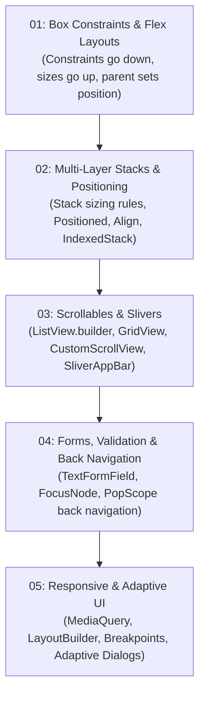

# Module 04: Layout, Slivers, and Responsive UI

Welcome to **Module 04: Layout, Slivers, and Responsive UI**. This module covers the rules of Flutter's layout engine, box constraints, flex algorithms, scrollable slivers, form inputs, back navigation, and adaptive multi-screen layouts.

---

## 🗺️ Module Subsections

### Core Topics Covered in this Module:
1. **[01-flex-row-column-expanded/box-constraints-and-flex-layout.md](./01-flex-row-column-expanded/box-constraints-and-flex-layout.md):** The golden rule of Flutter layout, tight vs loose constraints, `Expanded` vs `Flexible`, and diagnosing `RenderFlex overflowed by X pixels`.
2. **[02-stack-and-positioned/stack-and-positioned.md](./02-stack-and-positioned/stack-and-positioned.md):** `StackFit`, positioned vs non-positioned children, floating action layers, and `IndexedStack`.
3. **[03-scrollable-widgets-listview-gridview/scrollables-deep-dive.md](./03-scrollable-widgets-listview-gridview/scrollables-deep-dive.md):** Viewport geometry, `ListView.builder`, itemExtent optimization, and grid delegates.
4. **[04-slivers-and-customscrollview/slivers-and-customscrollview.md](./04-slivers-and-customscrollview/slivers-and-customscrollview.md):** The Sliver protocol, `CustomScrollView`, collapsible `SliverAppBar`, and `NestedScrollView`.
5. **[05-input-and-forms/forms-validation-and-popscope.md](./05-input-and-forms/forms-validation-and-popscope.md):** `Form`, `TextFormField`, input sanitization, controller management, and modern `PopScope` predictive back navigation.
6. **[06-responsive-and-adaptive-layouts/responsive-and-adaptive-ui.md](./06-responsive-and-adaptive-layouts/responsive-and-adaptive-ui.md):** Designing apps that scale fluidly across mobile phones, tablets, foldables, and desktop monitors.

---

## 🎯 Learning Objectives

By completing Module 04, you will:
1. Master Flutter's Box Constraint algorithm and never struggle with RenderFlex overflow errors again.
2. Build sophisticated custom scrolling experiences using the sliver protocol.
3. Handle user inputs with form validation and modern Android 14+ predictive back gestures via `PopScope`.
4. Build responsive, multi-column adaptive UIs with breakpoints.
