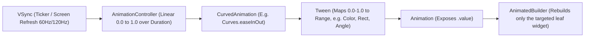

# Explicit Animations, AnimationController, and Staggered Sequences

> **Module:** 05-animations-and-motion  
> **Subsection:** 02-explicit-animations  
> **Prerequisites:** [05-animations-and-motion/01-implicit-animations/implicit-animations-deep-dive.md](../01-implicit-animations/implicit-animations-deep-dive.md)  
> **Official References:** [docs.flutter.dev/ui/widgets/animation](https://docs.flutter.dev/ui/widgets/animation) | [api.flutter.dev/flutter/animation/AnimationController-class.html](https://api.flutter.dev/flutter/animation/AnimationController-class.html)

---

## 1. Introduction

While Implicit Animations handle simple state-to-state transitions automatically, enterprise Flutter applications frequently demand fine-grained imperative control:
- Continuous loops (pulsing radar rings, rotating loading indicators).
- Bi-directional physics (springing open a drawer, dragging a sheet that snaps back).
- Chained or choreographed multi-element sequences (e.g. card expands, then text slides down, then button fades in).

This is the domain of **Explicit Animations**. Explicit animations require you to control time itself via an `AnimationController`.

---

## 2. Core Concepts: The Explicit Animation Trinity

An explicit animation in Flutter is composed of three interconnected parts:



1. **`Ticker` & `vsync`:** Synchronizes animation ticks with the physical screen refresh rate (typically 60Hz or 120Hz). Passing `vsync: this` prevents off-screen animations from consuming battery or CPU cycles when the app is backgrounded or navigated away from.
2. **`AnimationController`:** Produces a linear stream of double values from `0.0` to `1.0` across a defined `Duration`.
3. **`Tween<T>` (Between):** Translates the raw `0.0` to `1.0` double into your application's domain values—such as a `ColorTween` (Red to Blue), `SizeTween` (100x100 to 300x500), or `AlignmentTween`.
4. **`CurvedAnimation`:** Modifies the rate of change using mathematical easing curves.

---

## 3. Syntax and Implementation

### 1. The Right Way to Animate: `AnimatedBuilder` (Scoped Rebuilds)

> 🛑 **THE BIGGEST BEGINNER ANTI-PATTERN:**  
> Calling `_controller.addListener(() => setState(() {}))` forces Flutter to rebuild the **entire** widget tree on every single frame tick (60 or 120 times every second!).  
> **The Solution:** Use `AnimatedBuilder`. It isolates rebuilds strictly to the animating leaf widget.

```dart
import 'dart:math' as math;
import 'package:flutter/material.dart';

class PulsingRadarWidget extends StatefulWidget {
  const PulsingRadarWidget({super.key});

  @override
  State<PulsingRadarWidget> createState() => _PulsingRadarWidgetState();
}

class _PulsingRadarWidgetState extends State<PulsingRadarWidget>
    with SingleTickerProviderStateMixin {
  late final AnimationController _controller;
  late final Animation<double> _scaleAnimation;
  late final Animation<double> _fadeAnimation;

  @override
  void initState() {
    super.initState();
    _controller = AnimationController(
      vsync: this,
      duration: const Duration(seconds: 2),
    )..repeat(); // Continuously loops from 0.0 -> 1.0

    // Non-linear ease-out curve
    final curvedAnimation = CurvedAnimation(
      parent: _controller,
      curve: Curves.easeOutCubic,
    );

    // Scale from 0.8x to 2.2x
    _scaleAnimation = Tween<double>(begin: 0.8, end: 2.2).animate(curvedAnimation);

    // Fade out as it expands (1.0 down to 0.0)
    _fadeAnimation = Tween<double>(begin: 0.8, end: 0.0).animate(curvedAnimation);
  }

  @override
  void dispose() {
    // CRITICAL: Always dispose controllers to cancel active Ticker listeners
    _controller.dispose();
    super.dispose();
  }

  @override
  Widget build(BuildContext context) {
    return Scaffold(
      appBar: AppBar(title: const Text('Pulsing Radar')),
      body: Center(
        child: Stack(
          alignment: Alignment.center,
          children: [
            // 1. Animating radar wave (rebuilds isolated here)
            AnimatedBuilder(
              animation: _controller,
              builder: (context, child) {
                return Opacity(
                  opacity: _fadeAnimation.value,
                  child: Transform.scale(
                    scale: _scaleAnimation.value,
                    child: child,
                  ),
                );
              },
              // PERFORMANCE GOLD: child is pre-built once and never reconstructed during animation!
              child: Container(
                width: 120,
                height: 120,
                decoration: const BoxDecoration(
                  shape: BoxShape.circle,
                  color: Colors.blueAccent,
                ),
              ),
            ),

            // 2. Static center radar beacon
            const CircleAvatar(
              radius: 36,
              backgroundColor: Colors.blue,
              child: Icon(Icons.radar, color: Colors.white, size: 36),
            ),
          ],
        ),
      ),
    );
  }
}
```

---

### 2. Choreographed Staggered Animations with `Interval`

In professional UI onboarding screens or card reveals, multiple visual properties animate sequentially rather than simultaneously. We achieve this by attaching multiple `CurvedAnimation`s with distinct `Interval`s to a **single** `AnimationController`:

```mermaid
gantt
    title Staggered Animation Sequence (Total Duration: 1200ms)
    dateFormat X
    axisFormat %s
    section Opacity
    Fade In (0% to 40%) : 0, 400
    section Width
    Expand Card (25% to 75%) : 250, 750
    section Content
    Text Slide Down (60% to 100%) : 600, 1000
```



```dart
import 'package:flutter/material.dart';

class StaggeredCardScreen extends StatefulWidget {
  const StaggeredCardScreen({super.key});

  @override
  State<StaggeredCardScreen> createState() => _StaggeredCardScreenState();
}

class _StaggeredCardScreenState extends State<StaggeredCardScreen>
    with SingleTickerProviderStateMixin {
  late final AnimationController _controller;
  late final Animation<double> _opacity;
  late final Animation<double> _width;
  late final Animation<EdgeInsets> _padding;
  late final Animation<BorderRadius?> _borderRadius;

  @override
  void initState() {
    super.initState();
    _controller = AnimationController(
      vsync: this,
      duration: const Duration(milliseconds: 1400),
    );

    // Stage 1: Fade In (From 0% to 30% of total duration)
    _opacity = Tween<double>(begin: 0.0, end: 1.0).animate(
      CurvedAnimation(
        parent: _controller,
        curve: const Interval(0.0, 0.3, curve: Curves.easeIn),
      ),
    );

    // Stage 2: Expand Width (From 25% to 70% of total duration)
    _width = Tween<double>(begin: 80.0, end: 320.0).animate(
      CurvedAnimation(
        parent: _controller,
        curve: const Interval(0.25, 0.70, curve: Curves.easeOutCubic),
      ),
    );

    // Stage 3: Smooth rounded corners (From 60% to 90%)
    _borderRadius = BorderRadiusTween(
      begin: BorderRadius.circular(40),
      end: BorderRadius.circular(16),
    ).animate(
      CurvedAnimation(
        parent: _controller,
        curve: const Interval(0.60, 0.90, curve: Curves.easeOut),
      ),
    );

    // Stage 4: Slide padding down (From 70% to 100%)
    _padding = EdgeInsetsTween(
      begin: const EdgeInsets.only(bottom: 16.0),
      end: const EdgeInsets.only(bottom: 64.0),
    ).animate(
      CurvedAnimation(
        parent: _controller,
        curve: const Interval(0.70, 1.0, curve: Curves.easeOutBack),
      ),
    );

    // Start sequence
    _controller.forward();
  }

  @override
  void dispose() {
    _controller.dispose();
    super.dispose();
  }

  @override
  Widget build(BuildContext context) {
    return Scaffold(
      appBar: AppBar(title: const Text('Staggered Choreography')),
      body: Center(
        child: AnimatedBuilder(
          animation: _controller,
          builder: (context, child) {
            return Padding(
              padding: _padding.value,
              child: Opacity(
                opacity: _opacity.value,
                child: Container(
                  width: _width.value,
                  height: 180,
                  decoration: BoxDecoration(
                    color: Colors.deepPurple,
                    borderRadius: _borderRadius.value,
                  ),
                  alignment: Alignment.center,
                  child: const Text(
                    'Staggered Magic',
                    style: TextStyle(color: Colors.white, fontSize: 18, fontWeight: FontWeight.bold),
                  ),
                ),
              ),
            );
          },
        ),
      ),
      floatingActionButton: FloatingActionButton(
        onPressed: () {
          if (_controller.status == AnimationStatus.completed) {
            _controller.reverse();
          } else {
            _controller.forward();
          }
        },
        child: const Icon(Icons.play_arrow),
      ),
    );
  }
}
```

---

## 4. Common Pitfalls & Anti-Patterns

### Pitfall 1: Calling `setState()` in `addListener()`
Calling `setState` in `addListener` forces the build method of the parent widget to run 60 to 120 times per second, discarding caching benefits. Always prefer `AnimatedBuilder` with the cached `child` parameter.

### Pitfall 2: Recreating `CurvedAnimation` in `build()`
Never instantiate `CurvedAnimation` or `Tween` inside the `build()` method. Allocate them once in `initState()` and store them in `late final` variables.

---

## 5. Interview & Assessment Takeaways

| Interview Question | Concise Verbal Answer |
|:---|:---|
| **What does `vsync: this` do and why is it needed?** | It binds the `AnimationController` to Flutter's screen refresh synchronization (`TickerProvider`). This ensures animations only run when the widget is visible on screen, matching the native display rate (60Hz/120Hz) and automatically silencing ticks when off-screen to prevent battery drain. |
| **How does `AnimatedBuilder` optimize animation performance?** | `AnimatedBuilder` scopes the rebuild strictly to its builder closure. Furthermore, any static child passed to its `child` parameter is cached and reused across frames rather than being reconstructed on every frame tick. |
| **What is an `Interval` in Flutter animations?** | An `Interval` maps a subsection of an `AnimationController`'s total duration ($0.0 \dots 1.0$) into an isolated curve window (e.g. $0.2 \dots 0.6$), enabling multiple staggered animations to be choreographed off a single controller. |
